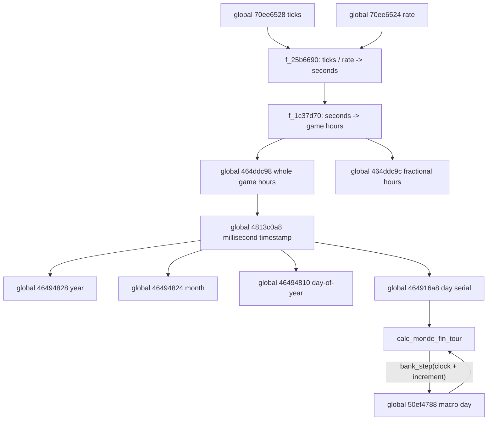
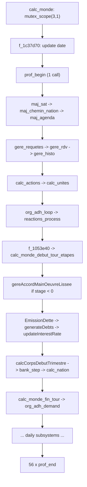
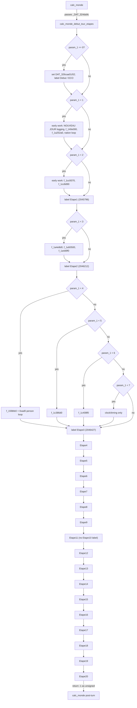
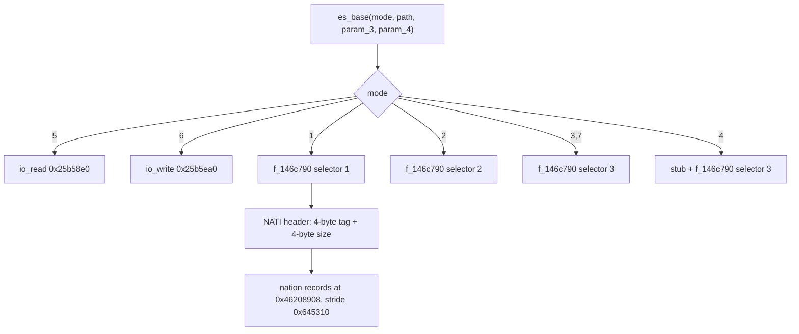

# Volume 1: Simulation Core & Temporal Engine

This volume is validated against `recomp/full_fns.clean.c` (the corpus of record, per D-001). Every structural or numeric claim below carries a D-002 citation: `[fn 0x... name]` for a function header, `[global 0x... type]` for a `// GLOBALS` entry, `[qty 0x... role]` for a stride/size/count literal, and `[tag 0x... "TAG"]` for a four-character immediate. Runtime artifacts (`calc_monde_steps.txt`, `dayprof.json`, `etapes_*.tsv`) are marked **observed, not decompiled** and are used only as corroboration. Anything the corpus does not contain is either deleted or named in a "What the code does not establish" subsection.

---

## 1. Temporal Architecture & Clocks

The corpus contains three distinct time representations, not three independent clocks: a tick counter read by a timer function, a game-hour accumulator that builds a millisecond timestamp, and a separate macro-turn day counter. The data flows through code; it is not a free-running multi-clock scheduler.



### 1.1 The timer function

`f_25b6690` [fn 0x25b6690 f_25b6690] returns a `float`. When the smoothing coefficient at [global 0x70ee6548 f64] is non-zero it computes a smoothed tick estimate from [global 0x70ee6528 f64], [global 0x70ee6524 i32], [global 0x70ee651c f32], [global 0x70ee6540 f64] and [global 0x70ee6530 f64], clamps the advance, and divides by the rate. Only the `else` branch is the simple `ticks / rate` form:

```c
if (_DAT_70ee6548 != 0.0) {
    d = ((double)_DAT_70ee651c + _DAT_70ee6540) * _DAT_70ee6548
        + (1.0 - _DAT_70ee6548) * _DAT_70ee6528;
    if ((double)_DAT_70ee6524 * _DAT_70ee6530 < d - _DAT_70ee6528)
        d = _DAT_70ee6528 - (double)_DAT_70ee6524 * _DAT_70ee6530;
    return (float)(d / (double)_DAT_70ee6524);
}
return (float)(_DAT_70ee6528 / (double)_DAT_70ee6524);
```

So the old volume's "Elapsed Seconds = Ticks / Rate" is the fallback path, not the whole function [fn 0x25b6690 f_25b6690]. The smoothing constants are read but their physical meaning is not named by the corpus.

### 1.2 Game hours and the date object

`f_1c37d70` [fn 0x1c37d70 f_1c37d70] takes `mutex_scope(0xf,1)` and, in its normal branch, computes game hours as

```
hours = ((timer_seconds - _DAT_464ddc8c) - _DAT_46054ecc) / (_DAT_464ddc88 / _DAT_322a4f4)
```

where the dividend uses [global 0x464ddc8c f32] and [global 0x46054ecc f32], and the divisor is the ratio of [global 0x464ddc88 f32] to [global 0x322a4f4 f32]. The code does not name the units of that ratio; the "speed multiplier" and "time base" labels are interpretive, though the ratio form is real.

The returned hours are split into a fractional part at [global 0x464ddc9c f32] and a whole-hour accumulator at [global 0x464ddc98 f32] (the `floorf` of the accumulated fraction is added to the whole-hour value). The integer cast `(int)_DAT_464ddc98` is then passed to `f_25a7630`, which builds `((hours * 60 + minutes) * 60 + seconds) * 1000`, and `f_25a7940` writes that millisecond value into [global 0x4813c0a8 i64] [fn 0x25a7630 f_25a7630] [fn 0x25a7940 f_25a7940].

The eight-byte object at [global 0x4813c0a8 i64] is therefore a millisecond timestamp, not a `COleDateTime`: `f_25cafe0` [fn 0x25cafe0 f_25cafe0] returns `(int)floor(ms / 86400000.0)` and `f_25dd540` [fn 0x25dd540 f_25dd540] returns `(ms % 86400000) / 3600000`. The code never constructs an OLE Automation date and never uses a Julian epoch.

From that timestamp `f_1c37d70` derives:
- [global 0x46494828 u32] = year, via `f_25e9b60` [fn 0x25e9b60 f_25e9b60];
- [global 0x46494824 i32] = month, via `f_25df0d0` [fn 0x25df0d0 f_25df0d0];
- [global 0x464916a8 i32] = day serial, via `f_25cafe0`; this is `floor(ms / 86400000)`, not a Julian day counter;
- [global 0x46494810 i32] = day-of-year, computed as `(_DAT_464916a8 - day_serial(Jan 1 of year)) + 1`.

[global 0x4649165c i32] gates many branches (`== 0` in the common path). The corpus compares it against 0 and against the negative values -1, -2, -3, -4, -6, -7, -8, -9 and -10 in different functions, but it does not define what `-6` means. The old volume's "`< -6` represents menus/paused state" and "`0` represents active simulation" are therefore not established; only "the value is used as a mode gate, with 0 as the normal-path value" is supported.

### 1.3 The macro-turn clock

The macro-turn clock is the `double` at [global 0x50ef4788 f64]. It is advanced by exactly one non-initialising assignment in the corpus, inside `calc_monde_fin_tour` [fn 0x140e5d0 calc_monde_fin_tour], at corpus line 2050107:

```
dVar55 = ((double)(iVar40 - iVar14) / 365.0) * 0.038461538461538464 * 365.25
         + _DAT_50ef4788;
...
iVar40 = bank_step(dVar55);
if (_DAT_464916a8 == iVar40 + 4) {
    DAT_4649484b = '\0';
    _DAT_50ef4788 = dVar55;
}
```

`iVar40` and `iVar14` are the day serials of 1 January of the next and current year, so `iVar40 - iVar14` is the number of days in the current year. The constant `0.038461538461538464` is exactly 1/26. The increment is therefore

```
(days_in_year / 365.0) * (1/26) * 365.25
```

For a 365-day year that is 14.048076923… days; for a 366-day year it is 14.086564805… days [fn 0x140e5d0 calc_monde_fin_tour]. The old volume's "14.03846 days" equals 365/26 and does not match the code.

`bank_step` is [fn 0x1378460 bank_step], not `f_140e000`. It only rounds a `double` to an `int`: for a non-negative input it returns `trunc(x)` unless the fractional part is at least 0.5, in which case it returns `trunc(x) + 1`; for a negative input it decrements when the fractional part is below -0.5. It contains no catch-up loop and no comparison against `today`.

The turn-advance comparisons are in `calc_monde_fin_tour`, not in `bank_step`: the corpus compares the current day serial [global 0x464916a8 i32] against `bank_step(dVar55) + 1`, `+2`, `+3` and `+4` in different branches. There is no single `today - day(clock + Δt + 5) > 0` inequality. The initialisation of the clock is also elsewhere: `f_239f3b0` [fn 0x239f3b0 f_239f3b0] sets [global 0x50ef4788 f64] to the current day serial when it is more than 100 days behind (corpus line 4494244).

### 1.4 Pseudocode (temporal core)

```pseudocode
// f_25b6690 @ 0x25b6690 (corpus 4847341) -- seconds from tick counter
float f_25b6690(void) {
    if (_DAT_70ee6548 != 0.0) {
        d = ((double)_DAT_70ee651c + _DAT_70ee6540) * _DAT_70ee6548
            + (1.0 - _DAT_70ee6548) * _DAT_70ee6528;
        if ((double)_DAT_70ee6524 * _DAT_70ee6530 < d - _DAT_70ee6528)
            d = _DAT_70ee6528 - (double)_DAT_70ee6524 * _DAT_70ee6530;
        return (float)(d / (double)_DAT_70ee6524);
    }
    return (float)(_DAT_70ee6528 / (double)_DAT_70ee6524);
}

// f_1c37d70 @ 0x1c37d70 (corpus 3294553) -- game-hour accumulator and date build
undefined4 f_1c37d70(void) {
    mutex_scope(0xf, 1);
    uVar12 = 0;
    auStackX_10[0] = 0;
    if (_DAT_46209e1c == 0) {
        if (_DAT_464ddc84 != 0) {
            fVar14 = (float)f_25b6690();
            _DAT_464ddc8c = (fVar14 - _DAT_46054ecc) - _DAT_464ddc88 * 24.0;
            uVar12 = 4294967295U;
            auStackX_10[0] = 4294967295U;
        }
        if (_DAT_46495ec4 < 1) {
            if ((_DAT_322a4f4 == 0.0) || ((_DAT_464de20c + 2U & 4294967291U) == 0)) {
                fVar14 = (float)f_25b6690();
                fVar14 = fVar14 - _DAT_46054ecc;
                _DAT_464ddc8c = fVar14;
            } else {
                if (_DAT_46495ec4 == -1) {
                    _DAT_46495ec4 = 0;
                    _DAT_464ddc8c = (float)f_25b6690();
                    _DAT_464ddc8c = _DAT_464ddc8c - _DAT_46054ecc;
                }
                if (_DAT_4649165c == 0 && _DAT_4649166c == 0) {
                    fVar14 = (float)f_25b6690();
                    fVar14 = ((fVar14 - _DAT_464ddc8c) - _DAT_46054ecc)
                             / (_DAT_464ddc88 / _DAT_322a4f4);
                }
                else
                    fVar14 = (-_DAT_464ddc8c - _DAT_46054ecc)
                             / (_DAT_464ddc88 / _DAT_322a4f4);
                fVar16 = fVar14;
                if (_DAT_4649165c == 0) {
                    if (1.0 < _DAT_464ddc8c) _DAT_464ddc8c = 1.0;
                    fVar16 = 1.0;
                    if (fVar14 <= 1.0) fVar16 = fVar14;
                }
                fVar15 = 0.0;
                if (0.0 <= fVar16) fVar15 = fVar16;
                fVar15 = _DAT_464ddc9c + fVar15;
                _DAT_464ddc9c = fVar15;
                fVar16 = floorf(fVar15);
                if (fVar16 != 0.0) {
                    _DAT_464ddc9c = fVar15 - fVar16;
                    fVar15 = floorf((_DAT_464ddc98 + fVar16) / 24.0);
                    if (((float)_DAT_4649481c < fVar15) &&
                        ((((_DAT_324da98 != 0 || ((float)(_DAT_46494820 + 1) < fVar15))
                           || (cVar1 = f_91e5c0(), fVar14 = _DAT_464ddc8c, cVar1 == 0))
                          && (_DAT_4649165c == 0))) {
                        fVar14 = (float)f_25b6690();
                        fVar14 = (fVar14 - _DAT_46054ecc)
                                 - (_DAT_464ddc88 / _DAT_322a4f4) * _DAT_464ddc9c;
                        fVar16 = 0.0;
                        _DAT_464ddc9c = 1.0;
                        _DAT_464ddc8c = fVar14;
                    }
                    _DAT_464ddc98 = _DAT_464ddc98 + fVar16;
                }
            }
        } else {
            fVar14 = (float)f_25b6690();
            _DAT_464ddc8c = (fVar14 - _DAT_46054ecc) - (float)_DAT_46495ec4;
            fVar15 = (float)f_25b6690();
            fVar14 = _DAT_464ddc8c;
            fVar16 = (float)_DAT_46495ec4;
            fVar15 = floorf((fVar15 - _DAT_464ddc8c) - _DAT_46054ecc);
            if (fVar16 <= fVar15) fVar16 = fVar15;
            _DAT_464ddc98 = _DAT_464ddc98 + fVar16;
            _DAT_46495ec4 = -1;
            auStackX_10[0] = 1;
            uVar12 = 1;
        }
        if (_DAT_4649165c == 0) {
            _DAT_46054ecc = (float)f_25b6690();
            _DAT_46054ecc = _DAT_46054ecc - _DAT_464ddc8c;
        } else {
            _DAT_46054ecc = -fVar14;
        }
        if (_DAT_46209e20 != 0) {
            _DAT_1844bd08 = _DAT_464ddc98;
            _DAT_1844bd0c = _DAT_464ddc9c;
        }
    } else {
        _DAT_464ddc98 = _DAT_1844bd08;
        _DAT_464ddc9c = _DAT_1844bd0c;
    }
    iVar10 = (int)_DAT_464ddc98;
    puVar4 = f_25a7630(&tmp, 0, 0, 0, iVar10, 0, 0);       // ms from hours
    puVar4 = f_25a7b90(&tmp2, _DAT_47938838, *puVar4);
    f_25a7940(&DAT_4813c0a8, &lStackX_8, *puVar4);          // write ms timestamp
    f_25a7880(); f_25a7880(); f_25a7880();
    _DAT_46494828 = f_25e9b60(&DAT_4813c0a8);               // year
    _DAT_46494824 = f_25df0d0(&DAT_4813c0a8);               // month
    _DAT_46494814 = f_25d2b10(&DAT_4813c0a8);
    lVar5 = f_25dd540(&DAT_4813c0a8);
    iVar8 = _DAT_464916a8;
    _DAT_46494808 = (undefined4)lVar5;
    _DAT_464916a8 = f_25cafe0(_DAT_4813c0a8);               // day serial
    _DAT_46494818 = f_25da840(&DAT_4813c0a8);
    plVar6 = f_25a7610(&lStackX_8, _DAT_46494828, 1, 1);
    iVar3 = f_25cafe0(*plVar6);
    _DAT_46494810 = (_DAT_464916a8 - iVar3) + 1;            // day-of-year
    f_25a7880();
    plVar6 = (longlong *)f_25a7630(&lStackX_8, 0, 0, 0, iVar10, 0, 0);
    _DAT_4649481c = f_25cafe0(*plVar6);
    f_25a7880();
    if (((_DAT_464916a8 != iVar8) && (_DAT_46494824 == 2)) &&
        ((_DAT_46494814 == 1 && (lStackX_8._0_2_ = 1, 1 < _DAT_322a3f4)))) {
        do {
            // nation pair loop body 3294700-3294731:
            // f_1a414d0 / f_1a216c0 with masks 0xfffeffffffffffff,
            // 0xffff7fffffffffff, 0x1000000000000
            // (not read: full loop body)
        } while ((short)lStackX_8 < _DAT_322a3f4);
    }
    plVar6 = f_25a7610(&lStackX_8, _DAT_46494828 + 1, 1, 1);
    plVar7 = f_25a7610(&lStackX_8, _DAT_46494828, 1, 1);
    iVar8 = f_25cafe0(*plVar6);
    iVar3 = f_25cafe0(*plVar7);
    _DAT_322a4e0 = (float)(iVar8 - iVar3);
    f_25a7880(); f_25a7880();
    plVar6 = f_25a7610(&lStackX_8, _DAT_46494828, 1, 1);
    plVar7 = f_25a7610(&lStackX_8, _DAT_46494828 - 1, 1, 1);
    iVar8 = f_25cafe0(*plVar6);
    iVar3 = f_25cafe0(*plVar7);
    _DAT_322a4e4 = (float)(iVar8 - iVar3);
    f_25a7880(); f_25a7880();
    _DAT_46495e7c = (int)(_DAT_46494828 - _DAT_4649482c) % 0x1d + 1;
    _DAT_464ddc90 = _DAT_464ddcb0;
    if (_DAT_46209e1c == 0) {
        _DAT_464ddc90 = (double)(_DAT_464ddc9c + _DAT_464ddc98);
    }
    _DAT_4649480c = (int)((_DAT_464ddc90 - (double)_DAT_464ddc98) * 60.0);
    if (_DAT_4649480c < 0) {
        _DAT_4649480c = 0;
    } else if (0x3b < _DAT_4649480c) {
        _DAT_4649480c = 0x3b;
    }
    mutex_scope(0xf, 0);
    return uVar12;
}

// calc_monde_fin_tour @ 0x140e5d0 (corpus 2048643) -- only advancing write to 50ef4788
// (not read: the other ~2,500 lines of the function)
if (_DAT_4649165c == 0 && _DAT_463d1a7c == 0) {
    plVar17 = f_25a7610(&tmp1, 0, 0, (int)_DAT_50ef4788);
    uVar13 = f_25e9b60(plVar17);
    plVar17 = f_25a7610(&tmp2, uVar13 + 1, 1, 1);          // 1 Jan next year
    plVar18 = f_25a7610(&tmp3, 0, 0, (int)_DAT_50ef4788);
    uVar13 = f_25e9b60(plVar18);
    plVar18 = f_25a7610(&tmp4, uVar13, 1, 1);              // 1 Jan this year
    iVar40 = f_25cafe0(*plVar17);
    iVar14 = f_25cafe0(*plVar18);
    f_25a7880(); f_25a7880(); f_25a7880(); f_25a7880();
    dVar55 = ((double)(iVar40 - iVar14) / 365.0) * 0.038461538461538464 * 365.25
             + _DAT_50ef4788;
    iVar40 = bank_step(dVar55);
    if (_DAT_464916a8 == iVar40 + 3) DAT_4649484b = 1;
    iVar40 = bank_step(dVar55);
    if (_DAT_464916a8 == iVar40 + 4) {
        DAT_4649484b = 0;
        _DAT_50ef4788 = dVar55;
    }
}
```

**What the code does not establish.** The corpus does not name a class for [global 0x4813c0a8 i64], does not state the epoch of the day serial, does not give units for the ratio of [global 0x464ddc88 f32] to [global 0x322a4f4 f32], does not define the meaning of `4649165c < -6`, and does not explain why the macro increment uses 1/26. Those are stated as not established rather than filled in from domain knowledge.

---

## 2. The Daily Execution Pipeline (`calc_monde`)

`calc_monde` is the function at [fn 0x13f3290 calc_monde] (mangled `_geolgame__Cgps__calc_monde`), 93,356 bytes and 15,853 corpus lines. It takes `mutex_scope(3,1)` at corpus line 2030531 and logs the literal `"Attend mutex IDME_cmt_permanent"` at line 2030787; the log string is present, and the lock call is the `mutex_scope` at that site [fn 0x13f3290 calc_monde].

The old volume's "36 sequential phases" is removed. Counting the profiler markers in the body gives one `prof_begin` call [fn 0x12bb2b0 prof_begin] at line 2030705 and 56 `prof_end` calls [fn 0x12d04b0 prof_end]. `prof_end` is a three-byte `return;` function with no label argument; `prof_begin` takes and returns one opaque argument. The corpus contains no phase-index constant and no profiler label string. The label sequence in `calc_monde_steps.txt` is a runtime observation from the emulator harness and is tagged **observed, not decompiled**.

The ordered top-level work listed below is corroborated by that observation, but each row is anchored to a direct call that is present in `calc_monde`:



| Observed label (runtime) | Direct callee verified in `calc_monde` |
| --- | --- |
| `maj_sat` | [fn 0x1a3aa70 maj_sat] |
| `maj_chemin` | [fn 0x18c0970 maj_chemin_nation] |
| `maj_agenda` | [fn 0x15a7be0 maj_agenda] |
| `gere_requetes` | [fn 0x1d087a0 gere_requetes] |
| `gere_rdv` | [fn 0x15a5e20 gere_rdv] |
| `gere_histo` | [fn 0x1e2eef0 gere_histo] |
| `calc_actions` | [fn 0x1cfad00 calc_actions] |
| `calc_unites` | [fn 0x24c5200 calc_unites] |
| `org_adh_loop` | [fn 0x2128f80 org_adh_loop] |
| `trigger` | [fn 0x22c3590 reactions_process] (the corpus name is `reactions_process`) |
| `plansociaux` | [fn 0x1053e40 f_1053e40] (38-byte helper; see below) |
| `calc_monde_debut_tour` | [fn 0x1409f40 calc_monde_debut_tour_etapes] |
| `gereAccordMainOeuvreLissee` | [fn 0x1c7d720 gereAccordMainOeuvreLissee] |
| `EmissionDette` | [fn 0x1705700 f_1705700] |
| `Bank generateDebts` | [fn 0x17101f0 f_17101f0] |
| `updateInterestRate` | [fn 0x170fd40 bank_updateInterestRate] |
| `calcCorpsDebutTrimestre` | [fn 0x980cc0 calcCorpsDebutTrimestre] |
| `bank` | [fn 0x1378460 bank_step] (rounding helper; not the whole bank system) |
| `calc_nation` | [fn 0x14134a0 calc_nation] |
| `calc_monde_fin_tour` | [fn 0x140e5d0 calc_monde_fin_tour] |
| `org_adh_demand` | [fn 0x2128b00 org_adh_demand] |
| `calc_PersoPrinc_evol_effectifs_cacher` | [fn 0x218eaf0 calc_PersoPrinc_evol_effectifs_cacher] |
| `ordi_strategie_cyber` | [fn 0x20edc60 ordi_strategie_cyber] |
| `calc_astronautes` | [fn 0x893170 calc_astronautes] |
| `calc_programmes_spatiaux` | [fn 0x8939f0 calc_programmes_spatiaux] |
| `stat_popularite_add` | [fn 0x1cc4440 stat_popularite_add] |
| `maj_simu_lan_clients` | [fn 0x1f5b9b0 maj_simu_lan_clients] |
| `calc_monde_annee` | [fn 0x1c38a50 calc_monde_annee] |
| `ia_programmes_spatiaux` | [fn 0x8ac300 ia_programmes_spatiaux] |
| `gestion_epidemies` | [fn 0xd53a40 gestion_epidemies] |
| `calcBourseJour` | [fn 0x910ec0 calcBourseJour] |
| `calcCorpsJour` | [fn 0x980f70 calcCorpsJour] |
| `majClassementConsortiums` | [fn 0x9e17c0 majClassementConsortiums] |
| `majClassementMilliardaires` | [fn 0x9e1950 majClassementMilliardaires] |

Two rows of the old table need explicit correction:

- The old `plansociaux` row cited [fn 0x1053e40 f_1053e40] and called it the corporate-redundancy system. The body is 38 bytes and returns `(int)((_DAT_1c168090 / f_104d590()) * 212.0)`; it is not a redundancy solver. The runtime label is kept as an observation, but the "corporate redundancies, plant closures, severance" description is removed.
- The old `classer_joueur` row cited [fn 0x959710 f_959710]. That function is a three-byte `return;` no-op. The leaderboard description is removed; the address is not the described system.

`calc_monde` performs no "36-step" state machine itself. It calls the stage driver [fn 0x1409f40 calc_monde_debut_tour_etapes] and other subsystems in source order. The old 36-row phase table is replaced by the verified-call table above.

### 2.1 Pseudocode (daily driver)

```pseudocode
// calc_monde @ 0x13f3290 (corpus 2029428, 15,853 lines)
// (not read: the full 93,356-byte body; only the head and the ordered call sites were read)
void calc_monde(uint param_1, ...) {
    mutex_scope(3, 1);                       // corpus 2030531
    // (not read: setup before the first temporal call)
    f_1c37d70();                             // corpus 2030564, game-hour/date update
    // (not read: early scenario setup)
    prof_begin(pppdVar20);                   // one call, corpus 2030705
    // observed order (calc_monde_steps.txt, observed not decompiled):
    // (not read: selected call-site names in first-occurrence order; arguments and per-call guards omitted)
    maj_sat();
    maj_chemin_nation();
    maj_agenda();
    gere_requetes();
    gere_rdv();
    gere_histo();
    calc_actions();
    calc_unites();
    org_adh_loop();
    reactions_process();
    f_1053e40();
    calc_monde_debut_tour_etapes(_DAT_324da9c);   // corpus 2031956
    // (not read: the branching around the call, corpus 2031956-2032040)
    gereAccordMainOeuvreLissee();            // only when (int)_DAT_324da9c < 0
    // (not read: the remaining daily subsystems; order taken from the call list)
    _DAT_324daa0 = calc_monde_fin_tour(_DAT_324daa0);   // corpus 2048643 call site
    // ... 56 x prof_end() in total
}
```

**What the code does not establish.** The corpus does not define "phase", does not carry the `calc_monde_steps.txt` label strings, and does not state that any named subsystem is the "heaviest". The table's descriptions beyond the callee names are not in the corpus.

---

## 3. The Multi-Frame Stage Driver (`calc_monde_debut_tour_etapes`)

The driver is [fn 0x1409f40 calc_monde_debut_tour_etapes], 16,575 bytes. It takes a single `uint param_1`, and `calc_monde` passes the global stage index [global 0x324da9c u32] into it and writes the return value back (corpus 2031956-2031957). The driver returns the unsigned value -1 (all 32 bits set) on completion (corpus line 2048638; body-relative line 3358); `calc_monde` tests `(int)_DAT_324da9c < 0` and then runs the post-turn code.

The old "20 Etapes" count is corrected by counting the source labels in the body. The body contains exactly 19 `/* label "EtapeN" */` markers: Etape1 through Etape9 and Etape11 through Etape20. There is no Etape10 marker; the gap is between corpus lines 2047134 (`Etape9`) and 2047287 (`Etape11`). The labels are the counting method: `grep 'label "Etape'` on the function body returns 19 matches [fn 0x1409f40 calc_monde_debut_tour_etapes]. The driver's early work is additionally gated by `if ((int)param_1 < N)` for N = 1..7. These are early-work gates, not additional numbered Etapes: `< 1` (2045628-2045773) and `< 2` (2045775-2045795) run before the Etape1 label at 2045796; `< 3` (2045867) is inside the Etape1 block; `< 4..< 7` (2046284, 2046334, 2046368, 2046396) are inside the Etape2 block. The Etape1 label is outside both early gates.



| Label (corpus line) | Direct callees verified in that block |
| --- | --- |
| Etape1 (2045796) | [fn 0x1a4e8d0 f_1a4e8d0], [fn 0x1a33cf0 f_1a33cf0], [fn 0x255f6b0 f_255f6b0], [fn 0x1a3aac0 f_1a3aac0] |
| Etape2 (2046212) | [fn 0x21bf540 f_21bf540], [fn 0x10f2060 f_10f2060], [fn 0x159bfe0 f_159bfe0], [fn 0x21428c0 f_21428c0] |
| Etape3 (2046427) | [fn 0x193af90 f_193af90] |
| Etape4 (2046505) | [fn 0x157fb20 f_157fb20], [fn 0x2118290 f_2118290] |
| Etape5 (2046658) | [fn 0x18e77a0 f_18e77a0], [fn 0x155cc10 f_155cc10], [fn 0x153c510 f_153c510], [fn 0x1557510 f_1557510] |
| Etape6 (2046792) | [fn 0x18e7550 f_18e7550] |
| Etape7 (2046903) | [fn 0xedcf60 f_edcf60], [fn 0xededa0 f_ededa0] |
| Etape8 (2047008) | [fn 0x1558b00 f_1558b00], [fn 0x1558620 f_1558620] |
| Etape9 (2047134) | [fn 0x9de510 f_9de510], [fn 0x15427b0 f_15427b0] |
| Etape11 (2047287) | [fn 0x1bea500 f_1bea500], [fn 0x1c3c060 f_1c3c060] |
| Etape12 (2047413) | [fn 0x9df3b0 f_9df3b0], [fn 0x15445f0 f_15445f0], [fn 0x9ebf20 f_9ebf20], [fn 0x9eac60 f_9eac60] |
| Etape13 (2047696) | [fn 0x158c1f0 f_158c1f0], [fn 0x1ca2e50 f_1ca2e50], [fn 0x157ddb0 f_157ddb0], [fn 0x15741e0 f_15741e0] |
| Etape14 (2047812) | [fn 0x19a4be0 f_19a4be0] |
| Etape15 (2047883) | [fn 0x9800d0 f_9800d0] |
| Etape16 (2047957) | [fn 0x981a00 f_981a00] |
| Etape17 (2048027) | [fn 0x25276f0 f_25276f0] |
| Etape18 (2048108) | [fn 0x8732b0 f_8732b0], [fn 0x25a7610 f_25a7610], [fn 0x25df0d0 f_25df0d0], [fn 0x25e9b60 f_25e9b60] |
| Etape19 (2048496) | [fn 0x24cd530 f_24cd530] |
| Etape20 (2048568) | [fn 0x12bd280 f_12bd280] (three-byte function) |

The per-Etape kernel addresses that survive are listed in the table above; the old descriptions are not verified. Specific corrections:

- Etape1's "heaviest step, iterates all companies × buildings" is removed; the block calls [fn 0x1a4e8d0 f_1a4e8d0] and [fn 0x1a33cf0 f_1a33cf0] among others, but the corpus does not label it "heaviest".
- Etape3's "12,000 records of stride [qty 0x41b8 stride]" is corrected: the stride literal is real at corpus lines 2046292 and 2046501, but the count 12,000 is not present at that site. The base is [global 0x1e660190 longlong].
- Etape5's "Leontief input-output matrix" is removed; the block calls [fn 0x18e77a0 f_18e77a0] and [fn 0x155cc10 f_155cc10], but no matrix arithmetic is named by the corpus.
- Etape12's "124,000 companies" is removed from this row; the block calls the corporate functions, but the 124,000 bound is not used at that site.
- Etape20's "increments turn counter; resets `_DAT_324da9c` to 0" is corrected: the driver returns the unsigned value -1, and the caller handles the negative value. `f_12bd280` is a three-byte function.

### 3.1 Pseudocode (stage driver)

```pseudocode
// calc_monde_debut_tour_etapes @ 0x1409f40 (corpus 2045281) -- early gates + 19 Etape labels
ulonglong calc_monde_debut_tour_etapes(uint param_1) {
    f_2793510();
    // label "calc_monde_debut_tour"
    if (param_1 == 0) {
        DAT_326caa01 = '\x01';
        DAT_326caa02 = '\x01';
    }
    /* label "Debut" */
    // (not read: setup/logging block before the <1 gate)
    // early-work gate, NOT Etape1
    if ((int)param_1 < 1) {
        if (_DAT_4649165c == 0) {
            // (not read: full logging block 2045629-2045663; calls include
            // f_85fdf0, f_25e9800, f_25e97b0, f_25e9760, f_25e9670,
            // f_1ecb9e0, f_959710)
        }
        f_140e000();
        if (DAT_4649484b == '\0' && (int)param_1 < 1) f_1a252a0((undefined1 *)G_50ef2200);
        if (_DAT_4649165c < -1) {
            // nation loop: f_9ebf20, f_9eac60, f_9defe0, f_9de5d0,
            // f_1a38620, f_1a36d10, f_9b4df0, f_977360, f_9e8fb0
            // (not read: full loop)
        }
        // (not read: clock/timing guard 2045767-2045772)
    }
    // early-work gate, NOT Etape2
    if ((int)param_1 < 2) {
        f_1cc9370();
        f_1cc8d90(_DAT_464916a8, ...);
        // (not read: clock/timing guard 2045781-2045794)
    }
    /* label "Etape1" (corpus 2045796) */
    if ((int)param_1 < 3) {
        if (DAT_326caa01 != '\0') {
            puVar12 = (undefined4 *)f_1a4e8d0();
            f_1a50500(puVar12);
        }
        piVar13 = (int *)f_1a4e8d0();
        uVar39 = 0;
        piVar36 = (int *)(ulonglong)(bVar42 ^ 1);
        f_1a4d9f0(piVar13, _DAT_4649168c, bVar42 ^ 1, 0);
        if ((extraout_AL == '\0') && (DAT_463d1b41 == '\0')) {
            uVar41 = 2;
            DAT_326caa01 = '\0';
            goto LAB_7ff647c7df98;   // early return path
        }
        DAT_326caa01 = '\x01';
        // (not read: clock/timing guard 2045882-2045924)
    }
    // (not read: the rest of the Etape1 block up to the Etape2 label at 2046212)
    /* label "Etape2" (corpus 2046212) */
    if ((int)param_1 < 4) {
        f_159bfe0();
        for (iVar31 = *(int *)(_DAT_5d85ada0 + 4); 0 < iVar31;
             iVar31 = *(int *)((longlong)iVar31 * 0xad0 + 4 + _DAT_5d85ada0)) {
            // f_21bf540 / f_10f2060 on the 0x41b8 profile record
            // (not read: full loop)
        }
        // (not read: clock/timing guard 2046310-2046327)
    }
    if ((int)param_1 < 5) {
        f_1c386d0();
        // (not read: clock/timing guard 2046339-2046367)
    }
    if ((int)param_1 < 6) {
        f_1c408f0();
        // (not read: clock/timing guard 2046379-2046395)
    }
    if ((int)param_1 < 7) { /* clock/timing only */ }
    // (not read: the rest of the Etape2 block up to the Etape3 label at 2046427)
    /* label "Etape3" (corpus 2046427) */
    // f_193af90 on 0x41b8 * index + _DAT_1e660190 (corpus 2046501)
    // labels Etape4..Etape20 (19 labels total; no Etape10)
    // (not read: the remaining stage bodies)
    uVar41 = 4294967295U;   // (uint)-1; corpus writes all bits set
    f_12bd280();
    return (ulonglong)uVar41;
}
```

**What the code does not establish.** The corpus does not map each Etape to a domain responsibility, does not prove that one Etape runs per rendered frame (the blocks contain `clock()`/`f_91de00()` budget checks, but the frame relationship is not stated), and does not contain an Etape10 label. The `0x41b8` stride is used with [global 0x1e660190 longlong], but the record count is not established.

---

## 4. World Database Serializer and Memory Layout (`es_base`)

The serializer is [fn 0x143acd0 es_base] (mangled `Cdatabase__es_base`), 39,622 bytes. The decompiled signature is

```
ulonglong es_base(uint param_1, ushort *param_2, ulonglong param_3, undefined8 param_4)
```

so the old `void es_base(int mode, const wchar_t* path, int version = -1)` is corrected: the return type is `ulonglong`, the path is a `ushort *` (wide string), and there are four parameters. `param_3` is threaded into the per-field read/write helpers, but the corpus does not name it "version" and does not show a default of -1.

The mode dispatch is a chain at corpus lines 2073817-2073839:

```
if (param_1 == 5)      uVar58 = io_read(puVar30, 0x40d9908);
else if (param_1 == 1) uVar58 = f_146c790(puVar30, 1, p2, ...);
else if (param_1 == 6) uVar58 = io_write(puVar30, 0x40d9908);
else if (param_1 == 2) uVar58 = f_146c790(puVar30, 2, p2, ...);
else if (param_1 == 3) uVar58 = f_146c790(puVar30, 3, p2, ...);
else if (param_1 == 4) { inlined_stub_45(puVar30, 0, 0x40d9908);
                         uVar58 = f_146c790(puVar30, 3, p2, ...); }
else if (param_1 == 7) uVar58 = f_146c790(puVar30, 3, p2, ...);
```

Thus:
- `Mode 5` is a binary read through [fn 0x25b58e0 io_read];
- `Mode 6` is a binary write through [fn 0x25b5ea0 io_write];
- `Mode 1` is the field walker [fn 0x146c790 f_146c790] with selector 1;
- modes 2, 3, 4 and 7 are also implemented; the old volume listed only 5, 6 and 1.

The old claim that mode 1 performs "delta compression against a base reference file ([global 0x70eeaa50 i32])" is removed. `70eeaa50` is a file handle: the caller at 4846113 does `_DAT_70eeaa50 = f_25eeb70(...)`, and `io_read_raw` / `io_read_buffered` consume it [fn 0x25b58e0 io_read] [fn 0x25b5ea0 io_write]. No second reference buffer or delta base is visible in the mode-1 walker.



### 4.1 Record header

The old `SaveChunkHeader { fourcc; record_size; }` struct is not a named type in the corpus, but the field sequence is observable in [fn 0x147d030 f_147d030] (corpus 2111594-2111600):

```
uStack_12088 = 0x645310;       // 4-byte record size
uStack_1208c = 0x4e415449;     // 4-byte tag "NATI"
f_8604f0(fd, &uStack_1208c, param_3);
f_8604f0(fd, &uStack_12088, param_3);
```

`f_8604f0` reads/writes four bytes per call, selecting `io_read` for mode 5, `io_write` for mode 6, and the field helpers for the other modes. The tag is [tag 0x4e415449 "NATI"] and the size is the nation stride [qty 0x645310 stride]. So the NATI record does begin with an 8-byte tag/size pair; the corpus does not define a general struct with that name for every record type.

### 4.2 Arrays and strides

| Object | Evidence |
| --- | --- |
| Nation array | Base [global 0x46208908 longlong]; record stride [qty 0x645310 stride]. `f_8c5310`, inside `if (param_1 == 0x166)`, runs 299 iterations: `lVar2 = 299; ... lVar2 = lVar2 + -1; } while (lVar2 != 0);` [fn 0x8c5310 f_8c5310]. The literal `300` is in `f_8c5500` (`while (iVar6 < 300)`, with `iVar6` starting at 1), which also runs 299 iterations [fn 0x8c5500 f_8c5500]. No assignment of the literal 300 to [global 0x322a3f4 i32] was found. |
| Variable store | Base [global 0x32d1920 undefined4]; `variable_store_get` calls `f_27933fc(&DAT_32d1920, 0x10, 4000000, f_1cc89c0)`, i.e. 4,000,000 records of [qty 0x10 record size] bytes [fn 0x8b9490 variable_store_get]. |
| Persons array | Base [global 0x5d85ada0 longlong]; stride [qty 0xad0 stride], e.g. `*param_1 * 0xad0 + _DAT_5d85ada0` [fn 0x869870 f_869870]. The 51,000 count is not established at that site. |
| Companies array | Base [global 0xe1e9910 longlong]; stride [qty 0x1f60 stride], e.g. `iVar10 * 0x1f60 + _DAT_e1e9910` [fn 0x914a20 f_914a20]. The 124,000 bound is used against a different base [global 0xd65da58 longlong] in `f_8dc870`; it is not established for `e1e9910`. |
| PEPR stride | [qty 0x41b8 stride] used with [global 0x1e660190 longlong] at corpus 2046501 [fn 0x1409f40 calc_monde_debut_tour_etapes]. |

The old "8.48 GB in-memory state" figure is removed: it is a runtime observation, not a value in the corpus.

### 4.3 NATI sector region

The sector region is real but the old arithmetic is wrong. The code computes `nation_base + sector_index * 0x4068 + 0xcbc8` [qty 0x4068 sector stride] [qty 0xcbc8 sector base offset], e.g. at corpus 114703 in `f_8c5310`: `(longlong)param_2 * 0x4068 + lVar3 + _DAT_46208908 + 0xcbc8`. `0x4068` is 16,488 bytes. The old product `364 × 0x4068 = 6,108,864` is arithmetically wrong: 364 × 16,488 = 6,001,632. The corpus does not state a 364-sector count at that site, so the count and the product are removed.

### 4.4 Pseudocode (serializer and layout)

```pseudocode
// Cdatabase__es_base @ 0x143acd0 (corpus 2072351)
ulonglong Cdatabase__es_base(uint param_1, ushort *param_2, ulonglong param_3, undefined8 param_4) {
    // (not read: setup and header path handling before the mode dispatch)
    puVar30 = variable_store_get();
    f_1376270(...);
    if (param_1 == 5) {
        uVar58 = io_read(puVar30, 0x40d9908);
    } else if (param_1 == 1) {
        uVar58 = f_146c790(puVar30, 1, p2, ...);
    } else if (param_1 == 6) {
        uVar58 = io_write(puVar30, 0x40d9908);
    } else if (param_1 == 2) {
        uVar58 = f_146c790(puVar30, 2, p2, ...);
    } else if (param_1 == 3) {
        uVar58 = f_146c790(puVar30, 3, p2, ...);
    } else if (param_1 == 4) {
        inlined_stub_45(puVar30, 0, 0x40d9908);
        uVar58 = f_146c790(puVar30, 3, p2, ...);
    } else if (param_1 == 7) {
        uVar58 = f_146c790(puVar30, 3, p2, ...);
    }
    // (not read: the rest of the 39,622-byte function)
}

// f_147d030 @ 0x147d030 (corpus 2111365) -- NATI record header
uStack_12088 = 0x645310;          // record size
uStack_1208c = 0x4e415449;        // "NATI"
f_8604f0(fd, &uStack_1208c, param_3);
f_8604f0(fd, &uStack_12088, param_3);

// f_8c5310 @ 0x8c5310 (corpus 114686) -- nation scan, only when param_1 == 0x166
float f_8c5310(short param_1, int param_2) {
    if (param_1 == 0x166) {
        piVar1 = (int *)G_5c841f1c;
        lVar2 = 299;
        lVar3 = 0x645310;
        fVar5 = 0.0;
        do {
            if (0 < *piVar1) {
                dVar4 = f_1a37c40((longlong)param_2 * 0x4068 + lVar3
                                  + _DAT_46208908 + 0xcbc8);
                if (fVar5 <= (float)dVar4) fVar5 = (float)dVar4;
            }
            lVar3 = lVar3 + 0x645310;
            piVar1 = piVar1 + 1;
            lVar2 = lVar2 + -1;
        } while (lVar2 != 0);
        return fVar5;
    }
    dVar4 = f_1a37c40((longlong)param_1 * 0x645310 + _DAT_46208908
                      + (longlong)param_2 * 0x4068 + 0xcbc8);
    return (float)dVar4;
}

// variable_store_get @ 0x8b9490 (corpus 105569)
// The guard indexes a nested pointer chain at [field 0x514e64 in variable_store_get];
// the displacement is a field offset, not an address (D-010).
undefined *variable_store_get(void) {
    if (*(int *)(*(longlong *)(*(longlong *)(unaff_GS_OFFSET + 0x58)
                + (ulonglong)_DAT_73be39b0 * 8) + 0x514e64) < _DAT_73ab228) {
        operator_new(&DAT_73ab228);
        if (_DAT_73ab228 == -1) {
            f_27933fc(&DAT_32d1920, 0x10, 4000000, f_1cc89c0);
            _DAT_73ab220 = 1;
            f_1cca000((int *)&DAT_32d1920);
            f_27933e4();
            operator_delete(&DAT_73ab228);
            return &DAT_32d1920;
        }
    }
    return &DAT_32d1920;
}
```

**What the code does not establish.** The corpus does not define a `SaveChunkHeader` type, does not name `param_3` a version, does not implement delta compression in the visible mode-1 path, does not contain the 8.48 GB figure, and does not state a 364-sector count or the old byte product. Those are removed rather than approximated.

---

### Citation and evidence summary

Old-volume RVAs and tokens were classified against `.team/corpus_index.tsv` and `.team/globals_index.tsv`. The per-claim ledger, including the closing statistics, is in [`evidence/01_CLAIMS.md`](evidence/01_CLAIMS.md). The short form:

- 91 unique address tokens in the old volume: 66 resolve as functions, 19 as globals, 6 as quantities, 0 as tags.
- One wrong function address was corrected: `f_140e000` (called `bank_step`) is an 8-byte global, not a function header; the real `bank_step` is [fn 0x1378460 bank_step].
- Two targets whose named behaviour is absent were replaced by "not established": [fn 0x1053e40 f_1053e40] (38-byte helper, not `plansociaux`) and [fn 0x959710 f_959710] (three-byte no-op, not `classer_joueur`).
- The old "36 phases", "20 Etapes with no gap", "COleDateTime", "Julian day", "8.48 GB", "delta compression", and the 14.03846-day step are removed or corrected in place.

Quantities used by the new text are literals in the named functions: [qty 0x645310 stride], [qty 0x4068 sector stride], [qty 0xcbc8 sector base offset], [qty 0x1f60 stride], [qty 0xad0 stride], [qty 0x41b8 stride], [qty 0x40d9908 byte count], and [qty 0x10 record size]. They are not function or global headers and are not presented as such.
