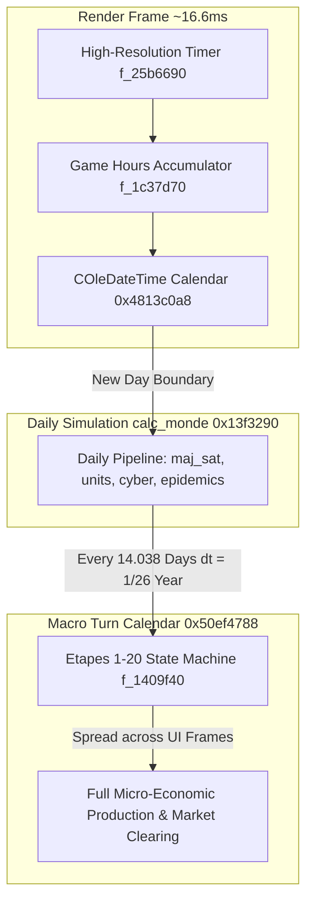

# Volume 1: Simulation Core & Temporal Engine

---

## 1. Temporal Architecture & Multi-Scale Clocks

The GPS5 simulation operates across three decoupled time scales to balance interactive 60 FPS rendering with compute-heavy macroeconomic modeling:



### 1.1 The Real-Time Clock & Time Dilation
The engine timer (`f_25b6690`) measures wall-clock elapsed seconds using high-resolution hardware counters:
$$\text{Elapsed Seconds} = \frac{\text{Ticks}_{f64} \text{ (at } \mathtt{0x70ee6528}\text{)}}{\text{Rate}_{i32} \text{ (at } \mathtt{0x70ee6524}\text{)}}$$

Function `f_1c37d70` (invoked at the head of every `calc_monde` call) translates wall-clock duration into game hours:
$$\Delta \text{Hours} = \frac{\text{Timer} - t_{0} \text{ (at } \mathtt{0x46054ecc}\text{)}}{\frac{\text{Speed Multiplier (at } \mathtt{0x464ddc88}\text{)}}{\text{Time Base (at } \mathtt{0x322a4f4}\text{)}}}$$

The accumulated float value at `0x464ddc98` increments the master date structure (`COleDateTime` at `0x4813c0a8`), tracking:
- `today` (`0x464916a8`): Julian day counter integer.
- `year` (`0x46494828`), `month` (`0x46494824`), `day_of_year` (`0x46494810`).
- `game_mode` (`0x4649165c`): Simulation state flag ($< -6$ represents menus/paused state, $0$ represents active simulation).

### 1.2 The Economic Macro-Turn Clock
While fast dynamics (military unit pathfinding, tactical engagements, riots, satellite orbits) update on every real-world simulation tick or game day, the formal economic and demographic solver executes on a **bi-weekly macro-turn schedule**:
- Clock variable: `0x50ef4788` (double precision floating-point days).
- Economic step size:
  $$\Delta t_{\text{turn}} = \frac{1}{26} \text{ year} \approx 14.03846 \text{ days}$$
- A macro catch-up loop in `f_140e000` (`bank_step`) triggers whenever:
  $$\text{today} - \text{day}(\text{clock} + \Delta t_{\text{turn}} + 5) > 0$$
This bi-weekly frequency ensures that massive aggregation loops (such as iterating across 620,000 buildings) do not execute unnecessarily every 24 game hours.

---

## 2. The Daily Execution Pipeline (`calc_monde`)

The core world update function `_geolgame::Cgps::calc_monde` (`0x13f3290`, 93 KB decompiled code) runs under the synchronization of the master permanent mutex `IDME_cmt_permanent`. It processes 36 sequential phases. Profiler instrumentation calls `f_12d04b0(profiler, label)` mark the boundaries:

```
=== calc_monde Daily Execution Phase Order ===
 [01] maj_sat                     (0x1a3aa70) Satellite orbital propagation & reconnaissance passes
 [02] maj_chemin                  (0x18c0970) Strategic route recalculation per nation
 [03] maj_agenda                  (0x15a7be0) Political agenda & official appointments calendar
 [04] gere_requetes               (0x1d087a0) Diplomatic request backlog resolution
 [05] gere_rdv                    (0x15a5e20) Bilateral face-to-face meeting events
 [06] gere_histo                  (0x1e2eef0) Historical event timeline logging
 [07] calc_actions                (0x1cfad00) Executive policy timers & construction progress
 [08] calc_unites                 (0x24c5200) Military unit AI, supply attrition, fuel, movements
 [09] org_adh_loop                (0x2128f80) International body resolutions & treaty compliance
 [10] trigger                     (0x22c3590) Scripted scenario conditions & event reactions
 [11] plansociaux                 (0x1053e40) Corporate redundancies, plant closures, severance
 [12] calc_monde_debut_tour       (0x1409f40) Multi-frame Etape driver state machine
 [13] gereAccordMainOeuvreLissee  (0x1c7d720) Bilateral migrant worker flow smoothing
 [14] EmissionDette               (0x1705700) Sovereign bond issuance & debt rollover auctions
 [15] Bank generateDebts          (0x17101f0) Corporate & private debt generation
 [16] updateInterestRate          (0x170fd40) Central bank interest rate & bond yield updates
 [17] calcCorpsDebutTrimestre     (0x980cc0)  Quarterly corporate balance sheet reconciliations
 [18] bank                        (0x1378460) Macro-turn debt & financial flow settlements
 [19] calc_nation                 (0x14134a0) Per-nation state updates (for active nations)
 [20] calc_monde_fin_tour         (0x140e5d0) Wrap-up of turn-based accounting ledgers
 [21] org_adh_demand              (0x2128b00) Accession & membership petitions to organizations
 [22] calc_PersoPrinc_effectifs   (0x218eaf0) Hidden security & secret service personnel updates
 [23] ordi_strategie_cyber        (0x20edc60) AI state-sponsored cyber-warfare operations
 [24] calc_astronautes            (0x893170)  Space missions, crew status, orbital projects
 [25] calc_programmes_spatiaux    (0x8939f0)  Space agency R&D and launch countdowns
 [26] stat_popularite_add         (0x1cc4440) Daily political popularity polling integration
 [27] maj_simu_lan_clients        (0x1f5b9b0) Multiplayer client network synchronization
 [28] calc_monde_annee            (0x1c38a50) Annual statistical aggregation (GDP, HDI, CO2)
 [29] NOUVEAU JOUR FIN            Profile checkpoint: end of synchronous daily pipeline
 [30] classer_joueur              (0x959710)  Player leaderboard & historical score evaluation
 [31] hardcoded_scenarios                     Specific crisis scripts (Taiwan, Bakhmut, COP summits)
 [32] ia_programmes_spatiaux      (0x8ac300)  AI national space program decision trees
 [33] gestion_epidemies           (0xd53a40)  Epidemiological contagion, hospital beds, mortality
 [34] calcBourseJour              (0x910ec0)  Daily financial market equity price movements
 [35] calcCorpsJour               (0x980f70)  Corporate daily production & cash reserves
 [36] majClassementMilliardaires   (0x9e1950)  Global billionaire net worth & consortium ranking
```

---

## 3. The Multi-Frame Phase Driver (`Etapes 1..20`)

Executing a full macroeconomic turn across 300 nations, 364 sectors, 124,000 enterprises, and 620,000 industrial facilities takes tens of billions of CPU instructions. To prevent rendering stutters, the driver function `calc_monde_debut_tour` (`0x1409f40`) shards the computation across subsequent visual frames via the global state index `_DAT_324da9c`:

| Etape Index | Kernel Address | Computational Responsibility | Heavy Loops / Aggregations |
| :--- | :--- | :--- | :--- |
| **Etape 1** | `0x1a33cf0`, `0x1a4e8d0` | Global transport network capacity & activity aggregation | **Heaviest step in engine**: iterates all companies $\times$ buildings to compute national sector outputs |
| **Etape 2** | `0x21bf540`, `0x10f2060` | Character updates, cabinet minister activity, loyalty drifts | Iterates 51,000 `PERS` records; evaluates interpersonal affinity matrices |
| **Etape 3** | `0x193af90` | Psychological profile updates (`PEPR`) | Traverses 12,000 records of stride `0x41b8` |
| **Etape 4** | `0x157fb20`, `0x2118290` | Political party memberships & organization finances | Updates political alignments and funding flows for `GROU` |
| **Etape 5** | `0x18e77a0`, `0x155cc10` | Industrial activities & supply constraint resolution | Computes input availability bottlenecks across Leontief input-output matrix |
| **Etape 6** | `0x18e7550` | Agricultural harvests & commodity yield adjustments | Evaluates weather effects (`xae.gt`) on crop yields |
| **Etape 7** | `0xedcf60`, `0xededa0` | Demographic migration models | Computes domestic urbanization (`URBA`) and cross-border net flows (`TMIG`) |
| **Etape 8** | `0x1558b00`, `0x1558620` | Energy grid distribution & electrical balance | Resolves national power generation vs. industrial/domestic load |
| **Etape 9** | `0x9de510`, `0x15427b0` | Corporate market clearing & domestic demand satisfaction | Companies market goods; domestic consumer spending subtracted |
| **Etape 11**| `0x1bea500`, `0x1c3c060` | National budget execution & tax collection accounting | Executes tax revenue extraction across VAT, income, corporate taxes |
| **Etape 12**| `0x9df3b0`, `0x15445f0` | **"IA CORP"**: Corporate AI managerial decision engine | 124,000 companies evaluate investment, hiring, expansion, or bankruptcy |
| **Etape 13**| `0x158c1f0`, `0x1ca2e50` | Public service quality & infrastructure depreciation | Calculates deterioration of roads, railways, hospitals, schools |
| **Etape 14**| `0x19a4be0` | International trade contract fulfillment | Deducts shipped volumes and transfers currency between nation treasuries |
| **Etape 15**| `0x9800d0` | Stock market valuation adjustments | P/E ratio and enterprise valuation recalculation |
| **Etape 16**| `0x981a00` | Dividend payouts & corporate tax remittance | Corporate net profit distributions |
| **Etape 17**| `0x25276f0` | Social security & pension entitlement disbursements | Computes welfare payments and pension fund balances |
| **Etape 18**| Disk I/O | Profile autosave serialization | Serializes game state into `profiles/<name>.sav` |
| **Etape 19**| `0x24cd530` | Final unit repositioning & base supply caches | Validates strategic military logistics |
| **Etape 20**| State reset | Turn finalization | Increments turn counter; resets `_DAT_324da9c` to 0 |

---

## 4. World Database Serializer & Memory Layout (`es_base`)

The master loader/saver `Cdatabase::es_base` (`0x143acd0`) manages the 8.48 GB in-memory state:
- **Signature**: `void es_base(int mode, const wchar_t* path, int version = -1)`
- **Modes**:
  - `Mode 5`: Fast binary image restore from disk (sequential block streaming via `0x25b58e0`).
  - `Mode 6`: Fast binary snapshot dump (sequential block writing via `0x25b5ea0`).
  - `Mode 1`: Field-by-field serialized walker (used for savegame files `.sav` and text export). Supports **delta compression** against a base reference file (`_DAT_70eeaa50`), storing only modified fields.

### 4.1 Memory Addressing & Relocation
In the unpacked binary, data arrays reside on the process heap with master pointer references stored in `.data`:
- Nation array pointer: `*0x46208908` (stride `0x645310`, count at `0x322a3f4` = 300).
- Companies array pointer: `*0xe1e9910` (stride `0x1f60`, count = 124,000).
- Variable store pointer: `*0x32d1920` (4,000,000 entries of 16 bytes each).
- Persons array pointer: `*0x5d85ada0` (stride `0xad0`, count = 51,000).

When building native savegames, each record is preceded by an 8-byte chunk header:
```cpp
struct SaveChunkHeader {
    uint32_t fourcc;     // e.g., 'NATI', 'PERS', 'CORP'
    uint32_t record_size;// Size of individual record in bytes
};
```
Within `NATI`, sub-arrays for economic sectors are stored contiguously starting at byte offset `+0xcbc8`, with each sector allocated exactly `0x4068` bytes (364 sectors $\times$ `0x4068` = 6,108,864 bytes).
