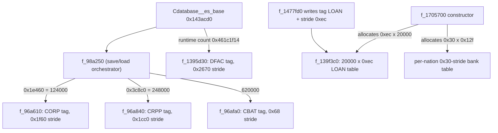
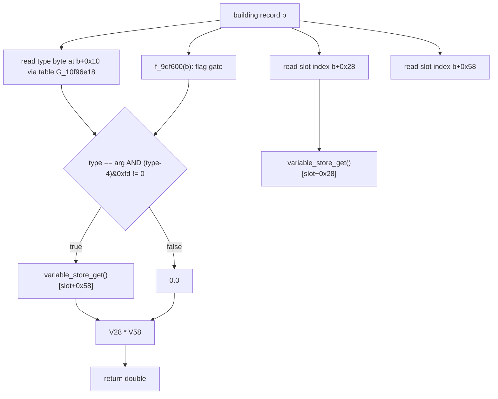
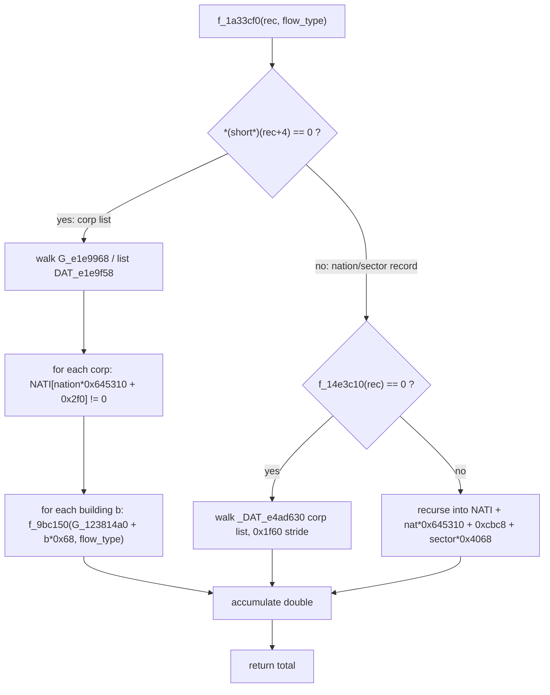
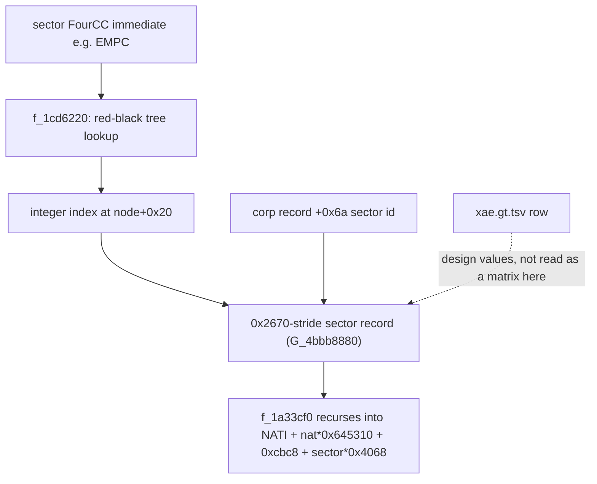
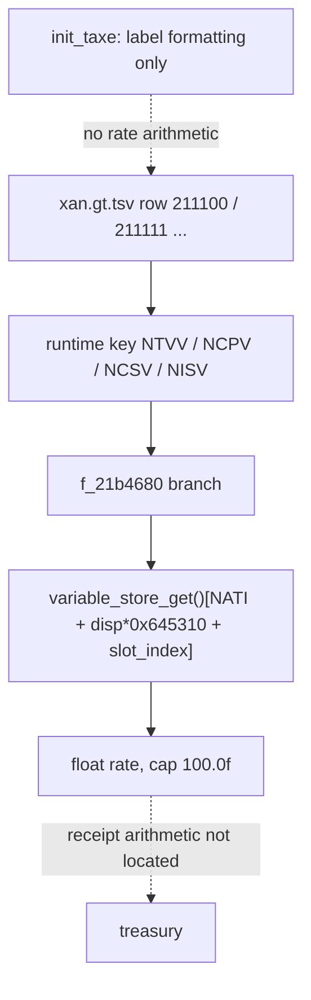
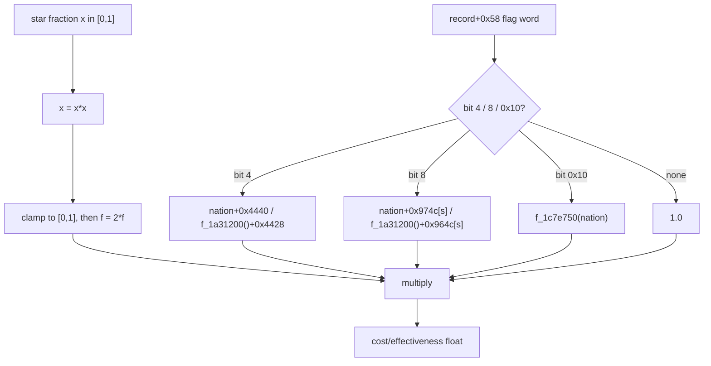
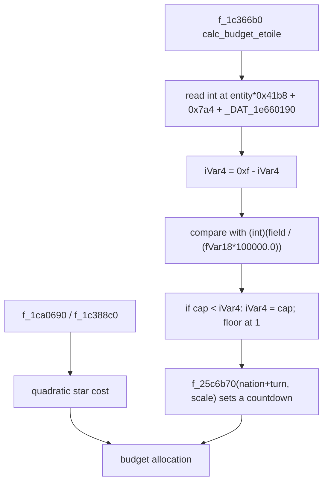
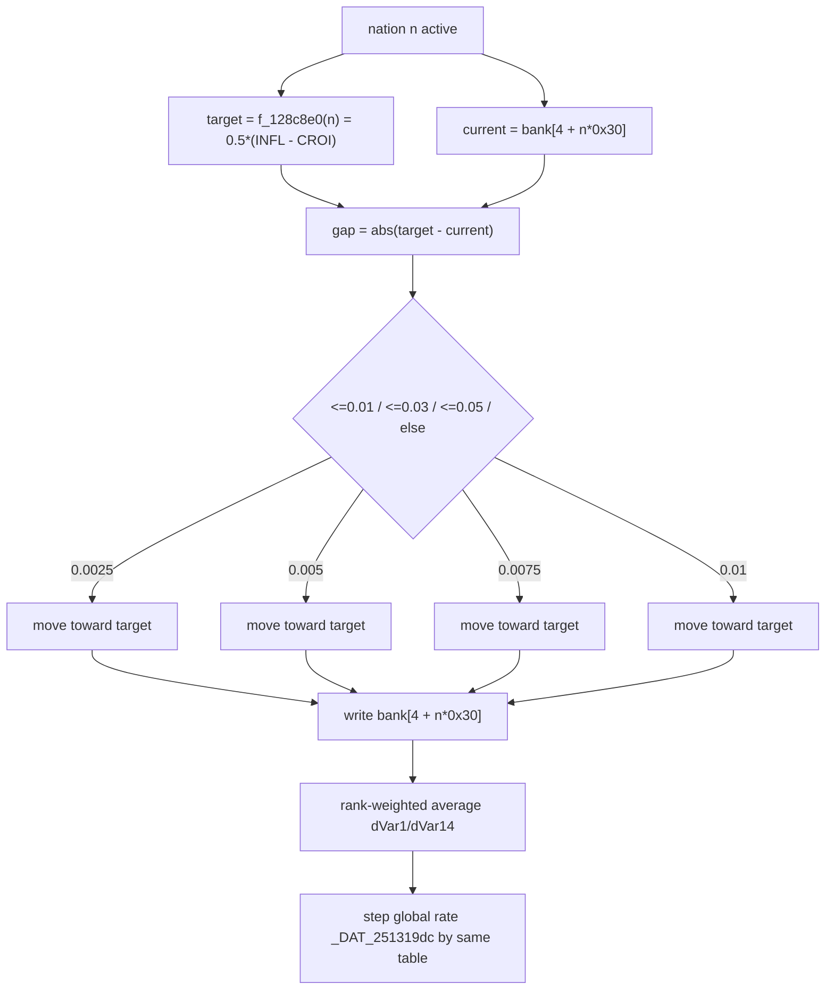
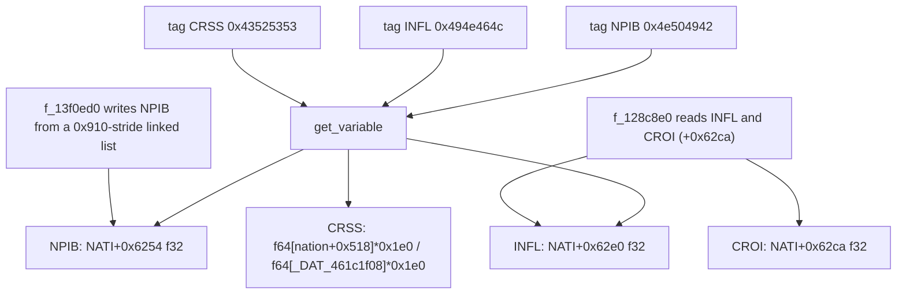

# Volume 2: Macroeconomic & Microeconomic Engine

---

This volume was rewritten against `recomp/full_fns.clean.c` (D-001). The rule used
throughout is simple: a mechanism is described only when the corpus contains the
arithmetic, and a data-table parameter is described only when a row of
`data/gt/*.tsv` contains it. Where the previous text asserted a named economic model
that the corpus does not compute, the model is removed and the text says what the
code does instead. Every surviving numeric anchor is cited with one of the D-002 /
D-008 / D-010 classes:

- `[fn 0x... name]` — RVA has a `// ==== <rva> <name>` header;
- `[global 0x... type]` — RVA appears in a `// GLOBALS` line;
- `[tag 0x... "XXXX"]` — four-character immediate with at least one comparing function;
- `[qty 0x... ...]` — numeric literal / stride / count;
- `[data <file> "<key>"]` — first-column key in a shipped `data/gt/*.tsv` table;
- `[field 0x... in <TYPE>]` — displacement from a base pointer in a cited function.

The old volume's labels `CBAT`, `CRPP`, `CORP` and `DFAC` are not invented: each is
the four-character save-block tag written by the block's serializer, cited in the
table below. They name serialized blocks, not a production hierarchy; the code is
described by tag, record size, stride and loader.

---

## 1. What the corpus actually contains: five record blocks, no named pyramid

The economy is backed by five large serialized blocks whose sizes are recoverable
from the loaders, the serializer tags and the save-block record sizes. They are independent facts; the corpus
does not contain a statement that one tier "feeds" another.

| Block tag | Records | Record size | Bytes | Evidence |
| :--- | ---: | ---: | ---: | :--- |
| `[tag 0x434f5250 "CORP"]` | 124,000 | `0x1f60` = 8,032 | 995,968,000 | serializer `[fn 0x145c5d0 f_145c5d0]` writes the tag and stride `0x1f60` at corpus 2093297-2093298; loader `[fn 0x96a610 f_96a610]`, called with `[qty 0x1e460 124000]` from `f_98a250` at corpus 236307 |
| `[tag 0x43525050 "CRPP"]` | 248,000 | `0x1cc0` = 7,360 | 1,825,280,000 | serializer `[fn 0x9a2490 f_9a2490]` writes the tag and stride `0x1cc0` at corpus 254822-254823; loader `[fn 0x96a840 f_96a840]`, called with `[qty 0x3c8c0 248000]` at corpus 236376 |
| `[tag 0x43424154 "CBAT"]` | 620,000 | `0x68` = 104 | 64,480,000 | serializer `[fn 0x9a3d20 f_9a3d20]` writes the tag and stride `0x68` at corpus 255518-255519; loader `[fn 0x96afa0 f_96afa0]`, called with `620000` at corpus 236644 |
| `[tag 0x44464143 "DFAC"]` | 364 in the shipped block | `0x2670` = 9,840 | 3,581,760 | serializer `[fn 0x1463940 f_1463940]` writes the tag and stride `0x2670` at corpus 2097048-2097049; loader `[fn 0x1395d30 f_1395d30]`, call at corpus 2075614 uses the runtime count `[global 0x461c1f14 i32]`, not a literal |
| `[tag 0x4c4f414e "LOAN"]` | 20,000 | `0xec` = 236 | 4,720,000 | serializer `[fn 0x1477fd0 f_1477fd0]` writes the tag and stride `0xec` at corpus 2108728-2108729; loader `[fn 0x139f3c0 f_139f3c0]`, called with `20000` at corpus 2065175 |

The counts are literal arguments at the call site (and each block also has an
explicit serializer tag and stride), so they are quantities, not inferences:

- `f_96a610(param_1, uVar7, N_CORP, ...)`, where `N_CORP` is `[qty 0x1e460 124000]`;
- `f_96a840(param_1, uVar7, N_CRPP, ...)`, where `N_CRPP` is `[qty 0x3c8c0 248000]`;
- `f_96afa0(param_1, uVar7, 620000, ...)` — 620,000 decimal;
- `f_139f3c0(param_2, param_1, 20000, ...)` — 20,000 decimal.

The old `DFAC` count is *not* a code constant. `Cdatabase__es_base`
(`[fn 0x143acd0 Cdatabase__es_base]`) calls the DFAC loader with
`[global 0x461c1f14 i32]`. The same global is reset to `0x17c` (380) in
`f_1cbac20` at corpus line 3345956, and `Cdatabase__es_base` initialises entries up to
`0x17c` at corpus line 2075617. The 364 value is only the record count implied by the
shipped serialized block (3,581,760 / 9,840). The corpus therefore does not establish
"364 sectors"; it establishes a 364-record save block and a runtime sector count
whose reset value is 380.

The base pointers used by the production code are globals, not block names:
`[global 0x123814a0 i64]` is the building array base used to form the pointer
passed to `f_9bc150`, and
`[global 0xd65da58 i64]` is the corp array base used by `f_9df700` and `f_15981d0`.
Throughout this volume `NATI_STRIDE` means `[qty 0x645310 stride]`, the per-nation
record spacing used by every nation-indexed expression.



```pseudocode
// Transcribed from f_98a250 (corpus 236249) and Cdatabase__es_base (2072351).
// The three call sites are the count evidence; the loaders themselves only loop.
uVar7 = _DAT_d65da58;                       // corp array base
f_96a610(param_1, uVar7, 0x1e460, ...);     // 124000 records of 0x1f60
uVar7 = _DAT_da27920;
f_96a840(param_1, uVar7, 0x3c8c0, ...);     // 248000 records of 0x1cc0
uVar7 = _DAT_da27928;
f_96afa0(param_1, uVar7, 620000, ...);      // 620000 records of 0x68

// Transcribed from Cdatabase__es_base (corpus 2075610-2075615).
f_8604f0(param_1, &_DAT_461c1f14, iVar12);  // load the runtime sector count
iVar10 = f_1395d30(param_1, (void *)G_4bbb8880, _DAT_461c1f14, iVar12, ...);

// Transcribed from f_1477fd0 (corpus 2108725-2108732).
auStackX_18[0] = 0x4c4f414e;                // 'LOAN'
auStackX_8[0]  = 0xec;                      // stride
f_8604f0(param_2, auStackX_18, param_3);    // write tag
f_8604f0(param_2, auStackX_8,  param_3);    // write stride
```

### What the code does not establish

- No production-stage chain between the four tagged blocks exists. The five blocks
  have different loaders and different record sizes; no function in the corpus links
  a record of one block to a record of the next as a production stage.
- The tags identify serialized blocks, not a production hierarchy. `CRPP` has no
  named consumer in `array_inventory.tsv` (`named_users` is empty), so its economic
  role is not established. The `CORP` tag also appears in non-serializer comparisons
  (15 code hits), but those comparisons do not turn it into a production tier.
- The old "364 consolidated sectors" is not a constant. The loader is called with
  `[global 0x461c1f14 i32]`; the save block happens to be 364 records and the reset
  value is 380.

---

## 2. Microeconomic production: a typed flow accessor, not a saturation equation

### 2.1 `f_9bc150`: two variable-store reads and one boolean gate

`[fn 0x9bc150 f_9bc150]` (corpus 269438) is the building-level quantity accessor used
by the aggregator. It reads two variable-store slots of the record, `+0x28` and
`+0x58`, and multiplies them. The `+0x58` term is **not** a general multiplier: it is
zero unless the building's type byte equals the caller's type argument and
`f_9df600` returns non-zero. There is no exponential, no capacity, no worker count,
no modernity and no health coefficient.



```pseudocode
// Transcribed from f_9bc150 (corpus 269438-269468).
double f_9bc150(longlong b, char flow_type)
{
  undefined4 v_hi = 0, v_lo = 0;
  char kind = *(char *)((longlong)*(int *)(b + 0x10) * 0x38 + G_10f96e18);
  if (((kind - 4U) & 0xfd) != 0) {                  // skip when kind is 4 or 6
    uVar2 = f_9df600(b);                            // boolean gate
    if ((kind == flow_type) && ((char)uVar2 != '\0')) {
      iVar1 = *(int *)(b + 0x58);
      puVar3 = variable_store_get();
      dVar4 = f_1cc8ac0(puVar3 + (longlong)iVar1 * 0x10);
      v_lo = SUB84(dVar4, 0);
      v_hi = (undefined4)((ulonglong)dVar4 >> 0x20);
    }
  }
  iVar1 = *(int *)(b + 0x28);
  puVar3 = variable_store_get();
  dVar4 = f_1cc8ac0(puVar3 + (longlong)iVar1 * 0x10);
  return dVar4 * (double)CONCAT44(v_hi, v_lo);
}
```

### 2.2 `f_9df600`: the gate is a bit-flag/activity test

`[fn 0x9df600 f_9df600]` (corpus 290942) does not test "alive, strike or siege". It
tests `(*(byte *)(b + 0x50) & 0x11) == 0`, then treats `*(int *)(b + 4)` as an index
into a `0x750`-stride activity array, masking the 64-bit flag word with
`[qty 0x8000380000 mask]`, `[qty 0x80000000 mask]` and testing the callbacks `f_2542950(..., [qty 0x10000 mask])` and
`f_2542950(..., [qty 0x4000000 mask])`, plus the byte at `+0x08` of the activity's flag block.
The economic meaning of those bits is not established by the corpus.

```pseudocode
// Transcribed from f_9df600 (corpus 290942-290964).
undefined8 f_9df600(longlong b)
{
  if ((*(byte *)(b + 0x50) & 0x11) == 0) {
    idx = *(int *)(b + 4);
    if (idx < 1) return 1;
    u64 flags = *(u64 *)(idx * 0x750 + G_61d0df38);
    if ((flags & 0x8000380000) == 0) {
      if ((flags & 0x80000000) != 0) {
        if (!f_2542950(idx * 0x750 + G_61d0deb0, 0x10000)) return 0;
      }
      idx = *(int *)(b + 4);
      if ((*(byte *)(idx * 0x750 + G_61d0df48) & 8) == 0) {
        if (!f_2542950(idx * 0x750 + G_61d0deb0, 0x4000000)) return 1;
      }
    }
  }
  return 0;                                          // low byte cleared
}
```

### 2.3 `f_1a33cf0`: sector aggregation by linked lists and recursion

`[fn 0x1a33cf0 f_1a33cf0]` (corpus 2932439) is called from
`calc_monde_debut_tour_etapes` (`[fn 0x1409f40 calc_monde_debut_tour_etapes]`, call
at corpus 2046045) and sums `f_9bc150` over a corp-linked list of buildings. For a
nation-level record it recurses into the sector sub-record at
`NATI + nation*NATI_STRIDE + 0xcbc8 + sector*0x4068`, which confirms the old volume's
`0xcbc8 + s*0x4068` address formula. It does **not** touch the 0x1cc0 (`CRPP`) block
and does not perform a matrix product.



```pseudocode
// Transcribed from f_1a33cf0 (corpus 2932439-2932550).
double f_1a33cf0(longlong rec, char flow_type)
{
  double total = 0.0;
  if (*(short *)(rec + 4) == 0) {
    iVar10 = *(int *)((longlong)*(short *)(rec + 0x3fc0) * 4 + G_e1e9968);
    while (iVar10 != 0) {
      lVar7 = (longlong)iVar10 * 0x1f60;
      sVar4 = f_9c5450(_DAT_e2dc850 + lVar7);
      if ((*(int *)((longlong)sVar4 * 0x645310 + _DAT_46208908 + 0x2f0) != 0) &&
          (f_9defe0(_DAT_e2dc850 + lVar7) == 0)) {
        iVar8 = *(int *)((longlong)*(int *)(lVar7 + _DAT_e2dc850) * 4 + G_11dd4298);
        iVar9 = (0x975de < iVar8 - 1U) ? 0 : *(int *)(&DAT_11e4d418 + (longlong)iVar8 * 4);
        while (iVar8 != 0) {
          total += f_9bc150((longlong)iVar8 * 0x68 + _DAT_123814a0, flow_type);
          iVar8 = iVar9;
          iVar9 = (0x975de < iVar8 - 1U) ? 0 : *(int *)(&DAT_11e4d418 + (longlong)iVar8 * 4);
        }
      }
      iVar10 = (0x1e45e < iVar10 - 1U) ? 0 : *(int *)(&DAT_e1e9f58 + (longlong)iVar10 * 4);
    }
  } else if (f_14e3c10(rec) == 0) {
    // second corp list at _DAT_e4ad630, same 0x1f60 record size
    // (loop body mirrors the branch above; corpus 2932493-2932520)
  } else {
    sVar4 = *(short *)((longlong)*(int *)(&DAT_4bbba49c +
                     (longlong)*(short *)(rec + 0x3fc0) * 0x2670) * 2 + G_45ebd9b0);
    while (sVar4 != 0) {
      total += f_1a33cf0((longlong)*(short *)(rec + 4) * 0x645310 +
                         _DAT_46208908 + 0xcbc8 + (longlong)sVar4 * 0x4068, flow_type);
      sVar4 = *(short *)(lVar7 + 2);
      lVar7 = lVar7 + 2;
    }
  }
  return total;
}
```

### What the code does not establish

- There is no exponential saturation production equation anywhere: `f_9bc150` is a
  product of two stored variables, gated by a type byte and a boolean; it contains no
  exponential and no capacity/worker/modernity/health terms.
- The old `Φ(unit)` semantics ("alive", "occupied", "strike", "siege") are not in
  `f_9df600`; it tests activity-array bit flags.
- No `CRPP` intermediate appears in the aggregation. The old four-tier production
  path is replaced by the corp-list -> building-list walk quoted above.
- The only `exp(` sites in the corpus are at lines 2248687, 2253838, 2268076,
  2268077 and 2273465, inside `f_15741e0`, `f_157c040`, `f_15981d0` and
  `f_15a0f30`. None is in `f_9bc150`, `f_1a33cf0` or `calc_monde_debut_tour_etapes`.
  The nearest is `f_15981d0`, which computes a factory *quality/price* coefficient
  (debug string `coef_qualite_prix_usine`), not a production function. No `pow(` call is on the building-production path either: the 37 `pow(`
  sites occur in unrelated functions (for example `f_1bec6b0` at 3255554 and
  `f_f970d0` at 5011845), and none is in `f_9bc150`, `f_1a33cf0` or
  `calc_monde_debut_tour_etapes`.

---

## 3. Sector records and the `xae.gt.tsv` table: per-sector lookup, not a Leontief matrix

### 3.1 What the table actually contains

`data/gt/xae.gt.tsv` has 118 columns and 359 four-character sector keys. The columns
used by the old table are real column indices, but several old cells were wrong:

| Column (0-based) | Header (verbatim, shortened) | Meaning |
| :--- | :--- | :--- |
| 0 | `Code Secteur` | FourCC key |
| 11 | `Prix moyen HT $` | price (comma decimal) |
| 21 | `Personnel (nb/unit annuelle)` | labour ratio |
| 28 | `Produit` | input product code / `self` |
| 29 | `Formule 1` | input recipe string |
| 41 | `Booster (Qualité)` | quality booster expression |
| 43 | `Invest (Capacité de prod)` | capacity expression |

Two rows, quoted exactly from the table:

```
EMPC  price=407,705  personnel=0,0001  produit=EMPE  formule1=ECO2 + @270
      booster=RDIN+ICME*0.2  invest=YBAT+ICME*10+TAXP
EENU  price=380      personnel=0,00006 produit=EE+NDRA*1e-5
      formule1=TKNU*1+EMUR*103e-6 + ECO2 + @70
      booster=RDEN+RDIN+RDMA+ICME*0.2  invest=YBAT*10+ICME*100+TKNU*10000
```

The old row labelled `AGBL` is not a key in the table; `INAC` and `INAU` are also
absent. The old `EENU` price "120" is wrong (the row says 380), the old `EENU`
booster `RDEN × 0.5` is wrong, and the old `EENU` invest `YBAT + TAXP` is wrong.
`MDEFN` in the ministry list is likewise absent; the key is `MDEF`.

`[data xae.gt.tsv "EMPC"]` and `[data xae.gt.tsv "EENU"]` are the citations. This is
a data table, not a binary constant (D-008): none of `EMPC`, `EENU`, `ECO2`, `RDIN`
or `YBAT` occurs as a text key in the executable, although individual item codes
such as `[tag 0x45434f32 "ECO2"]` do occur as code immediates (22 hits, 16 comparing
functions).

### 3.2 The engine's sector map and per-sector record

`[fn 0x1cd6220 f_1cd6220]` (corpus 3360806) is a red-black-tree lookup keyed by an
integer; it returns the integer stored at tree node `+0x20`. It is a generic
"code -> index" accessor. Sector codes are passed to it as immediates, e.g.
`[tag 0x454d5043 "EMPC"]` at corpus 2219819 and `[tag 0x45454e55 "EENU"]` at corpus
259569. The per-sector record is the `0x2670`-stride block; `f_15981d0` indexes it as
`*(short *)(corp + 0x6a) * 0x2670 + G_4bbb8880` (corpus 2268040), i.e. by the corp's
sector id.



```pseudocode
// Transcribed from f_1cd6220 (corpus 3360806-3360828): tree lookup.
undefined4 f_1cd6220(int code)
{
  puVar1 = _DAT_4bf496c0;                 // tree root
  puVar3 = (undefined8 *)_DAT_4bf496c0[1];
  while (*(char *)((longlong)puVar3 + 0x19) == '\0') {
    puVar2 = puVar3;
    if (*(int *)((longlong)puVar2 + 0x1c) < code) {
      puVar3 = (undefined8 *)puVar2[2];
      puVar2 = puVar1;
    } else {
      puVar3 = (undefined8 *)*puVar2;
    }
    puVar1 = puVar2;
  }
  if ((puVar2 != _DAT_4bf496c0) && (*(int *)((longlong)puVar2 + 0x1c) <= code))
    return *(undefined4 *)(puVar2 + 4);   // node+0x20
  return 0;
}
```

### What the code does not establish

- No Leontief matrix. A Leontief model needs a read of row/column coefficients and a
  sum of coefficient-by-output products. The corpus contains neither a whole-row reader for
  `xae.gt.tsv` nor a function that multiplies one sector row by another sector's
  output. `f_1a33cf0` reads one sector record and recurses; it does not combine a
  matrix of sectors.
- No intermediate-demand product, no min-over-suppliers bottleneck factor and no
  realised-output throttle. These are removed, not rephrased.
- No per-sector production/saturation throttle in the production path. The only
  `1 - exp(-x)` form is in `f_15981d0` (quality/price coefficient), quoted below for
  completeness, and it is not a production capacity equation.
- The recipe strings (`ECO2 + @270`) are design data. The executable contains the
  individual item tags but not the recipe strings, so the corpus does not establish
  that the engine parses and evaluates `Formule 1` as a matrix row.

The one saturating exponential near an economic quantity is
`[fn 0x15981d0 f_15981d0]` (corpus 2268034):

```pseudocode
// Transcribed from f_15981d0 (corpus 2268034-2268090).
double f_15981d0(short *param_1, longlong corp)
{
  lVar3 = *(int *)(corp + 4) * 0x1f60 + _DAT_d65da58;       // corp record
  lVar1 = *(short *)(lVar3 + 0x6a) * 0x2670;                // sector index
  lVar2 = lVar1 + G_4bbb8880;
  lVar3 = _DAT_46208908 + (longlong)*(short *)(lVar3 + 0x68) * 0x645310; // nation
  if (*param_1 == 0) {
    dVar6 = f_9b3a10(corp);
    dVar6 = f_1cd9d30(dVar6, lVar3);
    dVar6 = f_1a37380(lVar2, (int)*(char *)(corp + 8));
  } else {
    dVar6 = f_9b3a10(corp);
    dVar6 = f_1cd9bd0(dVar6, lVar3, (longlong)param_1);
    dVar6 = f_1a37380(lVar2, (int)*(char *)(corp + 8));
    dVar6 = f_1cd9b10(dVar6, (longlong)param_1);
  }
  if (dVar6 != 0.0) {
    fVar5 = f_9aed20(corp);
    dVar9 = (double)fVar5;
    dVar7 = (0.0 <= dVar9 && dVar9 <= 1.0) ? dVar9 : 1.0;
    dVar9 = log(*(double *)(lVar1 + G_4bbb89e8));
    dVar9 = dVar9 * (dVar7 - 0.5);
    dVar7 = exp(dVar9 + dVar9);
    dVar7 = exp(-(((1.0 / (dVar7 * 1.2)) * (double)CONCAT44(uVar8, uVar4)) / dVar6));
    dVar7 = 1.0 - dVar7;
  }
  dVar6 = (dVar7 <= 1.0) ? dVar7 : 1.0;
  if (0.95 < dVar6) dVar6 = 1.0;
  return dVar6;
}
```

This is a `1 - exp(-x)` saturation, but the arguments are a corp/sector scoring
ratio and a stored sector double, not `Workers / Workers_req`; the output is clamped
to `[0,1]` with a `0.95 -> 1.0` snap and is used by `f_1593b20` to build the
`coef_qualite_prix_usine` score. It is **not** the production equation.

---

## 4. Public finance: tax rates are action-table rows, not a tax formula

### 4.1 `xan.gt.tsv`: the tax law rows

Taxes are action rows in `data/gt/xan.gt.tsv`. The relevant columns are:

| Column | Header | Use |
| :--- | :--- | :--- |
| 0 | `*******LABEL` | action id (e.g. `211100`) |
| 10 | `**MIN VALEUR` | minimum |
| 11 | `**MAX VALEUR` | maximum |
| 12 | `*Variable utilisée` | runtime variable key |
| 13 | `*UNITE` | step |
| 14 | `*VAL INIT EXEMPLE REFERENCE` | initial/default value |

Quoted rows:

```
211100  min=0  max=0,5  var=B_TTVA  step=0,01  init=0,196   label "TVA"
211101  min=0  max=0,5  var=        step=0,01  init=0,12    label "Impôt sur les revenus"
211102  min=0  max=0,2  var=B_TISF  step=0,01  init=0,01    label "Taxe sur les grandes fortunes"
211113  min=0  max=0,75 var=B_TTIS  step=0,01  init=0,34    label "Impôt sur les sociétés"
211111  min=0  max=0,75 var=N_URST  step=0,01  init=0,2     label "Charges sociales salarié"
211112  min=0  max=0,75 var=N_URSE  step=0,01  init=0,4     label "Charges sociales employeur"
```

Citations: `[data xan.gt.tsv "B_TTVA"]`, `[data xan.gt.tsv "B_TTIS"]`,
`[data xan.gt.tsv "N_URST"]`, `[data xan.gt.tsv "N_URSE"]`,
`[data xan.gt.tsv "B_TISF"]`. The income-tax row `211101` has an **empty**
`*Variable utilisée` cell; the corpus and the table therefore do not establish an
implemented progressive income tax.

### 4.2 The runtime getter `f_21b4680`

`[fn 0x21b4680 f_21b4680]` (corpus 4148485; the tax branches start at 4148561) maps the runtime four-character action keys to variable-store
slots. It reads the slot, returns it as a float, and returns a scale cap in
`*param_5 = [qty 0x42c80000 100.0f]` (100.0f). The keys are:

| Key | Tag | Slot (NATI displacement) |
| :--- | :--- | ---: |
| `NTVV` | `[tag 0x4e545656 "NTVV"]` | `+0x6fa4` |
| `NCPV` | `[tag 0x4e435056 "NCPV"]` | `+0x6fd4` |
| `NCSV` | `[tag 0x4e435356 "NCSV"]` | `+0x6fd0` |
| `NISV` | `[tag 0x4e495356 "NISV"]` | `+0x6fd8` |
| `NEXV` | `[tag 0x4e455856 "NEXV"]` | (separate branch) |



```pseudocode
// Transcribed from f_21b4680 (corpus 4148561-4148582, NCPV/NCSV branches).
if (param_2 == 0x4e435056 /* NCPV */) {
  *param_5 = 0x42c80000;                                  // 100.0f
  if (iVar8 != 0) { *param_4 = _DAT_5314c720; *param_6 = 1; return 1; }
  iVar8 = *(int *)((longlong)param_1 * 0x645310 + 0x6fd4 + _DAT_46208908);
  puVar5 = variable_store_get();
  dVar2 = f_1cc8ac0(puVar5 + (longlong)iVar8 * 0x10);
  *param_4 = (float)dVar2;
  *param_3 = 1;
  return 1;
}
if (param_2 == 0x4e435356 /* NCSV */) {
  *param_5 = 0x42c80000;
  if (iVar8 != 0) { *param_4 = _DAT_5314c71c; *param_6 = 0xffffffff; return 1; }
  iVar8 = *(int *)((longlong)param_1 * 0x645310 + 0x6fd0 + _DAT_46208908);
  puVar5 = variable_store_get();
  dVar2 = f_1cc8ac0(puVar5 + (longlong)iVar8 * 0x10);
  *param_4 = (float)dVar2;
  return 1;
}
```

### 4.3 `init_taxe` is label construction, not tax computation

`[fn 0x1c904b0 init_taxe]` (corpus 3318429) copies a 4 x 0x40 block of localized
text from `G_4c7f86a0`, formats an integer with `"%d"`, formats a second string, and
calls the text helpers `f_25b7360`, `f_25e9760`, `f_25e9800`. It contains no
multiplication by a tax rate and no income/profit base. The old sentence "Fiscal
policy is handled by `gps_taux.cpp` (`[fn 0x23e8e70 calc_incitation_etud_sup]`)" is wrong on both counts:
`[fn 0x23e8e70 calc_incitation_etud_sup]` is a student-incentive function, and the
`gps_taux.cpp` source-name asserts belong to `[fn 0x23f1c80 get_valeur_etoile_lisse]`
and `[fn 0x23f1d40 f_23f1d40]` (corpus 4552156 and 4552240), i.e. to the star system,
not to tax collection.

### What the code does not establish

- No progressive/marginal income-tax computation. The income-tax row has no runtime
  variable key; no function in the corpus computes brackets, marginal rates or a
  taxable base.
- No VAT receipt equation and no demand-elasticity adjustment. The old values
  `epsilon ~ 0.4` and `~ 1.2` are absent; no such constants exist in the tax paths.
- No corporate-profit equation, no depreciation term, no `delta_div ~ 0.40`, and no
  `W_net = W_gross * (1 - tau_urst)` closed form. The social rows are data
  parameters; their receipt arithmetic was not located.
- `gps_taux.cpp` is not a tax function at address `[fn 0x23e8e70 calc_incitation_etud_sup]`. The string identifies
  the star accessor family.

---

## 5. Ministerial budgets and the "Budget en Étoile" star system

### 5.1 The 26 ministry rows

`data/gt/xae.gt.tsv` contains 26 consecutive ministry-coded rows from `MFIN` through
`MSOC`: `MFIN, MIND, MTRA, MSAN, MINT, MJUS, MDEF, MEDU, MCUL, MSPO, MFAM, MTRN,
MENV, MAFE, MAGR, MLOG, MREC, MENE, MREL, MINF, MECO, MTOU, MPRO, MDIV, MSEC, MSOC`.
The old `MDEFN` key is absent; the table has `MDEF`. Cite the keys as
`[data xae.gt.tsv "MFIN"]` ... `[data xae.gt.tsv "MSOC"]`; the count is a table
property, not a code constant.

### 5.2 The actual star cost is quadratic, not a power curve

`[fn 0x1c388c0 f_1c388c0]` (corpus 3294872) is the cost/effectiveness factor used by
the budget functions. Its core is:

```
x = x * x;
f = (x <= 0) ? 0 : (x <= 1 ? x : 1);
f = f + f;                                  // 2 * clamp(x^2, 0, 1)
```

It then multiplies by a finite positive ratio selected from the record's flag word
`*(u64 *)(record + 0x58)`:

- bit 4: `nation+0x4440 / f_1a31200()+0x4428`;
- bit 8: a per-sector ratio of `nation+0x974c[sector]` by `f_1a31200()+0x964c[sector]`,
  falling back to `nation+0x4440 / f_1a31200()+0x4428`;
- bit `0x10`: multiply by `f_1c7e750(nation)`;
- otherwise: no ratio.

`[fn 0x1c37980 f_1c37980]` (corpus 3294476) wraps the same factor with
flag-dependent multipliers `((star - current)*5.0)*k + 1.0` for `k = 1,2,3,4,5,10`,
where `current` is `*(float *)(nation + 0x57a4 + slot*4)`. `[fn 0x1c37ca0 f_1c37ca0]`
is the simpler wrapper: `factor * field[nation+0xc370+slot*4] * (dVar6*iVar1*(dVar5+1)+dVar4)`.

There is no power-law denominator or exponent, and no `gamma ~ 1.8`.



```pseudocode
// Transcribed from f_1c388c0 (corpus 3294872-3294908).
float f_1c388c0(longlong nation, longlong rec, float x)
{
  x = x * x;
  fVar4 = (0.0 <= x) ? (x <= 1.0 ? x : 1.0) : 0.0;
  uVar1 = *(ulonglong *)(rec + 0x58);
  fVar4 = fVar4 + fVar4;                       // 2 * clamp(x^2,0,1)
  if ((uVar1 & 4) == 0) {
    if ((uVar1 & 8) == 0) {
      if ((uVar1 & 0x10) != 0) fVar4 = fVar4 * f_1c7e750(nation);
    } else {
      fVar5 = *(float *)(nation + 0x974c + sector * 4);
      fVar6 = *(float *)(f_1a31200() + 0x964c + sector * 4);
      if (fVar5 <= 0.0 || fVar6 <= 0.0)
        fVar5 = (float)(*(double *)(nation + 0x4440) / *(double *)(f_1a31200() + 0x4428));
      else
        fVar5 = fVar5 / fVar6;
      fVar4 = fVar4 * fVar5;                   // + finite/<=0 fallback to 1.0
    }
  } else {
    fVar4 = fVar4 * (float)(*(double *)(nation + 0x4440) /
                            *(double *)(f_1a31200() + 0x4428));
  }
  if (!_finite(fVar4) || fVar4 < 0.0) fVar4 = 1.0;
  return fVar4;
}
```

### 5.3 The update rounds to 0.1 and scales to an integer 0..10

`[fn 0x1ca0690 maj_budget_etoile]` (corpus 3328712) rounds the star to one decimal:

```
fVar23 = floorf(fVar23 * 10.0 + 0.5);
fVar23 = fVar23 / 10.0;
if (0.0 <= fVar23) { fVar32 = (fVar23 <= 1.0) ? fVar23 : 1.0; } else fVar32 = 0.0;
```

and later `f_1378420(fVar32 * 10.0)` converts the `[0,1]` fraction to an integer
0..10 (`[fn 0x1378420 f_1378420]`, corpus 1980274). The internal value is a fraction;
the "0 to 10 stars" of the old text is a display/rounding convention, not an
independent state variable.

### 5.4 The "smoothing" claim is misattributed

`[fn 0x23f1c80 get_valeur_etoile_lisse]` (corpus 4552148) is a **clamped read**:
it reads `*(float *)(nation + 0x67a4 + index*4)` and returns it only if finite and
in `[0,1]`, else `0.0`. It contains no `lambda`, no subtraction from a target, and no
`0.05` constant. The same is true of `[fn 0x23f1b00 get_valeur_etoile]`
(`+0x5fa4`) and `f_23f1bc0` (`+0x57a4`).

The only star smoothing step found is in `[fn 0x23f1d40 f_23f1d40]` (corpus 4552185),
whose `gps_taux.cpp` assert names it `get_valeur_etoile_init`:

```
dVar8 = (read_slot(...) - *(float *)(nation + 0x645200)) * 0.125;
dVar1 = -0.25;
if ((-0.25 <= dVar8) && (dVar8 <= 0.25)) dVar1 = dVar8;    // clamp to +/-0.25
```

So the corpus has a `0.125` step clamped to `+/-0.25`; it has no `lambda = 0.05`
exponential lag.

### 5.5 `f_1c366b0` and the "15 - honesty" fragment

`[fn 0x1c366b0 calc_budget_etoile]` (corpus 3293861) contains
`iVar4 = 0xf - iVar4;` at corpus 3293950, where `iVar4` was read from
`*(int *)((longlong)entity * 0x41b8 + 0x7a4 + _DAT_1e660190)`. It also selects
`fVar18 = 10.0` or `2.0` after comparing the nation id with `f_1cd54e0(0x5553)`, and
computes `iVar5 = (int)(pfVar12[0x2ba] / (fVar18 * 100000.0))`. The numeric fragment
`15 - x` is therefore real. The old multiplier
`(15 - MinisterHonesty) * TimeUntilElection / ElectionCycle` is **not**: no election
period division appears in the function.



```pseudocode
// Transcribed from f_1c366b0 (corpus 3293940-3293965) and f_1ca0690 (3328850-3328890).
iVar4 = *(int *)((longlong)(int)uVar8 * 0x41b8 + 0x7a4 + _DAT_1e660190);
fVar18 = 2.0;
uVar8 = f_1cd54e0(0x5553);
if ((int)sVar2 == (int)uVar8) fVar18 = 10.0;
iVar4 = 0xf - iVar4;
iVar5 = (int)(pfVar12[0x2ba] / (fVar18 * 100000.0));
if (iVar5 <= iVar4) iVar4 = iVar5;
if (iVar4 < 1) { state = 0xffffffff; }
else {
  iVar4 = (int)(*(int *)(param_1 + 0x670) - _DAT_464916a8) / iVar4;
  if (iVar4 < 2) state = 1;
  else state = (int)(f_25c6b70((int)sVar2 + _DAT_464916a8, 1.0) * (float)iVar4 + 1.0);
}

// Star quantisation, f_1ca0690 (3328852-3328853):
fVar23 = floorf(fVar23 * 10.0 + 0.5) / 10.0;
fVar32 = (0.0 <= fVar23) ? ((fVar23 <= 1.0) ? fVar23 : 1.0) : 0.0;
iStar = f_1378420(fVar32 * 10.0);              // 0..10 integer
```

### What the code does not establish

- No power-law star-cost curve; no `gamma ~ 1.8` and no `PopBase`/`K_domain` terms.
  The implemented shape is quadratic in the star fraction with a `2*clamp(x^2,0,1)`
  factor.
- No `lambda = 0.05` exponential smoother. `get_valeur_etoile_lisse` is a clamped
  read; the `0.125` step lives in `f_23f1d40` and is clamped to `+/-0.25`.
- No election-cycle multiplier. The `15 - x` fragment is real; the ratio
  `TimeUntilElection / ElectionCycle` is not in the function.
- The internal star is a `[0,1]` float rounded to 0.1; "0 to 10" is the display
  scaling `*10.0`.

---

## 6. Banking, interest rates, and the `LOAN` table

### 6.1 `f_1705700` is a constructor, not `EmissionDette`

`[fn 0x1705700 f_1705700]` (corpus 2551240, 1,248 bytes) initialises a large
structure. It does not issue debt. Its first statements allocate a
`0x12f`-entry (`303`) table with record size `0x30` using the element constructor
`f_17056d0`:

```
f_27933fc(param_1, 0x30, 0x12f, f_17056d0);        // corpus 2551255
f_27933fc((void *)((longlong)param_1 + 0x38d0), 0xc, 4, f_1705fa0);
```

It then writes sentinel `[qty 0xbf800000 -1.0f]` (-1.0f) into four interleaved arrays for 300
iterations (corpus 2551385-2551394), sets counters including
`*(int *)(param_1 + 0x3840) = 300`, and resolves currency/country lookups with
`f_1cd54e0` for 0x4445, 0x5553, 0x4742 and 0x434e. The name `BankManager` is not a
corpus function name: it appears only in the debug assert text
`BankManager::ins().dismissContract(inat);` in the executable's string data. The
label is therefore a one-time analogy, not an implementation name.

### 6.2 The `LOAN` table is real and its stride/count are explicit

`[fn 0x1477fd0 f_1477fd0]` is the serializer for the block: it writes
`[tag 0x4c4f414e "LOAN"]` (corpus 2108728) and stride `0xec` (corpus 2108729), then
serializes 20,000 entries. `[fn 0x1705c30 f_1705c30]` allocates the same shape at
corpus 2551505:

```
f_27933fc((void *)param_1, 0xec, 20000, f_1705be0);
```

`[fn 0x139f3c0 f_139f3c0]` loads it with `20000` at corpus 2065175. This verifies
the old "stride 0xec, 20,000 slots" claim, but not `EmissionDette`.

### 6.3 `bank_updateInterestRate`: a dead-banded step, not a risk premium

`[fn 0x170fd40 bank_updateInterestRate]` (corpus 2558076) iterates active nations.
For each nation it reads a target `fVar13 = f_128c8e0(nation)` and the current rate
`bank[nation*0x30 + 4]`, then moves the current rate toward the target by a fixed
step chosen from the absolute gap:

| Gap | Step |
| :--- | ---: |
| `<= 0.01` | `0.0025` |
| `<= 0.03` | `0.005` |
| `<= 0.05` | `0.0075` |
| otherwise | `0.01` |

The sign is `-` when `target <= current`, `+` otherwise. The same step table is then
applied once to the global rate `_DAT_251319dc`, using the rank-weighted average
`dVar1/dVar14`. The rank weight is
`[fn 0x1cd3e20 f_1cd3e20]`: `1.0 - (rank-1)/N`, where `rank` is
`*(short *)(nation + [field 0x6193d0 in NATI])`. `f_128c8e0` returns
`0.5 * (*(float *)(nation + 0x62e0) - *(float *)(nation + 0x62ca))`, i.e. half the
INFL minus CROI gap (see section 7). There is no debt ratio, no quadratic risk
premium, no rating and no yield spread in this function.



```pseudocode
// Transcribed from bank_updateInterestRate (corpus 2558076-2558208).
for (sVar9 = 1; sVar9 < _DAT_322a3f4; sVar9++) {
  lVar10 = (longlong)sVar9;
  lVar8 = lVar10 * 0x645310;
  if (nation_is_active(_DAT_46208908 + lVar8)) {
    if (cVar4 == 0 && f_1290960(_DAT_46208908 + lVar8) != 0) {
      fVar11 = f_1cd3e20(_DAT_46208908 + lVar8);       // rank weight [0,1]
      fVar12 = (float)f_128c8e0(_DAT_46208908 + lVar8);// 0.5*(INFL-CROI)
      dVar14 += fVar11;                               // sum weights
      dVar1  += fVar12 * fVar11;                      // weighted target
    }
    if (f_1290960(_DAT_46208908 + lVar8) == 0) {
      fVar13 = (float)f_128c8e0(_DAT_46208908 + lVar8);
      fVar11 = *(float *)(param_1 + 4 + lVar10 * 0x30);
      fVar12 = ABS(fVar13 - fVar11);
      if (fVar12 <= 0.05) {
        if (fVar12 <= 0.03) {
          if (fVar12 <= 0.01) fVar11 += (fVar13 <= fVar11) ? -0.0025 : 0.0025;
          else                fVar11 += (fVar13 <= fVar11) ? -0.005  : 0.005;
        } else                  fVar11 += (fVar13 <= fVar11) ? -0.0075 : 0.0075;
      } else                    fVar11 += (fVar13 <= fVar11) ? -0.01   : 0.01;
      *(float *)(param_1 + 4 + lVar10 * 0x30) = fVar11;
    }
  }
}
// global rate: dVar2 = dVar1/dVar14; then the same 0.0025/0.005/0.0075/0.01 step
// toward dVar2 is applied to _DAT_251319dc (corpus 2558140-2558200).
```

### 6.4 The only hard threshold found is 103%, not 120%

`[fn 0x17074f0 f_17074f0]` (corpus 2552499) walks 300 nations and tests a ratio at
corpus 2552604:

```
103.0 <= ( *(float *)(nation*0x645310 + 0xc404 + _DAT_46208908)
           / *(float *)(param_1 + 0xc0478 + (300 + nation)*4) ) * 100.0
```

`[fn 0x1706fc0 f_1706fc0]` (corpus 2552278) walks a linked list of loan entries and
erases entries whose state at `+0x2c` is not 2, or whose two floats at
`[field 0x61bfb4 in NATI] + idx*4` and `[field 0x61c464 in NATI] + idx*4` are `< -0.1`. These are the loan-lifecycle rules found in this pass. The 103% comparison is the closest thing to a
debt-ratio gate in the corpus; no 120% spiral threshold exists.

### 6.5 `bank_step` is a rounding helper

`[fn 0x1378460 bank_step]` (corpus 1980293, 60 bytes) is:

```
int bank_step(double x) { int i = (int)x;
  if (x >= 0.0) return (x - i < 0.5) ? i : i+1;
  return (x - i < -0.5) ? i-1 : i; }
```

It does not drive a turn, deduct debt service, or schedule issuance. The old
sequence-diagram note "Bi-Weekly Macro Turn: bank_step deducts Debt Service" is
removed.

### What the code does not establish

- `EmissionDette` is not a function. It appears only as a debug string; no corpus
  header, no global and no comparing function. Debt issuance, tranches, 5/10/30-year
  tenors and rollover are absent.
- No credit ratings (AAA to D). The corpus contains a `DrawNotations` UI widget and
  a `MINISTERE_DETTE_SCT_NOTATION` layout string, but no grade scale, no rating
  table and no rating computation.
- No yield spreads and no risk-premium function. The old piecewise quadratic
  risk-premium form and the 1.20 threshold are not present.
- No debt-to-GDP calculation. The only ratio gate is the 103% comparison quoted
  above, whose semantic label is not established.
- `BankManager` is not a corpus name; it is a debug-assert string.

---

## 7. Macro indicators: `NPIB`, `INFL` and `CRSS` are tags and stored fields

### 7.1 `NPIB` is a variable-store tag and a stored float

`NPIB` is a four-character tag `[tag 0x4e504942 "NPIB"]` with two comparing
functions, including `[fn 0x2593bd0 get_variable]` (corpus 4827072). In
`get_variable` the `NPIB` case jumps to the label at corpus 4827793, which reads or
writes `*(float *)(nation + 0x6254)`:

```
if (uVar25 == 0x4e504942 /* NPIB */) goto LAB_7ff648e098a9;
...
LAB_7ff648e098a9:
  if (param_4 == 0) { *(float *)(param_1 + 0x6254) = fVar27; return; }
  auVar59 = ZEXT416(*(uint *)(param_1 + 0x6254));
```

The old anchor `[unresolved 0x621768]` is wrong: the corpus has no access at `[unresolved 0x621768]`; the
tag maps to `+0x6254`.
`[unresolved 0x621768]` is therefore removed as a field anchor, not re-labelled.

`NPIB` is written in `[fn 0x13f0ed0 f_13f0ed0]` (corpus 2028928 and 2029061):

```
*(float *)(param_1 + 0x6254) = fVar17;         // 2028928
...
*(undefined4 *)(param_1 + 0x6254) = *(undefined4 *)(param_1 + 0x6256);  // 2029061
```

The visible aggregation in that function walks a linked list of `0x910`-stride
records rooted at `G_47e23350` (array_inventory: 1,309 records, 3,036,880 bytes) and
calls `f_1a31210` / `f_1a409e0`, with the per-nation step involving
`f_1a36d10(G_50ef4788)` (`[global 0x50ef4788 f64]`). It does **not** sum over the
364-record sector block. The full derivation of `fVar17` is not reconstructed here.

`NPIB` has per-capita and sector variants as separate tags: `[tag 0x50494248 "PIBH"]`
(GDP per head), and the `PIBI`/`PIBM`/`PIBS` branches in `get_variable`. Those branches
use `*(int *)(nation + 0x2034*index + 0x85c4)` and `*(double *)(nation + 0x2034*index + 0x7a9c)`
without a closed-form equation that the corpus states.

### 7.2 `INFL` and `CROI` are stored per-nation floats

`INFL` is `[tag 0x494e464c "INFL"]`. In `get_variable` (corpus 4828501) the branch is:

```
if (uVar25 == 0x494e464c /* INFL */) {
  if (param_4 == 0) { *(float *)(param_1 + 0x62e0) = fVar27; return; }
  auVar59 = ZEXT416(*(uint *)(param_1 + 0x62e0));
}
```

So the field is `[field 0x62e0 in NATI]`, not `+0xc5c0`. The old `+0xc5c0` is a real
per-nation float used in aggregate code (e.g. `*(float *)(nation*NATI_STRIDE + 0xc5c0 +
NATI)` at corpus 3499831), but the corpus does not attach the name `INFL` to it; the
tag writes `+0x62e0`.

`CROI` is `[tag 0x43524f49 "CROI"]` and writes `*(float *)(nation + 0x62ca)` at
corpus 4828512. `f_128c8e0` reads both fields to build the string
`"Croissance = ..."` / `"% (Inflation = ..."` (corpus 1891665-1891730) and returns
`0.5 * (INFL - CROI)`.

### 7.3 `CRSS` is a ratio of two doubles in a currency table

`CRSS` is `[tag 0x43525353 "CRSS"]`. In `get_variable` (corpus 4833212) the branch
computes:

```
lVar16 = (longlong)*(int *)(param_1 + 0x518) * 0x1e0;
lVar12 = (longlong)_DAT_461c1f08;
...
auVar59 = f64[lVar16 + G_5b6d36c0] / f64[lVar12*0x1e0 + G_5b6d36c0];
```

i.e. a ratio of two `f64` entries in a `0x1e0`-stride table, indexed by the nation's
`[field 0x518 in NATI]` and the global `_DAT_461c1f08`. There is no
`CRSS`-recursion driven by the trade balance and no `psi` constant.



```pseudocode
// Transcribed from get_variable (corpus 4828501-4828514, 4833212-4833225).
if (uVar25 == 0x494e464c /* INFL */) {
  if (param_4 == 0) { *(float *)(param_1 + 0x62e0) = fVar27; return; }
  auVar59 = ZEXT416(*(uint *)(param_1 + 0x62e0));
}
if (uVar25 == 0x43525353 /* CRSS */) {
  lVar16 = (longlong)*(int *)(param_1 + 0x518) * 0x1e0;
  lVar12 = (longlong)_DAT_461c1f08;
  // LAB_7ff648e05a0d (corpus 4830231):
  auVar59 = ZEXT416((uint)(float)(*(double *)(lVar16 + G_5b6d36c0)
                                  / *(double *)(lVar12 * 0x1e0 + G_5b6d36c0)));
}

// Transcribed from f_13f0ed0 (corpus 2028890-2028930).
while (linked_list != 0) {
  lVar6 = (longlong)(short)index * 0x910;
  dVar16 = f_1a31210(lVar6 + G_47e23350, 0);
  dVar15 = *(double *)(lVar6 + G_47e23450);
  f_1a409e0(lVar6 + G_47e23350, dVar16 + dVar14 * dVar15);
  index = *(short *)(lVar6 + G_47e23350);
}
fVar17 = fVar17 * *(float *)(param_1 + 0x6252);
*(float *)(param_1 + 0x6254) = fVar17;          // NPIB
```

### What the code does not establish

- No GDP value-added summation. `NPIB` is a stored `f32`; the visible aggregation
  walks a `0x910`-stride linked list (1,309 records), not the 364/380-sector block.
- No theta-weighted inflation equation, no money-supply term, no energy price term
  and no `smig` term. `INFL` is a stored scalar at `+0x62e0`; no smoothing constant is
  applied in the tag path.
- No trade-balance exchange-rate recursion. `CRSS` is a ratio of two `f64` table
  entries.
- The old field anchors `[unresolved 0x621768]`, `+0xc5c0` and `+0xc594` are not the tag targets:
  `NPIB` is `+0x6254`, `INFL` is `+0x62e0`, and `CRSS` is a table ratio. `+0xc594`
  and `+0xc5c0` do exist as per-nation floats but are not named by the tags.

### Removed constructs (summary)

The following old constructs are absent from the corpus and were removed rather
than rephrased:

| Removed construct | What is there instead |
| :--- | :--- |
| four-tier `CBAT -> CRPP -> CORP -> DFAC` pyramid | five independent record blocks; corp-list -> building-list aggregation in `f_1a33cf0` |
| exponential saturation production equation | `f_9bc150`: `slot(+0x28) * gated slot(+0x58)` |
| Leontief input-output matrix, coefficients, bottleneck factor, throttling | per-sector record lookup and per-sector recursion; no matrix product |
| progressive/marginal income tax | income-tax action row with no runtime variable key |
| VAT elasticity coefficients | `B_TTVA` row (min 0, max 0.5, init 0.196); no elasticity constant |
| corporate profit and dividend-payout formula | `B_TTIS` row (min 0, max 0.75, init 0.34); no profit formula |
| power-law star-cost curve (gamma ~ 1.8) | `f_1c388c0`: `2*clamp(S^2,0,1) * ratio` |
| exponential star smoother (lambda ~ 0.05) | `f_23f1d40`: `(value - stored)*0.125`, clamped `+/-0.25` |
| election/honesty efficiency multiplier | only `iVar4 = 0xf - iVar4`; no election ratio |
| `EmissionDette`, tranches, 5/10/30-year tenors, rollover | `f_1705700` constructor and the 20,000 x `0xec` `LOAN` table |
| credit ratings AAA..D, yield spreads, risk premium | step table `0.0025/0.005/0.0075/0.01`; 103% ratio gate |
| debt-to-GDP ratio and the 1.20 spiral threshold | no debt-ratio formula; only the 103% comparison |
| GDP value-added summation | `NPIB` stored at `+0x6254`, written by `f_13f0ed0` |
| theta-weighted inflation equation | `INFL` stored at `+0x62e0`; no such formula |
| trade-balance exchange-rate recursion | `CRSS` = ratio of two `f64` table entries |
