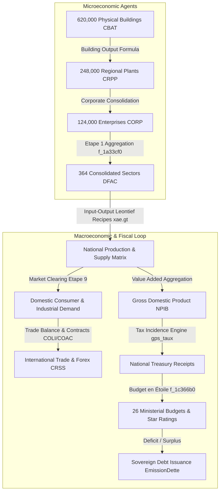
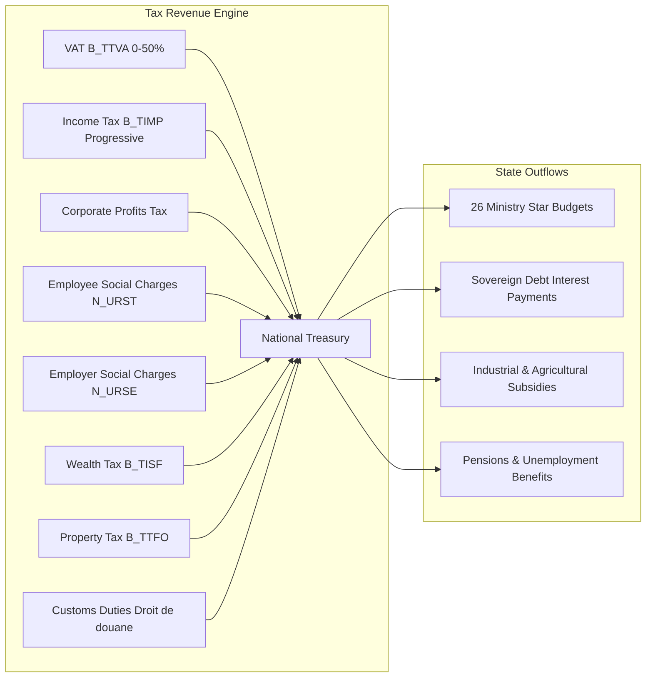
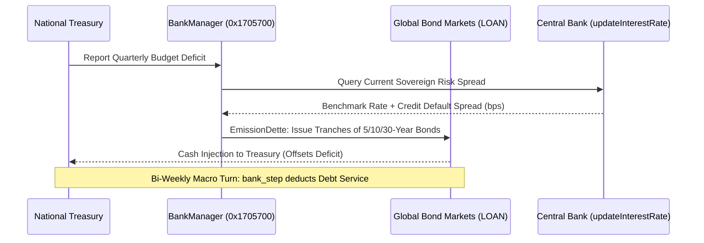

# Volume 2: Macroeconomic & Microeconomic Engine

---

## 1. Dual-Layer Economic Architecture

GPS5 uses a **two-tier economic simulation**:
1. A **bottom-up agent-based microeconomic foundation** comprised of 124,000 distinct enterprises (`CORP`), 248,000 regional production divisions (`CRPP`), and 620,000 physical buildings and industrial plants (`CBAT`).
2. A **top-down Leontief general equilibrium macro-structure** containing 364 consolidated sectors (`DFAC`), international commodity clearing markets, sovereign fiscal accounting, and monetary interest-rate feedback loops.

---

## 2. Microeconomic Production Engine

### 2.1 Entity Structures & Linkages
- **Enterprises (`CORP`)**: Stride `0x1f60` (8,032 bytes), array pointer in `.data`.
  - Offset `+0x68`: Sovereign nation index of corporate domicile ($0 .. 299$).
  - Offset `+0x6a`: Primary activity/sector ID ($1 .. 364$).
  - Offset `+0x78`: Cash reserves & liquid treasury.
  - Offset `+0x80`: Total debt obligations.
  - Offset `+0x90`: Total workforce headcount.
  - Offset `+0x98`: Ownership flags (private, state-owned, foreign subsidiary, listed on Bourse).
- **Production Plants (`CRPP`)**: Stride `0x1cc0` (7,360 bytes).
  - Offset `+0x4`: Parent enterprise index (`CORP`).
  - Offset `+0x10`: Aggregate plant physical output capacity.
  - Offsets `+0x20` .. `+0x4d0`: 300-nation distribution allocation array.
- **Physical Buildings (`CBAT`)**: Stride `0x68` (104 bytes), 620,000 instances.
  - Offset `+0x4`: Linked spatial unit on map (`UNIT` pointer).
  - Offset `+0x10`: Building archetype (`DCBA`, e.g., coal plant, steel mill, farm).
  - Offset `+0x28`: Production variable slot reference index.
  - Offset `+0x58`: Plant efficiency / technology scale coefficient.

### 2.2 Building Output Formula
In `f_9bc150` (called during Etape 1's aggregation), the output of building $i$ is calculated as:
$$\text{Output}_{i} = \text{var}(\text{slot}_{i} + 0\text{x}58) \times \text{var}(\text{slot}_{i} + 0\text{x}28) \times \Phi(\text{unit}_{i})$$

Where the operational status multiplier $\Phi(\text{unit}_{i})$ is evaluated by `f_9df600`:
$$\Phi(\text{unit}_{i}) = \begin{cases} 
1.0 & \text{if linked map unit exists, is alive, and not under strike/siege} \\
0.0 & \text{if destroyed, occupied, or severed from input supply} \\
\alpha \in (0, 1) & \text{if partially damaged or operating under labor strikes}
\end{cases}$$

### 2.3 Sectoral Supply Aggregation (`f_1a33cf0`)
During Etape 1, the total domestic production $Q_{\text{dom}}(n, s)$ for nation $n$ and sector $s$ is summed over the active linked building list:
$$Q_{\text{dom}}(n, s) = \sum_{c \in \text{Corps}(n, s)} \sum_{b \in \text{Buildings}(c)} \text{Output}_{b}$$
This value is written directly into the nation's sector sub-record at:
$$\text{Address} = \text{NationBase}(n) + 0\text{xcbc8} + s \times 0\text{x}4068$$

---

## 3. The 364 Economic Sectors & Leontief Input-Output Recipes

The archetype definition for each activity is loaded from the decrypted design table `data/gt/xae.gt.tsv`. Each sector row specifies technical production coefficients:

| Sector Code | Full Description | Category | Base Pre-Tax Price (`Prix HT`) | Labor Ratio (`Personnel`) | Input Recipe Formula (`Produit`) | Quality Booster (`Booster`) | Investment Capacity (`Invest`) |
| :--- | :--- | :--- | :--- | :--- | :--- | :--- | :--- |
| `EMPC` | Conventional Crude Oil | Energy | \$407.70 / toe | 0.00010 / unit | $\mathtt{ECO2} + \mathtt{@270}$ | $\mathtt{RDIN} + \mathtt{ICME} \times 0.2$ | $\mathtt{YBAT} + \mathtt{ICME} \times 10 + \mathtt{TAXP}$ |
| `EMPN` | Unconventional Oil | Energy | \$400.00 / toe | 0.00010 / unit | $\mathtt{ECO2} + \mathtt{@400}$ | $\mathtt{RDIN} + \mathtt{ICME} \times 0.2$ | $\mathtt{YBAT} + \mathtt{ICME} \times 10 + \mathtt{TAXP}$ |
| `EMGC` | Natural Gas | Energy | \$240.00 / toe | 0.00010 / unit | $\mathtt{ECO2} + \mathtt{@440}$ | $\mathtt{RDIN} + \mathtt{ICME} \times 0.2$ | $\mathtt{YBAT} + \mathtt{ICME} \times 10 + \mathtt{TAXP}$ |
| `EENU` | Nuclear Electricity | Energy | \$120.00 / MWh | 0.00008 / unit | $\mathtt{MINU} \times 0.15 + \mathtt{EAW} \times 0.05$ | $\mathtt{RDEN} \times 0.5$ | $\mathtt{YBAT} + \mathtt{TAXP}$ |
| `AGBL` | Wheat / Cereals | Agriculture | \$180.00 / ton | 0.00025 / unit | $\mathtt{NMPL} \times 0.3 + \mathtt{CHIM} \times 0.1$ | $\mathtt{RDAG} \times 0.4$ | $\mathtt{AGRI} \times 1.2$ |
| `INAC` | Steel & Metallurgy | Industry | \$650.00 / ton | 0.00015 / unit | $\mathtt{MINF} \times 0.6 + \mathtt{CHAR} \times 0.4$ | $\mathtt{RDIN} \times 0.3$ | $\mathtt{YBAT} \times 2.0$ |
| `INAU` | Automobile Assembly | Industry | \$18,500 / unit | 0.02500 / unit | $\mathtt{INAC} \times 0.3 + \mathtt{ELEC} \times 0.25$ | $\mathtt{RDIN} \times 0.8$ | $\mathtt{YBAT} \times 1.5$ |

### 3.1 Input Constraint & Capacity Throttling
For any sector $j$ requiring intermediate inputs from sectors $i \in \{1 \dots M\}$ with stoichiometric recipe requirements $a_{ij}$:
$$\text{Intermediate Demand } D_{\text{int}}(i, j) = a_{ij} \times Q_{\text{target}}(j)$$

If domestic supply and imports cannot satisfy intermediate demand:
$$\text{Supply Bottleneck Factor } \beta_{j} = \min_{i} \left( \frac{\text{Supply}(i)}{\sum_{k} a_{ik} Q_{\text{target}}(k)} \right)$$
When $\beta_{j} < 1.0$, the engine throttles realized production:
$$Q_{\text{realized}}(j) = Q_{\text{target}}(j) \times \beta_{j}$$
Unsatisfied demand cascades through the supply chain, triggering inflation and capacity idleness.

---

## 4. Public Finance, Taxation & Fiscal Incidence

Fiscal policy is handled by `gps_taux.cpp` (`0x23e8e70`) and `init_taxe` (`0x1c904b0`). Taxes are divided into direct receipts, indirect transactional levies, and pigouvian penalties:

### 4.1 Value-Added Tax (VAT / `B_TTVA`)
VAT is an ad-valorem tax applied on domestic household and final service consumption:
$$\text{VAT Receipts} = \tau_{\text{vat}} \times \sum_{s=1}^{364} \left( Q_{\text{conso}}(s) \times P_{\text{ht}}(s) \right)$$
- **Elasticity Penalty**: Raising $\tau_{\text{vat}}$ reduces final domestic demand according to price elasticity:
  $$Q_{\text{conso}}(s, \tau_{\text{vat}}) = Q_{\text{conso}}(s, 0) \times \left(1 - \epsilon_{s} \cdot \tau_{\text{vat}}\right)$$
  Where $\epsilon_{s} \approx 0.4$ for food/energy and $\approx 1.2$ for luxury manufacturing.

### 4.2 Corporate Income Tax (`IS`) & Profit Distribution
For enterprise $c$, taxable profit $\Pi_{c}$ is calculated after deducting intermediate inputs, depreciation, labor wages, and social charges:
$$\Pi_{c} = \text{Revenue}_{c} - \text{Inputs}_{c} - \text{Wages}_{c} - \text{SocialCharges}_{c} - \text{Interest}_{c}$$
$$\text{Tax Collected}_{c} = \max(0, \Pi_{c} \times \tau_{\text{corp}})$$
- **Corporate Retained Earnings**: $\Pi_{\text{net}} = \Pi_{c} - \text{Tax Collected}_{c}$.
- A fraction $\delta_{\text{div}} \approx 0.40$ is distributed as dividends to shareholders (affecting billionaire wealth and household disposable income); the remainder funds corporate reinvestment (`Invest`).

### 4.3 Social Security Contributions (`N_URST` & `N_URSE`)
- **Employee Contribution (`N_URST`)**: Deducted from gross salary $W_{\text{gross}}$, yielding net disposable wage:
  $$W_{\text{net}} = W_{\text{gross}} \times (1 - \tau_{\text{urst}})$$
- **Employer Contribution (`N_URSE`)**: Surcharge on total payroll paid by the enterprise:
  $$\text{Total Labor Cost} = W_{\text{gross}} \times (1 + \tau_{\text{urse}})$$
Excessive $\tau_{\text{urse}}$ raises marginal labor cost above marginal productivity, directly causing corporate layoffs during Etape 12 (`plansociaux`).

---

## 5. Ministerial Budgets & The "Budget en Étoile" (Stars System)

State expenditures are structured across 26 ministerial domains (Education `MEDU`, Defense `MDEFN`, Healthcare `MSAN`, Justice `MJUS`, Research `MREC`, Environment `MENV`, etc.).

### 5.1 Non-Linear Star Budget Curves (`f_1c366b0` / `f_1ca0690`)
The game abstracts ministerial effectiveness into a **0 to 10 Star rating system** ($\mathtt{Etoile} \in [0.0, 10.0]$). The budgetary cost to achieve and sustain star level $S$ is non-linear and exhibits severe diminishing marginal returns:

$$\text{Budget}(S) = \text{PopBase} \times K_{\text{domain}} \times \left( \frac{S}{10 - S + \delta} \right)^{\gamma}$$

Where:
- $\text{PopBase} = \mathtt{NATI.POPU} \times \text{PerCapitaMultiplier}$.
- $K_{\text{domain}}$ is the domain baseline unit cost coefficient.
- $\gamma \approx 1.8$ creates steep asymptotic cost scaling as $S \to 10.0$.

### 5.2 Temporal Smoothing & Election Damping
Budgetary allocations do not translate immediately into performance stars. The engine applies an exponential lag smoother in `f_23f1c80` (`get_valeur_etoile_lisse`):
$$S_{\text{effective}}(t) = S_{\text{effective}}(t - 1) + \lambda \cdot \left( S_{\text{target}} - S_{\text{effective}}(t - 1) \right)$$
Where $\lambda \approx 0.05$ per macro-turn.

Furthermore, as revealed in `calc_budget_etoile` (`decomp/d_01c.c:40751`), the minister's personal traits and the electoral cycle actively distort budgetary efficiency:
$$\text{Efficiency Multiplier } E = \left(15 - \text{MinisterHonesty}\right) \times \frac{\text{TimeUntilElection}}{\text{ElectionCycle}}$$
Corrupt or incompetent ministers siphon allocated funds, reducing effective output and requiring higher fiscal expenditures to maintain identical service levels.

---

## 6. Sovereign Debt, Bond Issuance & Central Banking

The financial system is orchestrated by the `BankManager` singleton (`0x1705700`):

### 6.1 Debt Accumulation & Sovereign Rating
When national expenditures exceed fiscal revenues:
$$\text{Deficit} = \sum \text{Expenditures} + \text{DebtService} - \sum \text{Taxes}$$
If $\text{Deficit} > 0$, `EmissionDette` (`0x1705700`) generates new debt tranches in the `LOAN` pool (stride `0xec`, 20,000 slots):
$$\text{DebtRatio} = \frac{\text{Total Sovereign Debt}}{\text{GDP (NPIB)}}$$

### 6.2 Interest Rate Determination (`updateInterestRate` / `0x170fd40`)
The interest rate $R_{\text{sovereign}}$ demanded by international investors on newly issued bonds is:
$$R_{\text{sovereign}} = R_{\text{global}} + \text{RiskPremium}(\text{DebtRatio}) + \text{InflationPremium}(\mathtt{INFL}) + \text{InstabilityFactor}$$

Where:
$$\text{RiskPremium} = \begin{cases} 
0.01 \cdot \text{DebtRatio} & \text{if DebtRatio} \le 0.60 \\
0.01 \cdot \text{DebtRatio} + 0.08 \cdot (\text{DebtRatio} - 0.60)^{2} & \text{if DebtRatio} > 0.60 
\end{cases}$$
If $\text{DebtRatio} > 1.20$ (120% of GDP), the exponential penalty creates a sovereign debt spiral, triggering credit rating downgrades, currency depreciation, and IMF intervention prompts.

---

## 7. Macroeconomic Equilibrium & Indicators

At the conclusion of each economic turn (`calc_monde_fin_tour`), macro aggregates are updated:
- **Gross Domestic Product (`NPIB` at `+0x621768`)**:
  $$\text{GDP} = \sum_{s=1}^{364} \left( \text{ValueAdded}(s) \right) + \text{Taxes}_{\text{indirect}} - \text{Subsidies}$$
- **Inflation Rate (`INFL` at `+0xc5c0`)**:
  $$\Delta \text{INFL} = \theta_{1} \cdot \left(\frac{\Delta \text{MoneySupply}}{\text{MoneySupply}} - \frac{\Delta \text{RealGDP}}{\text{RealGDP}}\right) + \theta_{2} \cdot \Delta P_{\text{energy}} + \theta_{3} \cdot \Delta W_{\text{smig}}$$
- **Dollar Exchange Rate (`CRSS` at `+0xc594`)**:
  Adjusted according to trade balance surpluses/deficits:
  $$\text{CRSS}(t) = \text{CRSS}(t-1) \times \left(1 - \psi \cdot \frac{\text{Exports} - \text{Imports}}{\text{GDP}}\right)$$
  Depreciation boosts export price competitiveness in `IAContrats` while increasing domestic imported inflation.
