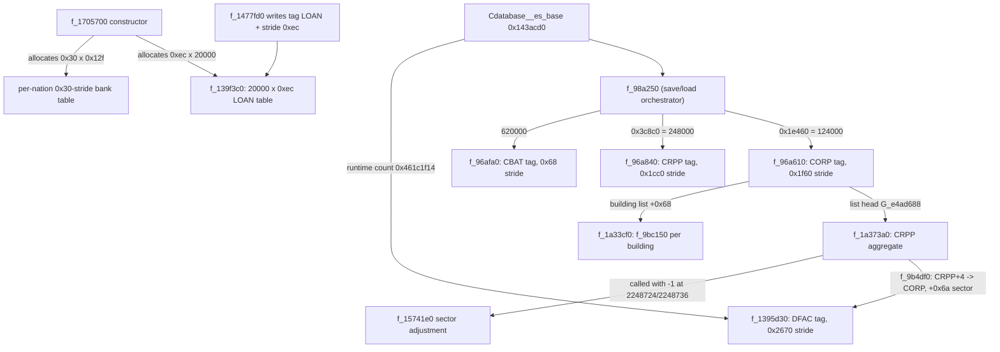
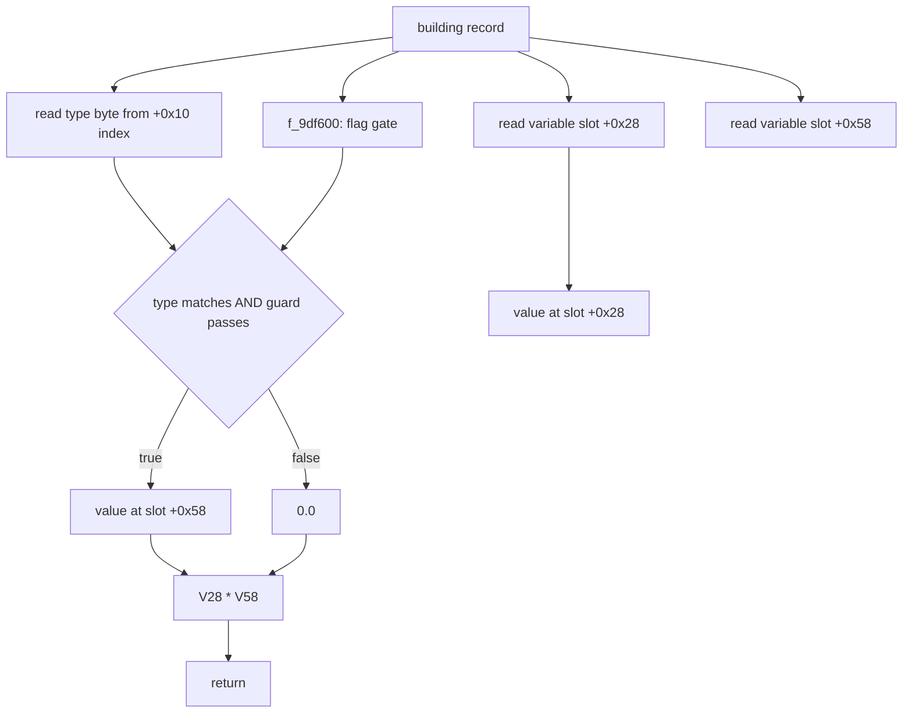
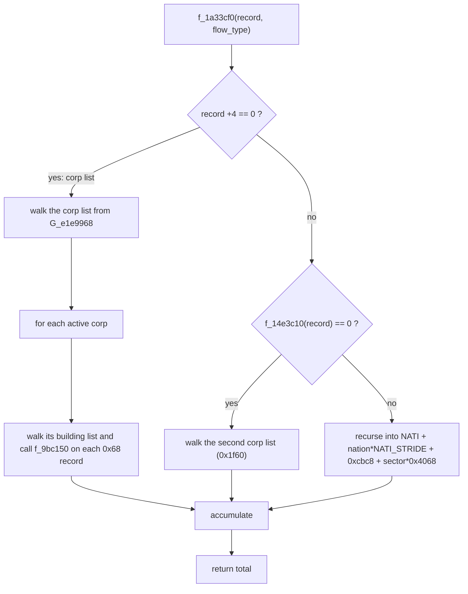
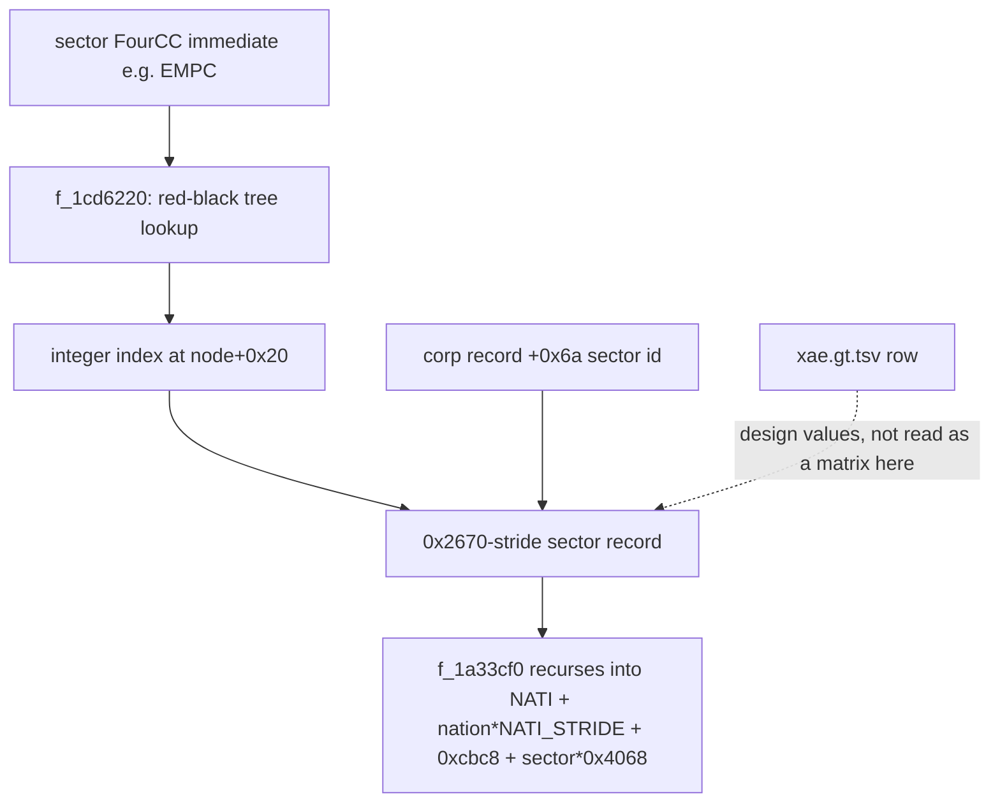
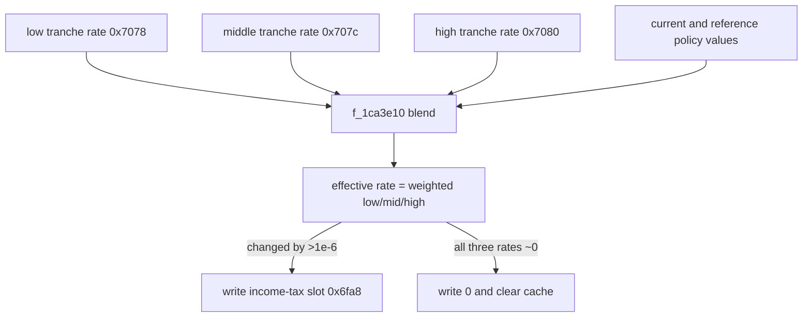
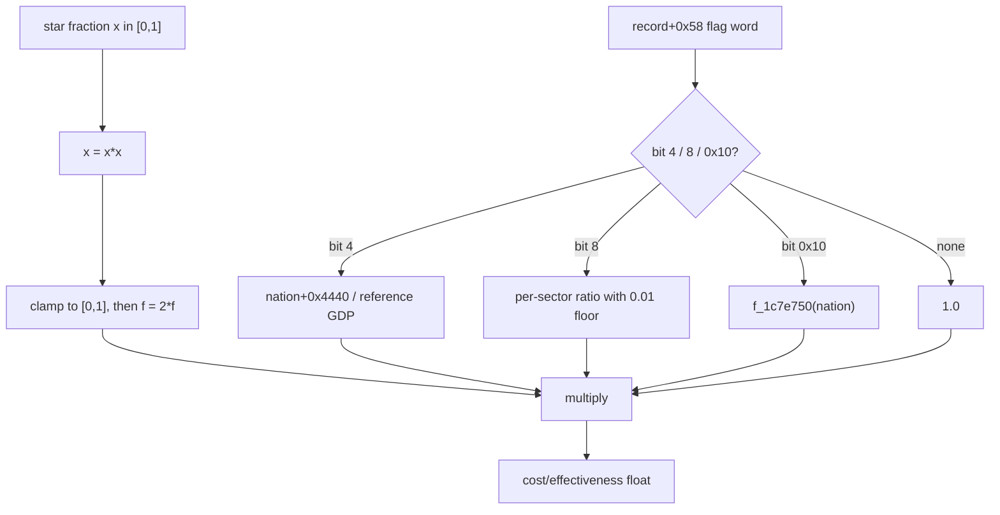
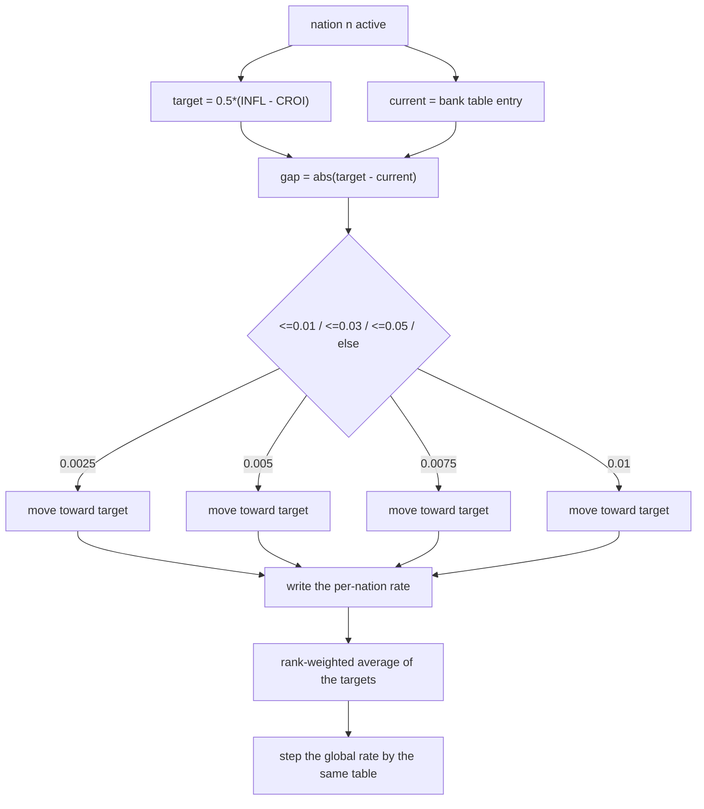
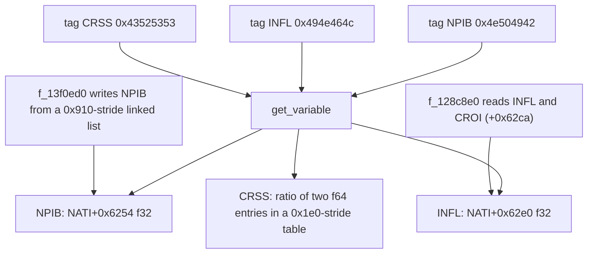

# Volume 2: Macroeconomic & Microeconomic Engine

---

This volume was rewritten against `recomp/full_fns.clean.c` (D-001) and follows the
D-016 pseudocode standard: each block is a plain-English algorithm, not decompiler C,
and ends with an evidence footer naming the function, RVA and corpus lines. Raw
decompiler excerpts live in `_whitepaper/evidence/02_CLAIMS.md`.

A mechanism is described only when the corpus contains the arithmetic, and a
data-table parameter is described only when a row of `data/gt/*.tsv` contains it.
Where the previous text asserted a named economic model that the corpus does not
compute, the model is removed and the text says what the code does instead. Every
surviving numeric anchor uses one of the D-002 / D-008 / D-010 classes:

- `[fn 0x... name]` — RVA has a `// ==== <rva> <name>` header;
- `[global 0x... type]` — RVA appears in a `// GLOBALS` line;
- `[tag 0x... "XXXX"]` — four-character immediate with at least one comparing function;
- `[qty 0x... ...]` — numeric literal / stride / count;
- `[data <file> "<key>"]` — first-column key in a shipped `data/gt/*.tsv` table;
- `[field 0x... in <TYPE>]` — displacement from a base pointer in a cited function.

The old labels `CORP`, `CRPP`, `CBAT` and `DFAC` are the four-character save-block
tags written by their serializers (see the table below); they name blocks, not a
production hierarchy. Throughout this volume `NATI_STRIDE` means
`[qty 0x645310 stride]`, the per-nation record spacing.

---

## 1. What the corpus contains: five tagged blocks and real cross-links

The economy is backed by five large serialized blocks. Their sizes come from the
loaders, the serializer tags and the save-block record sizes.

| Block tag | Records | Record size | Bytes | Evidence |
| :--- | ---: | ---: | ---: | :--- |
| `[tag 0x434f5250 "CORP"]` | 124,000 | `0x1f60` = 8,032 | 995,968,000 | serializer `[fn 0x145c5d0 f_145c5d0]` writes the tag and stride `0x1f60` at corpus 2093297-2093298; loader `[fn 0x96a610 f_96a610]`, called with `[qty 0x1e460 124000]` from `f_98a250` at corpus 236307 |
| `[tag 0x43525050 "CRPP"]` | 248,000 | `0x1cc0` = 7,360 | 1,825,280,000 | serializer `[fn 0x9a2490 f_9a2490]` writes the tag and stride `0x1cc0` at corpus 254822-254823; loader `[fn 0x96a840 f_96a840]`, called with `[qty 0x3c8c0 248000]` at corpus 236376 |
| `[tag 0x43424154 "CBAT"]` | 620,000 | `0x68` = 104 | 64,480,000 | serializer `[fn 0x9a3d20 f_9a3d20]` writes the tag and stride `0x68` at corpus 255518-255519; loader `[fn 0x96afa0 f_96afa0]`, called with `620000` at corpus 236644 |
| `[tag 0x44464143 "DFAC"]` | 364 in the shipped block | `0x2670` = 9,840 | 3,581,760 | serializer `[fn 0x1463940 f_1463940]` writes the tag and stride `0x2670` at corpus 2097048-2097049; loader `[fn 0x1395d30 f_1395d30]`, call at corpus 2075614 uses the runtime count `[global 0x461c1f14 i32]`, not a literal |
| `[tag 0x4c4f414e "LOAN"]` | 20,000 | `0xec` = 236 | 4,720,000 | serializer `[fn 0x1477fd0 f_1477fd0]` writes the tag and stride `0xec` at corpus 2108728-2108729; loader `[fn 0x139f3c0 f_139f3c0]`, called with `20000` at corpus 2065175 |

The counts are literal arguments at the call site (and each block also has an
explicit serializer tag and stride), so they are quantities, not inferences:

- the CORP loader is called with `[qty 0x1e460 124000]`;
- the CRPP loader is called with `[qty 0x3c8c0 248000]`;
- the CBAT loader is called with 620,000 decimal;
- the LOAN loader is called with 20,000 decimal.

The old `DFAC` count is *not* a code constant. `Cdatabase__es_base`
(`[fn 0x143acd0 Cdatabase__es_base]`) calls the DFAC loader with
`[global 0x461c1f14 i32]`. The same global is reset to `0x17c` (380) in
`f_1cbac20` at corpus line 3345956, and `Cdatabase__es_base` initialises entries up
to `0x17c` at corpus line 2075618. The 364 value is only the record count implied by
the shipped serialized block (3,581,760 / 9,840). The corpus therefore does not
establish "364 sectors"; it establishes a 364-record save block and a runtime sector
count whose reset value is 380.

### 1.1 The CORP→CRPP and CORP→CBAT links are real

`[fn 0x1a373a0 f_1a373a0]` (corpus 2934493) is a CRPP aggregator. For a corp-level
record it walks the corp list (`0x1f60` records) and, for each active corp, follows
the list head at `G_e4ad688` into `0x1cc0`-stride CRPP records. The loop bound is 247,999 on `i-1`, i.e. at most the serialized block's 248,000
CRPP records, and it sums
`f_9b4df0` over each matching CRPP record.

`[fn 0x9b4df0 f_9b4df0]` (corpus 265850) resolves the link back: it takes the
CRPP record's `+4` value, multiplies it by `0x1f60`, adds the CORP array base to get
the owning CORP, then reads the CORP's sector id at `+0x6a` (corpus 265859-265861),
tests the sector code, and multiplies the CRPP's `+0x10` by a per-nation-sector
factor at `NATI + nation*NATI_STRIDE + 0xcbc8 + sector*0x4068`.
This is a real CORP↔CRPP↔sector link.

The consumer is `[fn 0x15741e0 f_15741e0]`: it calls
`f_1a373a0(nation + sector*0x4068 + 0xcbc8, -1)` at corpus 2248724 and 2248736
while distributing a sector capacity adjustment. The CRPP array base `[global 0xe783f90 i64]` has 635 references in the corpus.

The CORP→CBAT link is in `f_1a33cf0`: it walks a corp's building list and calls
`f_9bc150` on `0x68`-stride records. The old four-tier *ordering*
(`CBAT -> CRPP -> CORP -> DFAC`) is still unproven, but the two links are not absent.



```pseudocode
The save system writes five blocks, each with a four-character tag and a record
stride. The loaders receive the record count from the caller.

for each block in [CORP, CRPP, CBAT, DFAC, LOAN]:
    write its tag and stride to the save stream
    load its records with the given count

CORP: 124,000 records of 8,032 bytes   (count is a literal at the call site)
CRPP: 248,000 records of 7,360 bytes  (count is a literal at the call site)
CBAT: 620,000 records of 104 bytes    (count is a literal at the call site)
DFAC: runtime sector count, stride 9,840 bytes
LOAN: 20,000 records of 236 bytes

The shipped DFAC block is 364 records long, but the runtime count is the global
sector count, reset to 380. "364 sectors" is therefore a save-file fact, not a
game constant.
```
> Evidence: `f_98a250` [fn 0x98a250], corpus 236307/236376/236644; `Cdatabase__es_base` [fn 0x143acd0], corpus 2075614; `f_1cbac20` [fn 0x1cbac20], corpus 3345956; `f_1477fd0` [fn 0x1477fd0], corpus 2108728-2108729; serializers `f_145c5d0`/`f_9a2490`/`f_9a3d20`/`f_1463940`.

### What the code does not establish

- The old four-tier *ordering* (`CBAT -> CRPP -> CORP -> DFAC`) is not proven. The
  code links CORP to CRPP (`f_1a373a0` / `f_9b4df0`) and CORP to CBAT (`f_1a33cf0`),
  and indexes a sector record from a CORP's `+0x6a`; it does not show a CRPP stage
  feeding a CORP stage in that order.
- The old "364 consolidated sectors" is not a constant. The loader is called with
  `[global 0x461c1f14 i32]`; the save block happens to be 364 records and the reset
  value is 380.
- The tags name serialized blocks. They do not, by themselves, define the economic
  role of each block.

---

## 2. Microeconomic production: a gated flow accessor, plus two documented exp/pow paths

### 2.1 `f_9bc150`: two variable-store reads and one boolean gate

`[fn 0x9bc150 f_9bc150]` (corpus 269438) is the building-level quantity accessor used
by the aggregator. It reads two variable-store slots of the record, `+0x28` and
`+0x58`, and multiplies them. The `+0x58` term is zero unless the building kind is neither 4 nor 6, the
building's type byte equals the caller's type argument, and `f_9df600` returns
non-zero. There is no
capacity, worker count, modernity or health coefficient in this function.



```pseudocode
function building_flow(building, requested_type):
    kind = type_of_building(building)                  // byte read through +0x10
    gated = 0
    if kind is neither 4 nor 6:                        // guard (kind-4)&0xfd != 0
        if kind == requested_type and operational(building):
            gated = read_variable_slot(building + 0x58)
    base = read_variable_slot(building + 0x28)
    return base * gated
```
> Evidence: `f_9bc150` [fn 0x9bc150], corpus 269438-269467; guard `(kind-4)&0xfd`, slots `+0x28`/`+0x58`, gate `f_9df600`.

### 2.2 `f_9df600`: the gate is a bit-flag/activity test

`[fn 0x9df600 f_9df600]` (corpus 290942) does not test "alive, strike or siege". It
tests a flag byte, then treats the building's `+0x04` value as an index into a
`0x750`-stride activity array. It masks the 64-bit flag word with a 40-bit value
written `0x8000380000` (10 hex digits, so not a cite.py-resolvable 5-8-digit token)
and tests callbacks with masks `[qty 0x10000 mask]` and `[qty 0x4000000 mask]`, plus
the activity flag byte read through the separate global `G_61d0df48` at corpus
290962 (not a `+0x08` displacement). The economic meaning of those bits is not
established by the corpus.

```pseudocode
function operational(building):
    if (flag_byte(building + 0x50) & 0x11) != 0:
        return false
    activity = int_at(building + 0x04)
    if activity < 1:
        return true
    flags = 64_bit_word(activity * 0x750)               // activity array
    if (flags & 0x8000380000) == 0:                     // 40-bit mask, 10 hex digits
        if (flags & 0x80000000) != 0:
            if callback(activity, 0x10000) is false:
                return false
        if (activity_flag_byte(activity) & 8) == 0:      // separate flag array, 290962
            if callback(activity, 0x4000000) is false:
                return true
    return false
```
> Evidence: `f_9df600` [fn 0x9df600], corpus 290942-290964; 40-bit mask 0x8000380000, masks [qty 0x80000000 mask], [qty 0x10000 mask], [qty 0x4000000 mask]; activity stride 0x750; flag byte via G_61d0df48 at 290962.

### 2.3 `f_1a33cf0`: sector aggregation by linked lists and recursion

`[fn 0x1a33cf0 f_1a33cf0]` (corpus 2932439) is called from
`calc_monde_debut_tour_etapes` (`[fn 0x1409f40 calc_monde_debut_tour_etapes]`, call
at corpus 2046045) and sums `f_9bc150` over a corp-linked list of buildings. For a
nation-level record it recurses into the sector sub-record at
`NATI + nation*NATI_STRIDE + 0xcbc8 + sector*0x4068`. It does not walk CRPP; the
CRPP aggregate is `f_1a373a0` (section 1.1).



```pseudocode
function sector_total(record, flow_type):
    total = 0
    if short_at(record + 4) == 0:                       // corp-level record
        corp = first_corp_in_sector_list(record)
        while corp exists:
            if nation_slot(corp, 0x2f0) != 0 and is_active(corp):
                building = first_building_of(corp)
                while building exists:
                    total = total + building_flow(building, flow_type)
                    building = next_building(building)
            corp = next_corp(corp)
    else if f_14e3c10(record) != 0:
        sub = first_sector_subrecord(record)            // 0x4068 stride at +0xcbc8
        while sub exists:
            total = total + sector_total(sub, flow_type)
            sub = next_sector_subrecord(sub)
    else:
        corp = first_corp_in_second_list()              // 0x1f60 records
        while corp exists:
            if is_active(corp):
                building = first_building_of(corp)
                while building exists:
                    total = total + building_flow(building, flow_type)
                    building = next_building(building)
            corp = next_corp(corp)
    return total
```
> Evidence: `f_1a33cf0` [fn 0x1a33cf0], corpus 2932439-2932550; building call `f_9bc150`; recursion offset `0xcbc8 + sector*0x4068`; called from `calc_monde_debut_tour_etapes` [fn 0x1409f40], corpus 2046045.

### 2.4 `f_15741e0`: a sector-capacity smoothing path with `exp` and `sqrt`

`[fn 0x15741e0 f_15741e0]` (corpus 2248652) is called from
`calc_monde_debut_tour_etapes` at corpus 2047786. It walks the `0x2670`-stride sector
array. For a sector whose current quantity is below its target it computes a
smoothing factor `exp((0.5 - current/target)*8.0)` and
`sqrt(current/target)/0.982`, uses it to reduce the previous capacity, distributes
the change across nations weighted by GDP (`+0x4428`), and, when the CRPP flag is
set, compares the distributed amount with `10 * f_1a373a0(nation+sector, -1)` and
redistributes the gap. This is a sector capacity/supply adjustment, not a
per-building production equation.

```pseudocode
function adjust_sector_capacity():
    for each sector in 1 .. sector_count:               // 0x2670-stride sector array
        if sector is flagged and (current != 0 or supply >= 1e-6) and current < target:
            old_capacity = sector.capacity
            current = current + price_index()           // current price index
            if current < target:
                smooth = exp((0.5 - current/target) * 8.0)       // 8.0 at 2248687
                scale = sqrt(current/target) / 0.982             // 0.982 at 2248689
                old_capacity = (1 / (1 + smooth)) * scale * old_capacity
            distribute old_capacity across active nations by GDP
            if the CRPP flag is set:
                crpp_total = crpp_aggregate(nation + sector*0x4068 + 0xcbc8, -1)
                if 10 * crpp_total < distributed:
                    redistribute the gap
            sector.total = sector.total + distributed
```
> Evidence: `f_15741e0` [fn 0x15741e0], corpus 2248652-2248748; `exp` at 2248687, `sqrt`/0.982 at 2248688-2248689; `f_1a373a0` calls at 2248720, 2248724 and 2248736; called from `calc_monde_debut_tour_etapes` [fn 0x1409f40], corpus 2047786.

### 2.5 `f_158c1f0`: a policy-driven per-sector compounding with `pow`

`[fn 0x158c1f0 f_158c1f0]` (corpus 2261789), called at corpus 2047778 in the same
tick, adjusts a per-sector quantity. It has two branches. When the policy variable
changes it builds a slope/offset from the old and new policy values and the cap,
applies it to the `0x2034`-stride sector quantities, floors each at `new_policy*12`,
and posts a `CR43` event. When the inflation field is non-zero it computes
`factor = pow(1 + 0.9*input, exponent)` at corpus 2262035 and 2262037, then a
slope/offset from the factor and cap at 2262039-2262046, and applies the factor (or
the linear multiplier below the cap) to each sector quantity.

```pseudocode
function compound_sector_quantity(nation):
    if nation is not active: return
    old_policy = field(nation + 0x310bfc)
    new_policy = read_policy_slot(nation + 0x310bfa)

    if new_policy differs from old_policy by more than 1e-14:
        reference = old_policy * 12
        if reference is tiny: reference = field(nation + 0x24ac)
        cap = field(nation + 0x24be) * reference
        slope = ((old_policy - new_policy) * 12) / (cap - old_policy*12)  // 2261868-2261875
        offset = (new_policy - old_policy)*12 - slope * old_policy*12
        for each sector in 1 .. sector_count:
            value = sector_quantity(sector)             // 0x2034 array
            if value < cap: value = value*slope + offset + value
            sector_quantity(sector) = max(value, new_policy*12)
        post CR43
        store new_policy in +0x310bfc

    if abs(field(nation + 0x62de)) > 1e-06:
        reference = new_policy * 12
        if reference is tiny: reference = field(nation + 0x24ac)
        cap = field(nation + 0x24be) * reference
        input = inflation_adjustment(...)               // f_137a850 / f_137a960
        factor = pow(1 + 0.9*input, price_index_exponent)  // 0.9 at 2262033; pow 2262035/2262037
        if new_policy*12 != cap:
            slope = (factor - 1) / (cap - new_policy*12)   // 2262039-2262046
            offset = 1 - slope * new_policy*12
        for each sector in 1 .. sector_count:
            value = sector_quantity(sector)
            multiplier = factor
            if value < cap: multiplier = value*slope + offset
            sector_quantity(sector) = value * multiplier
```
> Evidence: `f_158c1f0` [fn 0x158c1f0], corpus 2261789-2262100; policy slope/offset at 2261868-2261875; `pow` at 2262035 and 2262037, 0.9 at 2262033, slope/offset at 2262039-2262046; called from `calc_monde_debut_tour_etapes` [fn 0x1409f40], corpus 2047778.

### What the code does not establish

- `f_9bc150` and `f_1a33cf0` contain no `exp` or `pow`. There is no exponential
  capacity/workers/modernity/health production equation anywhere.
- The two `exp`/`pow` economic paths are the sector-capacity adjustment
  (`f_15741e0`) and the policy-driven compounding (`f_158c1f0`), both quoted above.
  They are not a per-building production function and they do not mention workers,
  modernity or health.
- The remaining `exp(` sites (2253838, 2268076, 2268077, 2273465) are in
  `f_157c040`, `f_15981d0` and `f_15a0f30`; `f_15981d0` is the factory quality/price
  coefficient quoted in section 3.3. The 37 `pow(` sites are not in `f_9bc150`,
  `f_1a33cf0` or `calc_monde_debut_tour_etapes`; the two economic ones are the
  `f_158c1f0` compounding above.

---

## 3. Sector records and the `xae.gt.tsv` table: per-sector lookup, not a Leontief matrix

### 3.1 What the table actually contains

`data/gt/xae.gt.tsv` has 118 columns, 456 non-blank data rows and 411 non-empty
first-column keys. Of those keys, 410 are four characters long: 359 are uppercase
forms (the sector/activity keys) and 51 are mixed-case variants such as `TKa2`. The
"359" is therefore the uppercase four-character subset, not the row count or the
total four-character count.

| Column (0-based) | Header (verbatim, shortened) | Meaning |
| :--- | :--- | :--- |
| 0 | `Code Secteur` | FourCC key |
| 11 | `Prix moyen HT $` | price (comma decimal) |
| 21 | `Personnel (nb/unit annuelle)` | labour ratio |
| 28 | `Produit` | input product code / `self` |
| 29 | `Formule 1` | input recipe string |
| 41 | `Booster (Qualité)` | quality booster expression |
| 43 | `Invest (Capacité de prod)` | capacity expression |

Two rows, quoted exactly from the table:

```
EMPC  price=407,705  personnel=0,0001  produit=EMPE  formule1=ECO2 + @270
      booster=RDIN+ICME*0.2  invest=YBAT+ICME*10+TAXP
EENU  price=380      personnel=0,00006 produit=EE+NDRA*1e-5
      formule1=TKNU*1+EMUR*103e-6 + ECO2 + @70
      booster=RDEN+RDIN+RDMA+ICME*0.2  invest=YBAT*10+ICME*100+TKNU*10000
```

The old row labelled `AGBL` is not a key in the table; `INAC` and `INAU` are also
absent. The old `EENU` price "120" is wrong (the row says 380), the old `EENU`
booster `RDEN × 0.5` is wrong, and the old `EENU` invest `YBAT + TAXP` is wrong.
`MDEFN` in the ministry list is likewise absent; the key is `MDEF`.

`[data xae.gt.tsv "EMPC"]` and `[data xae.gt.tsv "EENU"]` are the citations. This is
a data table, not a binary constant (D-008): none of `EMPC`, `EENU`, `ECO2`, `RDIN`
or `YBAT` occurs as a text key in the executable, although individual item codes
such as `[tag 0x45434f32 "ECO2"]` do occur as code immediates (22 hits, 16 comparing
functions).

### 3.2 The engine's sector map and per-sector record

`[fn 0x1cd6220 f_1cd6220]` (corpus 3360806) is a red-black-tree lookup keyed by an
integer; it returns the integer stored at tree node `+0x20`. Sector codes are passed
to it as immediates, e.g. `[tag 0x454d5043 "EMPC"]` at corpus 2219819 and
`[tag 0x45454e55 "EENU"]` at corpus 259607. The per-sector record is the
`0x2670`-stride block; `f_15981d0` indexes it as
`*(short *)(corp + 0x6a) * 0x2670 + G_4bbb8880` (corpus 2268040), i.e. by the corp's
sector id.



```pseudocode
function sector_index(code):
    node = root of the red-black tree
    while node is not a leaf:
        if node.key < code:
            node = node.right
        else:
            node = node.left
    if node is the root: return 0
    return int_at(node + 0x20)          // stored sector index
```
> Evidence: `f_1cd6220` [fn 0x1cd6220], corpus 3360806-3360828; tree node key at +0x1c, value at +0x20; `EMPC` call at 2219819, `EENU` call at 259607.

### 3.3 The one `1 - exp(-x)` near an economic quantity is a quality/price score

`[fn 0x15981d0 f_15981d0]` (corpus 2268034) computes a `[0,1]` coefficient used by
`f_1593b20` to build the `coef_qualite_prix_usine` score. It is not the production
equation.

```pseudocode
function factory_quality_price(corp, variant):
    sector = corp.sector_id                           // +0x6a
    nation = corp.nation_id                           // +0x68
    score = quality_input(sector, corp.type)          // f_1a37380
    if score == 0: return 1.0
    share = production_share(corp)                    // f_9aed20, clamped to [0,1]
    exponent = log(sector_double) * (share - 0.5)
    smooth = exp(2 * exponent)
    saturation = 1 - exp(-((1 / (1.2 * smooth)) * weighted_input) / score)  // 1.2 at 2268077
    result = min(saturation, 1.0)
    if result > 0.95: result = 1.0                    // 0.95 at 2268084
    return result
```
> Evidence: `f_15981d0` [fn 0x15981d0], corpus 2268034-2268088; `exp` at 2268076/2268077, 1.2 at 2268077, 0.95 snap at 2268084; used by `f_1593b20`.

### What the code does not establish

- No Leontief matrix. A Leontief model needs a read of row/column coefficients and a
  sum of coefficient-by-output products. The corpus contains neither a whole-row
  reader for `xae.gt.tsv` nor a function that multiplies one sector row by another
  sector's output. `f_1a33cf0` reads one sector record and recurses; it does not
  combine a matrix of sectors.
- No intermediate-demand product, no min-over-suppliers bottleneck factor and no
  realised-output throttle.
- The recipe strings (`ECO2 + @270`) are design data. The executable contains the
  individual item tags but not the recipe strings, so the corpus does not establish
  that the engine parses and evaluates `Formule 1` as a matrix row.

---

## 4. Public finance: a real three-tranche income tax, plus action-table parameters

### 4.1 The action rows and their first-column keys

Taxes are action rows in `data/gt/xan.gt.tsv`. The first-column key is the action id;
column 12 names the runtime variable (or is empty). The relevant rows are:

| Key | Column-12 cell | Meaning | Min | Max | Init |
| :--- | :--- | :--- | ---: | ---: | ---: |
| `[data xan.gt.tsv "211100"]` | `B_TTVA` | VAT | 0 | 0.5 | 0.196 |
| `[data xan.gt.tsv "211101"]` | (empty) | income-tax parent row | 0 | 0.5 | 0.12 |
| `[data xan.gt.tsv "211102"]` | `B_TISF` | wealth tax | 0 | 0.2 | 0.01 |
| `[data xan.gt.tsv "211111"]` | `N_URST` | employee social charges | 0 | 0.75 | 0.2 |
| `[data xan.gt.tsv "211112"]` | `N_URSE` | employer social charges | 0 | 0.75 | 0.4 |
| `[data xan.gt.tsv "211113"]` | `B_TTIS` | corporate tax | 0 | 0.75 | 0.34 |
| `[data xan.gt.tsv "211300"]` | `B_TIRL` | income tax, low tranche | 0 | 0.3 | 0.05 |
| `[data xan.gt.tsv "211301"]` | `B_TIRM` | income tax, middle tranche | 0 | 0.6 | 0.12 |
| `[data xan.gt.tsv "211302"]` | `B_TIRH` | income tax, high tranche | 0 | 0.9 | 0.41 |

`action_varmap.tsv` maps the actions to variable slots: `211101 -> 0x6fa8`,
`211300 -> 0x7078`, `211301 -> 0x707c`, `211302 -> 0x7080`. The parent row
211101 has an empty column-12 cell, but the action still maps to the effective-rate
slot 0x6fa8, which is the slot `f_1ca3e10` writes. `B_TTVA`, `B_TTIS`,
`N_URST`, `N_URSE`, `B_TIRL`, `B_TIRM` and `B_TIRH` are column-12 cells, not
first-column keys.

### 4.2 The effective income-tax rate: `f_1ca3e10`

`[fn 0x1ca3e10 f_1ca3e10]` (corpus 3330555) reads the three tranche rates from slots
`+0x7078` (low), `+0x707c` (middle) and `+0x7080` (high), blends them, and writes the
effective rate to the income-tax slot `+0x6fa8` (corpus 3330651 and 3330661). It
first checks whether all three rates are within `1e-6` of zero; if they are, it
writes zero to the effective-rate slot and returns.

The blend uses a policy/reference value:

- `average = 0.45*current + 0.55*reference` (corpus 3330612);
- `x = min(average, reference)`;
- `low_share = x / (4*reference)` (corpus 3330626);
- `mid_share = reference/(4*reference) - low_share` (derived ratio; corpus 3330627);
- `mid_rate = low*(x/reference) + (1 - x/reference)*middle` (corpus 3330628-3330630);
- `high_rate = low*low_share + (1 - low_share - mid_share)*high + mid_share*middle`
  (corpus 3330641-3330643);
- `effective = low*weight_low + mid_rate*weight_mid + high_rate*weight_high`
  (corpus 3330644-3330647).

The weights are the floats at `+0x7090`, `+0x7094` and `+0x7098`. The effective rate
is written to `+0x6fa8` only if it changed by more than `1e-6`.



```pseudocode
function update_effective_income_tax_rate(nation):
    low    = read_rate_slot(nation, 0x7078)
    middle = read_rate_slot(nation, 0x707c)
    high   = read_rate_slot(nation, 0x7080)

    if low, middle and high are all within 1e-6 of zero:
        write 0 to the effective-rate slot
        return

    reference = policy_reference_value(nation)        // f_153b580
    current   = policy_current_value(nation)          // f_1a37bb0
    average   = 0.45*current + 0.55*reference          // 0.45/0.55 at 3330612
    x         = min(average, reference)
    low_share = x / (4.0 * reference)                  // 4.0 at 3330626
    mid_share = reference/(4.0*reference) - low_share   // derived ratio, 3330627

    mid_rate  = low*(x/reference) + (1 - x/reference)*middle
    high_rate = low*low_share + (1 - low_share - mid_share)*high + mid_share*middle
    effective = low*weight_low + mid_rate*weight_mid + high_rate*weight_high

    if effective changed by more than 1e-6 from the cached value:
        write effective to income-tax slot 0x6fa8
        cache the new effective rate
```
> Evidence: `f_1ca3e10` [fn 0x1ca3e10], corpus 3330555-3330664; slots 0x7078/0x707c/0x7080 -> 0x6fa8; 0.45/0.55 at 3330612, 4.0 at 3330626, mid_share derived at 3330627; policy inputs `f_153b580`/`f_1a37bb0`; `action_varmap.tsv` rows 211101/211300/211301/211302.

### 4.3 The tax amount: `f_1bf00f0` and the class components

`[fn 0x1bf00f0 f_1bf00f0]` (corpus 3256401) computes the income-tax amount from the
three tranche rates. It reads the effective rate from `+0x6fa8`; if it is within
`0.0001` of zero it returns zero. Otherwise it reads the three tranche rates from
`+0x7078`/`+0x707c`/`+0x7080` (or the cached overrides at `+0xc340`/`+0xc344`/`+0xc348`),
computes three bracket shares and forms three additive groups:

- `q7 = powf(x/reference, 7.0)`;
- `q2 = powf(x/(4*reference), 2.0)`;
- `qhalf = powf(reference/(4*reference) - q2, 0.5)`;
- group A = `((1 - q2 - qhalf)*high + qhalf*middle + q2*low) * (4*reference*base*wh)`;
- group B = `(reference*base*wm) * ((1 - q7)*middle + q7*low)`;
- group C = `(x*base*wl) * low`;
- the low/middle/high weights are the floats at `+0x7090`/`+0x7094`/`+0x7098`, and
  the base is `+0x4918`;
- the total is `0x709c * 0x5748 * f_1beb9e0 * weight_override * (A + B + C)`.

`weight_override` is `1.0` unless `+0x799c <= 0`, in which case it is `+0x70a4`
(corpus 3256524-3256525). If `f_14e3e10()` returns true, `x`, `reference` and
`4*reference` each receive `+12*adjust` from slot `[field 0x621804 in NATI]` before the shares are
computed (corpus 3256452-3256467).

Two further class components use a different shape: `[fn 0x1bef3e0 f_1bef3e0]`
(class 6) and `[fn 0x1bf00b0 f_1bf00b0]` (class 9) compute
`f_1beb9e0(nation,class) * rate_field * |class_base| * GDP(+0x4428)`, where the rate
fields are `+0x79b0` and `+0x79bc`. `[fn 0x1bef780 f_1bef780]` (corpus 3256103) sums
a per-corp tax over the `0x1f60` corp list and scales by `+0x3866` and `f_1a36d20`.

```pseudocode
function income_tax_amount(nation):
    effective = read_rate_slot(nation, 0x6fa8)
    if |effective| < 0.0001:
        return 0

    low    = read_rate_slot(nation, 0x7078)
    middle = read_rate_slot(nation, 0x707c)
    high   = read_rate_slot(nation, 0x7080)
    base   = income_base(nation + 0x4918)
    wl = weight(nation + 0x7090)
    wm = weight(nation + 0x7094)
    wh = weight(nation + 0x7098)

    current   = policy_current_value(nation)          // f_1a37bb0
    reference = policy_reference_value(nation)        // f_153b580
    x = min(0.4*current + 0.6*reference, reference)   // 0.4/0.6 at 3256446
    four_ref = 4 * reference                          // 4.0 at 3256445
    if f_14e3e10() is true:
        adjustment = read_slot(nation + 0x621804) * 12
        x = x + adjustment
        reference = reference + adjustment
        four_ref = four_ref + adjustment

    q7    = powf(x / reference, 7.0)                  // 3256517
    q2    = powf(x / four_ref, 2.0)                   // 3256519
    qhalf = powf(reference / four_ref - q2, 0.5)      // 3256520

    groupA = ((1 - q2 - qhalf)*high + qhalf*middle + q2*low)
             * (four_ref * base * wh)
    groupB = (reference * base * wm) * ((1 - q7)*middle + q7*low)
    groupC = (x * base * wl) * low

    override = 1.0
    if field(nation + 0x799c) <= 0:
        override = field(nation + 0x70a4)             // 3256524-3256525
    population_factor = f_1beb9e0(nation, 1, ...)     // 3256527
    return 0x709c * 0x5748 * population_factor * override
           * (groupA + groupB + groupC)

function class_tax(nation, class):                       // classes 6 and 9
    rate = read_class_rate(nation, class)               // +0x79b0 / +0x79bc
    base = abs(class_base(nation, class))               // f_1bf1f70
    population_factor = f_1beb9e0(nation, class, ...)
    gdp = GDP(nation + 0x4428)
    return population_factor * rate * base * gdp
```
> Evidence: `f_1bf00f0` [fn 0x1bf00f0], corpus 3256401-3256533; q7 at 3256517, q2 at 3256519, qhalf at 3256520; groups A/B/C at 3256528-3256531; 0x799c/0x70a4 branch at 3256524-3256525; `f_14e3e10` adjustment at 3256452-3256467; class components `f_1bef3e0`/`f_1bf00b0` with GDP +0x4428 and `f_1beb9e0`; `f_1bef780` @ 3256103.

### 4.4 The budget chain in `f_157c040`

`[fn 0x157c040 f_157c040]` (corpus 2253535) calls the tax chain and subtracts each
amount from a budget base. The relevant calls are at corpus 2253595-2253660:

```pseudocode
function apply_taxes_to_budget(nation):
    budget = production_value(nation) * price_index * population_factor

    corporate = corporate_tax_total(nation)          // f_1bef780
    budget = budget - corporate * price_index

    income = income_tax_amount(nation)               // f_1bf00f0
    budget = budget - income * price_index

    update_effective_income_tax_rate(nation)         // f_1ca3e10

    budget = budget - other_tax(nation) * price_index   // f_1bf0750
    budget = budget - class6_tax(nation) * price_index  // f_1bef3e0
    budget = budget - class9_tax(nation) * price_index  // f_1bf00b0
    ...
    return budget
```
> Evidence: `f_157c040` [fn 0x157c040], corpus 2253535-2253660; calls at 2253592 (`f_1bef780`), 2253595 (`f_1bf00f0`), 2253597 (`f_1ca3e10`), 2253598 (`f_1bf0750`), 2253604 (`f_1bef3e0`), 2253610 (`f_1bf00b0`).

### What the code does not establish

- The code blends three tranche rates and applies a three-share polynomial. It does
  not expose explicit income bracket thresholds (for example "income > X"); the
  tranche *names* come from the data rows, while the weights `0x7090`/`0x7094`/`0x7098`
  are class shares. The volume therefore documents the implemented blend, not an
  invented schedule of cut-offs.
- No VAT receipt formula and no corporate profit/dividend formula were located. The
  rate variables exist and the income-tax chain is real; the arithmetic that turns
  VAT or corporate profit into receipts is still unsupported.
- `gps_taux.cpp` is not the name of `[fn 0x23e8e70 calc_incitation_etud_sup]`: that RVA is
  `[fn 0x23e8e70 calc_incitation_etud_sup]`, and its own `gps_taux.cpp` assert is at
  corpus 4547832. The `gps_taux.cpp` asserts in `f_23f1c80`/`f_23f1d40` are at
  corpus 4552175 and 4552249. The file attribution is real; the old claim that
  [fn 0x23e8e70 calc_incitation_etud_sup] was the tax function is not.

---

## 5. Ministerial budgets and the "Budget en Étoile" star system

### 5.1 The 26 ministry rows

`data/gt/xae.gt.tsv` contains 26 consecutive ministry-coded rows from `MFIN` through
`MSOC`: `MFIN, MIND, MTRA, MSAN, MINT, MJUS, MDEF, MEDU, MCUL, MSPO, MFAM, MTRN,
MENV, MAFE, MAGR, MLOG, MREC, MENE, MREL, MINF, MECO, MTOU, MPRO, MDIV, MSEC, MSOC`.
The old `MDEFN` key is absent; the table has `MDEF`. Cite the keys as
`[data xae.gt.tsv "MFIN"]` ... `[data xae.gt.tsv "MSOC"]`; the count is a table
property, not a code constant.

### 5.2 The actual star cost is quadratic, not a power curve

`[fn 0x1c388c0 f_1c388c0]` (corpus 3294872) is the cost/effectiveness factor used by
the budget functions. Its core is:

```
x = x * x;
f = (x <= 0) ? 0 : (x <= 1 ? x : 1);
f = f + f;                                  // 2 * clamp(x^2, 0, 1)
```

It then multiplies by a finite positive ratio selected from the record's flag word
`*(u64 *)(record + 0x58)`:

- bit 4: `nation+0x4440 / f_1a31200()+0x4428`;
- bit 8: a per-sector ratio of `nation+0x974c[sector]` by `f_1a31200()+0x964c[sector]`,
  falling back to `nation+0x4440 / f_1a31200()+0x4428`;
- bit `0x10`: multiply by `f_1c7e750(nation)`;
- otherwise: no ratio.

If the ratio is positive but below `0.01`, it is floored at `0.01` (corpus 3294914).
`[fn 0x1c37980 f_1c37980]` (corpus 3294476) wraps the same factor with flag-dependent
multipliers `((star - current)*5.0)*k + 1.0` for `k = 1,2,3,4,5,10`.
`[fn 0x1c37ca0 f_1c37ca0]` is the simpler wrapper.

There is no `(S/(10-S+delta))^gamma` and no `gamma ~ 1.8`.



```pseudocode
function star_cost(nation, record, x):
    x = x * x
    f = clamp(x, 0, 1)
    f = 2 * f                                  // 2 at 3294893
    flags = flag_word(record + 0x58)
    if flags has bit 4:
        ratio = field(nation + 0x4440) / reference_gdp()
    else if flags has bit 8:
        ratio = per_sector_value(nation, sector) / per_sector_reference(sector)
        if ratio <= 0: ratio = field(nation + 0x4440) / reference_gdp()
        if 0 < ratio < 0.01: ratio = 0.01       // floor at 3294914
    else if flags has bit 0x10:
        ratio = extra_multiplier(nation)        // f_1c7e750
    else:
        ratio = 1.0
    if ratio is not finite or ratio <= 0.0: ratio = 1.0   // 3294922-3294924
    return f * ratio
```
> Evidence: `f_1c388c0` [fn 0x1c388c0], corpus 3294872-3294925; 2*clamp at 3294882-3294893, 0.01 floor at 3294914; flags 4/8/0x10, `f_1c7e750`; wrappers `f_1c37980` and `f_1c37ca0`.

### 5.3 The update rounds to 0.1 and scales to an integer 0..10

`[fn 0x1ca0690 maj_budget_etoile]` (corpus 3328712) rounds the star to one decimal:
it computes `floor(value*10 + 0.5)/10`, then clamps the fraction to `[0,1]`. Later
`f_1378420(value*10)` converts the `[0,1]` fraction to an integer 0..10
(`[fn 0x1378420 f_1378420]`, corpus 1980274). The internal value is a fraction;
"0 to 10 stars" is a display/rounding convention.

```pseudocode
function update_star(nation, target_fraction):
    value = floor(target_fraction * 10 + 0.5) / 10    // round to 0.1
    value = clamp(value, 0, 1)                         // internal fraction
    integer_star = round_to_int(value * 10)            // 0..10 display
    store value and integer_star
```
> Evidence: `maj_budget_etoile` [fn 0x1ca0690], corpus 3328712; rounding at 3328852-3328853; `f_1378420` [fn 0x1378420], corpus 1980274.

### 5.4 The "smoothing" claim is misattributed

`[fn 0x23f1c80 get_valeur_etoile_lisse]` (corpus 4552148) is a **clamped read**: it
reads `*(float *)(nation + 0x67a4 + index*4)` and returns it only if finite and in
`[0,1]`, else `0.0`. It contains no `lambda`, no subtraction from a target, and no
`0.05` constant. The same is true of `[fn 0x23f1b00 get_valeur_etoile]` (`+0x5fa4`)
and `f_23f1bc0` (`+0x57a4`).

The only star smoothing step found is in `[fn 0x23f1d40 f_23f1d40]` (corpus 4552185),
whose `gps_taux.cpp` assert names it `get_valeur_etoile_init`. It computes
`(current - stored) * 0.125` and clamps the result to `[-0.25, 0.25]`. The `0.125`
step is at corpus 4552228; there is no `lambda = 0.05` exponential lag.

```pseudocode
function smooth_star(nation):
    current = read_star_slot(nation)
    stored_star = field(nation + 0x645200)             // stored star
    delta = (current - stored_star) * 0.125            // 0.125 at 4552228
    delta = clamp(delta, -0.25, 0.25)                  // +/-0.25 at 4552235-4552237
    stored_star = stored_star + delta
    return stored_star
```
> Evidence: `get_valeur_etoile_lisse` [fn 0x23f1c80], corpus 4552148-4552178 (clamped read); `f_23f1d40` [fn 0x23f1d40], corpus 4552185; 0.125 at 4552228, clamp at 4552235-4552237; `gps_taux.cpp` assert at 4552249.

### 5.5 `f_1c366b0` and the "15 - honesty" fragment

`[fn 0x1c366b0 calc_budget_etoile]` (corpus 3293861) contains
`15 - rank` at corpus 3293950, where `rank` was read from a per-entity table at
`entity*0x41b8 + 0x7a4`. It also selects `10.0` or `2.0` after comparing the
nation id with `f_1cd54e0(0x5553)`, and computes a countdown divisor from
`field / (scale * 100000)`. The numeric fragment `15 - rank` is therefore real.

The old multiplier `(15 - MinisterHonesty) * TimeUntilElection / ElectionCycle` is
**not**: no election-period division appears in the function.

```pseudocode
function budget_star_schedule(nation, entity):
    rank = int_at(entity * 0x41b8 + 0x7a4)             // per-entity table
    scale = 2.0
    if nation_id == lookup(0x5553): scale = 10.0
    limit = 15 - rank                                  // 0xf at 3293950
    cap = int(field / (scale * 100000.0))
    if cap < limit: limit = cap
    if limit < 1:
        state = -1
    else:
        wait = (turn_counter - current_turn) / limit
        if wait < 2: state = 1
        else: state = int(hash(nation + turn) * wait + 1)
    return state
```
> Evidence: `calc_budget_etoile` [fn 0x1c366b0], corpus 3293861-3294050; `0xf - rank` at 3293950; `f_1cd54e0(0x5553)` and 10.0/2.0; `f_25c6b70` hash.

### What the code does not establish

- No power-law star-cost curve; no `gamma ~ 1.8` and no `PopBase`/`K_domain` terms.
  The implemented shape is quadratic in the star fraction with a
  `2*clamp(x^2,0,1)` factor and a 0.01 ratio floor.
- No `lambda = 0.05` exponential smoother. `get_valeur_etoile_lisse` is a clamped
  read; the `0.125` step lives in `f_23f1d40` and is clamped to `+/-0.25`.
- No election-cycle multiplier. The `15 - x` fragment is real; the ratio
  `TimeUntilElection / ElectionCycle` is not in the function.
- The internal star is a `[0,1]` float rounded to 0.1; "0 to 10" is the display
  scaling `*10.0`.

---

## 6. Banking, interest rates, and the `LOAN` table

### 6.1 `f_1705700` is a constructor, not `EmissionDette`

`[fn 0x1705700 f_1705700]` (corpus 2551240, 1,248 bytes) initialises a large
structure. It does not issue debt. It allocates a `0x12f`-entry (303) table with
record size `0x30` using the element constructor `f_17056d0`, plus 4 entries of 0xc
bytes at offset `+0x38d0` (corpus 2551255). It then writes sentinel
`[qty 0xbf800000 -1.0f]` into four interleaved arrays for 300 iterations (corpus
2551386-2551394), sets counters including a 300-entry count at `+0x3840`, and
resolves currency/country lookups with
`f_1cd54e0` for 0x4445, 0x5553, 0x4742 and 0x434e. The name `BankManager` is not a
corpus function name: it appears only in the debug assert text
`BankManager::ins().dismissContract(inat);` in the executable's string data. The
label is therefore a one-time analogy, not an implementation name.

### 6.2 The `LOAN` table is real and its stride/count are explicit

`[fn 0x1477fd0 f_1477fd0]` is the serializer for the block: it writes
`[tag 0x4c4f414e "LOAN"]` (corpus 2108728) and stride `0xec` (corpus 2108729), then
serializes 20,000 entries. `[fn 0x1705c30 f_1705c30]` allocates the same
`0xec`-byte records for 20,000 entries at corpus 2551505. [fn 0x139f3c0 f_139f3c0] loads it with `20000` at corpus 2065175. This verifies
the old "stride 0xec, 20,000 slots" claim, but not `EmissionDette`.

### 6.3 `bank_updateInterestRate`: a dead-banded step, not a risk premium

`[fn 0x170fd40 bank_updateInterestRate]` (corpus 2558076) iterates active nations.
For each nation it reads a target from the inflation/growth gap and the current rate
from the per-nation bank table, then moves the current rate toward the target by a
fixed step chosen from the absolute gap:

| Gap | Step |
| :--- | ---: |
| `<= 0.01` | `0.0025` |
| `<= 0.03` | `0.005` |
| `<= 0.05` | `0.0075` |
| otherwise | `0.01` |

The sign is `-` when `target <= current`, `+` otherwise. The same step table is then
applied once to the global rate, using the rank-weighted average
`weighted_target / total_weight`. The rank weight is `[fn 0x1cd3e20 f_1cd3e20]`:
`1.0 - (rank-1)/N`, where `rank` is `*(short *)(nation + [field 0x6193d0 in NATI])`.
`f_128c8e0` returns `0.5 * (INFL - CROI)` (section 7). There is no debt ratio, no
quadratic risk premium, no rating and no yield spread in this function.



```pseudocode
function update_interest_rates():
    total_weight = 0
    weighted_target = 0
    for each active nation:
        target = 0.5 * (inflation(nation) - growth(nation))   // f_128c8e0
        weight = 1 - (rank(nation) - 1) / nation_count        // f_1cd3e20
        total_weight = total_weight + weight
        weighted_target = weighted_target + target * weight

        current = bank_rate(nation)
        gap = abs(target - current)
        if gap <= 0.01:   step = 0.0025
        else if gap <= 0.03: step = 0.005
        else if gap <= 0.05: step = 0.0075
        else:             step = 0.01
        if target <= current: current = current - step
        else:                 current = current + step
        bank_rate(nation) = current

    if total_weight > 0:
        average_target = weighted_target / total_weight
        move the global rate toward average_target by the same step table
```
> Evidence: `bank_updateInterestRate` [fn 0x170fd40], corpus 2558076-2558208; steps 0.0025/0.005/0.0075/0.01, dead-bands 0.01/0.03/0.05; `f_1cd3e20` [fn 0x1cd3e20] rank weight; `f_128c8e0` returns 0.5*(INFL-CROI).

### 6.4 The only hard threshold found is 103%, not 120%

`[fn 0x17074f0 f_17074f0]` (corpus 2552499) walks 300 nations and tests a ratio at
corpus 2552604: the nation field at `+0xc404` divided by the entry at
`[field 0xc0478 in NATI]` indexed by `300 + nation`, multiplied by 100, must be at
least `103.0`.

`[fn 0x1706fc0 f_1706fc0]` (corpus 2552278) walks a linked list of loan entries and
erases entries whose state at `+0x2c` is not 2, or whose two floats at
`[field 0x61bfb4 in NATI] + idx*4` and `[field 0x61c464 in NATI] + idx*4` are
`< -0.1`. These are the loan-lifecycle rules found in this pass. The 103% comparison
is the closest thing to a debt-ratio gate in the corpus; no 120% spiral threshold
exists.

### 6.5 `bank_step` is a rounding helper

`[fn 0x1378460 bank_step]` (corpus 1980293, 60 bytes) is a round-to-nearest helper:
positive values round up when the fractional part is at least 0.5, negative values
round down when it is below -0.5. It does not drive a turn, deduct debt service, or
schedule issuance. The old sequence-diagram note "Bi-Weekly Macro Turn: bank_step
deducts Debt Service" is removed.

### What the code does not establish

- `EmissionDette` is not a function. It appears only as a debug string; no corpus
  header, no global and no comparing function. Debt issuance, tranches, 5/10/30-year
  tenors and rollover are absent.
- No credit ratings (AAA to D). The corpus contains a `DrawNotations` UI widget and
  a `MINISTERE_DETTE_SCT_NOTATION` layout string, but no grade scale, no rating
  table and no rating computation.
- No yield spreads and no risk-premium function. The old piecewise quadratic
  risk-premium form and the 1.20 threshold are not present.
- No debt-to-GDP calculation. The only ratio gate is the 103% comparison quoted
  above, whose semantic label is not established.
- `BankManager` is not a corpus name; it is a debug-assert string.

---

## 7. Macro indicators: `NPIB`, `INFL` and `CRSS` are tags and stored fields

### 7.1 `NPIB` is a variable-store tag and a stored float

`NPIB` is a four-character tag `[tag 0x4e504942 "NPIB"]` with two comparing
functions, including `[fn 0x2593bd0 get_variable]` (corpus 4827072). In
`get_variable` the `NPIB` case jumps to the label at corpus 4827793, which reads or
writes a float at `NATI + 0x6254`. The old anchor `[unresolved 0x621768]` is wrong:
the corpus has no access there; the tag maps to `+0x6254`. `NPIB` is written in
`[fn 0x13f0ed0 f_13f0ed0]` at corpus 2028928 and copied from `+0x6256` at 2029061.
The visible aggregation in that function walks a linked list of `0x910`-stride
records rooted at `G_47e23350` (array_inventory: 1,309 records, 3,036,880 bytes) and
calls `f_1a31210` / `f_1a409e0`, with the per-nation step involving
`f_1a36d10(G_50ef4788)` (`[global 0x50ef4788 f64]`). It does not sum over the
364-record sector block. The full derivation of the intermediate value is not
reconstructed here.

`NPIB` has per-capita and sector variants as separate tags: `[tag 0x50494248 "PIBH"]`
(GDP per head), and the `PIBI`/`PIBM`/`PIBS` branches in `get_variable`.

### 7.2 `INFL` and `CROI` are stored per-nation floats

`INFL` is `[tag 0x494e464c "INFL"]`. In `get_variable` (corpus 4828501) the branch
stores or reads a float at `NATI + 0x62e0`. So the field is
`[field 0x62e0 in NATI]`, not `+0xc5c0`. `CROI` is
`[tag 0x43524f49 "CROI"]` and writes `*(float *)(nation + 0x62ca)` at corpus
4833222. `f_128c8e0` reads both fields to build the string `"Croissance = ..."` /
`"% (Inflation = ..."` and returns `0.5 * (INFL - CROI)`.

### 7.3 `CRSS` is a ratio of two doubles in a currency table

`CRSS` is `[tag 0x43525353 "CRSS"]`. In `get_variable` (corpus 4833212) the branch
returns a ratio of two `f64` entries in a `0x1e0`-stride table, indexed by the
nation's `[field 0x518 in NATI]` and the global currency index. There is no
trade-balance exchange-rate recursion and no `psi` constant.



```pseudocode
function read_macro_indicator(nation, tag):
    if tag == NPIB:
        if writing: store value in NATI + 0x6254
        else:       return float at NATI + 0x6254
    if tag == INFL:
        if writing: store value in NATI + 0x62e0
        else:       return float at NATI + 0x62e0
    if tag == CROI:
        if writing: store value in NATI + 0x62ca
        else:       return float at NATI + 0x62ca
    if tag == CRSS:
        row = int_at(NATI + 0x518)
        numerator = double_table[row * 0x1e0]
        denominator = double_table[global_currency_index * 0x1e0]
        return numerator / denominator
    return 0
```
> Evidence: `get_variable` [fn 0x2593bd0], corpus 4827072; NPIB case 4829436/4827793, INFL case 4828501, CROI case 4833222; `f_13f0ed0` [fn 0x13f0ed0], corpus 2028928/2029061; `f_128c8e0` reads +0x62e0/+0x62ca; CRSS division at 4830232-4830233.

### What the code does not establish

- No GDP value-added summation. `NPIB` is a stored `f32`; the visible aggregation
  walks a `0x910`-stride linked list (1,309 records), not the 364/380-sector block.
- No theta-weighted inflation equation, no money-supply term, no energy price term
  and no `smig` term. `INFL` is a stored scalar at `+0x62e0`; no smoothing constant is
  applied in the tag path.
- No trade-balance exchange-rate recursion. `CRSS` is a ratio of two `f64` table
  entries.
- The old field anchors `[unresolved 0x621768]`, `+0xc5c0` and `+0xc594` are not the
  tag targets: `NPIB` is `+0x6254`, `INFL` is `+0x62e0`, and `CRSS` is a table ratio.
  `+0xc594` and `+0xc5c0` do exist as per-nation floats but are not named by the tags.

### Removed or corrected constructs (summary)

The following old constructs are absent from the corpus or were narrowed to what the
code actually does:

| Removed construct | What is there instead |
| :--- | :--- |
| four-tier `CBAT -> CRPP -> CORP -> DFAC` ordering | CORP→CRPP (`f_1a373a0`/`f_9b4df0`) and CORP→CBAT (`f_1a33cf0`) links; the ordering is unproven |
| exponential saturation production equation | `f_9bc150`: `slot(+0x28) * gated slot(+0x58)` |
| Leontief input-output matrix, coefficients, bottleneck factor, throttling | per-sector record lookup and per-sector recursion; no matrix product |
| "no progressive tax at all" | the real three-tranche chain in section 4 (`f_1ca3e10`, `f_1bf00f0`, `f_1bef3e0`, `f_1bf00b0`, `f_1bef780`, `f_157c040`) |
| power-law star-cost curve (gamma ~ 1.8) | `f_1c388c0`: `2*clamp(S^2,0,1) * ratio`, 0.01 floor |
| exponential star smoother (lambda ~ 0.05) | `f_23f1d40`: `(value - stored)*0.125`, clamped `+/-0.25` |
| election/honesty efficiency multiplier | only `15 - rank`; no election ratio |
| `EmissionDette`, tranches, 5/10/30-year tenors, rollover | `f_1705700` constructor and the 20,000 x `0xec` `LOAN` table |
| credit ratings AAA..D, yield spreads, risk premium | step table `0.0025/0.005/0.0075/0.01`; 103% ratio gate |
| debt-to-GDP ratio and the 1.20 spiral threshold | no debt-ratio formula; only the 103% comparison |
| GDP value-added summation | `NPIB` stored at `+0x6254`, written by `f_13f0ed0` |
| theta-weighted inflation equation | `INFL` stored at `+0x62e0`; no such formula |
| trade-balance exchange-rate recursion | `CRSS` = ratio of two `f64` table entries |
