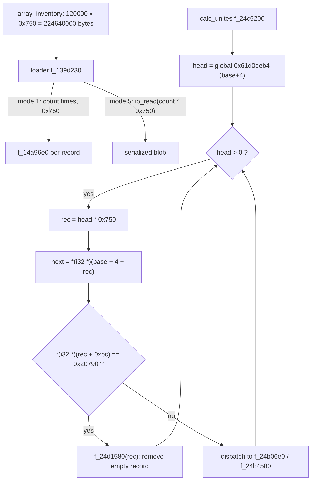
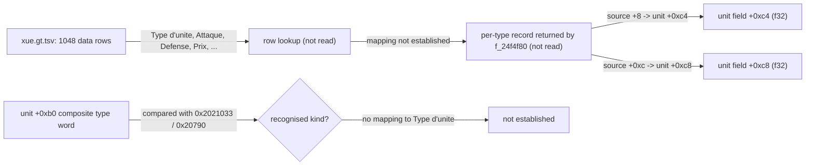
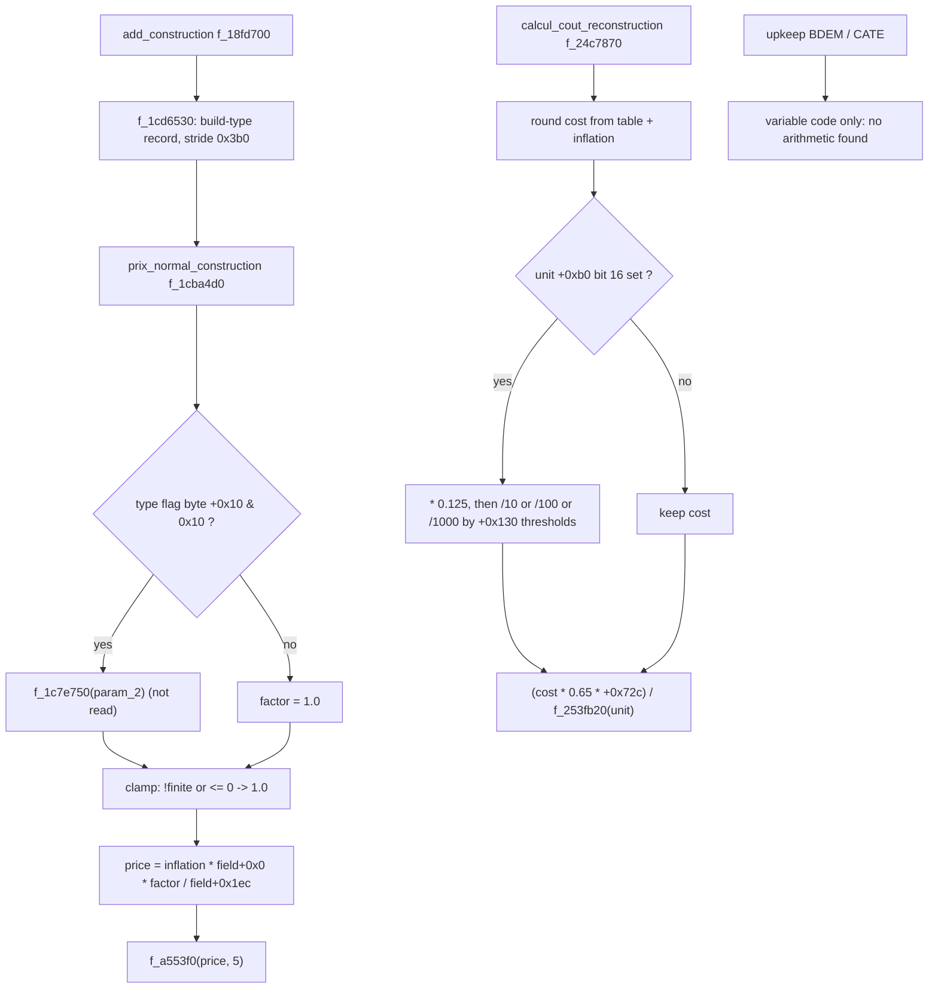
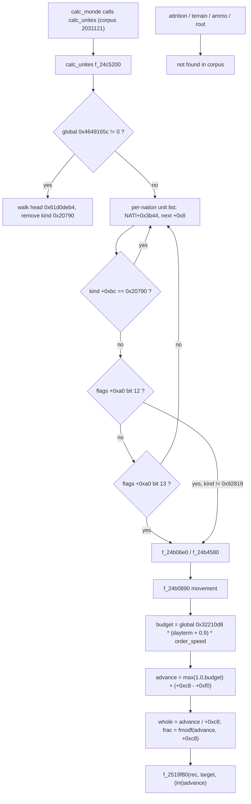
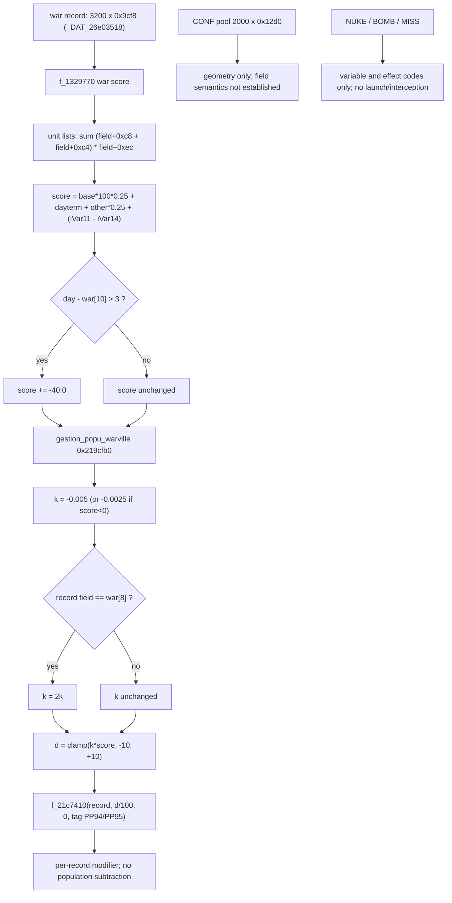

# Volume 3: Military Systems, Combat & Geopolitics

This volume is re-derived against the corpus of record, `recomp/full_fns.clean.c` (D-001). The unit pool, its record stride, its serializer and a small set of per-record scalar fields survive verification. The previous draft's combat model does not: its two-sided attrition differential equation, 100x100 spatial hash, terrain/weather/posture multipliers, ammunition drain, rout thresholds, procurement/upkeep schedules and nuclear exchange model have no implementing arithmetic in the corpus. Every section below states what was read, and what was not.

## 1. The Unit Pool (`UNIT`): 120,000 records at a 1,872-byte stride

The serializer writes both the record tag and the stride into its own header:

```c
// f_14a96e0, corpus lines 2137772-2137773
uStack_68 = 0x554e4954/*'UNIT'*/;
uStack_64 = 0x750;
```

The tag resolves as `[tag 0x554e4954 "UNIT"]` and the serializer as `[fn 0x14a96e0 f_14a96e0]`; the record stride is `[qty 0x750 stride]`.

The array inventory records the pool as 224,640,000 bytes, record size `[qty 0x750 stride]`, count 120,000, holder `G_61d0deb0`, loader `f_139d230`, serializer `f_14a96e0`, 759 users (`array_inventory.tsv`, row 350). That is 120,000 records at that stride. The loader is `[fn 0x139d230 f_139d230]`.

The loader proves the multiplication rather than merely the constant. In mode 1 it walks `count` records and advances the cursor by the stride; in mode 5 it reads `count` times the stride in one call:

```c
// f_139d230, corpus lines 1994107-1994117
while (uVar3 != 0) {
    iVar1 = f_14a96e0(param_2, 1, param_4, param_5);
    uVar2 = uVar2 + iVar1;
    param_2 = (void *)((longlong)param_2 + 0x750);   // line 1994109
    uVar3 = uVar3 - 1;
}
...
uVar3 = io_read(param_2, param_3 * 0x750);            // line 1994117
```

`calc_unites` indexes the same array by multiplying the record index by the same stride `[fn 0x24c5200 calc_unites]` `[qty 0x750 stride]`.

The 120,000 count is real, but the old citation `0x1d4c0` is not. Refuted token: `0x1d4c0` has zero literal hits in the corpus and `cite.py` classifies it unresolved. The code expresses the limit as the last index 119999 and as a `120000.0` validity bound, for example `iVar12 - 1U < 119999` in the war-score walk `[fn 0x1329770 f_1329770]`. The count therefore comes from the array inventory and the loader, not from a 120000 array-size literal.

### 1.1 Record organisation and verified offsets

The pool is an intrusive linked list over a sentinel element at index 0. The head lives at `base+4` and each record's `+4` is the next index:

```c
// calc_unites, corpus lines 4703763-4703768
iVar16 = _DAT_61d0deb4;                               // head, base+4
while (0 < iVar16) {
    lVar17 = (longlong)iVar16 * 0x750;
    iVar16 = *(int *)(&DAT_61d0deb4 + lVar17);        // next at +4
    ...
}
```

`_DAT_61d0deb4` resolves as `[global 0x61d0deb4 i32]`. A second list uses `+8` as its next link (`iVar16 = *(int *)(lVar17 + G_61d0deb8)`, line 4704120) `[field 0x8 in UNIT]`.

Only the following offsets are supported by an expression that indexes a `0x750` record. Nothing else in the old field map is.

| offset | width | expression read | citation |
| :--- | :--- | :--- | :--- |
| `+0x4` | i32 | list head / next index | `[field 0x4 in UNIT]` `[fn 0x24c5200]` |
| `+0x8` | i32 | second next index | `[field 0x8 in UNIT]` `[fn 0x24c5200]` |
| `+0x88` | u64 | flag word, bit tests | `[field 0x88 in UNIT]` `[fn 0x24c5200]` |
| `+0xa0` | u32 | flag word; bits 12 and 13 select the update path | `[field 0xa0 in UNIT]` `[fn 0x24c5200]` |
| `+0xb0` | u32 | type word returned by `f_24fc7d0` | `[field 0xb0 in UNIT]` `[fn 0x24fc7d0]` |
| `+0xbc` | i32 | second type/kind word, compared with the sentinel value | `[field 0xbc in UNIT]` `[qty 0x20790]` |
| `+0xc4` | f32 | per-type stat copied from source `+8` | `[field 0xc4 in UNIT]` `[fn 0x24a5040]` |
| `+0xc8` | f32 | per-type stat copied from source `+0xc` | `[field 0xc8 in UNIT]` `[fn 0x24a5040]` |
| `+0xec` | i32 | count multiplied into the war-score strength | `[field 0xec in UNIT]` `[fn 0x1329770]` |

The type word is read by a three-instruction function:

```c
// f_24fc7d0, corpus line 4741481
ulonglong f_24fc7d0(longlong param_1)
{
  return (ulonglong)*(uint *)(param_1 + 0xb0);
}
```

`calc_unites` treats `[qty 0x20790]` as the dead/empty kind: in the first pass it calls the removal routine `f_24d1580` only when the `+0xbc` word equals that sentinel (corpus lines 4703768-4703770) `[fn 0x24c5200]`.

The old struct map is refuted at three concrete points. Old `+0x08 pos_x` is the next-link index in the code (`[field 0x8 in UNIT]`). Old `+0x06 archetype_id` is not the type word: the type word is `+0xb0` (`[field 0xb0 in UNIT]`). Old `+0x18 hp_current`, `+0x1c hp_max`, `+0x20 morale`, `+0x28 fuel_current`, `+0x2c ammo_current` have no field access in `calc_unites`; the offsets that do appear there are `+0x88`, `+0xa0`, `+0xbc`, `+0xc4`, `+0xc8`, `+0xec`, `+0x1b8` and `+0x1e0`.

### 1.2 Logic graph



### 1.3 Pseudocode transcribed from `calc_unites` and `f_139d230`

```pseudocode
// f_139d230 (loader), corpus 1994093-1994117
function load(mode, buf, count, ...):
    if mode == 1:
        n = 0
        while count > 0:
            n += f_14a96e0(buf, 1, ...)      // serializer, body not read in full
            buf += 0x750                     // corpus 1994109
            count -= 1
        return n
    if mode == 5:
        return io_read(buf, count * 0x750)   // corpus 1994117
    // modes 2,3,4,6: (not read)

// calc_unites, corpus 4703763-4703976
base = G_61d0deb0
head = *(i32 *)(base + 0x4)                  // global 0x61d0deb4
while head > 0:
    rec  = head * 0x750                      // corpus 4703766 / 4703911
    next = *(i32 *)(base + 0x4 + rec)        // corpus 4703766-4703768
    kind = *(i32 *)(base + 0xbc + rec)       // field 0xbc
    if kind == 0x20790:
        f_24d1580(base + rec, NULL, ...)     // corpus 4703770
    head = next
// second pass: per-nation list head at NATI+0x3b44, next at +0x8 (corpus 4704114-4704132)
```

### 1.4 What the code does not establish

- No position, heading, hit-point, morale, fuel or ammunition field is proved. The old `+0x00..+0x58` layout is not the record layout `[fn 0x24c5200]` `[field 0x8 in UNIT]`.
- No explicit allocation expression containing 120,000. The count is inventory metadata plus the loader's count-times-stride read `[qty 0x750 stride]` `[fn 0x139d230]`.
- No 100x100 spatial grid. Section 4 records the searches `[fn 0x24c5200]`.
- `G_61d0deb0` is the static holder; the war code reaches records through `[global 0x31ed6c90 i64]` with the same stride. Whether these are one runtime instance or two is not established.

## 2. Unit Archetypes Are a Data Table, Not an Engine Formula (`xue.gt.tsv`)

`data/gt/xue.gt.tsv` contains one header line and 1,048 data rows (1,049 logical lines). The header names the columns used below: `Nom/Descriptif`, `Type d'unite`, `Attaque`, `Defense`, `Nb_avion`, `Hommes`, `Autonomie`, `Rayon`, `Vitesse`, `Prix`, `Distance d'attaque` `[data xue.gt.tsv "soldats CRG Niv1"]`.

These are exact rows, not rounded prose:

| row | Type d'unite | Attaque | Defense | Hommes | Autonomie | Rayon | Vitesse | Prix | Distance d'attaque |
| :--- | ---: | ---: | ---: | ---: | ---: | ---: | ---: | ---: | ---: |
| `soldats CRG Niv1` | 125 | 6.0000 | 10 | 1 | 5.0000 | 1000000.0000 | 0.3564 | 1 | 2.0000 |
| `soldats CRG Niv5` | 129 | 10.0000 | 10 | 1 | 5.0000 | 1000000.0000 | 0.4860 | 1 | 2.0000 |
| `tanks Niv1` | 135 | 1200.0000 | 1200 | 5 | 5.0000 | 1500000.0000 | 0.1782 | 120 | 2.0000 |
| `tanks Niv5` | 139 | 2000.0000 | 2000 | 5 | 5.0000 | 1500000.0000 | 0.2430 | 120 | 2.0000 |
| `chasseurs Niv5` | 164 | 200.0000 | 1400 | 1 | 1.0000 | 1500000.0000 | 5.4000 | 2000 | 2.0000 |
| `porte-avions Niv5` | 219 | 4000.0000 | 120000 | 2000 | 300.0000 | 20000000.0000 | 0.9720 | 10000 | 2.0000 |
| `missiles (nucl.) Niv1` | 83 | 100000.0000 | 100 | 0 | 730.0000 | 10000000.0000 | 5.4000 | 5000 | 2.0000 |

Each row is cited as `[data xue.gt.tsv "<row name>"]`. The old table's dollar prices (10,000 / 25,000 / 2,100,000 / 3,500,000 / 35,000,000 / 95,000,000 / 850,000,000 / 5,500,000,000 / 150,000,000) are not in the table. The table's `Prix` column is 1, 120, 2000, 10000 and 5000 for the same archetypes.

The table declares no unit for `Vitesse`, `Rayon`, `Prix` or `Distance d'attaque`. The old labels "km/h", "km", "Unlimited" and "$" are therefore removed. `Distance d'attaque` is 2.0000 for every row quoted above, not a per-archetype engagement range.

The engine does copy two per-type integers into the unit record, but the source record is not proved to be the `xue.gt.tsv` row:

```c
// f_24a5040, corpus lines 4688109-4688113
*(undefined4 *)(lVar23 + G_61d0df74) = *(undefined4 *)(lVar12 + 8);   // unit +0xc4
*(float *)(lVar23 + G_61d0df78) = (float)*(int *)(lVar12 + 0xc);      // unit +0xc8
```

`lVar12` comes from `f_24f4f80(unit)`; that function was not read, so the mapping from `Attaque`/`Defense` (or any other column) to source `+8`/`+0xc` is `(not read)`. The unit record's `+0xb0` word is also not the table's `Type d'unite`: the code compares `+0xb0` against composite values such as `[qty 0x2021033 composite-id]`, `[qty 0x2021036 composite-id]`, `[qty 0x2081039 composite-id]` and `[qty 0x20790]` (for example in `calc_programmes_spatiaux`, corpus lines 76250-76256), none of which equals the small integers 125, 135, 164 or 219 `[field 0xb0 in UNIT]` `[fn 0x8939f0 calc_programmes_spatiaux]`.

### 2.1 Logic graph



### 2.2 Pseudocode transcribed from `f_24fc7d0` and `f_24a5040`

```pseudocode
// f_24fc7d0, corpus 4741481
function get_type_word(rec):
    return *(u32 *)(rec + 0xb0)              // field 0xb0

// f_24a5040, corpus 4688109-4688113
function copy_per_type_stats(unit, src):     // src = f_24f4f80(unit), body not read
    *(u32  *)(unit + 0xc4) = *(u32 *)(src + 8)
    *(f32  *)(unit + 0xc8) = (f32)*(i32 *)(src + 0xc)

// observed comparison, calc_programmes_spatiaux, corpus 76250-76256
kind = get_type_word(unit)
if kind == 0x2021033 or kind == 0x2021036 or kind == 0x2081039:
    ...                                      // branch body (not read)
```

### 2.3 What the code does not establish

- No engine formula maps `Attaque`, `Defense`, `Vitesse`, `Rayon` or `Distance d'attaque` to combat or movement. Only `Prix` is consumed by a named price routine (section 3) `[data xue.gt.tsv "soldats CRG Niv1"]` `[fn 0x1cba4d0]`.
- No build duration column is present in `xue.gt.tsv` `[data xue.gt.tsv "tanks Niv1"]`.
- The table has no declared physical units. The old km/h and km readings are unsupported `[data xue.gt.tsv "soldats CRG Niv1"]`.
- The 1,050-row claim is corrected to 1,048 data rows `[data xue.gt.tsv "soldats CRG Niv1"]`.

## 3. Construction, Price and Reconstruction

`add_construction` is a generic construction-queue routine, not a unit-procurement routine. Its source label is `add_construction() in d:\_gps5\prog\gps_construction.cpp` (corpus line 2706971) `[fn 0x18fd700 add_construction]`. It resolves a build type through `f_1cd6530`, writes a price into `param_2+0xb0`, and enqueues through `f_11b2280`/`f_11b24f0`; the whole 8,467-byte body was not read, so the later branches are `(not read)`.

The named price function is real and computes rather than loads a price:

```c
// prix_normal_construction, corpus lines 3345743-3345787
uVar3 = f_1cd6530(..., 0x278a, '\x01');
lVar4 = (longlong)(int)uVar3 * 0x3b0;
fVar5 = 1.0;
if ((*(byte *)(lVar4 + G_47938898) & 0x10) != 0) {
    fVar5 = f_1c7e750(param_2);                       // (not read)
}
if (!finite(fVar5) || fVar5 <= 0.0) fVar5 = 1.0;
dVar1 = f_1cd9b10(1.0, param_2);                      // (not read)
afStackX_8[0] = *(float *)(lVar4 + G_47938a74);
if (afStackX_8[0] == 0.0) afStackX_8[0] = 1.0;
afStackX_8[0] = ((float)dVar1 * *(float *)(lVar4 + G_47938888) * fVar5) / afStackX_8[0];
return f_a553f0(afStackX_8, 5);                       // call not read
```

The record stride here is `0x3b0`, and the offsets relative to the record base are `+0x10` for the flag byte, `+0x0` and `+0x1ec` for the two floats `[qty 0x3b0 stride]` `[fn 0x1cba4d0 prix_normal_construction]`. The old wording "base price loaded from `prix_normal_construction`" is corrected: the value is derived from a type record, an optional multiplier, an inflation term and a divisor.

### 3.1 The four "requirements" in the old draft

1. **Financial allocation.** `prix_normal_construction` exists and is named; it is the only price routine found for construction `[fn 0x1cba4d0]`. There is no separate military-unit price path in the corpus.
2. **Industrial capacity (`DEFA`, `DEF2`, `DEFB`).** `DEFA` is a four-character code, not an output function: it occurs once as `[tag 0x44454641 "DEFA"]` in a label assignment (corpus line 2095915). `DEF2` and `DEFB` occur as data keys in `xim.gt.tsv`, `xia.gt.tsv` and `xrn.gt.tsv`; no function computes a defense-industrial output from them. This requirement is removed.
3. **Manpower quota (`MILA` at `+0xc850`).** `MILA` is a variable code `[tag 0x4d494c41 "MILA"]`. The `get_variable` switch maps it to `param_1 + 0x6428`, not `+0xc850` (corpus line 4828470) `[fn 0x2593bd0 get_variable]`. The old offset is corrected.
4. **Build duration (90 days / 720 days).** No such constants occur in the corpus size or in `xue.gt.tsv`. The `xan.gt.tsv` rows 330096, 330097 and 330098 have an empty construction-duration cell. This requirement is removed.

The three `xan.gt.tsv` ids are action ids, and they are also code literals. Row 330096 is `Bases militaires / Military bases` `[data xan.gt.tsv "330096"]`; the same id appears as a switch case in `Cmenu_droit__do_action` (corpus line 5342038) and in `f_203bc10` (corpus line 5346849) `[qty 0x50970 action-id]` `[fn 0x2021e10 Cmenu_droit__do_action]`. Rows 330097 and 330098 likewise map to naval and air bases `[data xan.gt.tsv "330097"]` `[data xan.gt.tsv "330098"]` `[qty 0x50971 action-id]` `[qty 0x50972 action-id]`.

### 3.2 Upkeep and readiness

There is no upkeep arithmetic. `BDEM` is a variable code, not a NATI offset: `[tag 0x4244454d "BDEM"]` and `get_variable` returns `*(u32 *)(param_1 + 0x3db2)` (corpus line 4832402) `[fn 0x2593bd0 get_variable]`. The old claim "`BDEM` at offset `+0x7b64` in `NATI`" is corrected; `+0x7b64` is not in that branch.

`CATE` is also a variable code `[tag 0x43415445 "CATE"]`; its getter calls `f_1bec400(6, param_1, 0)` (corpus line 4832594), not an offset `+0x230`.

The old upkeep expression `BasePrice * mu * (1 + OverseasMultiplier)` and the "readiness decay ... hit points decay by up to 2% per macro-turn" are removed. Searches for `0.98`, `0.02` and `- 0.02` against unit-record accesses in `calc_unites` and `f_24b4580` returned no such assignment; the only subtractions on unit records found are path progress and a timestamp, not hit points.

### 3.3 Reconstruction cost

`calcul_cout_reconstruction` is real, and its arithmetic is not the old repair formula:

```c
// calcul_cout_reconstruction, corpus lines 4705085-4705160
uVar4 = f_1cd6530(..., 0x2d8a, '\x01');
lVar5 = (longlong)(int)uVar4 * 0x3b0;
dVar7 = f_1cd9b10(..., param_1) / (double)*(float *)(lVar5 + G_47938a74);  // (not read)
... log10 / powf rounding to a power of ten ...
fVar6 = (float)dVar8;
if (((*(uint *)(param_2 + 0xb0) >> 0x10 & 1) != 0) &&
    (fVar6 = fVar6 * 0.125, 1 < (*(uint *)(param_2 + 0xb0) & 0xfff) - 2)) {
    if (*(int *)(param_2 + 0x130) < 500000) fVar6 = fVar6 / 10.0;
    else if (*(int *)(param_2 + 0x130) < 1000000) fVar6 = fVar6 / 100.0;
    else fVar6 = fVar6 / 1000.0;
}
return (fVar6 * 0.65 * (float)*(int *)(param_2 + 0x72c)) / (float)f_253fb20(param_2);
```

So the returned quantity is `(rounded_cost * 0.65 * field_0x72c) / f_253fb20(record)`, with an optional `*0.125` and a `/10`, `/100` or `/1000` scale selected by `field_0x130` at 500,000 and 1,000,000 `[fn 0x24c7870 calcul_cout_reconstruction]`. The old `(1 - hp/hp_max) * BasePrice * 0.40` is removed: there is no hp ratio and no 0.40.

### 3.4 Logic graph



### 3.5 Pseudocode transcribed from `prix_normal_construction` and `calcul_cout_reconstruction`

```pseudocode
// prix_normal_construction, 0x1cba4d0, corpus 3345743-3345787
function prix_normal_construction(key, param_2):
    t = f_1cd6530(key, 0x278a, 1)            // (not read)
    rec = t * 0x3b0
    factor = 1.0
    if (*(u8 *)(rec + 0x10) & 0x10) != 0:
        factor = f_1c7e750(param_2)          // (not read)
    if not finite(factor) or factor <= 0.0:
        factor = 1.0
    infl = f_1cd9b10(1.0, param_2)           // (not read)
    den = *(f32 *)(rec + 0x1ec)
    if den == 0.0: den = 1.0
    price = ((f32)infl * *(f32 *)(rec + 0x0) * factor) / den
    return f_a553f0(price, 5)                // (not read)

// calcul_cout_reconstruction, 0x24c7870, corpus 4705085-4705160
function calcul_cout_reconstruction(param_1, rec, param_3):
    t = f_1cd6530(param_3, 0x2d8a, 1)        // (not read)
    v = t * 0x3b0
    d = f_1cd9b10(*(f32 *)(v + 0x0), param_1) / *(f32 *)(v + 0x1ec)   // (not read)
    // log10 + powf rounding block (read, lines 4705099-4705145)
    f = round_pow10(d)
    if (*(u32 *)(rec + 0xb0) >> 0x10 & 1) != 0:
        f = f * 0.125
        if ((*(u32 *)(rec + 0xb0) & 0xfff) - 2) > 1:
            if *(i32 *)(rec + 0x130) < 500000:   f = f / 10.0
            elif *(i32 *)(rec + 0x130) < 1000000: f = f / 100.0
            else:                                 f = f / 1000.0
    return (f * 0.65 * (f32)*(i32 *)(rec + 0x72c)) / (f32)f_253fb20(rec)  // (not read)
```

### 3.6 What the code does not establish

- No daily upkeep, no readiness decay, no fuel/ammo drain, no overseas surcharge `[tag 0x4244454d "BDEM"]`.
- No unit-specific procurement path; `add_construction` is generic construction `[fn 0x18fd700]`.
- No manpower deduction from a national pool `[tag 0x4d494c41 "MILA"]`.
- No build-duration schedule for units `[data xan.gt.tsv "330096"]`.

## 4. The Daily Unit Pass: `calc_unites` and Movement, Not Attrition

`calc_monde` calls `calc_unites(param_1)` once in its daily sequence (corpus line 2031121) `[fn 0x13f3290 calc_monde]` `[fn 0x24c5200 calc_unites]`. The "Phase 8" label in the old draft is not in the code; only the call site is established.

`calc_unites` has two unit walks. The first is the empty-record cleanup already shown in section 1. The second walks each nation's unit list, whose head is at `[qty 0x3b44 offset]` in the NATI record and whose next link is `+0x8`, skips `[qty 0x20790]`, and selects an update path from bits 12 and 13 of the `+0xa0` flag word:

```c
// calc_unites, corpus lines 4704114-4704132
iVar16 = *(int *)(lVar17 + 0x3b44);                  // nation's unit-list head
do {
    if (iVar16 < 1) break;
    lVar17 = (longlong)iVar16 * 0x750;
    iVar16 = *(int *)(lVar17 + G_61d0deb8);          // next at +0x8
    if (*(int *)(lVar17 + G_61d0df6c) != 0x20790) {  // field +0xbc
        if ((*(uint *)(lVar17 + G_61d0df50) >> 0xc & 1) == 0) {
            if ((*(uint *)(lVar17 + G_61d0df50) >> 0xd & 1) == 0) continue;
            ...
        } else {
            if (*(int *)(lVar17 + G_61d0df6c) != 0x92819) {
                f_24b06e0(lVar17 + G_61d0deb0, param_2, iVar22, iVar22);
                continue;
            }
            ...
        }
        ...
    }
} while (true);
```

`f_24b06e0` is a thin dispatcher. When the record's `+0xbc` word is not `[qty 0x20790]` it calls `f_24b4580`, then optionally `f_24d0bd0` and `f_24d0920` with readiness checks `f_251e710`/`f_257aa60` and follow-ups `f_24ee030`/`f_24ecd70` `[fn 0x24b06e0 f_24b06e0]`.

The one movement computation read in full is `f_24b0890`. It turns an order speed and a day-dependent term into a distance budget, then advances the unit along its path:

```c
// f_24b0890, corpus lines 4692684-4692731
fVar14 = f_25c6b70(_DAT_464916a8 + *(int *)(param_1 + 0x28), 0.2);   // (not read)
fVar14 = _DAT_32210d8 * (fVar14 + 0.9) * param_2;
if (fVar14 <= 0.0) { ... return; }
...
fVar16 = 1.0;
if (1.0 <= fVar14) fVar16 = fVar14;
fVar14 = *(float *)(param_1 + 200);                                  // field +0xc8
fVar16 = fVar16 + (fVar14 - (float)*(int *)(param_1 + 0xf0));
uVar13 = (uint)(fVar16 / fVar14);
fVar15 = fmodf(fVar16, fVar14);
...
f_2519f80(param_1, lVar7 * 0x750 + G_61d0deb0, (int)fVar16);         // (not read)
```

The global `_DAT_32210d8` resolves as `[global 0x32210d8 u32]`; the day counter `_DAT_464916a8` as `[global 0x464916a8 i32]`; the unit stat at `+0xc8` and the integer at `+0xf0` are the movement scale and accumulator `[field 0xc8 in UNIT]` `[field 0xf0 in UNIT]` `[fn 0x24b0890 f_24b0890]`.

### 4.1 No attrition, no grid

The independent searches for the old combat model:

- A case-insensitive corpus search for the old attrition law's name returns 0.
- A corpus search for its hyphenated two-word ratio spelling returns 0.
- No `dA/dt`, no per-tick subtraction of a strength or hit-point field, no terrain/weather/posture multiplier, no ammunition field, no rout test at 0.25 or 0.20.
- The only two-sided strength arithmetic is the war score in section 5: it sums `(field_0xc8 + field_0xc4) * field_0xec` on each side and compares ratios. It does not subtract casualties from either side.
- The old spatial hash is absent. There is no `CellY * 100 + CellX` expression, no 10,000-cell array, and no `x/100`, `y/100` cell index. The only 10,000 in `calc_unites` guards a doubly linked iterator list: `if (uVar21 < 10000)` and `9999 < uVar21` -> `"Bad iterator"` (corpus lines 4703792-4703814) `[fn 0x24c5200]`. That is an object iterator, not a world grid.

The old 120,000 x 0x750 pool is real, but it is traversed by index lists, not by spatial buckets. The old `10,000` cells and the `CellX/CellY` equations are removed.

### 4.2 Logic graph



### 4.3 Pseudocode transcribed from `calc_unites`, `f_24b06e0` and `f_24b0890`

```pseudocode
// calc_unites, 0x24c5200, corpus 4704114-4132
function per_nation_pass(nation):
    head = *(i32 *)(nation + 0x3b44)
    while head > 0:
        rec = head * 0x750
        head = *(i32 *)(base + 0x8 + rec)          // next link at +0x8
        if *(i32 *)(base + 0xbc + rec) == 0x20790: continue
        flags = *(u32 *)(base + 0xa0 + rec)
        if (flags >> 12 & 1) == 0:
            if (flags >> 13 & 1) == 0: continue
        if *(i32 *)(base + 0xbc + rec) != 0x92819:
            f_24b06e0(base + rec, param_2, iVar22, iVar22)
        // otherwise: another branch (not read)

// f_24b06e0, 0x24b06e0, corpus 4692585-4692605
function f_24b06e0(rec, param_2, param_3, param_4):
    if *(i32 *)(rec + 0xbc) != 0x20790:
        f_24b4580(rec, param_2)                    // body not read in full
        if param_4 != 0:
            if f_24d0bd0(rec, ...) != 0:
                if f_251e710(rec, 1) != 0 and f_257aa60(rec) == 0:
                    f_24ee030(rec)
            if f_24d0920(rec, ...) != 0:
                if f_251e710(rec, 1) != 0 and f_257aa60(rec) == 0:
                    f_24ecd70(rec)

// f_24b0890, 0x24b0890, corpus 4692684-4692731
function move(unit, order_speed, ...):
    dayterm = f_25c6b70(day + *(i32 *)(unit + 0x28), 0.2)   // (not read)
    budget  = *(u32 *)0x32210d8 * (dayterm + 0.9) * order_speed
    if budget <= 0.0: ... return
    advance = max(1.0, budget) + (*(f32 *)(unit + 0xc8) - (f32)*(i32 *)(unit + 0xf0))
    whole   = (u32)(advance / *(f32 *)(unit + 0xc8))
    frac    = fmodf(advance, *(f32 *)(unit + 0xc8))
    if target != 0:
        f_2519f80(unit, target * 0x750 + G_61d0deb0, (i32)advance)   // (not read)
```

### 4.4 What the code does not establish

- No per-tick attrition, no damage transfer between two units, no strength subtraction `[fn 0x24c5200]`.
- No terrain, weather, posture or cover multiplier `[fn 0x24b4580]`.
- No ammunition count and no "attack drops to 10%" branch `[fn 0x24b4580]`.
- No morale/rout threshold `[fn 0x24b4580]`.
- No spatial partition; the unit lists are intrusive index lists `[fn 0x24c5200]`.

## 5. War Records, Urban Effects and the Absence of a Nuclear Model

### 5.1 The war-record pool

The `CONF` pool is real. `array_inventory.tsv` records 2,000 records of `0x12d0` bytes (9,632,000 bytes), holder `&DAT_433f40e0`, loader `f_1394d20`, serializer `f_14585e0`, 151 users `[fn 0x14585e0 f_14585e0]` `[fn 0x1394d20 f_1394d20]` `[qty 0x12d0 stride]`. The claimed field semantics (attacker coalition, defender coalition, annexation/regime-change objectives, casus belli, UN authorization) are not established by the pool or the serializer header. Only the pool geometry is verified.

The urban routine indexes a different, larger pool by a separate stride (corpus line 4125185): 3,200 records of that size `[qty 0x9cf8 stride]` `[fn 0x13a07b0 f_13a07b0]` `[fn 0x219cfb0 gestion_popu_warville]`.

### 5.2 The war score

`f_1329770` computes a scalar war score. It walks the unit lists, filters by type/flag, and sums a strength term per side:

```c
// f_1329770, corpus lines 1970173, 1970246-1970248, 1970271
iStackX_20 = (int)(((float)param_1[9] * 0.5 + 50.0) - (float)(_DAT_464916a8 - param_1[10]));
...
fVar17 = (*(float *)(lVar10 + 200 + _DAT_31ed6c90) +
          *(float *)(lVar10 + 0xc4 + _DAT_31ed6c90)) *
         (float)*(int *)(lVar10 + 0xec + _DAT_31ed6c90);
...
fVar16 = fVar16 * 100.0 * 0.25 + (float)iVar12 + (float)iVar5 * 0.25 + (float)(iVar11 - iVar14);
...
if (param_1[2] == 2) {
    ...
    fVar16 = (fVar19 - fVar18) * 0.25 + fVar16;
}
...
if (3 < _DAT_464916a8 - param_1[10]) {
    fVar16 = fVar16 + -40.0;
}
```

The reads are `[fn 0x1329770 f_1329770]`, `[global 0x31ed6c90 i64]`, `[global 0x464916a8 i32]`. The strength term uses fields `+0xc8`, `+0xc4` and `+0xec` `[field 0xc8 in UNIT]` `[field 0xc4 in UNIT]` `[field 0xec in UNIT]`. The score is a daily comparison of aggregated unit values, not a per-unit attrition step.

### 5.3 Urban population effects

`gestion_popu_warville` does not subtract city or national population. It takes the war score and applies a per-record modifier to up to the number of affected records:

```c
// gestion_popu_warville, corpus lines 4125312-4125411
fVar27 = f_1329770((int *)puVar25, pdVar12, pdVar9);
...
fVar28 = -0.005;
if (fVar27 < 0.0) fVar28 = -0.0025;
if (*(uint *)(psVar24 + 0x176) == puVar25[8]) fVar28 = fVar28 + fVar28;
fVar28 = fVar28 * fVar27;
if (-10.0 <= fVar28) { fVar29 = 10.0; if (fVar28 <= 10.0) fVar29 = fVar28; }
else fVar29 = -10.0;
...
f_21c7410((longlong)iVar6 * 0xad0 + _DAT_5d85ada0, fVar29 / 100.0, 0, uVar26, ...);
```

The pool is 51,000 records at `[qty 0xad0 stride]` in `_DAT_5d85ada0` (array inventory), and `f_21c7410` modifies a record in that pool, not a population counter `[fn 0x21c7410 f_21c7410]`. The tags `PP94`/`PP95`/`G0WV` are the effect codes `[tag 0x50503934 "PP94"]` `[tag 0x50503935 "PP95"]` `[tag 0x47305756 "G0WV"]`.

The old formula with `Pop_city * sum(Damage) / Fortification * 0.005` is removed. There is no fortification term, no damage sum and no population write. There is a real `0.005`/`0.0025` coefficient, but it multiplies the war score and goes through a clamp and a division by 100 before reaching a record in the `0xad0` pool.

`calc_cata_victimes_initiales` is real but is a catastrophe estimator, not urban combat: its source label is `calc_cata_victimes_initiales() in d:\_gps5\prog\gps_catas.cpp` (corpus line 2625008), and its arithmetic uses `log10`, `powf(10.0, ...)`, a float field at `+0x9a0`, and constants such as `0.15`, `860.0`, `0.013076923` and `0.125` `[fn 0x182afc0 calc_cata_victimes_initiales]`. It is not the formula the old section quoted.

### 5.4 The two "refugee/homeless" codes

`NSDF` is a variable code `[tag 0x4e534446 "NSDF"]`; `get_variable` reads or writes `param_1 + 0x223c` (corpus lines 4829461-4829470) `[fn 0x2593bd0 get_variable]`. The old `+0x4478` is not in that branch.

`RCLW` is a variable code `[tag 0x52434c57 "RCLW"]`; its getter calls `f_1056100()`, which sums two NATI floats at `[qty 0x6434a8 offset]` and `[qty 0x6434ac offset]` across active nations (corpus lines 1481952-1481958) `[fn 0x1056100 f_1056100]`.

The old claim that RCLW lives at this offset is a category error: `[field 0x619ca0 in NATI]` is a float field used by `f_205eb70` in a different computation:

```c
// f_205eb70, corpus lines 3910428-3910433
fVar13 = *(float *)((longlong)(int)uVar7 * 0x645310 + 0x619c90 + _DAT_46208908);
uVar7  = f_22f1330((double *)(param_1 + 0x28), 0);
fVar1  = *(float *)((longlong)(int)uVar7 * 0x645310 + 0x619ca0 + _DAT_46208908);
fVar10 = f_25c6b70(*(int *)(param_1 + 4) + _DAT_464916a8, 1.0);
fVar13 = fVar10 * ((fVar13 * 10.0 * (float)(fVar8 == 1.0) + fVar12 + fVar12) -
                   fVar1 * 10.0 * (float)(fVar9 == 1.0)) + 0.01;
if (0.01 <= fVar13) { /* kept */ } else { fVar13 = 0.01; }
```

The two adjacent floats are fields `[field 0x619c90 in NATI]` and `[field 0x619ca0 in NATI]` of the NATI record, and the result is clamped to at least 0.01 `[fn 0x205eb70 f_205eb70]`. The corpus does not name the field; the old "refugee" label is removed.

### 5.5 Nuclear weapons are not implemented

`NUKE` occurs exactly twice, both as a case label in the generic `get_variable` dispatcher (corpus lines 3588017 and 4821458) `[tag 0x4e554b45 "NUKE"]` `[fn 0x1e18460 getval_rdv_rdv_test_cmp]` `[fn 0x25890e0 f_25890e0]`. It maps to a variable slot, not to a launch, interception or detonation function.

`BOMB` is an effect kind passed to `f_21c7410` and to `f_21c7c40`; in `f_21c7410` it merely suppresses the `* 0.75` reduction `[tag 0x424f4d42 "BOMB"]` `[fn 0x21c7410 f_21c7410]`. `MISS` is compared as an object/unit code in `f_8dc870` and `f_8e9480` (corpus lines 141261 and 152433) `[tag 0x4d495353 "MISS"]` `[fn 0x8dc870 f_8dc870]`.

No launch sequence, interception roll, deterrence threshold, 85%-99% mortality constant, `CBAT` deletion or soot parameter is present. Those claims are removed.

### 5.6 Logic graph



### 5.7 Pseudocode transcribed from `f_1329770`, `gestion_popu_warville` and `f_1056100`

```pseudocode
// f_1329770, 0x1329770, corpus 1970173-1970305
function war_score(war):
    dayterm = (i32)((f32)war[9] * 0.5 + 50.0 - (f32)(day - war[10]))
    sideA = 0.0; sideB = 0.0
    for each unit record u in the side lists:          // 119999 bound, corpus 1970256
        if u passes the type/flag filters:
            s = (*(f32 *)(u + 0xc8) + *(f32 *)(u + 0xc4)) * (f32)*(i32 *)(u + 0xec)
            if side flag: sideA += s else sideB += s
    score = base * 100.0 * 0.25 + (f32)dayterm + (f32)other * 0.25 + (f32)(iVar11 - iVar14)
    if war[2] == 2:
        ratioA = ...; ratioB = ...                     // lines 1970274-1970299
        score = (ratioA - ratioB) * 0.25 + score
    if day - war[10] > 3:
        score = score + -40.0
    return score

// gestion_popu_warville, 0x219cfb0, corpus 4125312-4125411
function warville(war_index, ...):
    war = _DAT_26e03518 + war_index * 0x9cf8
    score = war_score(war)
    for each affected record p in the 0xad0-stride pool:
        k = -0.005
        if score < 0.0: k = -0.0025
        if *(u32 *)(nation + 0x176) == war[8]: k = k + k
        d = clamp(k * score, -10.0, 10.0)
        f_21c7410(p, d / 100.0, 0, tag, ...)            // body not read in full

// f_1056100 (the RCLW getter), corpus 1481952-1481958
function rclw():
    a = 0.0; b = 0.0
    for nation in 1 .. active_nations:
        f1 = *(f32 *)(nation * 0x645310 + 0x6434a8 + NATI)
        if f1 > 0.0: a += f1
        f2 = *(f32 *)(nation * 0x645310 + 0x6434ac + NATI)
        if f2 > 0.0: b += f2
    return ...                                          // tail not read
```

### 5.8 What the code does not establish

- No nuclear launch, interception, deterrence or exchange model `[tag 0x4e554b45 "NUKE"]`.
- No 85%-99% mortality, no `CBAT` deletion, no soot/climate parameter `[tag 0x4e554b45 "NUKE"]`.
- No population subtraction and no fatality count from urban combat. The routine applies a per-record percentage modifier `[fn 0x219cfb0]` `[fn 0x21c7410]`.
- No field semantics for the `CONF` pool beyond its size and stride `[fn 0x14585e0]`.
- No three-state ruin transition logic. `xue.gt.tsv` contains `Ruin` and `Semi-Ruin` rows (for example `bases militaires Ruin Niv1` and `bases militaires Semi-Ruin Niv1`), but the code path that changes a row/state was not found `[data xue.gt.tsv "bases militaires Ruin Niv1"]`.
