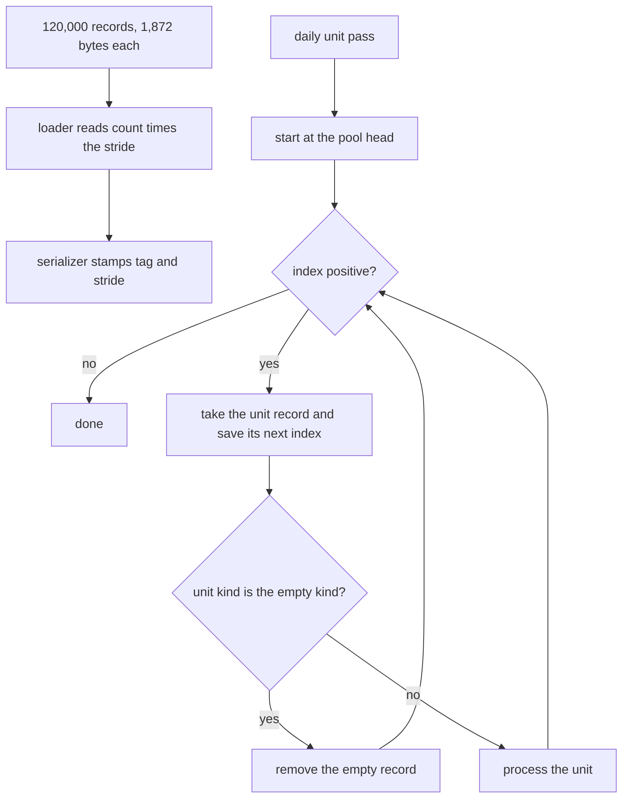
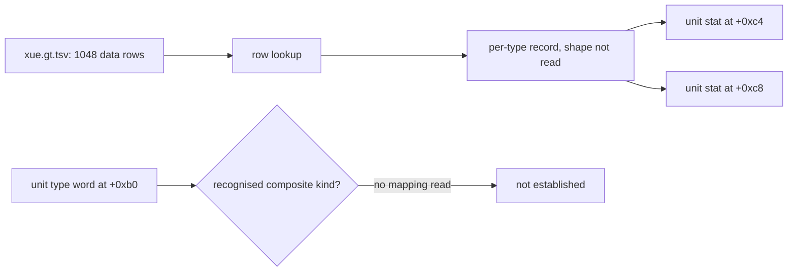
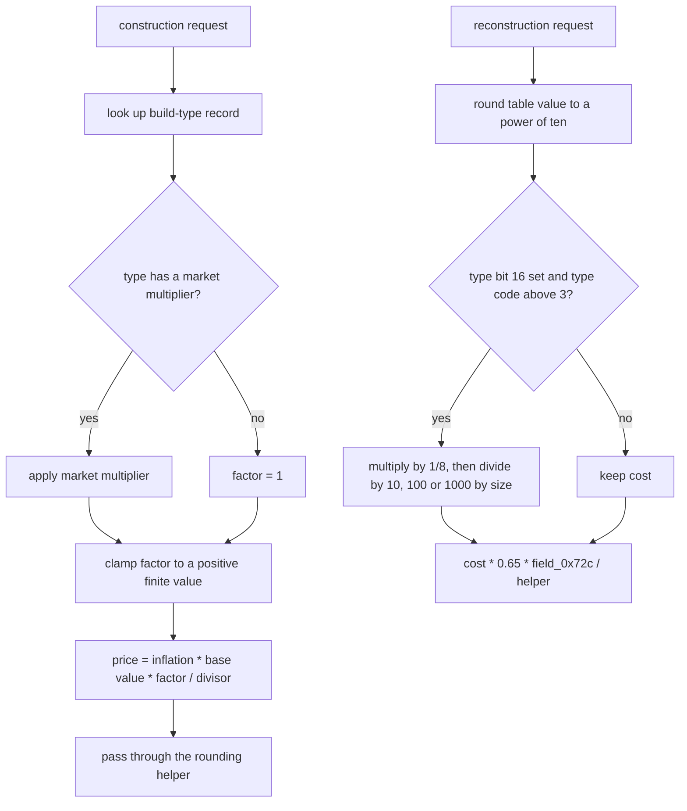
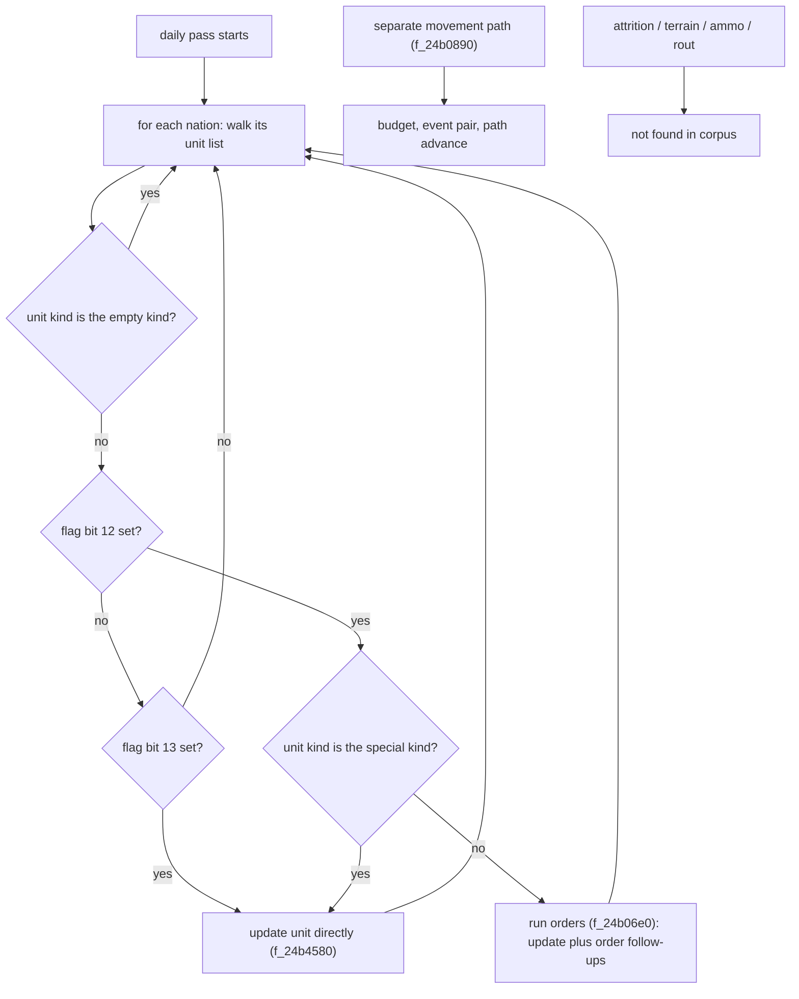
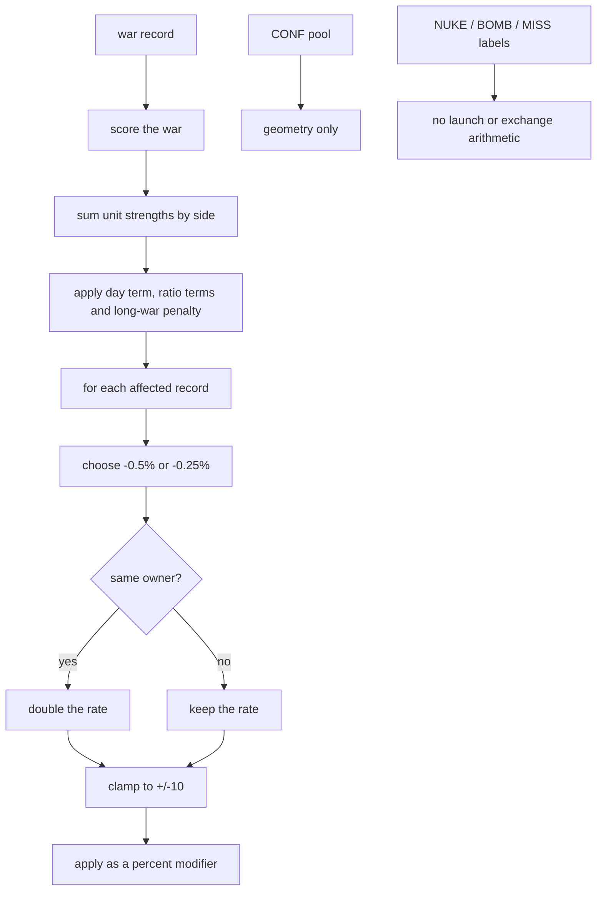

# Volume 3: Military Systems, Combat & Geopolitics

This volume is re-derived against the corpus of record, `recomp/full_fns.clean.c` (D-001). The unit pool, its record stride, its serializer and a small set of per-record scalar fields survive verification. The previous draft's combat model does not: its two-sided attrition differential equation, 100x100 spatial hash, terrain/weather/posture multipliers, ammunition drain, rout thresholds, procurement/upkeep schedules and nuclear exchange model have no implementing arithmetic in the corpus. Every section below states what was read, and what was not.

## 1. The Unit Pool (`UNIT`): 120,000 records at a 1,872-byte stride

The serializer stamps both the record tag and the stride into its own header: stride `[qty 0x750 stride]` at corpus line 2137771 and tag `[tag 0x554e4954 "UNIT"]` at line 2137772 `[fn 0x14a96e0 f_14a96e0]`.

The array inventory records the pool as 224,640,000 bytes, record size `[qty 0x750 stride]`, count 120,000, holder `G_61d0deb0`, loader `f_139d230`, serializer `f_14a96e0`, 759 users (`array_inventory.tsv`, row 350). That is 120,000 records at that stride. The loader is `[fn 0x139d230 f_139d230]`, and `Cdatabase__es_base` calls it with the literal record count at corpus line 2075010 `[fn 0x143acd0 Cdatabase__es_base]`:

The call passes the literal 120000, so 120000 is the loader's record count, i.e. the UNIT array length. In mode 1 the loader walks that many records and advances by the stride; in mode 5 it reads `count * 0x750` bytes at once (lines 1994107-1994117).

The old citation `0x1d4c0` is only a hex spelling: it has zero literal hits because the call uses decimal 120000. This is a spelling issue, not a count issue. Keep the separate last-index guard of 119999 at `f_1329770` line 1970256 distinct: it is an index-sanitisation check on a linked-list walk, not the pool size `[fn 0x1329770 f_1329770]`. The `120000.0` value that appears in map-coordinate code has no unit-pool context and is not used here.

### 1.1 Record organisation and verified offsets

The pool is an intrusive linked list over a sentinel element at index 0. The head lives at `base+4` (`[field 0x4 in UNIT]`) and each record's `+4` is the next index `[fn 0x24c5200 calc_unites]`. A second list uses `+8` as its next link `[field 0x8 in UNIT]`.

The following offsets are each supported by a read or write in the cited function. The list is not claimed to be exhaustive.

| offset | width | expression read | citation |
| :--- | :--- | :--- | :--- |
| `+0x4` | i32 | list head / next index | `[field 0x4 in UNIT]` `[fn 0x24c5200]` |
| `+0x8` | i32 | second next index | `[field 0x8 in UNIT]` `[fn 0x24c5200]` |
| `+0x3e` | i16 | short read in the same 0x750 walk | `[field 0x3e in UNIT]` `[fn 0x1327960]` |
| `+0x58` | f64 | double read in the same 0x750 walk | `[field 0x58 in UNIT]` `[fn 0x1327960]` |
| `+0x78` | f64 | first half of a 16-byte pair | `[field 0x78 in UNIT]` `[fn 0x24b0890]` |
| `+0x80` | f64 | second half of the same 16-byte pair | `[field 0x80 in UNIT]` `[fn 0x24b0890]` |
| `+0x88` | u64 | flag word, bit tests | `[field 0x88 in UNIT]` `[fn 0x24c5200]` |
| `+0xa0` | u32 | flag word; bits 12 and 13 select the update path | `[field 0xa0 in UNIT]` `[fn 0x24c5200]` |
| `+0xb0` | u32 | type word returned by `f_24fc7d0` | `[field 0xb0 in UNIT]` `[fn 0x24fc7d0]` |
| `+0xbc` | i32 | second type/kind word, compared with the sentinel value | `[field 0xbc in UNIT]` `[qty 0x20790]` |
| `+0xc4` | f32 | per-type stat copied from source `+8` | `[field 0xc4 in UNIT]` `[fn 0x24a5040]` |
| `+0xc8` | f32 | per-type stat copied from source `+0xc` | `[field 0xc8 in UNIT]` `[fn 0x24a5040]` |
| `+0xec` | i32 | count multiplied into the war-score strength | `[field 0xec in UNIT]` `[fn 0x1329770]` |

The added rows are cited to exact reads: `+0x3e` is a short read at base+0x3e in `f_1327960` (for example line 1969198); `+0x58` is a double read at base+0x58 in `f_1327960` line 1969432; `+0x78`/`+0x80` is a 16-byte pair read at `f_24b0890` lines 4692737-4692738 whose semantic name is not read.

The type word is read by a tiny accessor: `f_24fc7d0` returns the 32-bit word at record `+0xb0` (line 4741481) `[fn 0x24fc7d0 f_24fc7d0]`. `calc_unites` treats `[qty 0x20790]` as the empty kind and calls the removal routine `f_24d1580` on records whose `+0xbc` word equals it (lines 4703768-4703770) `[fn 0x24c5200]`.

The old map is wrong at the points tested: old `+0x08 pos_x` is the next-link index (`[field 0x8 in UNIT]`); old `+0x06 archetype_id` is not the type word, which is `+0xb0` (`[field 0xb0 in UNIT]`); and old `+0x18 hp_current` through `+0x2c ammo_current` have no field access in `calc_unites`. The old `+0x58` label `cargo_unit_head` is also not established, although `+0x58` does occur as a double in `f_1327960` line 1969432 `[field 0x58 in UNIT]`.

The fields the table describes are the ones this volume uses. The two stats at `+0xc4`/`+0xc8` are read in `f_24a5040` lines 4688111/4688113 and `f_1329770` lines 1970246-1970247, not in `calc_unites` `[fn 0x24a5040]` `[fn 0x1329770]`.

### 1.2 Logic graph



### 1.3 Pseudocode: loading and walking the unit pool

```pseudocode
Goal: load the unit pool and walk it as a linked list.

record_stride = 0x750            // 1,872 bytes per unit, f_14a96e0:2137771
record_tag = "UNIT"              // f_14a96e0:2137772

function load_units(buffer, count):
    if the caller reads one record at a time:
        for each of count records:
            read one record into buffer
            buffer = buffer + record_stride
    else if the caller reads the whole block:
        read count * record_stride bytes

function walk_units():
    next_index = pool.head                 // stored at pool base + 4
    while next_index > 0:
        unit = pool[next_index]
        following = unit.next_index        // stored at unit + 4
        if unit.kind == empty_kind:        // empty_kind = 0x20790, f_24c5200:4703768
            remove unit
        next_index = following
> Evidence: f_139d230 [fn 0x139d230], corpus 1994093-1994117; calc_unites [fn 0x24c5200], corpus 4703763-4703976. `0x750` is the stride, `0x20790` the empty kind, `+4` the list-link offset.
```

### 1.4 What the code does not establish

- No position, heading, hit-point, morale, fuel or ammunition field is proved. The old `+0x00..+0x58` table is not usable as a struct map: `+0x06`/`+0x08`/`+0x18..+0x2c` do not match, and `+0x58` is a double, not the claimed list head `[fn 0x24c5200]` `[field 0x8 in UNIT]`.
- The explicit count is the literal 120000 in the `Cdatabase__es_base` call at line 2075010; the loader multiplies it by the stride `[qty 0x750 stride]` `[fn 0x139d230]` `[fn 0x143acd0]`.
- No 100x100 spatial grid in `calc_unites`. Section 4 records the searches `[fn 0x24c5200]`.
- `G_61d0deb0` is the static holder; the war code reaches records through `[global 0x31ed6c90 i64]` with the same stride. Whether these are one runtime instance or two is not established.

## 2. Unit Archetypes Are a Data Table, Not an Engine Formula (`xue.gt.tsv`)

`data/gt/xue.gt.tsv` contains one header line and 1,048 data rows (1,049 logical lines). The header names the columns used below: `Nom/Descriptif`, `Type d'unite`, `Attaque`, `Defense`, `Nb_avion`, `Hommes`, `Autonomie`, `Rayon`, `Vitesse`, `Prix`, `Distance d'attaque` `[data xue.gt.tsv "soldats CRG Niv1"]`.

These are exact rows, not rounded prose:

| row | Type d'unite | Attaque | Defense | Hommes | Autonomie | Rayon | Vitesse | Prix | Distance d'attaque |
| :--- | ---: | ---: | ---: | ---: | ---: | ---: | ---: | ---: | ---: |
| `soldats CRG Niv1` | 125 | 6.0000 | 10 | 1 | 5.0000 | 1000000.0000 | 0.3564 | 1 | 2.0000 |
| `soldats CRG Niv5` | 129 | 10.0000 | 10 | 1 | 5.0000 | 1000000.0000 | 0.4860 | 1 | 2.0000 |
| `tanks Niv1` | 135 | 1200.0000 | 1200 | 5 | 5.0000 | 1500000.0000 | 0.1782 | 120 | 2.0000 |
| `tanks Niv5` | 139 | 2000.0000 | 2000 | 5 | 5.0000 | 1500000.0000 | 0.2430 | 120 | 2.0000 |
| `chasseurs Niv5` | 164 | 200.0000 | 1400 | 1 | 1.0000 | 1500000.0000 | 5.4000 | 2000 | 2.0000 |
| `porte-avions Niv5` | 219 | 4000.0000 | 120000 | 2000 | 300.0000 | 20000000.0000 | 0.9720 | 10000 | 2.0000 |
| `missiles (nucl.) Niv1` | 83 | 100000.0000 | 100 | 0 | 730.0000 | 10000000.0000 | 5.4000 | 5000 | 2.0000 |

Each row is cited as `[data xue.gt.tsv "<row name>"]`. The old table's dollar prices (10,000 / 25,000 / 2,100,000 / 3,500,000 / 35,000,000 / 95,000,000 / 850,000,000 / 5,500,000,000 / 150,000,000) are not in the table. The table's `Prix` column is 1, 120, 2000, 10000 and 5000 for the same archetypes.

The table declares no unit for `Vitesse`, `Rayon`, `Prix` or `Distance d'attaque`. The old labels "km/h", "km", "Unlimited" and "$" are therefore removed. `Distance d'attaque` is 2.0000 for every row quoted above, not a per-archetype engagement range.

The engine does copy two per-type integers into the unit record, but the source record is not proved to be the `xue.gt.tsv` row: `f_24a5040` calls `f_24f4f80` twice and copies source `+8` into unit `+0xc4`, then source `+0xc` into unit `+0xc8` (lines 4688110-4688113) `[fn 0x24a5040 f_24a5040]`. `f_24f4f80` was not read, so the mapping from `Attaque`/`Defense` (or any other column) is `(not read)`.

The unit record's `+0xb0` word is also not the table's `Type d'unite`: the code compares `+0xb0` against composite values such as `[qty 0x2021033 composite-id]`, `[qty 0x2021036 composite-id]`, `[qty 0x2081039 composite-id]` and `[qty 0x20790]` (for example in `calc_programmes_spatiaux`, corpus lines 76250-76256), none of which equals the small integers 125, 135, 164 or 219 `[field 0xb0 in UNIT]` `[fn 0x8939f0 calc_programmes_spatiaux]`.

### 2.1 Logic graph



### 2.2 Pseudocode: copying type stats into a live unit

```pseudocode
Goal: copy two stats from a unit-type record into a live unit.

function copy_type_stats(unit):
    if unit.value_at_0x58 < 0.0:              // guard at +0x58, f_24a5040:4688109
        type_record = look_up_type_record(unit)   // f_24f4f80, body not read
        unit.stat_a = type_record.value_at_8      // source +8, f_24a5040:4688111
        unit.stat_b = type_record.value_at_12     // source +0xc, f_24a5040:4688113

function read_type_word(unit):
    return unit.word_at_0xb0                  // f_24fc7d0:4741481
> Evidence: f_24a5040 [fn 0x24a5040], corpus 4688109-4688113; f_24fc7d0 [fn 0x24fc7d0], corpus 4741481. The copy is guarded by the double at unit +0x58; the mapping from `xue.gt.tsv` rows to the type record is not read.
```

### 2.3 What the code does not establish

- No engine formula maps `Attaque`, `Defense`, `Vitesse`, `Rayon` or `Distance d'attaque` to combat or movement. The price routine in section 3 operates on a `0x3b0` type record, not on a `xue.gt.tsv` row; the row-to-record mapping is `(not read)` `[data xue.gt.tsv "soldats CRG Niv1"]` `[fn 0x1cba4d0]`.
- No build duration column is present in `xue.gt.tsv` `[data xue.gt.tsv "tanks Niv1"]`.
- The table has no declared physical units. The old km/h and km readings are unsupported `[data xue.gt.tsv "soldats CRG Niv1"]`.
- The 1,050-row claim is corrected to 1,048 data rows `[data xue.gt.tsv "soldats CRG Niv1"]`.

## 3. Construction, Price and Reconstruction

`add_construction` is a generic construction-queue routine, not a unit-procurement routine. Its source label is `add_construction() in d:\_gps5\prog\gps_construction.cpp` (corpus line 2706971) `[fn 0x18fd700 add_construction]`. It resolves a build type through `f_1cd6530`, writes a price into the build record at offset `+0xb0`, and enqueues through `f_11b2280`/`f_11b24f0`; the whole 8,467-byte body was not read, so the later branches are `(not read)`.

The named price function `prix_normal_construction` is real and computes rather than loads a price. It looks up a `0x3b0`-byte type record through `f_1cd6530`, optionally applies `f_1c7e750`, clamps the factor to 1.0 when it is non-finite or non-positive, obtains an inflation index from `f_1cd9b10(1.0, ...)`, and computes `inflation * record_base_value * factor / record_divisor`, then passes the result to `f_a553f0(..., 5)` (lines 3345745-3345787) `[qty 0x3b0 stride]` `[fn 0x1cba4d0 prix_normal_construction]`. The old wording "base price loaded from `prix_normal_construction`" is corrected: the value is derived, not loaded.

### 3.1 The four "requirements" in the old draft

1. **Financial allocation.** `prix_normal_construction` exists and is named; it is the only price routine found for construction `[fn 0x1cba4d0]`. There is no separate military-unit price path in the corpus.
2. **Industrial capacity (`DEFA`, `DEF2`, `DEFB`).** `DEFA` is a four-character code, not an output function: it occurs once as `[tag 0x44454641 "DEFA"]` in a label assignment (corpus line 2095915). `DEF2` occurs in `xim.gt.tsv` and `xqm.gt.tsv`; `DEFB` occurs in `xia.gt.tsv`, `xim.gt.tsv`, `xrn.gt.tsv` and `xso.gt.tsv`; no function computes a defense-industrial output from them. This requirement is removed.
3. **Manpower quota (`MILA` at `+0xc850`).** `MILA` is a variable code `[tag 0x4d494c41 "MILA"]`. The `get_variable` switch reads the field at offset `+0x6428`, not `+0xc850` (corpus line 4828470) `[fn 0x2593bd0 get_variable]`. The old offset is corrected.
4. **Build duration (90 days / 720 days).** No such constants occur in the corpus size or in `xue.gt.tsv`. The `xan.gt.tsv` rows 330096, 330097 and 330098 have an empty construction-duration cell. This requirement is removed.

The three `xan.gt.tsv` ids are action ids, and they are also code literals. Row 330096 is `Bases militaires / Military bases` `[data xan.gt.tsv "330096"]`; the same id appears as a switch case in `Cmenu_droit__do_action` (corpus line 5342038) and in `f_203bc10` (corpus line 5346849) `[qty 0x50970 action-id]` `[fn 0x2021e10 Cmenu_droit__do_action]`. Rows 330097 and 330098 likewise map to naval and air bases `[data xan.gt.tsv "330097"]` `[data xan.gt.tsv "330098"]` `[qty 0x50971 action-id]` `[qty 0x50972 action-id]`.

### 3.2 Upkeep and readiness

There is no upkeep arithmetic. `BDEM` is a variable code, not a NATI offset: `[tag 0x4244454d "BDEM"]` and `get_variable` returns the 32-bit word at offset `+0x3db2` (corpus line 4832402) `[fn 0x2593bd0 get_variable]`. The old claim "`BDEM` at offset `+0x7b64` in `NATI`" is corrected; `+0x7b64` is not in that branch.

`CATE` is also a variable code `[tag 0x43415445 "CATE"]`; its getter calls `f_1bec400` with argument 6 and the nation record (corpus line 4832594), not an offset `+0x230`.

The old upkeep expression `BasePrice * mu * (1 + OverseasMultiplier)` and the "readiness decay ... hit points decay by up to 2% per macro-turn" are removed. Searches for `0.98`, `0.02` and `- 0.02` against unit-record accesses in `calc_unites` and `f_24b4580` returned no such assignment; the only subtractions on unit records found are path progress and a timestamp, not hit points.

### 3.3 Reconstruction cost

`calcul_cout_reconstruction` rounds a table/inflation quotient to a power of ten. When the unit's `+0xb0` word has bit 16 set and its low 12 bits exceed 3, it multiplies by `0.125` and then divides by 10, 100 or 1000 depending on whether the `+0x130` field is below 500,000 or below 1,000,000. The returned value is `cost * 0.65 * field_0x72c / f_253fb20(record)` (lines 4705085-4705160) `[fn 0x24c7870 calcul_cout_reconstruction]`. The old `(1 - hp/hp_max) * BasePrice * 0.40` is removed: there is no hp ratio and no 0.40.

### 3.4 Logic graph



### 3.5 Pseudocode: price and reconstruction

```pseudocode
Goal: compute a construction price.

function construction_price(type_key, market):
    type_record = look_up_build_type(type_key)       // f_1cd6530, not read
    factor = 1
    if type_record.has_market_multiplier:
        factor = market_multiplier(market)           // f_1c7e750, not read
    if factor is not finite or factor <= 0:
        factor = 1
    inflation = inflation_index(market)              // f_1cd9b10, not read
    divisor = type_record.divisor_at_0x1ec
    if divisor == 0: divisor = 1
    price = inflation * type_record.base_value_at_0x0 * factor / divisor
    return round_5(price)                            // f_a553f0, not read

Goal: compute a reconstruction cost.

function reconstruction_cost(unit, market):
    type_index = look_up_reconstruction_type(unit)   // f_1cd6530 returns a type index, not a cost
    type_record = type_index * 0x3b0                 // record stride, f_24c7870:4705117
    value = price_index(type_record.value_at_0x0, market)  // f_1cd9b10, not read
    divisor = type_record.divisor_at_0x1ec           // +0x1ec, f_24c7870:4705121
    cost = round_to_power_of_ten(value / divisor)    // rounding block, f_24c7870:4705123-4705145
    if unit.type_word has bit 16 set and unit.type_code > 3:
        cost = cost * 0.125                          // 1/8, f_24c7870:4705146
        if unit.size_field < 500000:                 // f_24c7870:4705147
            cost = cost / 10
        else if unit.size_field < 1000000:           // f_24c7870:4705150
            cost = cost / 100
        else:
            cost = cost / 1000
    return cost * 0.65 * unit.field_0x72c / unit.helper()  // final weight, f_24c7870:4705159
> Evidence: prix_normal_construction [fn 0x1cba4d0], corpus 3345743-3345787; calcul_cout_reconstruction [fn 0x24c7870], corpus 4705085-4705160. `0.125` = 1/8 at 4705146, `0.65` at 4705159, and `500000`/`1000000` at 4705147/4705150.
```

### 3.6 What the code does not establish

- No daily upkeep, no readiness decay, no fuel/ammo drain, no overseas surcharge `[tag 0x4244454d "BDEM"]`.
- No unit-specific procurement path; `add_construction` is generic construction `[fn 0x18fd700]`.
- No manpower deduction from a national pool `[tag 0x4d494c41 "MILA"]`.
- No build-duration schedule for units `[data xan.gt.tsv "330096"]`.

## 4. The Daily Unit Pass: `calc_unites` and Movement, Not Attrition

`calc_monde` calls `calc_unites` once in its daily sequence (corpus line 2031121) `[fn 0x13f3290 calc_monde]` `[fn 0x24c5200 calc_unites]`. The "Phase 8" label in the old draft is not in the code; only the call site is established.

`calc_unites` has two unit walks. The first is the empty-record cleanup shown in section 1. The second walks each nation's unit list, whose head is at `[field 0x3b44 in NATI]` and whose next link is `+0x8`. It skips `[qty 0x20790]`. The dispatch is (corpus lines 4704119-4143):

- bit 12 clear and bit 13 clear: skip the unit.
- bit 12 clear and bit 13 set: call `f_24b4580` directly.
- bit 12 set and kind not `[qty 0x92819]`: call `f_24b06e0`, which itself calls `f_24b4580` and then the order follow-ups.
- bit 12 set and kind is `[qty 0x92819]`: call `f_24b4580` directly.

`f_24b06e0` is a thin dispatcher: when the record is not the empty kind it calls `f_24b4580`, then optionally `f_24d0bd0` and `f_24d0920` with readiness checks `f_251e710`/`f_257aa60` and follow-ups `f_24ee030`/`f_24ecd70` `[fn 0x24b06e0 f_24b06e0]`.

The movement path `f_24b0890` turns an order speed and a day-dependent term into a distance budget. It uses a 16-byte pair at `+0x78`/`+0x80` for a pending event or path check (lines 4692737-4692738; the semantic name is not read), then adds the `+0xc8` stat minus the `+0xf0` accumulator, splits the result into whole steps and a remainder, and advances the unit along its target path. The speed multiplier is `[global 0x32210d8 f32]` `[fn 0x24b0890 f_24b0890]`.

### 4.1 No attrition, no 100x100 combat hash

The independent searches for the old combat model:

- A case-insensitive corpus search for the old attrition law's name returns 0.
- A corpus search for its hyphenated two-word ratio spelling returns 0.
- No `dA/dt`, no per-tick subtraction of a strength or hit-point field, no terrain/weather/posture multiplier, no ammunition field, no rout test at 0.25 or 0.20.
- The only two-sided strength arithmetic is the war score in section 5: it sums `(field_0xc8 + field_0xc4) * field_0xec` on each side and compares ratios. It does not subtract casualties from either side.
- The old 100x100 combat hash is absent from `calc_unites`: there is no `CellY * 100 + CellX`, no 10,000-cell unit array, and no `x/100`, `y/100` cell index there. The only 10,000 in `calc_unites` guards a doubly linked iterator list (a 10,000-entry bound; the out-of-range path throws `"Bad iterator"`, corpus lines 4703792-4703814) `[fn 0x24c5200]`. That is an object iterator, not a unit-neighbour grid. A separate 128-column map-cell index exists in `f_1327960` at corpus line 1970021: row index times 128 plus column index `[fn 0x1327960 f_1327960]` `[qty 0x80 grid-width]`; it is not a 100x100 combat hash.

### 4.2 Logic graph



### 4.3 Pseudocode: the daily unit pass and movement

```pseudocode
Goal: advance every unit once.

for each nation:
    next_index = nation.unit_list_head
    while next_index > 0:
        unit = pool[next_index]
        next_index = unit.next_index          // save before any handler
        if unit.kind == empty_kind:           // 0x20790, f_24c5200:4704121
            continue
        if flag_bit_12(unit) is clear:
            if flag_bit_13(unit) is clear:
                continue
            update_unit(unit)                 // f_24b4580
        else:
            if unit.kind == special_kind:     // 0x92819, f_24c5200:4704129
                update_unit(unit)             // f_24b4580
            else:
                run_orders(unit)              // f_24b06e0: f_24b4580 + order follow-ups

Goal: move one unit along its path.

function move_unit(unit, order_speed):
    dayterm = smoothing(day + unit.timer, 0.2)          // f_25c6b70, not read
    budget = speed_global * (dayterm + 0.9) * order_speed   // 0.9 base speed term, f_24b0890:4692685
    if budget <= 0: return
    if unit has a pending event at pair_0x78_0x80:
        log_event(unit, 0x5c)                            // 0x5c event id, f_24b0890:4692715
    advance = max(1, budget) + (unit.stat_c8 - unit.field_f0)
    whole_steps = advance / unit.stat_c8
    fraction = remainder(advance, unit.stat_c8)
    if unit.target is set:
        advance_along_path(unit, unit.target, advance)
> Evidence: calc_unites [fn 0x24c5200], corpus 4704114-4704145; f_24b06e0 [fn 0x24b06e0], corpus 4692585-4692605; f_24b0890 [fn 0x24b0890], corpus 4692684-4692731. `0.9` is the base speed term, `0x5c` the log/event id, `0x92819` the special unit kind.
```

### 4.4 What the code does not establish

- No per-tick attrition, no damage transfer between two units, no strength subtraction `[fn 0x24c5200]`.
- No terrain, weather, posture or cover multiplier `[fn 0x24b4580]`.
- No ammunition count and no "attack drops to 10%" branch `[fn 0x24b4580]`.
- No morale/rout threshold `[fn 0x24b4580]`.
- No 100x100 combat hash in `calc_unites`; its unit lists are intrusive index lists `[fn 0x24c5200]`. A separate 128-column map-cell index exists in `f_1327960` (row index times 128 plus column index, line 1970021), not a unit-neighbour hash `[fn 0x1327960]` `[qty 0x80 grid-width]`.

## 5. War Records, Urban Effects and the Absence of a Nuclear Launch/Exchange Model

### 5.1 The war-record pool

The `CONF` pool is real. `array_inventory.tsv` records 2,000 records of `0x12d0` bytes (9,632,000 bytes), holder `&DAT_433f40e0`, loader `f_1394d20`, serializer `f_14585e0`, 151 users `[fn 0x14585e0 f_14585e0]` `[fn 0x1394d20 f_1394d20]` `[qty 0x12d0 stride]`. The claimed field semantics (attacker coalition, defender coalition, annexation/regime-change objectives, casus belli, UN authorization) are not established by the pool or the serializer header. Only the pool geometry is verified.

The urban routine indexes a different, larger pool by a separate stride (corpus line 4125184): 3,200 records of `0x9cf8` bytes (`array_inventory.tsv` row 413) `[qty 0x9cf8 stride]` `[fn 0x13a07b0 f_13a07b0]` `[fn 0x219cfb0 gestion_popu_warville]`.

### 5.2 The war score

`f_1329770` computes a scalar war score. It starts from a day term, walks the unit lists and sums a strength term per side, then combines the terms (lines 1970173, 1970246-1970248, 1970271, 1970302, 1970305-1970306) `[fn 0x1329770 f_1329770]` `[global 0x31ed6c90 i64]` `[global 0x464916a8 i32]`.

The strength term uses fields `+0xc8`, `+0xc4` and `+0xec` `[field 0xc8 in UNIT]` `[field 0xc4 in UNIT]` `[field 0xec in UNIT]`. The score is a daily comparison of aggregated unit values, not a per-unit attrition step.

### 5.3 Urban population effects

`gestion_popu_warville` does not subtract city or national population. It takes the war score and applies a per-record modifier to up to the number of affected records: the base rate is `-0.005`, or `-0.0025` when the score is negative; it doubles when the record's owner field equals the war's `+8` field; the product is clamped to `[-10, +10]` and divided by 100 before being passed to `f_21c7410` (corpus lines 4125312-4125411) `[qty 0xad0 stride]` `[fn 0x21c7410 f_21c7410]`.

The old formula with `Pop_city * sum(Damage) / Fortification * 0.005` is removed. There is no fortification term, no damage sum and no population write. The pool is 51,000 records at `[qty 0xad0 stride]` in the array inventory's person pool, and `f_21c7410` modifies a record in that pool, not a population counter.

`calc_cata_victimes_initiales` is real but is a catastrophe estimator, not urban combat: its source label is `calc_cata_victimes_initiales() in d:\_gps5\prog\gps_catas.cpp` (corpus line 2625008), and its arithmetic uses `log10`, `powf(10.0, ...)`, a float field at `+0x9a0`, and constants such as `0.15`, `860.0`, `0.013076923` and `0.125` `[fn 0x182afc0 calc_cata_victimes_initiales]`. It is not the formula the old section quoted.

### 5.4 The two "refugee/homeless" codes

`NSDF` is a variable code `[tag 0x4e534446 "NSDF"]`; `get_variable` reads or writes the field at offset `+0x223c` (corpus lines 4829461-4829470) `[fn 0x2593bd0 get_variable]`. The old `+0x4478` is not in that branch.

`RCLW` is a variable code `[tag 0x52434c57 "RCLW"]`; its getter calls `f_1056100()`, which sums two NATI floats at `[field 0x6434a8 in NATI]` and `[field 0x6434ac in NATI]` across active nations (corpus lines 1481952-1481958) `[fn 0x1056100 f_1056100]`.

The old claim that RCLW lives at this offset is a category error: `[field 0x619ca0 in NATI]` is a float field used by `f_205eb70` in a different computation. The two adjacent floats are fields `[field 0x619c90 in NATI]` and `[field 0x619ca0 in NATI]`; the result is clamped to at least 0.01 (corpus lines 3910428-3910433) `[fn 0x205eb70 f_205eb70]`. The corpus does not name the field; the old "refugee" label is removed.

### 5.5 No nuclear launch/interception/exchange model

`xue.gt.tsv` does contain nuclear missile rows, for example `missiles (nucl.) Niv1` `[data xue.gt.tsv "missiles (nucl.) Niv1"]`, and the corpus contains the UI/localisation string `NUCLEAR_DEVELOP` (line 399665). Neither supplies launch, interception or detonation arithmetic.

`NUKE` occurs exactly twice, both as a case label: in `getval_rdv_rdv_test_cmp` (corpus line 3588017) and in `f_25890e0` (corpus line 4821458) `[tag 0x4e554b45 "NUKE"]` `[fn 0x1e18460 getval_rdv_rdv_test_cmp]` `[fn 0x25890e0 f_25890e0]`. It maps to a variable slot, not to a launch, interception or detonation function.

`BOMB` is an effect kind passed to `f_21c7410` and to `f_21c7c40`; in `f_21c7410` it merely suppresses the `* 0.75` reduction `[tag 0x424f4d42 "BOMB"]` `[fn 0x21c7410 f_21c7410]`. `MISS` is compared as an object/unit code in `f_8dc870` and `f_8e9480` (corpus lines 141261 and 152433) `[tag 0x4d495353 "MISS"]` `[fn 0x8dc870 f_8dc870]`.

No launch sequence, interception roll, deterrence threshold, 85%-99% mortality constant, `CBAT` deletion or soot parameter is present. Those claims are removed.

### 5.6 Logic graph



### 5.7 Pseudocode: war score and urban effect

```pseudocode
Goal: score a war and apply its effect to nearby population records.

function war_score(war):
    dayterm = war.intensity * 0.5 + 50 - (day - war.start_day)   // 0.5 and 50, f_1329770:1970173
    side_a = 0; side_b = 0
    for each unit on each side:
        strength = (unit.stat_c8 + unit.stat_c4) * unit.count
        add strength to that side
    score = base * 100 * 0.25 + dayterm + other * 0.25 + (side_a_count - side_b_count)
    if war.type == 2:
        score = score + (ratio_a - ratio_b) * 0.25
    if day - war.start_day > 3:
        score = score - 40                                      // long-war penalty, f_1329770:1970305
    return score

function apply_war_effect(war):
    score = war_score(war)
    for each affected record:
        k = -0.005                                              // -0.5%, f_219cfb0:4125357
        if score < 0: k = -0.0025                               // -0.25%, f_219cfb0:4125359
        if record.owner_field == war.field_8: k = k * 2         // same-owner doubling, f_219cfb0:4125361
        effect = clamp(k * score, -10, 10)
        apply_percent_modifier(record, effect / 100)            // f_21c7410, body not read
> Evidence: f_1329770 [fn 0x1329770], corpus 1970173-1970306; gestion_popu_warville [fn 0x219cfb0], corpus 4125312-4125411; f_21c7410 [fn 0x21c7410], corpus 4161527. `-0.005`/`-0.0025` are the base war-effect rates and `-40` is the long-war penalty.
```

### 5.8 What the code does not establish

- No nuclear launch, interception, deterrence or exchange model `[tag 0x4e554b45 "NUKE"]`.
- No 85%-99% mortality, no `CBAT` deletion, no soot/climate parameter `[tag 0x4e554b45 "NUKE"]`.
- No population subtraction and no fatality count from urban combat. The routine applies a per-record percentage modifier `[fn 0x219cfb0]` `[fn 0x21c7410]`.
- No field semantics for the `CONF` pool beyond its size and stride `[fn 0x14585e0]`.
- The three-state ruin transition is not established. `xue.gt.tsv` has 462 `Ruin`/`Semi-Ruin` rows (for example `bases militaires Ruin Niv1` and `bases militaires Semi-Ruin Niv1`) and the corpus has `Ruine_` strings at line 1442517, but no state-transition arithmetic was read `[data xue.gt.tsv "bases militaires Ruin Niv1"]`.
