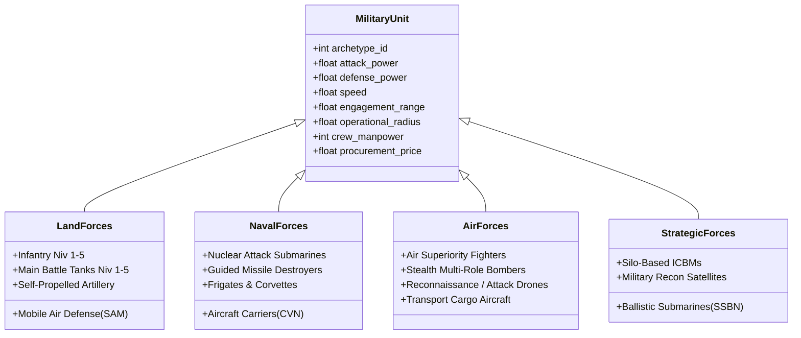
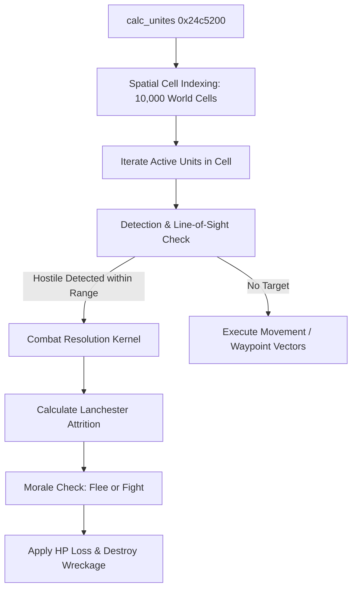

# Volume 3: Military Systems, Combat & Geopolitics

---

## 1. Military Unit Data Structures (`UNIT`)

All military forces in GPS5 exist as discrete physical entities managed in a global static array of 120,000 slots located at `G_61d0deb0` (record tag `'UNIT'`, serializer `f_14a96e0`):
- **Stride**: `0x750` bytes (1,872 bytes per unit).
- **Total In-Memory Size**: $120,000 \times 1,872 \approx 224.6 \text{ MB}$.

```
+0x00:  uint32_t unit_id;               // Unique entity ID in active simulation pool
+0x04:  uint16_t nation_id;             // Owning nation index (0..299)
+0x06:  uint16_t archetype_id;          // Unit class reference into xue.gt.tsv
+0x08:  float    pos_x;                 // World longitude coordinate
+0x0c:  float    pos_y;                 // World latitude coordinate
+0x10:  float    pos_z;                 // Altitude / depth (negative for submarines)
+0x14:  float    heading;               // Heading rotation in radians
+0x18:  float    hp_current;            // Current operational integrity / hit points
+0x1c:  float    hp_max;                // Maximum nominal hit points
+0x20:  float    morale;                // Combat morale [0.0, 1.0]
+0x24:  float    experience;            // Veteran level [0.0, 2.0]
+0x28:  float    fuel_current;          // Current fuel supply
+0x2c:  float    ammo_current;          // Current ammunition reserve
+0x30:  uint32_t current_order;         // Bitfield: Move, Attack, Patrol, Siege, Guard
+0x34:  uint32_t target_unit_id;        // Hostile target unit ID under engagement
+0x38:  float    target_x, target_y;    // Destination waypoint coordinates
+0x40:  uint32_t base_facility_id;      // Home base/barracks/port/airfield index
+0x58:  uint32_t cargo_unit_head;       // Linked list head for embarked units
+0x750: [Next Unit Record]
```

---

## 2. Unit Archetype Design Catalogue (`xue.gt.tsv`)

Unit base parameters are defined across 1,050 rows in `data/gt/xue.gt.tsv`. Each unit belongs to an operational domain:



### 2.1 Technical Specifications of Benchmark Formations

| Archetype Name | Tier | Attack (`Attaque`) | Defense (`Defense`) | Speed (`Vitesse`) | Range (`Distance`) | Radius (`Autonomie`) | Crew (`Hommes`) | Procurement Price (`Prix`) |
| :--- | :--- | :--- | :--- | :--- | :--- | :--- | :--- | :--- |
| **Infantry (`soldats CRG`)** | Tier 1 | 6.0 | 10.0 | 0.356 km/h | 2.0 km | 1,000,000 km | 1 soldier | \$10,000 |
| **Infantry (`soldats CRG`)** | Tier 5 | 10.0 | 10.0 | 0.486 km/h | 2.0 km | 1,000,000 km | 1 soldier | \$25,000 |
| **Heavy Tank (`tanks`)** | Tier 1 | 1,200.0 | 1,200.0 | 0.178 km/h | 2.0 km | 1,500,000 km | 5 crew | \$2,100,000 |
| **Heavy Tank (`tanks`)** | Tier 5 | 2,000.0 | 2,000.0 | 0.243 km/h | 2.0 km | 1,500,000 km | 5 crew | \$3,500,000 |
| **Fighter (`chasseur`)** | Tier 1 | 800.0 | 600.0 | 1.800 km/h | 35.0 km | 2,500 km | 1 pilot | \$35,000,000 |
| **Fighter (`chasseur`)** | Tier 5 | 2,200.0 | 1,800.0 | 2.500 km/h | 80.0 km | 4,200 km | 1 pilot | \$95,000,000 |
| **Destroyer (`destroyer`)** | Tier 3 | 4,500.0 | 5,000.0 | 0.450 km/h | 60.0 km | 12,000 km | 220 sailors | \$850,000,000 |
| **Carrier (`porte-avions`)**| Tier 5 | 2,000.0 | 8,500.0 | 0.520 km/h | 150.0 km | Unlimited (Nucl)| 3,200 crew | \$5,500,000,000 |
| **ICBM Silo (`silo`)** | Tier 1 | 50,000.0 | 5,000.0 | N/A (Stationary)| Global | Global | 50 crew | \$150,000,000 |

---

## 3. Procurement, Construction & Upkeep Mechanics

### 3.1 Unit Production (`add_construction` / `0x18fd700`)
Commissioning a military unit requires:
1. **Financial Allocation**: Base price loaded from `prix_normal_construction` (`0x1cba4d0`).
2. **Industrial Capacity**: Output from domestic defense activities (`DEFA`, `DEF2`, `DEFB`).
3. **Manpower Quota**: Active military recruits deducted from the national available manpower pool (`MILA` at `+0xc850` in `NATI`).
4. **Build Duration**: Time-to-build $T_{\text{build}}$ (e.g., 90 days for tanks, 720 days for nuclear submarines).

### 3.2 Operational Upkeep & Maintenance (`BDEM` / `CATE`)
Units incur daily maintenance costs deducted from the Defense Budget (`BDEM` at offset `+0x7b64` in `NATI`):
$$\text{UpkeepCost}(u) = \text{BasePrice}(u) \times \mu_{\text{upkeep}} \times \left(1 + \text{OverseasMultiplier}\right)$$
- If deployed abroad, overseas maintenance surcharges are logged under `CATE` (offset `+0x230`).
- **Readiness Decay**: If the defense budget is cut below maintenance requirements:
  $$\text{DeficitRatio} = \frac{\text{BudgetAllocated}}{\text{TotalMaintenanceDemanded}}$$
  Units suffer passive operational attrition: fuel reserves drop, and hit points decay by up to 2% per macro-turn.

### 3.3 Reconstruction & Field Repair (`0x24c7870`)
Damaged units within operational radius of an undamaged base facility (`BMTE` for army, `BMMN` for navy, `BMAI` for air force) regenerate health at a financial cost evaluated by `calcul_cout_reconstruction`:
$$\text{RepairCost} = \left(1 - \frac{\text{hp\_current}}{\text{hp\_max}}\right) \times \text{BasePrice} \times 0.40$$

---

## 4. Spatial Partitioning & Combat Execution (`calc_unites`)

Combat simulation executes in `calc_unites` (`0x24c5200`), running during Phase 8 of `calc_monde`:



### 4.1 Spatial Grid Hash Table
To avoid $O(N^2)$ pairwise distance checks across 120,000 units, the world surface is partitioned into 10,000 spatial cells managed via linked list headers in `.data` (`0x7ff6b5f72230`):
$$\text{CellX} = \lfloor \text{pos\_x} \times K_{x} \rfloor, \quad \text{CellY} = \lfloor \text{pos\_y} \times K_{y} \rfloor$$
$$\text{CellIndex} = \text{CellY} \times 100 + \text{CellX}$$
Units query only their immediate cell and adjacent 8 neighbors for targeting.

### 4.2 Lanchester Combat Engagement Formula
When unit $A$ engages hostile unit $B$ at distance $d \le \text{Range}_{A}$:
$$\text{Damage}(A \to B) = \Delta t \times \frac{\text{Atk}_{A} \times \text{Morale}_{A} \times \left(1 + 0.25 \cdot \text{Exp}_{A}\right)}{\text{Def}_{B} \times \text{TerrainMod}} \times \Xi(A, B)$$

Where:
- $\text{TerrainMod}$ accounts for cover: $1.0$ in open plains, $1.5$ in forests, $2.5$ in urban centers (`warville`), $3.0$ in fortified bunkers.
- $\Xi(A, B)$ is the domain effectiveness matrix (e.g., SAM batteries deal $4.0\times$ damage against aircraft; torpedoes deal $3.5\times$ damage against ships; infantry deal negligible damage against heavy tanks).

### 4.3 Ammunition Depletion & Retreat
Each combat tick subtracts ammunition:
$$\text{ammo\_current} = \max\left(0.0, \text{ammo\_current} - \kappa_{\text{ammo}} \Delta t\right)$$
When $\text{ammo\_current} = 0$, unit attack drops to $10\%$ of nominal value. If $\text{hp\_current} / \text{hp\_max} < 0.25$ or $\text{Morale} < 0.20$, the unit breaks formation and executes an emergency routing order to the nearest friendly territory.

---

## 5. Strategic Warfare, Urban Destruction & Conflict Records (`CONF`)

Wars and alliances are tracked in the `CONF` record pool (serializer `f_14585e0`, stride `0x12d0`, 2,000 active slots):
- Belligerent nation indices (attacker coalition vs. defender coalition).
- Formal war objectives: Annexation, regime change, demilitarization, liberation.
- Casus belli validity & UN Security Council authorization flags.

### 5.1 Urban Combat & Population Losses (`gestion_popu_warville` / `0x219cfb0`)
When ground or bombardment units fight within a city's spatial radius:
1. **Civilian Casualties**: Computed via `calc_cata_victimes_initiales` (`0x182afc0`):
   $$\Delta \text{Casualties} = \text{Pop}_{\text{city}} \times \frac{\sum \text{Damage}_{\text{heavy weapons}}}{\text{Fortification}_{\text{city}}} \times 0.005$$
   Fatalities are subtracted directly from national population (`NATI.POPU` at `+0x4428`).
2. **Infrastructure Ruin**: Urban buildings (`xue.gt.tsv` rows 1..15) transition across three physical degradation states:
   $$\text{Intact} \longrightarrow \text{Semi-Ruin} \longrightarrow \text{Complete Ruin}$$
   Ruin transitions destroy housing stock, raising homeless population (`NSDF` at `+0x4478`) and spawning climate/war refugees (`RCLW` at `+0x619ca0`).

### 5.2 Strategic Nuclear Weapons & Ballistic Interception
Nuclear warfare mechanics are handled by dedicated trigger routines:
- **Launch Sequence**: Silos or SSBNs fire ICBMs with sub-orbital ballistic flight arcs.
- **Interception Roll**: Anti-ballistic missile defense systems (e.g., Patriot, S-400, Iron Dome) execute an interception test against incoming warheads:
  $$P(\text{Intercept}) = \text{Def}_{\text{abm}} \times \text{TechLevel}_{\text{abm}} - \text{Stealth}_{\text{icbm}}$$
- **Detonation**: If warheads penetrate, target cities suffer $85\%$ to $99\%$ immediate population mortality, industrial buildings are deleted from `CBAT`, regional terrain climate is poisoned, and global atmospheric soot parameters increment.
