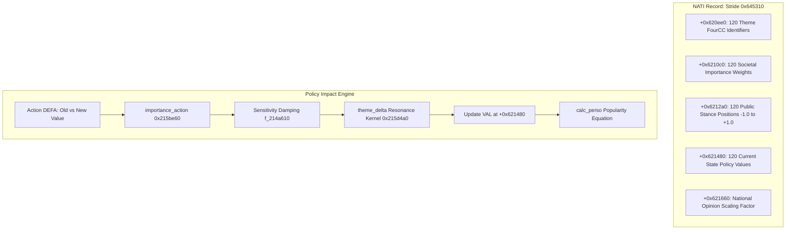
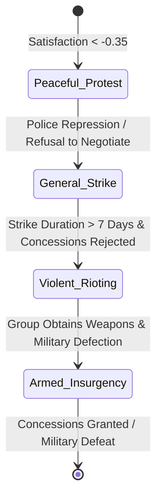

# Volume 4: Politics, Popularity & Social Dynamics

---

## 1. The 120-Theme Political Opinion Ledger

In GPS5, public opinion is not a single abstract percentage. Every sovereign nation record (`NATI`) embeds a **120-dimensional political opinion ledger** that quantifies the ideological desires and policy perceptions of the electorate across 120 distinct societal themes.

### 1.1 Memory Offsets of the National Ledger
Located within each nation record `*0x46208908 + (nation_idx * 0x645310)`:
- `+0x620ee0`: `int32_t theme_ids[120]` — 4-byte packed ASCII tokens.
  - Social / Welfare: `SCOL` (Schools), `HOSP` (Hospitals), `LOGE` (Housing), `FAMI` (Family), `VIEU` (Elderly/Pensions).
  - Law & Order / State: `JUST` (Justice), `POLI` (Police), `ARME` (Military), `4SEC` (Security vs. Liberty).
  - Economy & Labor: `3CAP` (Capitalism), `2LIB` (Free Market Liberalism), `5IND` (Individualism), `TRAN` (Transport).
  - Cultural / Moral: `FEMM` (Women's Rights), `RELI` (Religion), `CULT` (Arts/Culture), `SPOR` (Sports), `1DIC` (Authoritarianism).
- `+0x6210c0`: `float theme_importance[120]` — Relative priority of each theme in public discourse.
- `+0x6212a0`: `float theme_position[120]` — Societal target position $[-1.0, +1.0]$.
- `+0x621480`: `float theme_value[120]` — Current perceived governmental policy value $[-1.0, +1.0]$.
- `+0x621660`: `float ledger_scale` — National opinion scaling constant.

---

## 2. Mathematical Formulation of Policy Impact

When any policy parameter or statutory law changes from $V_{\text{old}}$ to $V_{\text{new}}$, the engine computes societal reaction through a rigorous pipeline ported and verified in `tools/orient_check.py`:

### 2.1 The Action Importance Kernel (`importance_action` / `0x215be60`)
The raw importance of a policy reform depends on the magnitude of the change relative to the action's predefined step increment and existing baseline:
1. **Normalized Step Delta**:
   $$\text{steps} = \frac{V_{\text{new}} - V_{\text{old}}}{\text{step}}$$
   $$\text{mid} = \frac{V_{\text{new}} + V_{\text{old}}}{2}$$
2. **Asymmetric Policy Distortion Flags** (read from action bitfield `+0x58`):
   $$\text{steps} \leftarrow \begin{cases}
   \text{steps} \times 1.33 & \text{if bit 16 is set and } \text{steps} > 0 \\
   \text{steps} \times 2.00 & \text{if bit 17 is set and } \text{steps} > 0 \\
   \text{steps} \times 1.33 & \text{if bit 18 is set and } \text{steps} < 0 \\
   \text{steps} \times 2.00 & \text{if bit 19 is set and } \text{steps} < 0
   \end{cases}$$
3. **Asymptotic Base Formula**:
   Parameters $A, B$ are loaded from offset `+0x224` of the action record (`DEFA`):
   $$\text{base} = \frac{\text{step} \times A}{\text{step} + \text{mid}} + B$$
   $$v = \text{base} \times \text{steps} \times 0.01$$
4. **Minimum Value Dampening**:
   If flag bit 15 is active, reforms near zero are dampened to prevent excessive backlash for minor cosmetic tweaks:
   $$h = \frac{\min(\text{mn}, \text{val})}{2}$$
   $$\text{If } \text{step} > 0 \text{ and } (h - \text{mid}) > 0 \implies v \leftarrow v \times \left(1 - \frac{h - \text{mid}}{h}\right)$$
5. **Clamping**:
   $$\text{Importance}_{\text{raw}} = \text{clamp}(v, -4.0, +4.0)$$

### 2.2 Sensitivity Damping (`f_214a610`)
Each action specifies a public sensitivity parameter $\mathtt{sens}$ at offset `+0x74`:
$$\text{Importance} = \begin{cases}
\text{Importance}_{\text{raw}} \times \left(1 - \frac{\mathtt{sens}}{10}\right) & \text{if } \mathtt{sens} < 0 \\
\frac{\text{Importance}_{\text{raw}}}{\frac{\mathtt{sens}}{10} + 1} & \text{if } \mathtt{sens} \ge 0
\end{cases}$$

### 2.3 The Theme Delta Resonance Kernel (`theme_delta` / `0x215d4a0`)
An action updates up to 30 themes simultaneously. For each linked theme $j$ with target threshold $\text{thr}_{j}$, weight $w_{j}$, and public position $\text{pos}_{j}$:
1. **Target Distance**:
   $$x = \text{clamp}\left(\frac{\text{thr}_{j} - \text{pos}_{j}}{2}, -1.0, +1.0\right)$$
   If $\text{thr}_{j}$ and $\text{pos}_{j}$ share the same sign but $|\text{thr}_{j}| < |\text{pos}_{j}|$, then $x \leftarrow 0.5 x$.
2. **Piecewise Resonance Function $f(x)$**:
   $$f(x) = \begin{cases}
   1.0 - \frac{|x| \times 0.75}{0.20} & \text{if } |x| < 0.20 \\
   \frac{(1.0 - |x|) \times 0.75}{0.80} - 1.0 & \text{if } |x| \ge 0.20
   \end{cases}$$
   - When $|x| < 0.20$ (the reform aligns closely with public desire), $f(x) > 0$, generating **public approval**.
   - When $|x| > 0.20$ (the reform diverges from public desire), $f(x) < 0$, generating **public anger**.
3. **Magnitude Multiplication**:
   $$p = (\text{Importance} \times w_{j}) \times (\text{theme\_importance}_{j} \times \text{ledger\_scale})$$
   $$r = f(x) \times p$$
   $$\Delta \text{Value}_{j} = \begin{cases}
   r \times (\max(k, -1.0) + 1.0) & \text{if } k < 0 \\
   r + |p| \times k & \text{if } k \ge 0
   \end{cases}$$
Where $k$ is the curvature parameter passed by the caller. $\Delta \text{Value}_{j}$ is accumulated into `theme_value[j]`.

---

## 3. The Popularity Formulation (`calc_perso`)

The Head of State's overall political popularity rating $\mathtt{Pop} \in [0.0, 1.0]$ is recalculated without artificial smoothing inside `calc_perso` (`0x219cfb0`):

$$\mathtt{Pop} = 0.75 \times \left(0.50 + 0.50 \times S_{\text{themes}}\right) + 0.25 \times \left(0.50 + \frac{\sum_{i=1}^{N_{\text{peers}}} \text{Opinion}_{i}}{2 \cdot N_{\text{peers}}}\right) + \sum \text{Offsets}$$

### 3.1 Term Breakdown
1. **Theme Satisfaction Aggregate ($S_{\text{themes}}$)**:
   $$S_{\text{themes}} = \frac{\sum_{j=1}^{120} \left( \text{theme\_importance}_{j} \times \text{theme\_value}_{j} \right)}{\sum_{j=1}^{120} \text{theme\_importance}_{j}}$$
   Since all $\text{theme\_value}_{j}$ start at $0.0$ at scenario inception, the baseline public satisfaction term evaluates exactly to:
   $$0.50 + 0.50 \times 0.0 = 0.50 \text{ (50\%)}$$
2. **Peer & Elite Approval Aggregate**:
   Evaluates the approval of the Head of State among $N_{\text{peers}}$ key actors: cabinet ministers, ruling party deputies, military chiefs of staff, and leading trade union heads. Each actor's opinion $\text{Opinion}_{i} \in [-1.0, +1.0]$ contributes to the institutional stability score.
3. **Exogenous Offsets**:
   Direct additive bonuses/penalties:
   - Scandal active in press: $-0.05$ to $-0.25$.
   - Victorious war / rally-around-the-flag: $+0.10$ to $+0.30$.
   - Ongoing famine / severe blackouts: $-0.15$ to $-0.40$.

### 3.2 Game Difficulty Scaling (`f_1cd2170`)
Public backlash and approval swings are scaled by game difficulty coefficients:
$$\text{DifficultyFactor} = \begin{cases}
0.38 & \text{Easy} \\
1.00 & \text{Normal} \\
1.45 & \text{Hard}
\end{cases}$$
For human player-controlled nations, the engine applies an additional stabilizing divisor of $3.0$ ($\times \frac{1}{3}$) to prevent instant electoral collapse from single controversial decrees.

---

## 4. Social & Pressure Groups (`GROU`)

Society is stratified into 15,000 active group instances (`GROU`, serializer `f_146e300`, stride `0xb88` / 2,952 bytes):
- **Archetypes**: Industrial Workers Unions, Public Sector Unions, Business Confederations, Farmers Associations, Religious Clergy, Student Movements, Retirees, Environmental Lobbies, Police Unions, Armed Forces Officer Corps.

### 4.1 Internal State Variables
- `+0x00`: Group unique identifier.
- `+0x04`: Owning nation ID.
- `+0x10`: Societal influence weight (percentage of national electorate represented).
- `+0x24`: Current satisfaction rating towards government $[-1.0, +1.0]$.
- `+0x89`: Ideological alignment vector.
- `+0x9f`: Total parliamentary seats controlled (for political parties).
- `+0x2a0`: Radicalization index $[0.0, 1.0]$.
- `+0x2ba`: Strike fund / liquid campaign reserves.

### 4.2 Protests, Strikes & Riots Engine (`TROU` / `gps_troubles.cpp`)
When a group's satisfaction drops below its radicalization threshold:
$$\text{Trigger Condition}: \mathtt{GROU.satisfaction} < -0.35 \quad \text{and} \quad \mathtt{GROU.influence} > 0.05$$
The engine instantiates a trouble record in the `TROU` array (stride `0x348`, 6,000 slots) via `add_trouble` (`0x247eb60`):

1. **Gravity Progression (`trouble_update_gravite` / `0x248bc10`)**:
   $$\text{Gravity}(t) = \text{Gravity}(t-1) \times 0.95 + \text{AngerFactor} \times \text{Mobilization}$$
2. **Economic Damage**:
   - In `General_Strike`, linked industrial sectors (`xae.gt`) suffer production penalties $\Phi(\text{unit}) \leftarrow \Phi(\text{unit}) \times (1 - \text{Mobilization})$.
   - In `Violent_Rioting`, transport networks (`CHMN`) and commercial buildings (`CBAT`) suffer physical structural damage, requiring state reconstruction spending.
