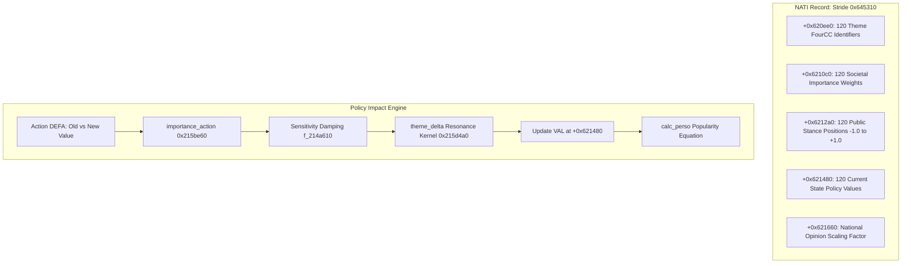
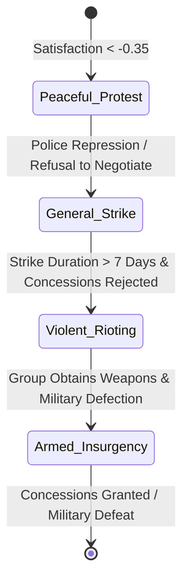

# Volume 4: Politics, Popularity & Social Dynamics

---

## 1. The 120-Theme Political Opinion Ledger

In GPS5, public opinion is not a single abstract percentage. Every sovereign nation record (`NATI`) embeds a **120-dimensional political opinion ledger** that quantifies the ideological desires and policy perceptions of the electorate across 120 distinct societal themes.



### 1.1 Memory Offsets of the National Ledger
Located within each nation record `*0x46208908 + (nation_idx * 0x645310)`:
- `+0x620ee0`: `int32_t theme_ids[120]` — 4-byte packed ASCII tokens.
  - Social / Welfare: `SCOL` (Schools), `HOSP` (Hospitals), `LOGE` (Housing), `FAMI` (Family), `VIEU` (Elderly/Pensions).
  - Law & Order / State: `JUST` (Justice), `POLI` (Police), `ARME` (Military), `4SEC` (Security vs. Liberty).
  - Economy & Labor: `3CAP` (Capitalism), `2LIB` (Free Market Liberalism), `5IND` (Individualism), `TRAN` (Transport).
  - Cultural / Moral: `FEMM` (Women's Rights), `RELI` (Religion), `CULT` (Arts/Culture), `SPOR` (Sports), `1DIC` (Authoritarianism).
- `+0x6210c0`: `float theme_importance[120]` — Relative priority of each theme in public discourse.
- `+0x6212a0`: `float theme_position[120]` — Societal target position $[-1.0, +1.0]$.
- `+0x621480`: `float theme_value[120]` — Current perceived governmental policy value $[-1.0, +1.0]$.
- `+0x621660`: `float ledger_scale` — National opinion scaling constant.

---

### 1.2 Architectural Dimension: 120 Logical Themes vs. 128 Aligned Slots
In the game engine binaries and data structures, the opinion ledger is accessed via two complementary conventions:
1. **The 120-Iteration Simulation Bound (`0x78`)**:
   As decompiled in `FUN_7ff648547ef0` (`d_01c.c:147786`) and `calc_opinion` (`d_021.c:58624`), the execution loop terminates with `if (0x77 < iVar2) return -1;` or `while ((int)uVar4 < 0x78);`. There are exactly 120 active/allocatable theme positions in the game's contiguous arrays (each array spanning $120 \times 4 = 480$ / `0x1e0` bytes).
2. **The 128-Element Memory Block Alignment (`0x80`)**:
   In low-level heap memory buffers, serialization descriptors, and vector/SIMD processing buffers, the structure is padded and power-of-two aligned to 128 elements ($128 \times 4 = 512$ bytes).
3. **Array Layout inside `NATI` (Stride `0x645310`)**:
   - `+0x620ee0` ($120 \times \mathtt{int32\_t}$ = 480 B): FourCC Theme Identifiers.
   - `+0x6210c0` ($120 \times \mathtt{float}$ = 480 B): Electorate Importance Weights.
   - `+0x6212a0` ($120 \times \mathtt{float}$ = 480 B): Public Target Positions $[-1.0, +1.0]$.
   - `+0x621480` ($120 \times \mathtt{float}$ = 480 B): Perceived Policy Values $[-1.0, +1.0]$.
   - `+0x621660` ($1 \times \mathtt{float}$ = 4 B): Master Ledger Scaling Constant.

---

### 1.3 Complete Enumeration of the 120 Opinion Theme Array (Slots 0 to 119)

Below is the complete, exhaustive index of every slot in the national opinion array, verified directly from unpacked nation records (`us_nation.bin`, `fr_nation.bin`, `nations_0_7.bin`), action references (`actions.bin`), localization records (`data/gt/xim.gt.tsv`), and engine emulation scripts (`tools/orient_check.py`):

| Slot | Token | Raw Hex | Masked FourCC | English Theme Description | Category & Aliases |
| :--- | :--- | :--- | :--- | :--- | :--- |
| **0** | `1DIC` | `0x31444943` | `1DIC` (`0x31444943`) | State Authority vs. Human Rights | Core Ideological Pole |
| **1** | `2LIB` | `0x324c4942` | `2LIB` (`0x324c4942`) | State Employees vs. Public Sector | Core Ideological Pole |
| **2** | `3CAP` | `0x33434150` | `3CAP` (`0x33434150`) | Capitalism vs. Social Welfare | Core Ideological Pole |
| **3** | `4SEC` | `0x34534543` | `4SEC` (`0x34534543`) | Security vs. Civil Liberties | Core Ideological Pole |
| **4** | `5IND` | `0x35494e44` | `5IND` (`0x35494e44`) | Sovereignty vs. Foreign Policy | Core Ideological Pole |
| **5** | `HOSP` | `0x484f5350` | `HOSP` (`0x484f5350`) | Health | Standard Domain |
| **6** | `HOS2` | `0x484f5332` | `HOS2` (`0x484f5332`) | Health | Alias -> `HOSP` |
| **7** | `VIEU` | `0x56494555` | `VIEU` (`0x56494555`) | Old folks | Standard Domain |
| **8** | `VIE2` | `0x56494532` | `VIE2` (`0x56494532`) | Old folks *(Alias for `VIEU`)* | Alias -> `VIEU` |
| **9** | `JEUN` | `0x4a45554e` | `JEUN` (`0x4a45554e`) | Young people | Standard Domain |
| **10** | `FAMI` | `0x46414d49` | `FAMI` (`0x46414d49`) | Family | Standard Domain |
| **11** | `FAM2` | `0x46414d32` | `FAM2` (`0x46414d32`) | Family *(Alias for `FAMI`)* | Alias -> `FAMI` |
| **12** | `FEMM` | `0x46454d4d` | `FEMM` (`0x46454d4d`) | Women's rights | Standard Domain |
| **13** | `FEM2` | `0x46454d32` | `FEM2` (`0x46454d32`) | Women's rights *(Alias for `FEMM`)* | Alias -> `FEMM` |
| **14** | `AVOR` | `0x41564f52` | `AVOR` (`0x41564f52`) | Abortion | Standard Domain |
| **15** | `LOGE` | `0x4c4f4745` | `LOGE` (`0x4c4f4745`) | Housing | Standard Domain |
| **16** | `LOG2` | `0x4c4f4732` | `LOG2` (`0x4c4f4732`) | Housing *(Alias for `LOGE`)* | Alias -> `LOGE` |
| **17** | `SCOL` | `0x53434f4c` | `SCOL` (`0x53434f4c`) | Education | Standard Domain |
| **18** | `SCO2` | `0x53434f32` | `SCO2` (`0x53434f32`) | Education | Alias -> `SCOL` |
| **19** | `INTE` | `0x494e5445` | `INTE` (`0x494e5445`) | Integration / anti-racism | Standard Domain |
| **20** | `HUMA` | `0x48554d41` | `HUMA` (`0x48554d41`) | Humanitarian | Standard Domain |
| **21** | `HUM2` | `0x48554d32` | `HUM2` (`0x48554d32`) | Humanitarian *(Alias for `HUMA`)* | Alias -> `HUMA` |
| **22** | `ABMO` | `0x41424d4f` | `ABMO` (`0x41424d4f`) | Abolition of the death penalty | Standard Domain |
| **23** | `PROS` | `0x50524f53` | `PROS` (`0x50524f53`) | Prostitution | Standard Domain |
| **24** | `CHAS` | `0x43484153` | `CHAS` (`0x43484153`) | Hunting restriction | Standard Domain |
| **25** | `HAND` | `0x48414e44` | `HAND` (`0x48414e44`) | Handicap | Standard Domain |
| **26** | `CONS` | `0x434f4e53` | `CONS` (`0x434f4e53`) | Consumers | Standard Domain |
| **27** | `ANIM` | `0x414e494d` | `ANIM` (`0x414e494d`) | Animals | Standard Domain |
| **28** | `JEUX` | `0x4a455558` | `JEUX` (`0x4a455558`) | Video games | Standard Domain |
| **29** | `RECH` | `0x52454348` | `RECH` (`0x52454348`) | Research | Standard Domain |
| **30** | `REC2` | `0x52454332` | `REC2` (`0x52454332`) | Research | Alias -> `RECH` |
| **31** | `PHYS` | `0x50485953` | `PHYS` (`0x50485953`) | Physics/chemistry | Standard Domain |
| **32** | `ASTR` | `0x41535452` | `ASTR` (`0x41535452`) | Meteorology | Standard Domain |
| **33** | `SPAC` | `0x53504143` | `SPAC` (`0x53504143`) | Space Research | Standard Domain |
| **34** | `AERO` | `0x4145524f` | `AERO` (`0x4145524f`) | Aeronautics | Standard Domain |
| **35** | `GENE` | `0x47454e45` | `GENE` (`0x47454e45`) | Genetics | Standard Domain |
| **36** | `SIDA` | `0x53494441` | `SIDA` (`0x53494441`) | Fight against AIDS | Standard Domain |
| **37** | `CANC` | `0x43414e43` | `CANC` (`0x43414e43`) | Fight against cancer | Standard Domain |
| **38** | `CULT` | `0x43554c54` | `CULT` (`0x43554c54`) | Culture | Standard Domain |
| **39** | `CUL2` | `0x43554c32` | `CUL2` (`0x43554c32`) | Culture *(Alias for `CULT`)* | Alias -> `CULT` |
| **40** | `MUSV` | `0x4d555356` | `MUSV` (`0x4d555356`) | Variety music | Standard Domain |
| **41** | `MUSI` | `0x4d555349` | `MUSI` (`0x4d555349`) | Classical music | Standard Domain |
| **42** | `MUSR` | `0x4d555352` | `MUSR` (`0x4d555352`) | Rock | Standard Domain |
| **43** | `PEIN` | `0x5045494e` | `PEIN` (`0x5045494e`) | Painting | Standard Domain |
| **44** | `LITT` | `0x4c495454` | `LITT` (`0x4c495454`) | Literature | Standard Domain |
| **45** | `CINE` | `0x43494e45` | `CINE` (`0x43494e45`) | Cinema | Standard Domain |
| **46** | `THEA` | `0x54484541` | `THEA` (`0x54484541`) | Theatre | Standard Domain |
| **47** | `DANS` | `0x44414e53` | `DANS` (`0x44414e53`) | Dance | Standard Domain |
| **48** | `MODE` | `0x4d4f4445` | `MODE` (`0x4d4f4445`) | Fashion | Standard Domain |
| **49** | `ARCH` | `0x41524348` | `ARCH` (`0x41524348`) | Architecture | Standard Domain |
| **50** | `MEDI` | `0x4d454449` | `MEDI` (`0x4d454449`) | Media | Standard Domain |
| **51** | `ARME` | `0x41524d45` | `ARME` (`0x41524d45`) | Militarism | Standard Domain |
| **52** | `SENA` | `0x53454e41` | `SENA` (`0x53454e41`) | Militarism | Standard Domain |
| **53** | `ARMR` | `0x41524d52` | `ARMR` (`0x41524d52`) | Repatriation of troops in foreign countries | Standard Domain |
| **54** | `ARM3` | `0x41524d33` | `ARM3` (`0x41524d33`) | National defense | Standard Domain |
| **55** | `SPOR` | `0x53504f52` | `SPOR` (`0x53504f52`) | Sport | Standard Domain |
| **56** | `SPO2` | `0x53504f32` | `SPO2` (`0x53504f32`) | Sport *(Alias for `SPOR`)* | Alias -> `SPOR` |
| **57** | `FOOT` | `0x464f4f54` | `FOOT` (`0x464f4f54`) | Football-Soccer | Standard Domain |
| **58** | `TENN` | `0x54454e4e` | `TENN` (`0x54454e4e`) | Tennis | Standard Domain |
| **59** | `AUTO` | `0x4155544f` | `AUTO` (`0x4155544f`) | Automobile | Standard Domain |
| **60** | `ENVI` | `0x454e5649` | `ENVI` (`0x454e5649`) | Environment | Standard Domain |
| **61** | `TRAN` | `0x5452414e` | `TRAN` (`0x5452414e`) | Transport | Standard Domain |
| **62** | `TRA2` | `0x54524132` | `TRA2` (`0x54524132`) | Transport *(Alias for `TRAN`)* | Alias -> `TRAN` |
| **63** | `TRAI` | `0x54524149` | `TRAI` (`0x54524149`) | Rail transport | Standard Domain |
| **64** | `AVIO` | `0x4156494f` | `AVIO` (`0x4156494f`) | Air transport | Standard Domain |
| **65** | `ROUT` | `0x524f5554` | `ROUT` (`0x524f5554`) | Road transport | Standard Domain |
| **66** | `INDU` | `0x494e4455` | `INDU` (`0x494e4455`) | Industry | Standard Domain |
| **67** | `ENER` | `0x454e4552` | `ENER` (`0x454e4552`) | Energy independence | Standard Domain |
| **68** | `ENEE` | `0x454e4545` | `ENEE` (`0x454e4545`) | Energy | Standard Domain |
| **69** | `AGRI` | `0x41475249` | `AGRI` (`0x41475249`) | Agriculture | Standard Domain |
| **70** | `PECH` | `0x50454348` | `PECH` (`0x50454348`) | Fishing | Standard Domain |
| **71** | `JUST` | `0x4a555354` | `JUST` (`0x4a555354`) | Justice | Standard Domain |
| **72** | `JUS2` | `0x4a555332` | `JUS2` (`0x4a555332`) | Justice *(Alias for `JUST`)* | Alias -> `JUST` |
| **73** | `TERR` | `0x54455252` | `TERR` (`0x54455252`) | Anti-terrorism | Standard Domain |
| **74** | `SECT` | `0x53454354` | `SECT` (`0x53454354`) | Fight against religious sects | Standard Domain |
| **75** | `ARPE` | `0x41525045` | `ARPE` (`0x41525045`) | Purchasing power | Standard Domain |
| **76** | `TFO1` | `0x54464f31` | `TFO1` (`0x54464f31`) | State Authority vs. Human Rights *(Alias for `1DIC`)* | Alias -> `1DIC` |
| **77** | `TFO2` | `0x54464f32` | `TFO2` (`0x54464f32`) | State Employees vs. Public Sector *(Alias for `2LIB`)* | Alias -> `2LIB` |
| **78** | `TFO3` | `0x54464f33` | `TFO3` (`0x54464f33`) | Capitalism vs. Social Welfare *(Alias for `3CAP`)* | Alias -> `3CAP` |
| **79** | `TFO4` | `0x54464f34` | `TFO4` (`0x54464f34`) | Security vs. Civil Liberties *(Alias for `4SEC`)* | Alias -> `4SEC` |
| **80** | `TFO5` | `0x54464f35` | `TFO5` (`0x54464f35`) | Sovereignty vs. Foreign Policy *(Alias for `5IND`)* | Alias -> `5IND` |
| **81** | `COLT` | `0x434f4c54` | `COLT` (`0x434f4c54`) | Firearms | Standard Domain |
| **82** | `HOMO` | `0x484f4d4f` | `HOMO` (`0x484f4d4f`) | LGBT Rights | Standard Domain |
| **83** | `EUTH` | `0x45555448` | `EUTH` (`0x45555448`) | Physician-assisted suicide | Standard Domain |
| **84** | `CANN` | `0x43414e4e` | `CANN` (`0x43414e4e`) | Consumption of marijuana | Standard Domain |
| **85** | `ADHO` | `0x4144484f` | `ADHO` (`0x4144484f`) | Same-sex parent adoption | Standard Domain |
| **86** | `BPRI` | `0x42505249` | `BPRI` (`0x42505249`) | Low price policy | Standard Domain |
| **87** | `EMPO` | `0x454d504f` | `EMPO` (`0x454d504f`) | Employment | Standard Domain |
| **88** | `IMMG` | `0x494d4d47` | `IMMG` (`0x494d4d47`) | Controlled immigration | Standard Domain |
| **89** | `UEUR` | `0x55455552` | `UEUR` (`0x55455552`) | European Union | Standard Domain |
| **90** | `NUME` | `0x4e554d45` | `NUME` (`0x4e554d45`) | Digital  | Standard Domain |
| **91** | `ALCO` | `0x414c434f` | `ALCO` (`0x414c434f`) | Alcohol | Standard Domain |
| **92** | `ROBO` | `0x524f424f` | `ROBO` (`0x524f424f`) | Automation | Standard Domain |
| **93** | `TRAD` | `0x54524144` | `TRAD` (`0x54524144`) | Conservative Values | Standard Domain |
| **94** | `PRIV` | `0x50524956` | `PRIV` (`0x50524956`) | Respect for Privacy | Standard Domain |
| **95** | `ENFA` | `0x454e4641` | `ENFA` (`0x454e4641`) | Child Protection | Standard Domain |
| **96** | `LCUL` | `0x4c43554c` | `LCUL` (`0x4c43554c`) | Freedom of Religion | Standard Domain |
| **97** | `LAIC` | `0x4c414943` | `LAIC` (`0x4c414943`) | Secularism | Standard Domain |
| **98** | `AREN` | `0x4152454e` | `AREN` (`0x4152454e`) | Enterprises | Standard Domain |
| **99** | `SERV` | `0x53455256` | `SERV` (`0x53455256`) | Services | Standard Domain |
| **100** | `SOLV` | `0xd34f4c56` | `SOLV` (`0x534f4c56`) | Public Finances / Deficit | Standard Domain (Flag bit 31 set: `0xd3` -> `S`) |
| **101** | `MREL` | `0x4d52454c` | `MREL` (`0x4d52454c`) | Majority religion | Standard Domain |
| **102** | `—` | `0x00000000` | `0x00000000` | *Reserved Slot* | Reserved / Unused |
| **103** | `—` | `0x00000000` | `0x00000000` | *Reserved Slot* | Reserved / Unused |
| **104** | `—` | `0x00000000` | `0x00000000` | *Reserved Slot* | Reserved / Unused |
| **105** | `—` | `0x00000000` | `0x00000000` | *Reserved Slot* | Reserved / Unused |
| **106** | `—` | `0x00000000` | `0x00000000` | *Reserved Slot* | Reserved / Unused |
| **107** | `—` | `0x00000000` | `0x00000000` | *Reserved Slot* | Reserved / Unused |
| **108** | `—` | `0x00000000` | `0x00000000` | *Reserved Slot* | Reserved / Unused |
| **109** | `—` | `0x00000000` | `0x00000000` | *Reserved Slot* | Reserved / Unused |
| **110** | `—` | `0x00000000` | `0x00000000` | *Reserved Slot* | Reserved / Unused |
| **111** | `—` | `0x00000000` | `0x00000000` | *Reserved Slot* | Reserved / Unused |
| **112** | `—` | `0x00000000` | `0x00000000` | *Reserved Slot* | Reserved / Unused |
| **113** | `—` | `0x00000000` | `0x00000000` | *Reserved Slot* | Reserved / Unused |
| **114** | `—` | `0x00000000` | `0x00000000` | *Reserved Slot* | Reserved / Unused |
| **115** | `—` | `0x00000000` | `0x00000000` | *Reserved Slot* | Reserved / Unused |
| **116** | `—` | `0x00000000` | `0x00000000` | *Reserved Slot* | Reserved / Unused |
| **117** | `—` | `0x00000000` | `0x00000000` | *Reserved Slot* | Reserved / Unused |
| **118** | `—` | `0x00000000` | `0x00000000` | *Reserved Slot* | Reserved / Unused |
| **119** | `—` | `0x00000000` | `0x00000000` | *Reserved Slot* | Reserved / Unused |

---

### 1.4 Theme Aliasing, High-Bit Flags, and Crisis Modifiers

#### 1.4.1 Engine Alias Redirection Table
When legislative actions or executive decrees modify policy, actions frequently target secondary FourCC tokens. The engine function `FUN_7ff648547ef0` and its companion dispatchers redirect aliases to canonical primary slots according to `tools/orient_check.py`:
- **Education**: `SCO2` $\to$ `SCOL` (Slot 17)
- **Health**: `HOS2` $\to$ `HOSP` (Slot 5)
- **Pensions / Elderly**: `VIE2` $\to$ `VIEU` (Slot 7)
- **Family**: `FAM2` $\to$ `FAMI` (Slot 10)
- **Women's Rights**: `FEM2` $\to$ `FEMM` (Slot 12)
- **Housing**: `LOG2` $\to$ `LOGE` (Slot 15)
- **Humanitarian**: `HUM2` $\to$ `HUMA` (Slot 20)
- **Scientific Research**: `REC2` $\to$ `RECH` (Slot 29)
- **Arts / Culture**: `CUL2` $\to$ `CULT` (Slot 38)
- **Militarism**: `ARM2` $\to$ `ARME` (Slot 51)
- **Sports**: `SPO2` $\to$ `SPOR` (Slot 55)
- **Transportation**: `TRA2` $\to$ `TRAN` (Slot 61)
- **Justice & Legal**: `JUS2` $\to$ `JUST` (Slot 71)
- **Ideological Poles**:
  - `TFO1` $\to$ `1DIC` (Slot 0: Authoritarianism vs. Human Rights)
  - `TFO2` $\to$ `2LIB` (Slot 1: State Employees vs. Public Sector)
  - `TFO3` $\to$ `3CAP` (Slot 2: Capitalism vs. Social Welfare)
  - `TFO4` $\to$ `4SEC` (Slot 3: Security vs. Civil Liberties)
  - `TFO5` $\to$ `5IND` (Slot 4: Sovereignty vs. Foreign Policy)

#### 1.4.2 The High-Bit Sign / Flag Bit (`0x7fffffff` Mask)
In raw memory saves, slot 100 stores `0xd34f4c56`. When unpacked directly as ASCII, byte 0 is `0xd3`. The game engine (`d_021.c:58647`) explicitly executes:
```c
uVar8 = uVar4 & 0x7fffffff;
```
Masking bit 31 transforms `0xd3` ($0x53 \mid 0x80$) back into `0x53` (`'S'`), yielding the standard FourCC string `SOLV` (`0x534f4c56` = Public Finances / Sovereign Solvency). Bit 31 is utilized by the engine as an active state flag indicating whether the sovereign solvency crisis condition is actively firing.

#### 1.4.3 Crisis & Dynamic Event Themes
In addition to the 102 persistent national ledger themes, `data/gt/xim.gt.tsv` defines specialized dynamic event tokens (e.g., pandemic themes `POP_VACC`, `POP_CONF`, `POP_MASQ`, `POP_REST`, `POP_TELE`; trade pact themes `POP_CODH`, `POP_LIEC`; moral/marital events `POP_MARI`, `POP_DIVO`). These dynamic tokens are injected into temporary event calculation contexts (`actions.bin`) and project deltas into the persistent ledger slots via the sensitivity kernel before decaying over time.

---

## 2. Mathematical Formulation of Policy Impact

When any policy parameter or statutory law changes from $V_{\text{old}}$ to $V_{\text{new}}$, the engine computes societal reaction through a rigorous pipeline ported and verified in `tools/orient_check.py`:

### 2.1 The Action Importance Kernel (`importance_action` / `0x215be60`)
The raw importance of a policy reform depends on the magnitude of the change relative to the action's predefined step increment and existing baseline:
1. **Normalized Step Delta**:
   $$\text{steps} = \frac{V_{\text{new}} - V_{\text{old}}}{\text{step}}$$
   $$\text{mid} = \frac{V_{\text{new}} + V_{\text{old}}}{2}$$
2. **Asymmetric Policy Distortion Flags** (read from action bitfield `+0x58`):
   $$\text{steps} \leftarrow \begin{cases}
   \text{steps} \times 1.33 & \text{if bit 16 is set and } \text{steps} > 0 \\
   \text{steps} \times 2.00 & \text{if bit 17 is set and } \text{steps} > 0 \\
   \text{steps} \times 1.33 & \text{if bit 18 is set and } \text{steps} < 0 \\
   \text{steps} \times 2.00 & \text{if bit 19 is set and } \text{steps} < 0
   \end{cases}$$
3. **Asymptotic Base Formula**:
   Parameters $A, B$ are loaded from offset `+0x224` of the action record (`DEFA`):
   $$\text{base} = \frac{\text{step} \times A}{\text{step} + \text{mid}} + B$$
   $$v = \text{base} \times \text{steps} \times 0.01$$
4. **Minimum Value Dampening**:
   If flag bit 15 is active, reforms near zero are dampened to prevent excessive backlash for minor cosmetic tweaks:
   $$h = \frac{\min(\text{mn}, \text{val})}{2}$$
   $$\text{If } \text{step} > 0 \text{ and } (h - \text{mid}) > 0 \implies v \leftarrow v \times \left(1 - \frac{h - \text{mid}}{h}\right)$$
5. **Clamping**:
   $$\text{Importance}_{\text{raw}} = \text{clamp}(v, -4.0, +4.0)$$

### 2.2 Sensitivity Damping (`f_214a610`)
Each action specifies a public sensitivity parameter $\mathtt{sens}$ at offset `+0x74`:
$$\text{Importance} = \begin{cases}
\text{Importance}_{\text{raw}} \times \left(1 - \frac{\mathtt{sens}}{10}\right) & \text{if } \mathtt{sens} < 0 \\
\frac{\text{Importance}_{\text{raw}}}{\frac{\mathtt{sens}}{10} + 1} & \text{if } \mathtt{sens} \ge 0
\end{cases}$$

### 2.3 The Theme Delta Resonance Kernel (`theme_delta` / `0x215d4a0`)
An action updates up to 30 themes simultaneously. For each linked theme $j$ with target threshold $\text{thr}_{j}$, weight $w_{j}$, and public position $\text{pos}_{j}$:
1. **Target Distance**:
   $$x = \text{clamp}\left(\frac{\text{thr}_{j} - \text{pos}_{j}}{2}, -1.0, +1.0\right)$$
   If $\text{thr}_{j}$ and $\text{pos}_{j}$ share the same sign but $|\text{thr}_{j}| < |\text{pos}_{j}|$, then $x \leftarrow 0.5 x$.
2. **Piecewise Resonance Function $f(x)$**:
   $$f(x) = \begin{cases}
   1.0 - \frac{|x| \times 0.75}{0.20} & \text{if } |x| < 0.20 \\
   \frac{(1.0 - |x|) \times 0.75}{0.80} - 1.0 & \text{if } |x| \ge 0.20
   \end{cases}$$
   - When $|x| < 0.20$ (the reform aligns closely with public desire), $f(x) > 0$, generating **public approval**.
   - When $|x| > 0.20$ (the reform diverges from public desire), $f(x) < 0$, generating **public anger**.
3. **Magnitude Multiplication**:
   $$p = (\text{Importance} \times w_{j}) \times (\text{theme\_importance}_{j} \times \text{ledger\_scale})$$
   $$r = f(x) \times p$$
   $$\Delta \text{Value}_{j} = \begin{cases}
   r \times (\max(k, -1.0) + 1.0) & \text{if } k < 0 \\
   r + |p| \times k & \text{if } k \ge 0
   \end{cases}$$
Where $k$ is the curvature parameter passed by the caller. $\Delta \text{Value}_{j}$ is accumulated into `theme_value[j]`.

---

## 3. The Popularity Formulation (`calc_perso`)

The Head of State's overall political popularity rating $\mathtt{Pop} \in [0.0, 1.0]$ is recalculated without artificial smoothing inside `calc_perso` (`0x219cfb0`):

$$\mathtt{Pop} = 0.75 \times \left(0.50 + 0.50 \times S_{\text{themes}}\right) + 0.25 \times \left(0.50 + \frac{\sum_{i=1}^{N_{\text{peers}}} \text{Opinion}_{i}}{2 \cdot N_{\text{peers}}}\right) + \sum \text{Offsets}$$

### 3.1 Term Breakdown
1. **Theme Satisfaction Aggregate ($S_{\text{themes}}$)**:
   $$S_{\text{themes}} = \frac{\sum_{j=1}^{120} \left( \text{theme\_importance}_{j} \times \text{theme\_value}_{j} \right)}{\sum_{j=1}^{120} \text{theme\_importance}_{j}}$$
   Since all $\text{theme\_value}_{j}$ start at $0.0$ at scenario inception, the baseline public satisfaction term evaluates exactly to:
   $$0.50 + 0.50 \times 0.0 = 0.50 \text{ (50\%)}$$
2. **Peer & Elite Approval Aggregate**:
   Evaluates the approval of the Head of State among $N_{\text{peers}}$ key actors: cabinet ministers, ruling party deputies, military chiefs of staff, and leading trade union heads. Each actor's opinion $\text{Opinion}_{i} \in [-1.0, +1.0]$ contributes to the institutional stability score.
3. **Exogenous Offsets**:
   Direct additive bonuses/penalties:
   - Scandal active in press: $-0.05$ to $-0.25$.
   - Victorious war / rally-around-the-flag: $+0.10$ to $+0.30$.
   - Ongoing famine / severe blackouts: $-0.15$ to $-0.40$.

### 3.2 Game Difficulty Scaling (`f_1cd2170`)
Public backlash and approval swings are scaled by game difficulty coefficients:
$$\text{DifficultyFactor} = \begin{cases}
0.38 & \text{Easy} \\
1.00 & \text{Normal} \\
1.45 & \text{Hard}
\end{cases}$$
For human player-controlled nations, the engine applies an additional stabilizing divisor of $3.0$ ($\times \frac{1}{3}$) to prevent instant electoral collapse from single controversial decrees.

---

## 4. Social & Pressure Groups (`GROU`)

Society is stratified into 15,000 active group instances (`GROU`, serializer `f_146e300`, stride `0xb88` / 2,952 bytes):
- **Archetypes**: Industrial Workers Unions, Public Sector Unions, Business Confederations, Farmers Associations, Religious Clergy, Student Movements, Retirees, Environmental Lobbies, Police Unions, Armed Forces Officer Corps.

### 4.1 Internal State Variables
- `+0x00`: Group unique identifier.
- `+0x04`: Owning nation ID.
- `+0x10`: Societal influence weight (percentage of national electorate represented).
- `+0x24`: Current satisfaction rating towards government $[-1.0, +1.0]$.
- `+0x89`: Ideological alignment vector.
- `+0x9f`: Total parliamentary seats controlled (for political parties).
- `+0x2a0`: Radicalization index $[0.0, 1.0]$.
- `+0x2ba`: Strike fund / liquid campaign reserves.

### 4.2 Protests, Strikes & Riots Engine (`TROU` / `gps_troubles.cpp`)
When a group's satisfaction drops below its radicalization threshold:
$$\text{Trigger Condition}: \mathtt{GROU.satisfaction} < -0.35 \quad \text{and} \quad \mathtt{GROU.influence} > 0.05$$
The engine instantiates a trouble record in the `TROU` array (stride `0x348`, 6,000 slots) via `add_trouble` (`0x247eb60`):



1. **Gravity Progression (`trouble_update_gravite` / `0x248bc10`)**:
   $$\text{Gravity}(t) = \text{Gravity}(t-1) \times 0.95 + \text{AngerFactor} \times \text{Mobilization}$$
2. **Economic Damage**:
   - In `General_Strike`, linked industrial sectors (`xae.gt`) suffer production penalties $\Phi(\text{unit}) \leftarrow \Phi(\text{unit}) \times (1 - \text{Mobilization})$.
   - In `Violent_Rioting`, transport networks (`CHMN`) and commercial buildings (`CBAT`) suffer physical structural damage, requiring state reconstruction spending.
