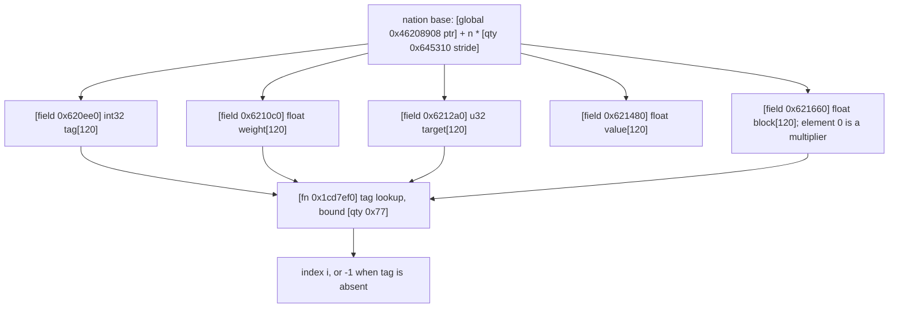
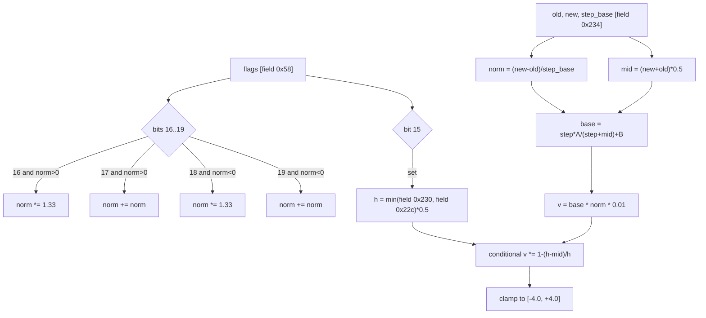
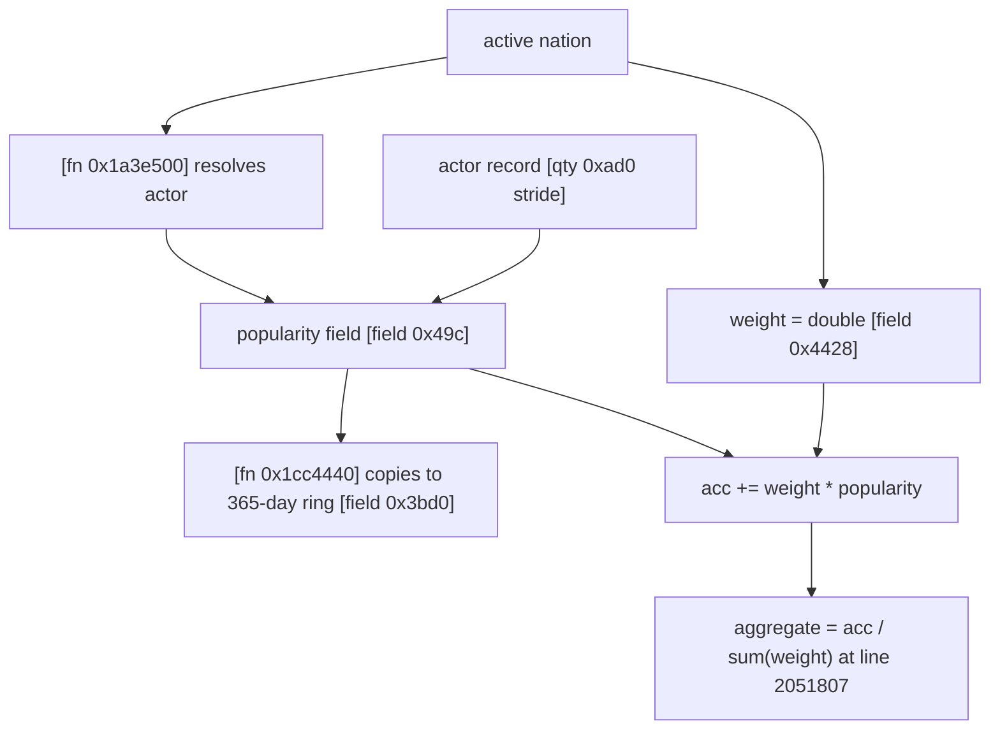
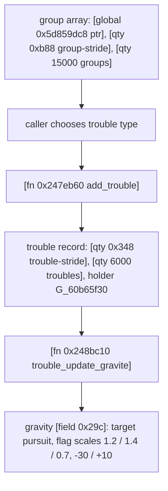

# Volume 4: Politics, Popularity & Social Dynamics

This volume was rebuilt against the corpus of record, `recomp/full_fns.clean.c` (D-001). Every structural or numeric statement below carries a citation bracket in one of the five classes fixed by D-002/D-008: `[fn <rva> <name>]`, `[global <rva> <type>]`, `[tag <be-u32> "<fourcc>"]`, `[qty <value> <role>]`, `[data <file> "<key>"]`, plus `[field <offset> <role>]` for a record displacement. A displacement is not an RVA: `[field 0x620ee0]` is verified by an indexing expression, not by an address lookup. Line numbers refer to `recomp/full_fns.clean.c`.

The former text mixed four different things: real function RVAs, real ASCII tag immediates, data-table keys, and record field offsets. The 120-row table keeps the 102 non-zero rows whose tag is found by at least one of three searches (code immediate, quoted code text, data-table key) plus the 18 zero rows as `reserved` placeholders; those 18 are removed from the tag classification because zero is the array terminator and no evidence fixes a count of reserved slots.

---

## 1. The 120-Theme Political Opinion Ledger

### 1.1 Record geometry and the 120-entry bound

The nation record is reached from a single pointer global, `[global 0x46208908 ptr]` (8 bytes, `longlong`), indexed by the stride `[qty 0x645310 stride]`. The expression is explicit in `[fn 0x215d460 f_215d460]` at line 4084448:

```pseudocode
// f_215d460  rva 0x215d460  (58 bytes; corpus line 4084440)
f_1cd29b0(param_1,
          (short *)((longlong)param_2 * 0x645310 + _DAT_46208908),
          0, 1, 0);
```

The same `stride + base` form is used by `[fn 0x215cd40 f_215cd40]` at line 4084275 and by `[fn 0x215ba00 f_215ba00]` at line 4083549. Five parallel 120-entry blocks follow one another at fixed `[qty 0x1e0 block-bytes]` spacing (120 x 4 bytes):

| Block | Offset | Element type as read | Verified by |
|---|---|---|---|
| Theme identifiers | `[field 0x620ee0 int32[120]]` | `int` (`*(int *)`) | `[fn 0x1cd7ef0 f_1cd7ef0]` line 3361889 |
| Theme weight | `[field 0x6210c0 float[120]]` | `float` | `[fn 0x1cd7ef0 f_1cd7ef0]` line 3361903 |
| Theme target word | `[field 0x6212a0 u32[120]]` | 32-bit word (`undefined4`) | `[fn 0x1cd7ef0 f_1cd7ef0]` line 3361904 |
| Theme value | `[field 0x621480 float[120]]` | `float`, read and written | `[fn 0x2143660 f_2143660]` line 4069159 |
| Fifth block / scalar | `[field 0x621660 float[120]]` | `float`; element 0 used as a multiplier | `[fn 0x1cd7ef0 f_1cd7ef0]` line 3361906; set to 1.0f by `[fn 0x215d330 f_215d330]` line 4084435 |

The lookup function walks the identifier block until it finds the requested tag or reaches the bound `[qty 0x77 last-index]`, i.e. 120 entries indexed 0 through 119. The literal bound test at line 3361899 returns -1 once the index exceeds `[qty 0x77 last-index]`. Loops in `[fn 0x2149fc0 f_2149fc0]` and `[fn 0x214a2e0 f_214a2e0]` use the same 120 bound at lines 4073125 and 4073229. A zero identifier terminates the scan and yields -1 (line 3361893), which is why a short populated prefix is followed by zeros.

Two corrections follow from the geometry. First, `[field 0x621660]` is not a lone scalar: it is the first float of a fifth 480-byte block, and only element 0 is observed being used as a scale. Second, `[field 0x6212a0]` is only ever read as a 32-bit word in the corpus, so the former "float position in [-1,+1]" label is not established; the neutral "target word" label is used.



### 1.2 The tag catalog: three searches per row

Each of the 102 non-zero rows inherited from the previous text was tested three ways:

1. **Code immediate**: a count of the big-endian 32-bit immediate in `recomp/full_fns.clean.c`, per D-009 (the value form is shown by each `[tag ...]` row). Big-endian string order is the empirical convention: "SOLV" is `[tag 0x534f4c56 "SOLV"]` with 9 hits, while the little-endian form has 0 hits.
2. **Code text**: exact quoted four-character literal in the corpus (reported in the `text` column). This search produced no surviving string class: the only `"PRIV"` hit is the decompiler label at line 1533558, and PRIV is classified from its data key instead.
3. **Data table**: `grep -l "<TAG>" data/gt/*.tsv`, plus a stricter key test `POP_<TAG>`.

The `imm`, `text` and `tsv` columns are those three result counts. `imm` is the number of matching occurrences, not the number of matching lines (`grep -c` counts lines: CULT has 46 occurrences on 45 lines). `text` counts quoted four-character occurrences, including decompiler label comments: PRIV has 1 (the label at 1533558), and TRAN has 118 of which 117 are label comments. `tsv` counts files with a plain substring hit; the `Evidence` column names the actual data key when the tag is not a code immediate. Of the 102 non-zero rows, 92 are code-immediate rows, 1 is a code-immediate row that also carries a flagged SOLV value (slot 100, mechanism verified in section 1.4), and 9 are data-key-only rows (PRIV plus ABMO, COLT, UEUR, NUME, ROBO, TRAD, LCUL, LAIC). `PRIV` is data-key-only: the only code hit is the decompiler label `/* label "PRIV" */` at line 1533558, not a string literal; the real evidence is `[data xim.gt.tsv "POP_PRIV"]` at line 21641. No non-zero row was removed.

**Result: 102 verified / 0 corrected / 18 removed out of 120 original slot rows (102/102 non-zero tags survived).**

The 18 zero rows are removed from the tag classification (they are not tags); they remain in the table only as `reserved` placeholders so the original 120 ordinals stay visible, and they are counted as removed in the summary.

The Slot column preserves the previous text's ordinal. The corpus proves that each tag exists; it does not prove that the game stores the tags in this ordinal order, because lookup is by tag value, not by fixed index.

| Slot | Tag | imm | text | tsv | Class | Evidence |
|---:|---|---:|---:|---:|---|---|
| 0 | `1DIC` | 6 | 0 | 1 | code-immediate | [tag 0x31444943 "1DIC"] [fn 0x15ee940 Cdlg_action_law___event] |
| 1 | `2LIB` | 5 | 0 | 1 | code-immediate | [tag 0x324c4942 "2LIB"] [fn 0x15ee940 Cdlg_action_law___event] |
| 2 | `3CAP` | 6 | 0 | 1 | code-immediate | [tag 0x33434150 "3CAP"] [fn 0x15ee940 Cdlg_action_law___event] |
| 3 | `4SEC` | 12 | 0 | 1 | code-immediate | [tag 0x34534543 "4SEC"] [fn 0x15ee940 Cdlg_action_law___event] |
| 4 | `5IND` | 10 | 0 | 1 | code-immediate | [tag 0x35494e44 "5IND"] [fn 0x15ee940 Cdlg_action_law___event] |
| 5 | `HOSP` | 10 | 0 | 4 | code-immediate | [tag 0x484f5350 "HOSP"] [fn 0x15ee940 Cdlg_action_law___event] |
| 6 | `HOS2` | 2 | 0 | 3 | code-immediate | [tag 0x484f5332 "HOS2"] [fn 0x2342a00 reaction_yesno_sp8] |
| 7 | `VIEU` | 7 | 0 | 3 | code-immediate | [tag 0x56494555 "VIEU"] [fn 0x15ee940 Cdlg_action_law___event] |
| 8 | `VIE2` | 1 | 0 | 1 | code-immediate | [tag 0x56494532 "VIE2"] [fn 0x215b3a0 f_215b3a0] |
| 9 | `JEUN` | 5 | 0 | 4 | code-immediate | [tag 0x4a45554e "JEUN"] [fn 0x22e4ad0 taux_critere] |
| 10 | `FAMI` | 10 | 0 | 8 | code-immediate | [tag 0x46414d49 "FAMI"] [fn 0x13f3290 _geolgame__Cgps__calc_monde] |
| 11 | `FAM2` | 1 | 0 | 2 | code-immediate | [tag 0x46414d32 "FAM2"] [fn 0x215b3a0 f_215b3a0] |
| 12 | `FEMM` | 5 | 0 | 3 | code-immediate | [tag 0x46454d4d "FEMM"] [fn 0x21554b0 f_21554b0] |
| 13 | `FEM2` | 1 | 0 | 3 | code-immediate | [tag 0x46454d32 "FEM2"] [fn 0x215b3a0 f_215b3a0] |
| 14 | `AVOR` | 6 | 0 | 5 | code-immediate | [tag 0x41564f52 "AVOR"] [fn 0x2593bd0 get_variable] |
| 15 | `LOGE` | 6 | 0 | 5 | code-immediate | [tag 0x4c4f4745 "LOGE"] [fn 0x15ee940 Cdlg_action_law___event] |
| 16 | `LOG2` | 1 | 0 | 1 | code-immediate | [tag 0x4c4f4732 "LOG2"] [fn 0x215b3a0 f_215b3a0] |
| 17 | `SCOL` | 12 | 0 | 4 | code-immediate | [tag 0x53434f4c "SCOL"] [fn 0x15ee940 Cdlg_action_law___event] |
| 18 | `SCO2` | 6 | 0 | 3 | code-immediate | [tag 0x53434f32 "SCO2"] [fn 0x232ea90 reaction_yesno_sp15] |
| 19 | `INTE` | 8 | 6 | 6 | code-immediate | [tag 0x494e5445 "INTE"] [fn 0x15ee940 Cdlg_action_law___event] |
| 20 | `HUMA` | 4 | 0 | 5 | code-immediate | [tag 0x48554d41 "HUMA"] [fn 0x22b9d00 cmpcode_reaction_sp4] |
| 21 | `HUM2` | 1 | 0 | 1 | code-immediate | [tag 0x48554d32 "HUM2"] [fn 0x215b3a0 f_215b3a0] |
| 22 | `ABMO` | 0 | 0 | 2 | data-key | [data xim.gt.tsv "POP_ABMO"] |
| 23 | `PROS` | 6 | 0 | 3 | code-immediate | [tag 0x50524f53 "PROS"] [fn 0x1cfb560 calc_effet_loi] |
| 24 | `CHAS` | 3 | 0 | 3 | code-immediate | [tag 0x43484153 "CHAS"] [fn 0x1cd4110 f_1cd4110] |
| 25 | `HAND` | 8 | 0 | 4 | code-immediate | [tag 0x48414e44 "HAND"] [fn 0x232ea90 reaction_yesno_sp15] |
| 26 | `CONS` | 6 | 0 | 9 | code-immediate | [tag 0x434f4e53 "CONS"] [fn 0x232ea90 reaction_yesno_sp15] |
| 27 | `ANIM` | 2 | 0 | 4 | code-immediate | [tag 0x414e494d "ANIM"] [fn 0x1cd4110 f_1cd4110] |
| 28 | `JEUX` | 3 | 0 | 4 | code-immediate | [tag 0x4a455558 "JEUX"] [fn 0x232ea90 reaction_yesno_sp15] |
| 29 | `RECH` | 11 | 0 | 7 | code-immediate | [tag 0x52454348 "RECH"] [fn 0x22e4ad0 taux_critere] |
| 30 | `REC2` | 3 | 0 | 3 | code-immediate | [tag 0x52454332 "REC2"] [fn 0x215b3a0 f_215b3a0] |
| 31 | `PHYS` | 4 | 0 | 4 | code-immediate | [tag 0x50485953 "PHYS"] [fn 0x232ea90 reaction_yesno_sp15] |
| 32 | `ASTR` | 3 | 0 | 4 | code-immediate | [tag 0x41535452 "ASTR"] [fn 0x232ea90 reaction_yesno_sp15] |
| 33 | `SPAC` | 26 | 0 | 5 | code-immediate | [tag 0x53504143 "SPAC"] [fn 0x22f1a70 reaction_idyesno] |
| 34 | `AERO` | 2 | 0 | 4 | code-immediate | [tag 0x4145524f "AERO"] [fn 0x2593bd0 get_variable] |
| 35 | `GENE` | 4 | 8 | 7 | code-immediate | [tag 0x47454e45 "GENE"] [fn 0x232ea90 reaction_yesno_sp15] |
| 36 | `SIDA` | 8 | 0 | 6 | code-immediate | [tag 0x53494441 "SIDA"] [fn 0x15ee940 Cdlg_action_law___event] |
| 37 | `CANC` | 5 | 0 | 5 | code-immediate | [tag 0x43414e43 "CANC"] [fn 0x22e4ad0 taux_critere] |
| 38 | `CULT` | 46 | 0 | 12 | code-immediate | [tag 0x43554c54 "CULT"] [fn 0x1e2eef0 gere_histo] |
| 39 | `CUL2` | 4 | 0 | 2 | code-immediate | [tag 0x43554c32 "CUL2"] [fn 0x232ea90 reaction_yesno_sp15] |
| 40 | `MUSV` | 7 | 0 | 2 | code-immediate | [tag 0x4d555356 "MUSV"] [fn 0x22e4ad0 taux_critere] |
| 41 | `MUSI` | 8 | 0 | 5 | code-immediate | [tag 0x4d555349 "MUSI"] [fn 0x1e18460 getval_rdv_rdv_test_cmp] |
| 42 | `MUSR` | 2 | 0 | 2 | code-immediate | [tag 0x4d555352 "MUSR"] [fn 0x1e38e40 f_1e38e40] |
| 43 | `PEIN` | 2 | 0 | 3 | code-immediate | [tag 0x5045494e "PEIN"] [fn 0x22ad5a0 cmpcode_reaction] |
| 44 | `LITT` | 4 | 0 | 4 | code-immediate | [tag 0x4c495454 "LITT"] [fn 0x232ea90 reaction_yesno_sp15] |
| 45 | `CINE` | 3 | 0 | 5 | code-immediate | [tag 0x43494e45 "CINE"] [fn 0x1e38e40 f_1e38e40] |
| 46 | `THEA` | 2 | 0 | 4 | code-immediate | [tag 0x54484541 "THEA"] [fn 0x1e38e40 f_1e38e40] |
| 47 | `DANS` | 2 | 0 | 3 | code-immediate | [tag 0x44414e53 "DANS"] [fn 0x1e38e40 f_1e38e40] |
| 48 | `MODE` | 5 | 0 | 5 | code-immediate | [tag 0x4d4f4445 "MODE"] [fn 0x142f4d0 f_142f4d0] |
| 49 | `ARCH` | 3 | 0 | 8 | code-immediate | [tag 0x41524348 "ARCH"] [fn 0x1e18460 getval_rdv_rdv_test_cmp] |
| 50 | `MEDI` | 3 | 7 | 7 | code-immediate | [tag 0x4d454449 "MEDI"] [fn 0x219e5e0 f_219e5e0] |
| 51 | `ARME` | 14 | 0 | 10 | code-immediate | [tag 0x41524d45 "ARME"] [fn 0x22b9d00 cmpcode_reaction_sp4] |
| 52 | `SENA` | 7 | 0 | 3 | code-immediate | [tag 0x53454e41 "SENA"] [fn 0x1be3950 f_1be3950] |
| 53 | `ARMR` | 4 | 0 | 2 | code-immediate | [tag 0x41524d52 "ARMR"] [fn 0x232ea90 reaction_yesno_sp15] |
| 54 | `ARM3` | 1 | 0 | 3 | code-immediate | [tag 0x41524d33 "ARM3"] [fn 0x153fbe0 f_153fbe0] |
| 55 | `SPOR` | 38 | 0 | 6 | code-immediate | [tag 0x53504f52 "SPOR"] [fn 0x1e2eef0 gere_histo] |
| 56 | `SPO2` | 1 | 0 | 2 | code-immediate | [tag 0x53504f32 "SPO2"] [fn 0x215b3a0 f_215b3a0] |
| 57 | `FOOT` | 7 | 0 | 5 | code-immediate | [tag 0x464f4f54 "FOOT"] [fn 0x1e18460 getval_rdv_rdv_test_cmp] |
| 58 | `TENN` | 4 | 0 | 4 | code-immediate | [tag 0x54454e4e "TENN"] [fn 0x1e18460 getval_rdv_rdv_test_cmp] |
| 59 | `AUTO` | 5 | 0 | 6 | code-immediate | [tag 0x4155544f "AUTO"] [fn 0x1e18460 getval_rdv_rdv_test_cmp] |
| 60 | `ENVI` | 9 | 0 | 7 | code-immediate | [tag 0x454e5649 "ENVI"] [fn 0x15ee940 Cdlg_action_law___event] |
| 61 | `TRAN` | 5 | 118 | 10 | code-immediate | [tag 0x5452414e "TRAN"] [fn 0x232ea90 reaction_yesno_sp15] |
| 62 | `TRA2` | 1 | 0 | 1 | code-immediate | [tag 0x54524132 "TRA2"] [fn 0x215b3a0 f_215b3a0] |
| 63 | `TRAI` | 2 | 0 | 5 | code-immediate | [tag 0x54524149 "TRAI"] [fn 0x1a19240 f_1a19240] |
| 64 | `AVIO` | 2 | 4 | 6 | code-immediate | [tag 0x4156494f "AVIO"] [fn 0x232ea90 reaction_yesno_sp15] |
| 65 | `ROUT` | 4 | 1 | 3 | code-immediate | [tag 0x524f5554 "ROUT"] [fn 0x22ad5a0 cmpcode_reaction] |
| 66 | `INDU` | 5 | 0 | 9 | code-immediate | [tag 0x494e4455 "INDU"] [fn 0x22b9d00 cmpcode_reaction_sp4] |
| 67 | `ENER` | 7 | 0 | 8 | code-immediate | [tag 0x454e4552 "ENER"] [fn 0x22b9d00 cmpcode_reaction_sp4] |
| 68 | `ENEE` | 6 | 0 | 3 | code-immediate | [tag 0x454e4545 "ENEE"] [fn 0x22b9d00 cmpcode_reaction_sp4] |
| 69 | `AGRI` | 5 | 0 | 8 | code-immediate | [tag 0x41475249 "AGRI"] [fn 0x232ea90 reaction_yesno_sp15] |
| 70 | `PECH` | 2 | 0 | 3 | code-immediate | [tag 0x50454348 "PECH"] [fn 0x22e4ad0 taux_critere] |
| 71 | `JUST` | 51 | 0 | 4 | code-immediate | [tag 0x4a555354 "JUST"] [fn 0x2593bd0 get_variable] |
| 72 | `JUS2` | 1 | 0 | 1 | code-immediate | [tag 0x4a555332 "JUS2"] [fn 0x215b3a0 f_215b3a0] |
| 73 | `TERR` | 18 | 21 | 10 | code-immediate | [tag 0x54455252 "TERR"] [fn 0x2593bd0 get_variable] |
| 74 | `SECT` | 5 | 0 | 5 | code-immediate | [tag 0x53454354 "SECT"] [fn 0x2593bd0 get_variable] |
| 75 | `ARPE` | 5 | 0 | 3 | code-immediate | [tag 0x41525045 "ARPE"] [fn 0x15ee940 Cdlg_action_law___event] |
| 76 | `TFO1` | 1 | 0 | 0 | code-immediate | [tag 0x54464f31 "TFO1"] [fn 0x215b3a0 f_215b3a0] |
| 77 | `TFO2` | 1 | 0 | 1 | code-immediate | [tag 0x54464f32 "TFO2"] [fn 0x215b3a0 f_215b3a0] |
| 78 | `TFO3` | 1 | 0 | 0 | code-immediate | [tag 0x54464f33 "TFO3"] [fn 0x215b3a0 f_215b3a0] |
| 79 | `TFO4` | 1 | 0 | 0 | code-immediate | [tag 0x54464f34 "TFO4"] [fn 0x215b3a0 f_215b3a0] |
| 80 | `TFO5` | 2 | 0 | 0 | code-immediate | [tag 0x54464f35 "TFO5"] [fn 0x215b3a0 f_215b3a0] |
| 81 | `COLT` | 0 | 0 | 2 | data-key | [data xim.gt.tsv "POP_COLT"] |
| 82 | `HOMO` | 11 | 0 | 4 | code-immediate | [tag 0x484f4d4f "HOMO"] [fn 0x1cfb560 calc_effet_loi] |
| 83 | `EUTH` | 5 | 0 | 4 | code-immediate | [tag 0x45555448 "EUTH"] [fn 0x1cfb560 calc_effet_loi] |
| 84 | `CANN` | 10 | 0 | 7 | code-immediate | [tag 0x43414e4e "CANN"] [fn 0x1cfb560 calc_effet_loi] |
| 85 | `ADHO` | 1 | 0 | 2 | code-immediate | [tag 0x4144484f "ADHO"] [fn 0x2242ba0 f_2242ba0] |
| 86 | `BPRI` | 3 | 0 | 2 | code-immediate | [tag 0x42505249 "BPRI"] [fn 0xe49b40 f_e49b40] |
| 87 | `EMPO` | 4 | 0 | 5 | code-immediate | [tag 0x454d504f "EMPO"] [fn 0x15ee940 Cdlg_action_law___event] |
| 88 | `IMMG` | 7 | 0 | 2 | code-immediate | [tag 0x494d4d47 "IMMG"] [fn 0x15ee940 Cdlg_action_law___event] |
| 89 | `UEUR` | 0 | 0 | 4 | data-key | [data xim.gt.tsv "POP_UEUR"] |
| 90 | `NUME` | 0 | 0 | 5 | data-key | [data xim.gt.tsv "POP_NUME"] |
| 91 | `ALCO` | 6 | 0 | 5 | code-immediate | [tag 0x414c434f "ALCO"] [fn 0x22e4ad0 taux_critere] |
| 92 | `ROBO` | 0 | 0 | 8 | data-key | [data xim.gt.tsv "POP_ROBO"] |
| 93 | `TRAD` | 0 | 0 | 10 | data-key | [data xim.gt.tsv "POP_TRAD"] |
| 94 | `PRIV` | 0 | 1 | 3 | data-key | [data xim.gt.tsv "POP_PRIV"] |
| 95 | `ENFA` | 5 | 0 | 5 | code-immediate | [tag 0x454e4641 "ENFA"] [fn 0x22f8c10 f_22f8c10] |
| 96 | `LCUL` | 0 | 0 | 3 | data-key | [data xim.gt.tsv "POP_LCUL"] |
| 97 | `LAIC` | 0 | 0 | 2 | data-key | [data xim.gt.tsv "POP_LAIC"] |
| 98 | `AREN` | 1 | 0 | 4 | code-immediate | [tag 0x4152454e "AREN"] [fn 0x232ea90 reaction_yesno_sp15] |
| 99 | `SERV` | 25 | 0 | 8 | code-immediate | [tag 0x53455256 "SERV"] [fn 0x153cc10 f_153cc10] |
| 100 | `SOLV` | 9 | 0 | 3 | code-immediate | [tag 0x534f4c56 "SOLV"] [fn 0x22e4ad0 taux_critere] [tag 0xd34f4c56 "bit31-SOLV"] |
| 101 | `MREL` | 4 | 0 | 4 | code-immediate | [tag 0x4d52454c "MREL"] [fn 0x172f350 f_172f350] |
| 102 | — | 0 | 0 | 0 | reserved | 0 terminates the scan; no tag to test |
| 103 | — | 0 | 0 | 0 | reserved | 0 terminates the scan; no tag to test |
| 104 | — | 0 | 0 | 0 | reserved | 0 terminates the scan; no tag to test |
| 105 | — | 0 | 0 | 0 | reserved | 0 terminates the scan; no tag to test |
| 106 | — | 0 | 0 | 0 | reserved | 0 terminates the scan; no tag to test |
| 107 | — | 0 | 0 | 0 | reserved | 0 terminates the scan; no tag to test |
| 108 | — | 0 | 0 | 0 | reserved | 0 terminates the scan; no tag to test |
| 109 | — | 0 | 0 | 0 | reserved | 0 terminates the scan; no tag to test |
| 110 | — | 0 | 0 | 0 | reserved | 0 terminates the scan; no tag to test |
| 111 | — | 0 | 0 | 0 | reserved | 0 terminates the scan; no tag to test |
| 112 | — | 0 | 0 | 0 | reserved | 0 terminates the scan; no tag to test |
| 113 | — | 0 | 0 | 0 | reserved | 0 terminates the scan; no tag to test |
| 114 | — | 0 | 0 | 0 | reserved | 0 terminates the scan; no tag to test |
| 115 | — | 0 | 0 | 0 | reserved | 0 terminates the scan; no tag to test |
| 116 | — | 0 | 0 | 0 | reserved | 0 terminates the scan; no tag to test |
| 117 | — | 0 | 0 | 0 | reserved | 0 terminates the scan; no tag to test |
| 118 | — | 0 | 0 | 0 | reserved | 0 terminates the scan; no tag to test |
| 119 | — | 0 | 0 | 0 | reserved | 0 terminates the scan; no tag to test |

### 1.3 Alias redirection is real and complete

`[fn 0x215b3a0 f_215b3a0]` (306 bytes) is a pure alias resolver: it compares its integer argument against 18 secondary tags and returns the canonical tag. Every one of the 18 alias pairs claimed by the former text is present. The resolver sites are (17 `return` statements plus one assignment for TFO5):

| Secondary | Canonical | Corpus line |
|---|---|---|
| SCO2 | SCOL | 4083297 |
| HOS2 | HOSP | 4083301 |
| ARM2 | ARME | 4083304 |
| CUL2 | CULT | 4083307 |
| FAM2 | FAMI | 4083310 |
| FEM2 | FEMM | 4083314 |
| HUM2 | HUMA | 4083319 |
| JUS2 | JUST | 4083322 |
| LOG2 | LOGE | 4083325 |
| REC2 | RECH | 4083329 |
| TFO4 | 4SEC | 4083335 |
| SPO2 | SPOR | 4083338 |
| TFO1 | 1DIC | 4083341 |
| TFO2 | 2LIB | 4083344 |
| TFO3 | 3CAP | 4083348 |
| TFO5 | 5IND | 4083352 |
| TRA2 | TRAN | 4083356 |
| VIE2 | VIEU | 4083359 |

**Alias pairs: 18 verified / 0 removed.** Note that the old table listed ARM3 at one slot but the resolver maps ARM2; both tags exist in code, and the pair is ARM2 -> ARME.

The five ideological axis tags are code immediates and are returned by this resolver: `[tag 0x31444943 "1DIC"]` (6 hits; also selected at lines 4085299-4085311 of `[fn 0x215e6d0 orient_action_fictive_theme]`), `[tag 0x324c4942 "2LIB"]` (5), `[tag 0x33434150 "3CAP"]` (6), `[tag 0x34534543 "4SEC"]` (12), `[tag 0x35494e44 "5IND"]` (10).

### 1.4 High-bit masking and data-table keys

The high-bit mask is real and SOLV/SOLB-specific. `[fn 0x1cd8ba0 f_1cd8ba0]` (23 bytes, corpus line 3362302) returns 1 only when the masked word is `[tag 0x534f4c42 "SOLB"]` or `[tag 0x534f4c56 "SOLV"]`: line 3362306 tests `(param_1 & [qty 0x7fffffff tag-mask]) != SOLB && != SOLV`. `[fn 0x1cd6d20 f_1cd6d20]` (1,697 bytes, corpus line 3361347) admits any non-negative input through the `-1 < (int)param_1` disjunct and applies the mask test only to the bit-31-set values at lines 3361376-3361377. `[fn 0x1cd73d0 f_1cd73d0]` (1,279 bytes, line 3361531) repeats the negative test at lines 3361561-3361562, and `[fn 0x1cd78d0 f_1cd78d0]` (1,419 bytes, line 3361697) repeats the positive test at lines 3361716-3361717. Because `[tag 0x534f4c56 "SOLV"]` OR `[qty 0x80000000 bit-31]` = `[tag 0xd34f4c56 "bit31-SOLV"]`, the old raw value is exactly the bit-31-set SOLV tag, and the mask recovers the canonical tag. A related but distinct bit-31/low-24 rebuild of a different field (`[field 0x620b04 tag-field]`) appears in `[fn 0x2149fc0 f_2149fc0]` at lines 4073146-4073156 (mask at 4073147, rebuild at 4073153/4073156) and in `[fn 0x214a2e0 f_214a2e0]` at lines 4073250-4073260 (mask at 4073251, rebuild at 4073257/4073260); it is not the SOLV tag test and is cited only as a parallel use of the mask bit.

Only the interpretation that bit 31 means an "active solvency-crisis state" is removed: none of the four functions above reads the bit as a state; each clears it and compares the tag. The value and the mask are verified; the crisis-state semantics is not.

`AQTE` and `PETE` are not binary constants (0 hits each). They are data keys: `[data xim.gt.tsv "POP_AQTE"]` and `[data xim.gt.tsv "POP_PETE"]`. Per D-012 both full keys occur in `xim.gt.tsv` only; bare `AQTE` also occurs in `xrn.gt.tsv`, and bare `PETE` occurs in `xrn.gt.tsv` and in `xvs.gt.tsv` only inside the city string `RU_SAINT_PETERSBURG`, not as the key. The dynamic event tokens named in the former text also exist as `POP_` keys in `xim.gt.tsv`: `[data xim.gt.tsv "POP_VACC"]`, `[data xim.gt.tsv "POP_CONF"]`, `[data xim.gt.tsv "POP_MASQ"]`, `[data xim.gt.tsv "POP_REST"]`, `[data xim.gt.tsv "POP_TELE"]`, `[data xim.gt.tsv "POP_CODH"]`, `[data xim.gt.tsv "POP_LIEC"]`, `[data xim.gt.tsv "POP_MARI"]`, `[data xim.gt.tsv "POP_DIVO"]`. Calling them "binary constants" was the defect; calling them data keys is correct.

---

## 2. Mathematical Formulation of Policy Impact

### 2.1 `importance_action`: the arithmetic that exists

`[fn 0x215be60 importance_action]` (2,899 bytes, corpus line 4083652) computes a normalized step, a midpoint, four asymmetric flag multipliers, an asymptotic base, a minimum dampener and a +/-4 clamp. The key lines are:

```pseudocode
// importance_action  rva 0x215be60  (2899 bytes; corpus line 4083652)
step_base = *(float *)(action + 0x234)          // line 4083903; action stride 0x3b0
delta     = new_value - old_value               // line 4083901
norm      = delta / step_base                   // line 4083908
mid       = (new_value + old_value) * 0.5       // line 4083910
flags     = action[0xb]                         // 64-bit flag word at byte 0x58
if (flags >> 0x10 & 1) and norm > 0: norm = norm * 1.33   // line 4083936
elif (flags >> 0x11 & 1) and norm > 0: norm = norm + norm // line 4083931
elif (flags >> 0x12 & 1) and norm < 0: norm = norm * 1.33 // line 4083926
elif (flags >> 0x13 & 1) and norm < 0: norm = norm + norm // line 4083927
base = (step_base * *(float *)(action + 0x224)) / (step_base + mid)
       + *(float *)(action + 0x228)                        // lines 4083969-4083970
v = base * norm * 0.01                                     // line 4083990
if (flags >> 0xf & 1):                                     // line 4083993
    h = min(*(float *)(action + 0x230), *(float *)(action + 0x22c)) * 0.5
    if step_base > 0 and (h - mid) > 0 and h > 0 and mid >= 0:
        v = v * (1.0 - (h - mid) / h)                      // line 4084001
importance = clamp(v, -4.0, +4.0)                          // lines 4084004-4084006
```

Corrections against the former text: the `B` term is at byte `[field 0x228 base-offset]`, not at `[field 0x224]` (the base `A` term); the minimum-dampener branch also requires `mid >= 0`; and the flag word is at byte `[field 0x58 flag-word]`. The asymmetric multipliers 1.33 and 2.0 are literal (lines 4083936 and 4083931). The clamp is exactly -4.0 to +4.0 (lines 4084004-4084006). There are two alternate branches for an action whose tag contains `C` or whose `[field 0x40]` bit pattern matches, which use a squared-difference term; they are secondary and are not reproduced as the general formula.



### 2.2 `f_215d4a0`: the piecewise resonance function

`[fn 0x215d4a0 f_215d4a0]` (456 bytes, corpus line 4084451) matches the former "theme_delta resonance" arithmetic term for term:

```pseudocode
// f_215d4a0  rva 0x215d4a0  (456 bytes; corpus line 4084451)
x = (thr - pos) * 0.5                        // line 4084462
x = clamp(x, -1.0, +1.0)                     // lines 4084463-4084470
if curvature_input != 0.0 and thr * pos > 0: // line 4084473
    if fabs(thr) < fabs(pos): x = x * 0.5    // lines 4084474-4084477
ax = fabs(x)
if ax >= 0.2: f = ((1.0 - ax) * 0.75) / 0.8 - 1.0   // line 4084484
else:         f = 1.0 - (ax * 0.75) / 0.2           // line 4084487
p = importance * weight                             // line 4084489
r = f * p                                           // line 4084490
if k < 0:  r = r * (clamp(k, -1.0, 0.0) + 1.0)      // lines 4084491-4084496
else:      r = r + fabs(p) * k                      // lines 4084498-4084500
return r
```

The piecewise constants 0.20, 0.75, 0.80 and 1.0 are literal. The third factor in the former `p` expression, "theme_importance x ledger_scale", is not inside this function: the caller supplies an already multiplied second argument. One caller does multiply by `[field 0x621660]` before the call, at line 4075505 in `[fn 0x214e560 f_214e560]`. So the label "theme delta resonance kernel" is supported by the arithmetic; the extra factor belongs to the caller, not the kernel.

### 2.3 `f_214a610` is not sensitivity damping

`[fn 0x214a610 f_214a610]` (1,381 bytes, corpus line 4073288) is a multi-point interpolation and clamp, not the former `1 - sens/10` damping curve. It reads a staged count at `[field 0x23c]`, two parallel arrays at `[field 0x240]` and `[field 0x280]`, and a tag at `[field 0x40]`; it calls the interpolation helpers `f_137aba0`, `f_137a760` and `f_137aa70` with breakpoint steps of `0.2`, `0.33` and `0.001` (lines 4073464-4073478), and returns a value clamped to [-1, +1] (lines 4073485-4073493). The former sens/10 formula is removed.

The `[field 0x74]` sensitivity multiplier is real, but it lives in the caller `[fn 0x215be60 importance_action]` after `f_214a610` returns:

```pseudocode
// importance_action  rva 0x215be60  (corpus line 4083652), sensitivity tail
v = f_214a610(action, importance, ...)          // line 4084013
if action->sens_at_0x74 != 0.0 and out != NULL: // line 4084016
    if v > 0.0:
        v = (action->sens_at_0x74 / 100.0 + 1.0) * v   // line 4084019
    v = clamp(v, -1.0, +1.0)                            // lines 4084022-4084028
```

So the correct multiplier is `(sens/100 + 1)` applied only to positive values, followed by a [-1,+1] clamp. The former `sens/10` branch and its `1/(sens/10+1)` alternative are removed.

---

## 3. The Popularity Record

### 3.1 The stored popularity value and its ring buffer

`[fn 0x1cc4440 stat_popularite_add]` (156 bytes, corpus line 3349581) does not compute a formula. It copies one already-computed float into a 365-entry ring:

```pseudocode
// stat_popularite_add  rva 0x1cc4440  (156 bytes; corpus line 3349581)
actor_id = *(int *)(param_1 + 0xc)
v = *(float *)(actor_id * 0xad0 + 0x49c + _DAT_5d85ada0)   // line 3349588
day = (*(int *)(param_1 + 0x4188) + 1) % 0x16d             // 0x16d = 365
*(int *)(param_1 + 0x4188) = day
*(u32 *)(param_1 + 0x418c) = _DAT_464916a8
*(float *)(param_1 + 0x3bd0 + day * 4) = v                 // line 3349592
```

The actor record stride is `[qty 0xad0 actor-stride]` and the popularity field is `[field 0x49c popularity]`. The ring base is `[field 0x3bd0 daily-popularity]` with 365 `[qty 0x16d days]` slots. This is verified. The former text's claim that the equation lives in `calc_perso` at `[refuted 0x219cfb0]` is corrected: the function at that RVA is `[fn 0x219cfb0 gestion_popu_warville]`, not `calc_perso`.

### 3.2 The three-term equation is not established; the aggregate is a weighted mean

For each former term, the corpus was searched and the result is recorded. The removal rests on reading the four candidate functions - `[fn 0x215d4a0 f_215d4a0]`, `[fn 0x214a610 f_214a610]`, `[fn 0x1cc4440 stat_popularite_add]` and `[fn 0x215ba00 f_215ba00]` - not on hit counts: none contains a three-term popularity expression. The counts show what was searched.

| Former term | Search performed | Result |
|---|---|---|
| `0.75 * (...)` theme term | hex-encoded double `[qty 0x3fe8000000000000 0.75-double]` (2 hits, lines 393798 and 5302988) and decimal `0.75` (543 token-boundary occurrences per the audit; my raw substring grep gives 547) | Neither form appears in a candidate popularity function. Removed. |
| `0.25 * (...)` peer term | hex-encoded double `[qty 0x3fd0000000000000 0.25-double]` (2 hits, both in `[fn 0x9d0ba0 f_9d0ba0]`, lines 282433/282623) and decimal `0.25` (1,123 token-boundary occurrences per the audit; my raw substring grep gives 1,140) | Neither form appears in a candidate popularity function. Removed. |
| `0.50 + 0.50 * S` | `0.5` is ubiquitous; no term multiplies a theme aggregate by 0.50 and adds 0.50 | Not established. Removed. |
| divisor `2 * N_peers` | no division by a doubled peer count in any candidate | Not established. Removed. |
| `sum(Offsets)` | no additive offset term in the popularity writers | Not established. Removed. |

What the corpus does contain is a population-weighted mean of per-nation head-of-state popularity in `[fn 0x1412580 f_1412580]` (3,857 bytes, corpus line 2051368):

```pseudocode
// f_1412580  rva 0x1412580  (3857 bytes; corpus line 2051368)
wsum = 0.0                                            // line 2051432
*(float *)(_DAT_5d85ada0 + 0x49c) = 0.0               // acc reset, line 2051429
sVar32 = 1                                            // line 2051440
if 1 < _DAT_322a3f4:                                  // line 2051470 (code order)
  do:
      if nation_is_active(_DAT_46208908 + sVar32 * 0x645310): // line 2051472
          w = (float)*(double *)(nation_n + 0x4428)   // line 2051479
          wsum = wsum + w                             // line 2051482
          actor = f_1a3e500(nation_n)                 // line 2051610
          acc = w * *(float *)(actor + 0x49c) + acc   // lines 2051611-2051612
      sVar32 = sVar32 + 1                             // line 2051624
  while sVar32 < _DAT_322a3f4                         // line 2051625
*(float *)(_DAT_5d85ada0 + 0x49c) = acc / wsum        // line 2051807
```

`[fn 0x1a3e500 f_1a3e500]` (41 bytes) resolves a nation to its actor record: it reads an index at `[field 0x190]`, multiplies it by `[qty 0x41b8 actor-index-stride]`, reads a per-actor index at `[field 0xc]`, and returns `index * [qty 0xad0 actor-stride] + _DAT_5d85ada0` (lines 2938267-2938268). The popularity field of that record is `[field 0x49c popularity]`, the same field read by `stat_popularite_add`.

So the only established aggregate is:

**Pop = sum over active nations n of ( weight_n * popularity_n ) / sum over active nations n of weight_n**, with `weight_n` at `[field 0x4428 weight]` of the nation record and `popularity_n` at `[field 0x49c popularity]` of the actor returned by `[fn 0x1a3e500 f_1a3e500]`. Both lines are cited above (2051611 and 2051807). This is a weighted mean, not the former three-term equation.

### 3.3 Difficulty scaling (`f_1cd2170`)

`[fn 0x1cd2170 f_1cd2170]` (750 bytes, corpus line 3358463) contains the literal difficulty factors. The selection is:

```pseudocode
// f_1cd2170  rva 0x1cd2170  (750 bytes; corpus line 3358463)
if group_flag == 0 and nation_found:
    if _DAT_32210d0 == 2: factor = 0.25      // line 3358518
    elif _DAT_32210d0 == 1: factor = 1.0     // line 3358522
else if _DAT_32210d0 != 2:
    if _DAT_32210d0 == 1: factor = 1.0       // line 3358528
    else: factor = 0.38                      // line 3358531
else: factor = 1.45                          // line 3358535
for i in 0..119:                             // bound < 0x78, line 3358584
    v = value[i]
    v = (v < 0.0) ? v * factor : v / factor  // lines 3358578-3358582
if player_controlled and controller_kind != 4:
    total = total / 3.0                      // line 3358586
```

The literals 0.38, 1.0, 1.45 and 0.25 and the divisor 3.0 are verified. The former text's mapping of 0.38 to "Easy" and 1.45 to "Hard" is not in the function; only the `_DAT_32210d0` branch values are. The term "additional stabilizing divisor of 3.0" is supported (line 3358586), with the condition the code actually tests.



---

## 4. Social & Pressure Groups

### 4.1 GROU records: stride and count

The group array base is `[global 0x5d859dc8 ptr]` and its stride is `[qty 0xb88 group-stride]`. The indexing expression appears repeatedly, for example the multiply-by-`[qty 0xb88 group-stride]`-and-add-`[global 0x5d859dc8 ptr]` form at line 133305. The serializer `[fn 0x146e300 f_146e300]` writes the same stride `[qty 0xb88 group-stride]` at line 2102948. The count `[qty 15000 groups]` is confirmed by `array_inventory.tsv`, which records `[qty 0xb88 group-stride]`, `[qty 15000 groups]`, holder `_DAT_5d859dc8`, serializer `f_146e300`; the byte size `[qty 0xb88 group-stride]` x `[qty 15000 groups]` = 44,280,000 matches the recorded size.

The former list of eight per-field GROU offsets (`[field 0x00]`, `[field 0x04]`, `[field 0x10]`, `[field 0x24]`, `[field 0x89]`, `[field 0x9f]`, `[field 0x2a0]`, `[field 0x2ba]`) is removed: none of those displacements was tied to a GROU base expression in the corpus. Only the stride and count survive.

### 4.2 TROU records and `trouble_update_gravite`

The trouble array has stride `[qty 0x348 trouble-stride]` and `[qty 6000 troubles]`, confirmed by `array_inventory.tsv` (holder `G_60b65f30`, serializer `f_14a7a40`, byte size `[qty 0x348 trouble-stride]` x `[qty 6000 troubles]` = 5,040,000). `[fn 0x247eb60 add_trouble]` (5,779 bytes, corpus line 4664527) indexes a trouble record by multiplying the index by `[qty 0x348 trouble-stride]` at line 4666905 and zeroes a full record of that size before filling it (line 4665297).

`[fn 0x248bc10 trouble_update_gravite]` (1,297 bytes, corpus line 4672015) updates a gravity-like value at `[field 0x29c]`. The arithmetic that exists is a target pursuit plus flag-scaled adjustments:

```pseudocode
// trouble_update_gravite  rva 0x248bc10  (1297 bytes; corpus line 4672015)
if trouble_type < 0x13 and (0x5c014 >> type) & 1: return *(float *)(t + 0x2a0)
if *(int *)(t + 0xc) != 0:
    target = min(input + 40.0, 125.0)          // lines 4672038-4672040
    if *(float *)(t + 0x29c) <= target and target != *(float *)(t + 0x29c):
        *(float *)(t + 0x29c) = target
satisfaction = 1.0 - approval                  // line 4672059
if flags & 0x10: gravity = gravity * 1.2       // line 4672116
if flags & 0x20: gravity = gravity * 1.4       // line 4672119
if flags & 0x40: gravity = gravity * 0.7       // line 4672122
if flags >> 0xd & 1: gravity = gravity - 30.0  // line 4672125
if flags >> 0xe & 1: gravity = gravity + 10.0  // line 4672128
```

The rest of the function selects between a linear branch and `f_13a12e0` interpolation based on `[field 0x294]`, `[field 0x298]` and `[field 0x290]`. The former closed form `Gravity(t) = Gravity(t-1) * 0.95 + AngerFactor * Mobilization` is removed: the literal `0.95` does not occur in this function, and no `AngerFactor * Mobilization` product is present. Likewise the trigger thresholds "satisfaction < -0.35 and influence > 0.05" are removed: neither literal occurs in `add_trouble` or `trouble_update_gravite`; callers invoke `add_trouble` with a trouble type (for example types 4, 10 and 11 at lines 2043667 and 2336876-2337420).



---

### 4.3 What this volume no longer asserts

The 18 zero rows, the "128-element alignment" claim, the "active solvency-crisis state" interpretation of the SOLV flag, the three-term popularity equation, the `2 * N_peers` divisor, the offset sum, the GROU field list, the TROU trigger thresholds and the `0.95` gravity recurrence are removed. The per-claim record, with the exact old text, verdict and corpus evidence, is in `_whitepaper/evidence/04_CLAIMS.md`.
