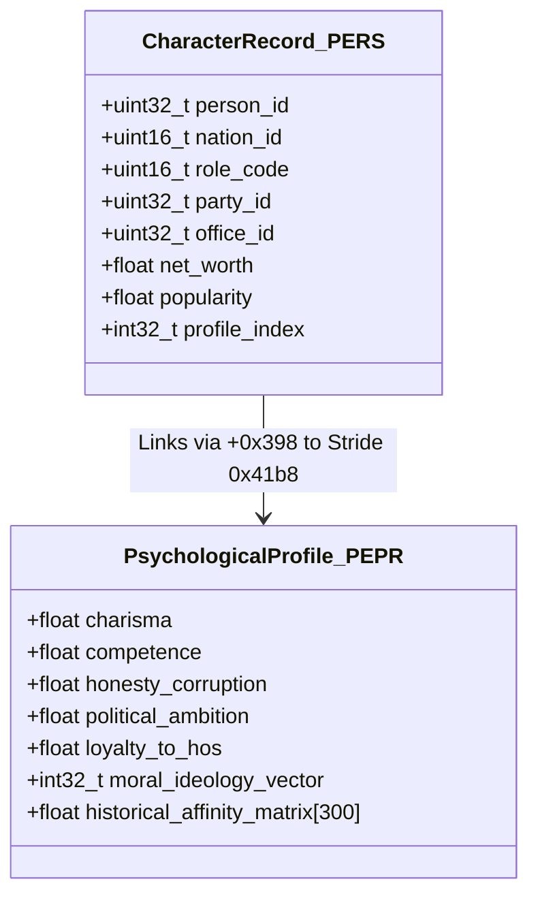
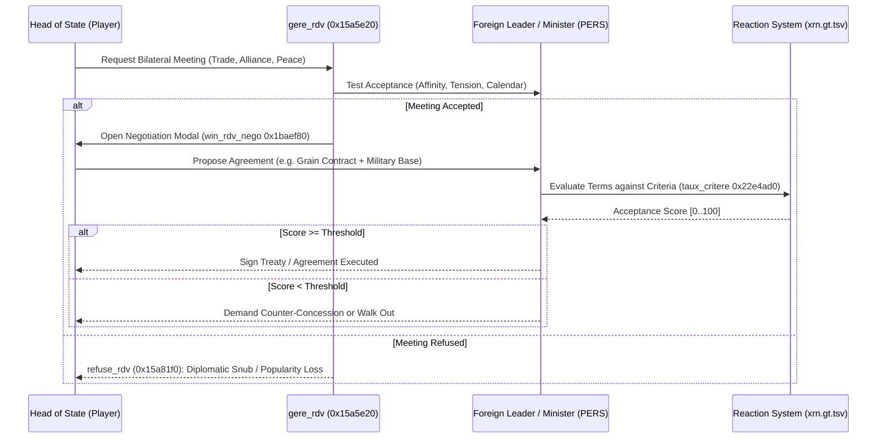

# Volume 5: Personality & Character Simulation

---

## 1. Character Data Architecture (`PERS` & `PEPR`)

Characters represent the human agency in GPS5: heads of state, cabinet ministers, party leaders, military generals, central bankers, trade union leaders, media moguls, and oligarchs. The character model is split into an entity header (`PERS`) and a deep psychological profile (`PEPR`):



### 1.1 Structural Layout of `PERS` (Stride `0xad0` / 2,768 bytes)
Stored at heap address `*0x5d85ada0` (serializer `f_1493660`, 51,000 slots):
- `+0x00`: Unique Character ID.
- `+0x04`: Owning sovereign nation ID ($0 .. 299$).
- `+0x10`: Wide-character UTF-16 proper name.
- `+0x240`: Current assigned governmental portfolio (e.g., Prime Minister, Finance Minister `MFIN`, Foreign Affairs `MAET`).
- `+0x248`: Sovereign domicile confirmation flag.
- `+0x270`: Political group allegiance index (`GROU`).
- `+0x398`: Profile pointer index into `PEPR` pool (`0x41b8` stride).

### 1.2 Structural Layout of `PEPR` (Stride `0x41b8` / 16,824 bytes)
Manages personality traits, historical grievances, and psychological parameters:
- `+0x04`: Character unique identifier.
- `+0x7a4`: Integrity / Honesty rating ($0 .. 15$, where $15$ is incorruptible, and $0$ is venal).
- `+0x7a8`: Technical Competence rating ($0.0 .. 1.0$).
- `+0x7ac`: Charisma & Rhetorical Eloquence ($0.0 .. 1.0$).
- `+0x7b0`: Political Ambition & Coup Propensity ($0.0 .. 1.0$).
- `+0x7b4`: Loyalty to Current Head of State ($0.0 .. 1.0$).
- `+0x800` .. `+0x1800`: Relational matrix storing interpersonal bilateral affinity with up to 300 key political figures.

---

## 2. Psychological Traits & Behavioral Mechanics

### 2.1 The Corruption Test (`is_perso_corruptible` / `0x21c0400`)
Whether a character will accept a secret bribe, participate in an embezzlement scheme, or provide confidential state intelligence is evaluated by `is_perso_corruptible`:
```cpp
bool is_perso_corruptible(longlong perso_ptr) {
    if (FUN_7ff64894b870() != 0) { // Global espionage / corruption system active
        int profile_idx = *(int*)(perso_ptr + 4);
        // Check integrity rating in PEPR record (stride 0xc18 / 0x41b8)
        if (*(int*)(profile_idx * 0xc18 + 0x7ff68e1463dc) != 0) {
            int country_id = FUN_7ff6485454e0();
            return *(int*)(perso_ptr + 0x248) == country_id;
        }
    }
    return false;
}
```
If a character's honesty rating at `+0x7a4` falls below $6$ ($< 40\%$), the character becomes eligible for illicit recruitment by secret services or corporate lobbyists. If uncovered, a scandal breaks in `gere_histo`, degrading national stability and triggering judicial investigations (`ENQU`).

### 2.2 Competence & Governance Impact
Cabinet ministers do not merely occupy ceremonial slots; their competence rating (`+0x7a8`) directly scales the productivity of their ministry:
$$\text{Effective Star Allocation } S_{\text{eff}} = S_{\text{budget}} \times \left(0.70 + 0.60 \times \mathtt{Competence}\right)$$
- An incompetent Health Minister ($0.10$) causes hospital bed shortages and mortality surges despite high budgetary allocations.
- An incompetent Chief of General Staff ($0.15$) inflicts combat penalty multipliers on military units under their command.

### 2.3 Ambition, Coup Plots & Defections
Characters with high political ambition ($> 0.80$) and low loyalty ($< 0.30$) monitor the Head of State's popularity:
$$\text{Betrayal Risk} = \mathtt{Ambition} \times (1.0 - \mathtt{Loyalty}) \times (1.0 - \mathtt{HoS\_Popularity})$$
If $\text{Betrayal Risk} > 0.65$:
- Ministers resign publicly, condemning the government and causing immediate $-5\%$ to $-12\%$ popularity shocks.
- Party leaders withdraw from governing coalitions, forcing early parliamentary snap elections.
- Military commanders in authoritarian regimes initiate coup d'état triggers, ordering garrisons to seize the presidential palace and broadcasting centers.

---

## 3. The Diplomatic & Bilateral Negotiation Engine (`gere_rdv`)

Face-to-face appointments and bilateral head-of-state meetings are managed by `gere_rdv` (`0x15a5e20`) and the negotiation dialogue evaluator `Cdlg_requete__win_rdv_nego` (`0x1baef80`):



### 3.1 Reaction Criteria Database (`xrn.gt.tsv`)
The meeting system is driven by the 27.2 MB decrypted table `data/gt/xrn.gt.tsv`, storing 16,348 discrete evaluation rules:
- **Criteria Types (`CRIT`)**: Strategic alignment, trade balance surplus, military balance of power, historical friendship, ideological affinity.
- **Evaluation Function (`taux_critere` / `0x22e4ad0`)**:
  Calculates the probability that the NPC will accept a proposal:
  $$\text{Score} = \sum_{c \in \text{Criteria}} \text{Weight}_{c} \times \text{TestValue}_{c}$$
  If $\text{Score} \ge \text{Threshold}$, the character agrees to execute the treaty, alliance, contract, or law amendment.

### 3.2 Televised Political Duels (`CDuel_TV___event` / `0x24178e0`)
During presidential elections or major national crises, political leaders engage in head-to-head televised debates. The outcome is computed from:
$$\text{DuelScore} = \left(\mathtt{Charisma} \times 0.45\right) + \left(\mathtt{Competence} \times 0.35\right) + \left(\mathtt{HoS\_Popularity} \times 0.20\right) + \text{RhetoricalRoll}$$
The victor receives an immediate $+3\%$ to $+8\%$ electoral polling boost among undecided voters (`stat_popularite_add`).
