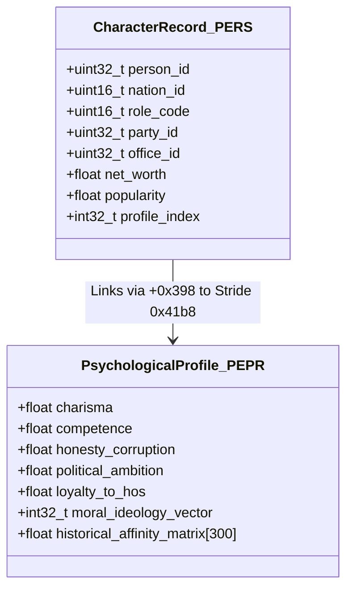
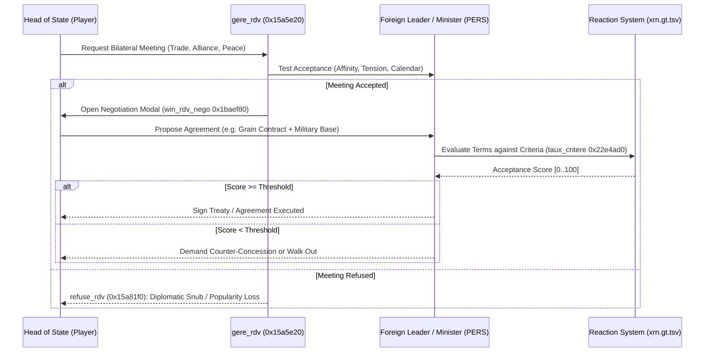
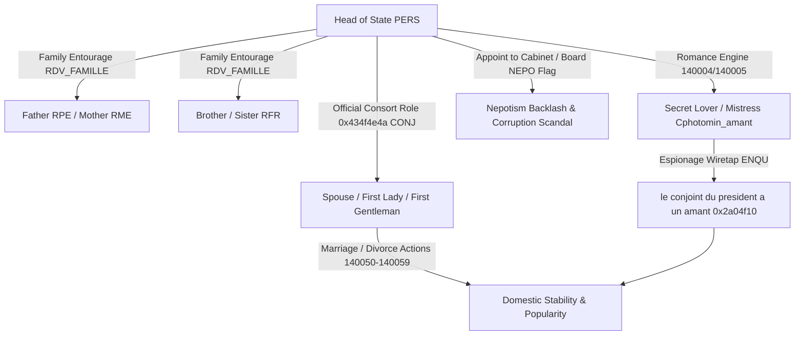

# Volume 5: Personality, Characters & Private Life Simulation

---

## 1. Character Data Architecture (`PERS` & `PEPR`)

Characters represent the human agency in GPS5: heads of state, cabinet ministers, party leaders, military generals, central bankers, trade union leaders, media moguls, oligarchs, and the presidential family. The character model is split into an entity header (`PERS`) and a deep psychological profile (`PEPR`):



### 1.1 Structural Layout of `PERS` (Stride `0xad0` / 2,768 bytes)
Stored at heap address `*0x5d85ada0` (serializer `f_1493660`, 51,000 slots):
- `+0x00`: Unique Character ID.
- `+0x04`: Owning sovereign nation ID ($0 .. 299$).
- `+0x10`: Wide-character UTF-16 proper name.
- `+0x18`: Institutional role tag (e.g., `CONJ` = `0x434f4e4a` for Spouse/First Lady, `TITN` = `0x5449544e` for Titular/Head of State).
- `+0x240`: Current assigned governmental portfolio (e.g., Prime Minister, Finance Minister `MFIN`, Foreign Affairs `MAET`, First Lady/Consort).
- `+0x248`: Sovereign domicile confirmation flag.
- `+0x270`: Political group allegiance index (`GROU`).
- `+0x398`: Profile pointer index into `PEPR` pool (`0x41b8` stride).

### 1.2 Structural Layout of `PEPR` (Stride `0x41b8` / 16,824 bytes)
Manages personality traits, historical grievances, and psychological parameters:
- `+0x04`: Character unique identifier.
- `+0x7a4`: Integrity / Honesty rating ($0 .. 15$, where $15$ is incorruptible, and $0$ is venal).
- `+0x7a8`: Technical Competence rating ($0.0 .. 1.0$).
- `+0x7ac`: Charisma & Rhetorical Eloquence ($0.0 .. 1.0$).
- `+0x7b0`: Political Ambition & Coup Propensity ($0.0 .. 1.0$).
- `+0x7b4`: Loyalty to Current Head of State ($0.0 .. 1.0$).
- `+0x800` .. `+0x1800`: Relational matrix storing interpersonal bilateral affinity with up to 300 key political figures.

---

## 2. Psychological Traits & Behavioral Mechanics

### 2.1 The Corruption Test (`is_perso_corruptible` / `0x21c0400`)
Whether a character will accept a secret bribe, participate in an embezzlement scheme, or provide confidential state intelligence is evaluated by `is_perso_corruptible`:
```cpp
bool is_perso_corruptible(longlong perso_ptr) {
    if (FUN_7ff64894b870() != 0) { // Global espionage / corruption system active
        int profile_idx = *(int*)(perso_ptr + 4);
        // Check integrity rating in PEPR record (stride 0xc18 / 0x41b8)
        if (*(int*)(profile_idx * 0xc18 + 0x7ff68e1463dc) != 0) {
            int country_id = FUN_7ff6485454e0();
            return *(int*)(perso_ptr + 0x248) == country_id;
        }
    }
    return false;
}
```
If a character's honesty rating at `+0x7a4` falls below $6$ ($< 40\%$), the character becomes eligible for illicit recruitment by secret services or corporate lobbyists. If uncovered, a scandal breaks in `gere_histo`, degrading national stability and triggering judicial investigations (`ENQU`).

### 2.2 Competence & Governance Impact
Cabinet ministers directly scale the productivity of their ministry:
$$\text{Effective Star Allocation } S_{\text{eff}} = S_{\text{budget}} \times \left(0.70 + 0.60 \times \mathtt{Competence}\right)$$
- An incompetent Health Minister ($0.10$) causes hospital bed shortages and mortality surges despite high budgetary allocations.
- An incompetent Chief of General Staff ($0.15$) inflicts combat penalty multipliers on military units under their command.

### 2.3 Ambition, Coup Plots & Defections
Characters with high political ambition ($> 0.80$) and low loyalty ($< 0.30$) monitor the Head of State's popularity:
$$\text{Betrayal Risk} = \mathtt{Ambition} \times (1.0 - \mathtt{Loyalty}) \times (1.0 - \mathtt{HoS\_Popularity})$$
If $\text{Betrayal Risk} > 0.65$:
- Ministers resign publicly, condemning the government and causing immediate $-5\%$ to $-12\%$ popularity shocks.
- Party leaders withdraw from governing coalitions, forcing early parliamentary snap elections.
- Military commanders in authoritarian regimes initiate coup d'état triggers, ordering garrisons to seize the presidential palace and broadcasting centers.

---

## 3. The Diplomatic & Bilateral Negotiation Engine (`gere_rdv`)

Face-to-face appointments and bilateral head-of-state meetings are managed by `gere_rdv` (`0x15a5e20`) and the negotiation dialogue evaluator `Cdlg_requete__win_rdv_nego` (`0x1baef80`):



### 3.1 Reaction Criteria Database (`xrn.gt.tsv`)
The meeting system is driven by the 27.2 MB decrypted table `data/gt/xrn.gt.tsv`, storing 16,348 discrete evaluation rules:
- **Criteria Types (`CRIT`)**: Strategic alignment, trade balance surplus, military balance of power, historical friendship, ideological affinity.
- **Evaluation Function (`taux_critere` / `0x22e4ad0`)**:
  Calculates the probability that the NPC will accept a proposal:
  $$\text{Score} = \sum_{c \in \text{Criteria}} \text{Weight}_{c} \times \text{TestValue}_{c}$$
  If $\text{Score} \ge \text{Threshold}$, the character agrees to execute the treaty, alliance, contract, or law amendment.

### 3.2 Televised Political Duels (`CDuel_TV___event` / `0x24178e0`)
During presidential elections or major national crises, political leaders engage in head-to-head televised debates. The outcome is computed from:
$$\text{DuelScore} = \left(\mathtt{Charisma} \times 0.45\right) + \left(\mathtt{Competence} \times 0.35\right) + \left(\mathtt{HoS\_Popularity} \times 0.20\right) + \text{RhetoricalRoll}$$
The victor receives an immediate $+3\%$ to $+8\%$ electoral polling boost among undecided voters (`stat_popularite_add`).

---

## 4. Head of State Private Life: Marriage, Family Network, Lovers & Nepotism

A distinctive subsystem within the character engine is the simulation of the **Head of State's private life, matrimonial status, family entourage, extramarital affairs, and nepotism**:



### 4.1 The First Spouse / Consort Architecture (`CONJ` / `NommerConjointPres`)
- **Role Tag**: The official consort is represented in the character database with the four-character role code `0x434f4e4a` (`'CONJ'`, decompiled in `d_013.c:648724`).
- **Official Appointment**: If unmarried at game start, the player can appoint or marry a chosen partner via `NommerConjointPres` (`0x29a09f0` / `f_13c3320`), referencing `ichoix_conjoint`.
- **First Lady / Consort Public Role**: The spouse appears in the government protocol hierarchy, provides public diplomacy bonuses during state visits, and holds an independent popularity rating.
- **Divorce Proceedings**: The player can initiate divorce via action `140058` (female spouse) or `140059` (male spouse): *"L'informer de votre décision de divorcer" / "Tell spouse of your decision to divorce"*. Divorce shocks the national opinion ledger: conservative and religious groups (`RELI`, `FAMI`) register negative theme deltas, lowering support among traditionalist voters.

### 4.2 The Family Network (`RDV_FAMILLE`)
The Head of State has simulated living family relatives with dedicated interaction dialogues in `xan.gt.tsv` (actions `140060`..`140089`):
1. **Mother (`RME` / Actions `140060`..`140063)**:
   - Dialogue actions: Offer flowers (`140062`), compliment *"You're the most beautiful mother in the whole world!"* (`140063`).
   - Maintaining high maternal affection provides passive moral/stress recovery to the Head of State.
2. **Father (`RPE` / Actions `140065`..`140068)**:
   - Dialogue actions: Give medication (`140065`), ask *"Well, as young as ever, Dad!?"* (`140066`).
   - **Abuse of Power / Favor Requests**: The father can request state favors, such as lending the presidential armored limousine (`140067`, *"Lui prêter votre voiture de fonction"*), or require intervention to curb gambling debts (`140068`).
3. **Siblings / Brother (`RFR` / Actions `140080`..`140082)**:
   - **Traffic Ticket Quashing (`140080` / *"Lui faire sauter ses PV"* / *"Cancel his traffic offenses"*)**: An executive abuse of power allowing the president to quash police fines.
   - **Curbing Scheming (`140081` / *"L'inciter à refréner ses magouilles"* / *"Encourage him to limit his scheming"*)**: Addresses sibling involvement in illicit lobbying or financial conflicts of interest before they trigger public scandals.

### 4.3 Romance, Lovers & Mistresses (`Cphotomin_amant`)
The Head of State can pursue romantic liaisons outside of or prior to marriage:
- **Romance Initiation**:
  - `140004`: *"Lui proposer de devenir votre maîtresse" / "Ask her to become your mistress"* (for female targets).
  - `140005`: *"Lui proposer de devenir votre amant" / "Ask him to become your lover"* (for male targets).
  - Target evaluation depends on interpersonal affinity (`PEPR`), orientation compatibility, and existing marital status.
- **Visual Representation**: When an affair is active, the character sheet displays a **pink/red heart icon** (`Cphotomin_amant`, documented in `docs/user_EN.txt:940` and `strings_rdata.txt:13485`).
- **Intimate Interaction (`RDV_CONJ`)**:
  - `140050` / `140054`: *"Lui proposer de faire l'amour, là, maintenant, tout de suite" / "Offer to make love right here and now"*.
  - `140053` / `140057`: *"C'est toi la plus belle ma chérie !" / "You're the most beautiful woman in the world, darling!"*.
- **Ending the Affair**: Action `140071`: *"Rompre la relation amoureuse au nom de l'intérêt supérieur de l'État" / "Break off the love affair in the interests of State"*.

### 4.4 Nepotism & Political Patronage (`NEPO` Flag)
Actions `140004` and `140005` carry the special action flag **`NEPO`** in `xan.gt.tsv`:
- **Nepotistic Appointments**: The Head of State has the mechanical power to appoint family members, spouses, or secret lovers to sovereign ministerial portfolios (e.g. Defense, Finance, Culture), state agency directorships, or state-owned corporate boards (`CORP`).
- **Consequences**:
  - Appointing underqualified relatives triggers immediate competence penalties ($S_{\text{eff}}$ collapse in the ministry).
  - Opposition parties (`!OPPO`) exploit the appointment, filing parliamentary inquiries and reducing public integrity ratings.

### 4.5 Adultery, Secret Service Surveillance & Press Scandals
Family and marital relationships are vulnerable to intelligence leaks and press investigations:
1. **Secret Service Wiretaps (`ENQU` / `fouine`)**: Domestic or foreign intelligence agencies can wiretap the presidential palace, uncovering hidden lovers or marital discord.
2. **Adultery Detection (`f_1c03ee0`)**:
   - The engine evaluates infidelity detection triggers, generating the historic event string:
     `"le conjoint du president a un amant"` (RVA `0x2a04f10` / `strings_rdata.txt:14004`).
3. **Marital Confrontation Dialogue**:
   - `140051`: *"Lui dire : 'Tu as un amant ! Je le sais femme volage ! Traîtresse ! Sorcière !'" / "Tell her: 'You have a lover! I know you have, fickle woman! Traitor, Witch!'"*
   - `140055`: *"Lui dire : 'C'est qui ta maîtresse, salaud !? Hein qui !?'" / "Ask him: 'Who is your mistress, you cad!? Well, who is she?'"*
   - `140052` / `140056`: *"L'inciter à être plus discret" / "Encourage them to be more discreet"*.
4. **Political Fallout**:
   When marital infidelity leaks to the media:
   $$\Delta \mathtt{Popularity} = -0.08 \text{ to } -0.22$$
   Religious and conservative groups (`RELI`, `FAMI`) register massive negative opinion deltas, while political rivals may introduce parliamentary votes of no confidence or launch impeachment proceedings.
