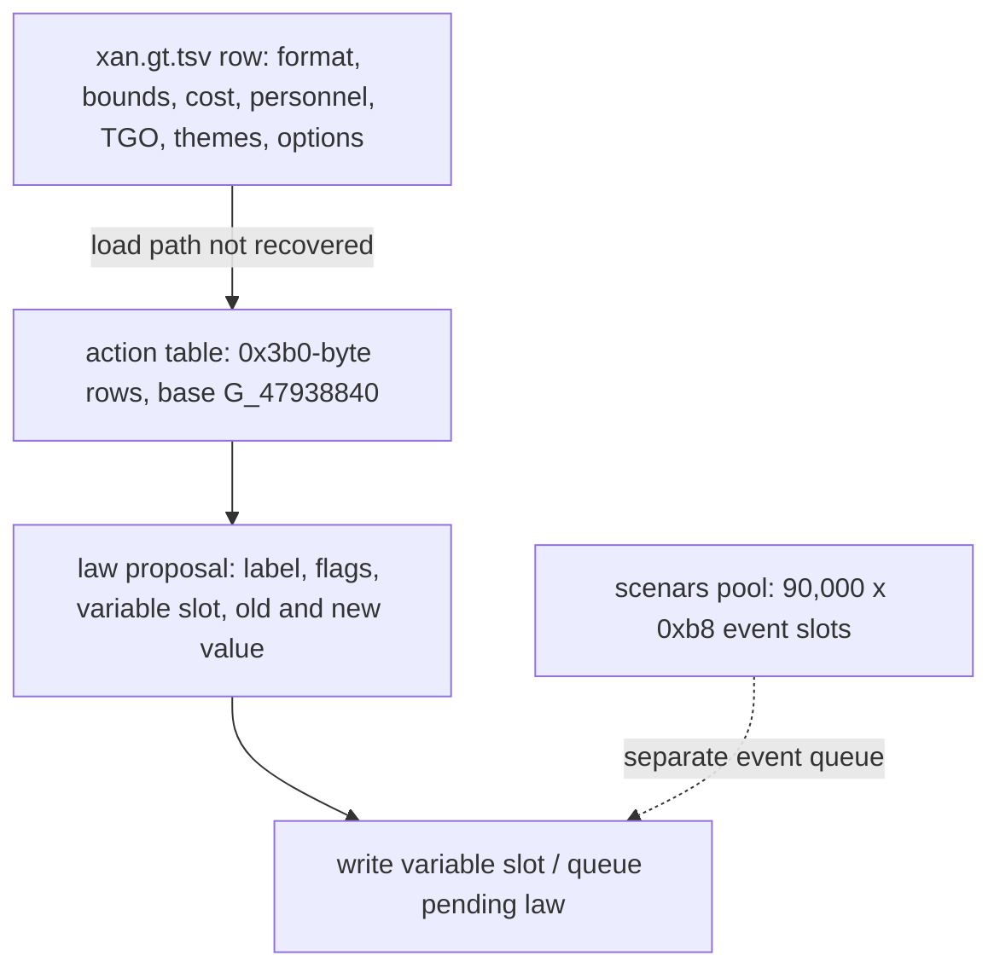
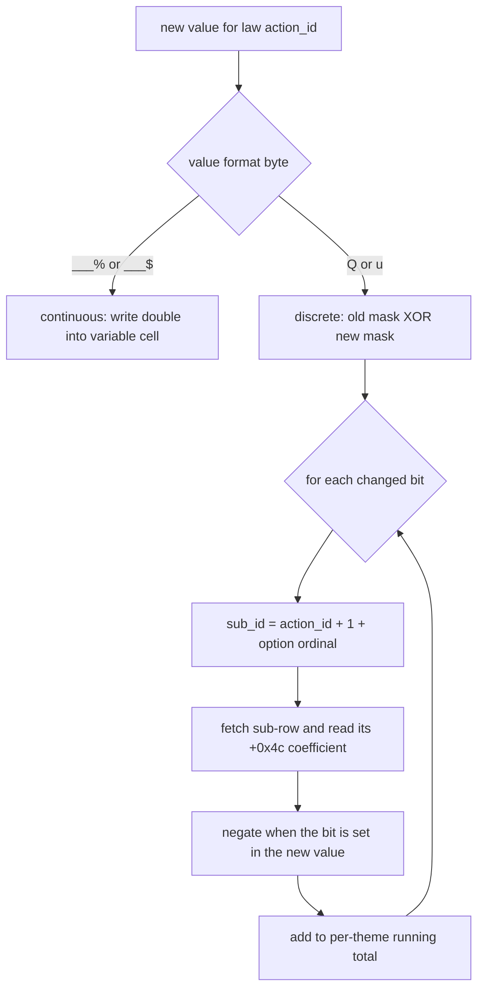
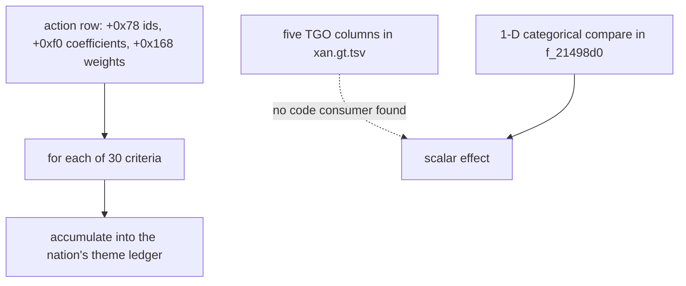
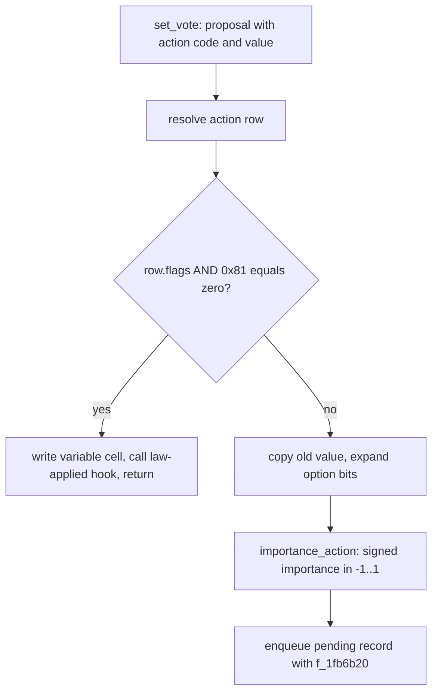
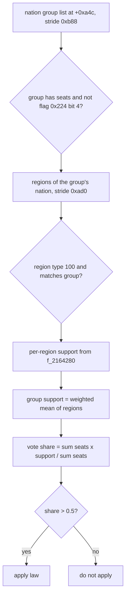
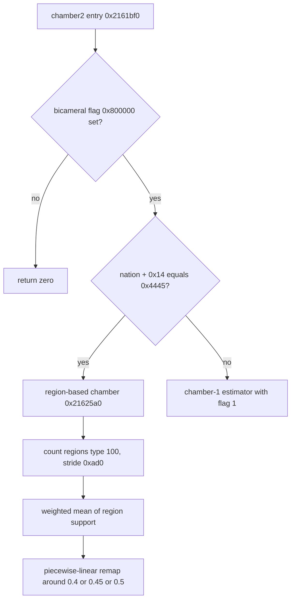
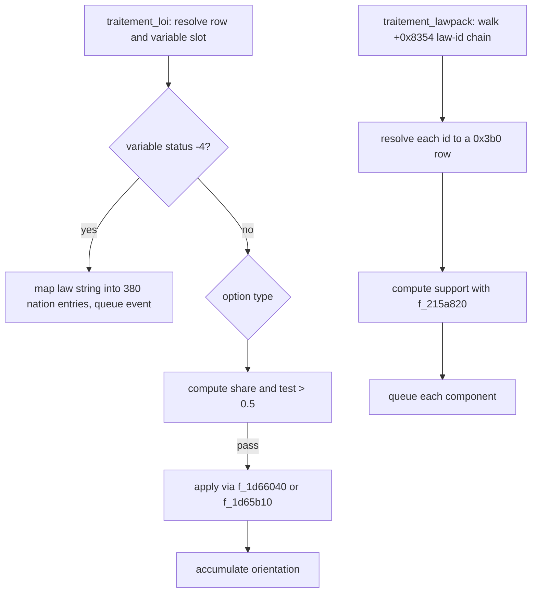

# Volume 6: Legislative System & Law Execution Engine

This volume describes how GPS5 turns a row in the law spreadsheet into a runtime
effect. Every mechanism below is quoted from `recomp/full_fns.clean.c` (125,881
function headers) or from an explicit row of `data/gt/xan.gt.tsv`. Three headline
corrections are recorded here rather than buried: `calc_effet_loi` is at
`0x1cfb560`, not the former address; the 5-axis `TGO` tensor does not exist as
code; and `traitement_lawpack` neither calls `traitement_loi` nor the parliament.

---

## 1. Law Storage & Data Representation

A law is a **row in a design sheet**, copied at load time into a fixed-stride
**action table**. The sheet is the authoring surface; the table is what the
engine reads.

The sheet is `data/gt/xan.gt.tsv`: 85 columns and 5,094 non-empty lines including
the header `[data xan.gt.tsv header row]`. The columns that matter here are the
parameter format (column 1), the value bounds (columns 10-13), the cost and
personnel coefficients (columns 22-23), the five `TGO` columns (26-30), the
criteria themes (31), the option codes (33), and the ministry fields (24-25)
`[data xan.gt.tsv columns 1,10-13,22-33]`.

The runtime table is addressed as `index * 0x3b0 + G_47938840`. That expression
occurs 293 times, for example in `parlement_vote_lawpack_chambre1_estimation`
at corpus 4086821 and in `calc_effet_loi` at corpus 3392760
`[global G_47938840 action table; qty 0x3b0 stride]`. `G_47938840` is a
decompiler-labelled array base; `.team/globals_index.tsv` records an adjacent
8-byte slot at `0x47938838`, not the array itself `[global 0x47938838 slot]`.
The number of populated rows and the loader are not established in the corpus:
no function writes the table by literal `0x3b0` offset, so the import path is
outside the recovered bodies.

Verified fields of one `0x3b0` row:

| offset | type | what the code does with it | evidence |
|---|---|---|---|
| `+0x00` | UTF-16 label | compared character-by-character when a law is looked up by its numeric string | `[field 0x00 in action row]`, corpus 4086348-4086370 |
| `+0x40` | 8 option bytes | first non-zero byte is the value format; `Q` and `u` select the bitmask path | `[field 0x40 in action row]`, corpus 3453184-3453186 |
| `+0x48` | f32 | cost coefficient, multiplied into the cost result | `[field 0x48 in action row]`, corpus 3304255 |
| `+0x4c` | f32 | personnel coefficient, multiplied into the personnel result | `[field 0x4c in action row]`, corpus 3304256 |
| `+0x58` | u64 flags | vote gate bits 0 and 7; finite-scaling bit 4; importance bits 21-26 | `[field 0x58 in action row]`, corpus 3453171, 3294489-3294518 |
| `+0x60` | i32 | criterion/theme index used to index nation arrays | `[field 0x60 in action row]`, corpus 3294522-3294531 |
| `+0x74` | f32 | public-sensitivity percentage, scales the importance result | `[field 0x74 in action row]`, corpus 4084016-4084026 |
| `+0x78` | i32[30] | criterion ids, sentinel `0` terminates | `[field 0x78 in action row]`, corpus 4074852-4074875 |
| `+0xf0` | f32[30] | per-criterion coefficient | `[field 0xf0 in action row]`, corpus 4074873 |
| `+0x168` | f32[30] | per-criterion weight, sentinel `-1200.0` | `[field 0x168 in action row]`, corpus 4074852-4074875 |
| `+0x224` | f32 | importance coefficient used in the weighted average | `[field 0x224 in action row]`, corpus 4083940-4083950 |
| `+0x234` | f32 | normalising divisor, forced to `1.0` when zero | `[field 0x234 in action row]`, corpus 3304251-3304256 |

The former claim that `+0x224` begins a five-float parameter block
`{A, B, val_init, mn, step}` is removed: at `+0x224` the code reads one float
coefficient, and the value bounds live in the sheet and in the variable slot,
not in the row `[field 0x224 in action row]`.

The 90,000-slot pool at `G_5f9830d0` is **not** the law table. It is allocated
with `f_139c350(..., 90000, ...)` at corpus 2075847, each slot is `0xb8` bytes
and is zeroed with `inlined_stub_45(..., 0xb8)` at corpus 4335259, and overflow
prints `"Debordement scenars"` at corpus 4335248
`[global G_5f9830d0 scenars pool; qty 0xb8 slot]`. It is an event/scenario pool.
The law-proposal record passed to `set_vote` is a different object: its used
fields are `+0x08` label, `+0x48` flags, `+0x50` nation selector, `+0x60`
variable slot, `+0x70` option index, `+0x88` new value, `+0xa8` post-mapping
value, `+0xb0` old value, and `+0xb8` a 16-byte block copied into the pending
record `[fn 0x1d593e0 set_vote]`. Its allocation site and stride are not
established.



```pseudocode
load the law sheet row for action_id:
    read format bytes, min, max, variable name, unit, init value
    read cost coefficient, personnel coefficient, divisor
    read 30 criterion ids, 30 coefficients, 30 weights
    store the row at action_table + action_id * 0x3b0

when the player edits law action_id:
    row = action_table + action_id * 0x3b0
    slot = variable slot named in the row
    proposal = {label, row.flags, slot, old value, new value}
    hand the proposal to set_vote
```

> Evidence: `calc_effet_loi` [fn 0x1cfb560], `set_vote` [fn 0x1d593e0], `f_1c488c0` [fn 0x1c488c0], `f_214ce10` [fn 0x214ce10]; corpus 3304251-3304256, 3392760, 3453171, 4074852-4074875, 4084016; stride `0x3b0`, row fields `+0x48/+0x4c/+0x234/+0x74/+0x78/+0xf0/+0x168`.

### What the code does not establish

The corpus contains no function that writes a `0x3b0` row from the sheet, so the
loader and the populated-row count are unknown. The meaning of individual flag
bits other than the ones exercised above is also unknown; the code tests them,
but names them only by offset. The proposal record's allocator and stride are not
visible in the recovered bodies.

---

## 2. Continuous Sliders vs Discrete Option Bits

The sheet distinguishes the two representations in its second column. A
continuous law carries a numeric format such as `___%` or `___$`; a discrete law
carries `Q` or `u`. Row `211100` (VAT) is continuous: `___%`, minimum `0`,
maximum `0,5`, variable `B_TTVA`, unit `0,01` `[data xan.gt.tsv "211100"]`.
Row `500900` is discrete: `Q`, blank bounds, blank variable, option code `VOTE`
`[data xan.gt.tsv "500900"]`.

For a continuous law the new value is a double written straight into the
16-byte variable cell: `f_1ccb8d0(cell, value)` at corpus 3453172. The cell's
numeric payload is read with `f_1cca7b0` / `f_1cc8ac0`, and its flags with
`f_1cca720` `[fn 0x1ccb8d0; fn 0x1d593e0 set_vote]`.

For a discrete law the value is an **integer bitmask**. The engine does not call
a per-clause callback. It walks the bits that changed between the old and the
new value, and for each changed bit it synthesises a **sub-action id**:

```text
sub_id = action_id + 1 + f_167b6c0(action_id, bit_value)
```

`f_167b6c0` returns the option ordinal; the resulting id is looked up as its own
`0x3b0` row. This happens twice in the corpus with the same shape:
`set_vote` at corpus 3453204-3453230 and `calc_effet_loi` at corpus
3392734-3392810 `[fn 0x1d593e0; fn 0x1cfb560]`.

`calc_effet_loi` shows the arithmetic of one changed bit: take the sub-row's
`+0x4c` coefficient, multiply it by the finite-scaling factor when flag bit 4 is
set, by a national factor when bit 8 is set, and by the sensitivity factor when
bit 16 is set; negate the result when the bit is set in the new value; add it to
the running total `[field 0x4c in action row]`, corpus 3392789-3392810.



```pseudocode
apply a law edit with old_value and new_value:
    if the row format is a number format:
        write new_value into the variable cell as a double
        return

    if the row format is Q or u:
        total = 0
        for each bit position while new_value != old_value:
            if the bit is set in exactly one of the two values:
                if the bit is set in new_value:
                    ordinal = option ordinal for this bit
                    sub_id = action_id + 1 + ordinal
                    coefficient = sub_row(sub_id).personnel_coefficient
                    if sub_row.flags has bit 4: coefficient *= finite_factor
                    if sub_row.flags has bit 8: coefficient *= nation_factor
                    if sub_row.flags has bit 16: coefficient *= sensitivity_factor
                    if bit is set in new_value: coefficient = -coefficient
                    total += coefficient
            shift both values right by one bit
        add total to the nation's per-theme ledger
```

> Evidence: `set_vote` [fn 0x1d593e0] corpus 3453184-3453230; `calc_effet_loi` [fn 0x1cfb560] corpus 3392734-3392822; `f_1c488c0` [fn 0x1c488c0] corpus 3304255-3304256; `f_167b6c0` [fn 0x167b6c0]; constants `+0x4c`, `+0x58`, `+0x60`, `0x3294`.

### What the code does not establish

`Q` and `u` are treated identically by `set_vote` and `calc_effet_loi`; the code
does not assign them different semantics. The loop is bounded by `new_value !=
old_value`, not by 32 iterations, so a 32-bit clause sweep is not what the code
does. The meaning of the synthesised sub-rows is data-defined; the corpus does
not name them.

---

## 3. The TGO Columns: Data Without a Tensor

The sheet has five ideological columns, labelled in the header as `TGO1` to
`TGO5`, each running from `-100` to `+100` `[data xan.gt.tsv columns 26-30]`.
They are sparsely filled. Row `211100` has `TGO3=90` and blanks elsewhere; row
`211101` has `TGO3=-40` `[data xan.gt.tsv "211100"; data xan.gt.tsv "211101"]`.

**No tensor product exists.** There is no matrix multiplication, no 5-term sum,
and no code that reads `TGO1..5` as a vector. The two multi-axis structures that
do exist are:

1. A **30-criterion** per-theme accumulator. `f_214ce10` reads the three 30-float
   arrays at `+0x78`, `+0xf0`, `+0x168`, calls `f_215d4a0` per criterion, scales
   by the row's `+0x74` sensitivity, and adds into `NATI + theme*8 + 0x310a40`
   `[fn 0x214ce10]`, corpus 4074852-4074875.
2. A **one-dimensional categorical alignment**. `f_21498d0` compares one party
   position integer with one action position integer, maps the distance through
   `f_137a960`, and returns a scalar in `[-1, 1]` `[fn 0x21498d0]`, corpus
   4072867-4072950.

`alignement_groupe_ideologique` is a boolean overlap test over the 30 criterion
ids, not a distance and not a tensor: it walks both 30-entry arrays with the
`-1200.0` sentinel and returns `1` on the first shared id, `0` otherwise
`[fn 0x2148840]`, corpus 4072415-4072490.



```pseudocode
read the law's ideology data:
    the sheet has five TGO columns, each -100 to +100
    the loaded row instead carries three 30-entry criterion arrays:
        ids, coefficients, weights

for each criterion slot 1..30:
    if the id is 0: stop
    if the weight is -1200: skip
    effect = curve(coefficient * national_scale, weight, current value)
    effect = effect * (row.sensitivity / 100 + 1) when sensitivity is non-zero
    add effect to the nation's ledger at this criterion

there is no step that combines TGO1..5 into one number
```

> Evidence: `f_214ce10` [fn 0x214ce10] corpus 4074852-4074875; `f_21498d0` [fn 0x21498d0] corpus 4072867-4072950; `alignement_groupe_ideologique` [fn 0x2148840] corpus 4072415-4072490; `f_215d4a0` [fn 0x215d4a0]; sentinel `-1200.0`, arrays `+0x78/+0xf0/+0x168`.

### What the code does not establish

The corpus does not show where the five `TGO` cells are consumed after load, if
anywhere. No function indexes a five-element vector, and no function uses the
column labels as keys `[data xan.gt.tsv columns 26-30]`. The former "5-axis
transformation tensor" is therefore removed, not reinterpreted.

---

## 4. The Legislative Workflow: Proposal, Gate, Queue

`set_vote` is the submission path. It parses the action code from the proposal
label, resolves the row with `f_1cd6530`, and then makes one binary gate on the
row's `+0x58` flags `[fn 0x1d593e0 set_vote]`:

- `(flags & 0x81) == 0`: write the value into the variable cell with
  `f_1ccb8d0`, call `f_1cbe540`, and return (corpus 3453171-3453178). This is the
  immediate/executive path.
- `(flags & 0x81) != 0`: copy the old value to `+0xb0`, expand option bits if the
  format is `Q`/`u`, call `importance_action`, and enqueue a pending law with
  `f_1fb6b20` (corpus 3453179-3453230, 3453399, 3453797).

`set_vote` does **not** call a parliament estimator. It enqueues a 10-int record
through `f_1fb6b20`; the record's fields are `type`, `key`, `param2`, `param3`,
`3`, and the day/importance payload `[fn 0x1fb6b20]`. The vote is evaluated
later by `traitement_loi` (§5, §7).

There is no named "decree" branch and no "executive decree" string. The only
branch is the bit pair `0x81`; which of bit 0 and bit 7 means "requires vote" is
not established by the code, because both are tested together
`[field 0x58 in action row]`.



```pseudocode
submit a law change:
    row = action_table + action_id * 0x3b0
    if row.flags & 0x81 == 0:
        write the new value into the variable cell
        call the law-applied hook
        return

    old_value = current value of the variable cell
    if row format is Q or u:
        expand each changed bit into its own sub-action
    importance = importance_action(row, old_value, new_value)
    enqueue a pending law record with its due day and importance
```

> Evidence: `set_vote` [fn 0x1d593e0] corpus 3453171-3453230, 3453399, 3453797; `f_1fb6b20` [fn 0x1fb6b20] corpus 3773299-3773400; `importance_action` [fn 0x215be60] corpus 4083652-4084100; gate `0x81`, delay from the returned importance.

### What the code does not establish

The code tests flag bits 0 and 7 together and never prints a reason. It does not
record whether a law was enacted by decree or by vote, and it has no string or
enum named for either. The queue's scheduler is outside this volume.

---

## 5. Parliamentary Voting Mechanics

### 5.1 The direct tally

`f_215eee0` is the routine that produces the number later compared with 0.5. It
walks the nation's group list starting at `nation + 0xa4c`; each group record is
`0xb88` bytes and carries its seat count at `+0x2a0`
`[global 0x5d859dc8 group array; qty 0xb88 stride; field 0x2a0 in group]`.

First pass: for each group with seats greater than zero, call `f_215bae0` to fill
the group's support at `+0x29c`, and add its seats to the denominator unless the
group's `+0x224` byte has bit 4 set (corpus 4085524-4085540). Second pass:

```text
vote_share = sum(seats[g] * support[g]) / sum(seats[g])
```

over the groups not excluded by `+0x224 & 4` (corpus 4085550-4085556)
`[fn 0x215eee0]`.

### 5.2 Group support

`f_215bae0` returns `0.5` immediately when `group + 0x224` has bit 2 set. Otherwise
it averages the group's regional support over the regions belonging to the
group's nation: regions are `0xad0` bytes, the loop uses the region count at
`nation + 0xa08`, and a region qualifies when bit 18 of its `+0xa8` flags is set
and its `+0x398` id matches the group `[fn 0x215bae0]`, corpus 4083588-4083635.
The per-region weight is `1.0`, or `5.0` when the region is the ruling party's
region. The result is the weighted mean of `f_2164280` over those regions.

`f_2164280` is the per-region support formula. It calls `importance_action`,
`f_2146e90`, `f_2148be0` (regional alignment), `f_21a0760` (government
popularity), adds a national-popularity term, adds a `0.15` term from the
government score, adds an EU adjustment for tag `0x4445`, then applies
`support = support * 0.5 + 0.5` and clamps to `[0, 1]`
`[fn 0x2164280]`, corpus 4088140-4088195.

### 5.3 The named estimator and the address conflict

`parlement_vote_lawpack_chambre1_estimation` is `0x2160650` (5,525 bytes,
corpus 4086147). It walks the same group list and fills parallel arrays: group
id, seat count `+0x2a0`, weight `+0x224`, and per-group support. It accumulates
the seat-weighted fraction at corpus 4086824 and returns the number of groups,
filling unused slots with `-1.0` (corpus 4086821-4086846)
`[fn 0x2160650]`.

`0x2160540` is a different, 272-byte function. It walks the group list and
returns one seat-weighted mean of `f_1cd29b0`; it is called by `f_21601f0`,
which is part of the chamber-2 path `[fn 0x2160540; fn 0x21601f0]`, corpus
4086113-4086146. `assert_names.tsv` pairs the estimator's assertion string with
`0x2160540`; that pairing is stale. The estimator is `0x2160650`.

### 5.4 The majority test

The test is a strict `> 0.5`, in two places:

- `traitement_loi`, for option type `0x50`, tests `0.5 < fVar38` and then calls
  the apply path (`f_162c5f0`, `f_1cbce40`) at corpus 3458605-3458608
  `[fn 0x1d60ce0]`.
- `f_1d69e60` requires both of its two support values to exceed `0.5` before it
  returns `1.0` `[fn 0x1d69e60]`, corpus 3463356-3463388.

There is no two-thirds test. A search of the corpus finds no `66.7`, no
`2/3` comparison, and no `0.6667` in any law or vote function; the `0.6667`
literals that exist belong to unrelated routines. The supermajority claim is
removed.

### 5.5 Party discipline

There is no individual-member model. A group votes as one block: `f_215eee0`
multiplies the group's single support value by its seat count. No discipline,
whip, or rebellion coefficient appears in the group record, the estimator, or
the tally `[fn 0x215eee0; fn 0x2160650]`. That claim is removed.



```pseudocode
vote share for one chamber:
    total_seats = 0
    weighted_support = 0

    for each group in the nation's group list:
        if group.seats <= 0: continue
        support = group_support(group)
        if group.flags has bit 4: continue from the denominator
        total_seats += group.seats
        weighted_support += group.seats * support

    return weighted_support / total_seats

group_support(group):
    if group.flags has bit 2: return 0.5
    sum_support = 0
    sum_weight = 0
    for each region of the group's nation:
        if region.flags bit 18 is clear: continue
        if region.id != group.id: continue
        weight = 5.0 if region is the ruling party's region else 1.0
        sum_support += weight * region_support(region)
        sum_weight += weight
    return sum_support / sum_weight

the bill passes when the returned share is strictly greater than 0.5
```

> Evidence: `f_215eee0` [fn 0x215eee0] corpus 4085524-4085556; `f_215bae0` [fn 0x215bae0] corpus 4083588-4083635; `f_2164280` [fn 0x2164280] corpus 4088140-4088195; `parlement_vote_lawpack_chambre1_estimation` [fn 0x2160650] corpus 4086821-4086846; `traitement_loi` [fn 0x1d60ce0] corpus 3458605; threshold `0.5`; seats `+0x2a0`, group flag `+0x224`, stride `0xb88`.

### What the code does not establish

The code contains no quorum rule, no abstention record, and no coalition term.
Bit 4 of the group flags merely removes a group from the seat denominator; the
code does not label it. No function compares the share with two-thirds, and no
function named `parlement_navette` exists.

---

## 6. Chamber 2 and the Bicameral Branch

The chamber-2 entry point is `parlement_vote_lawpack_chambre2_groupe_from_pres_region`
at `0x2161bf0`, not the former `0x2161d10` (which is not a function header)
`[fn 0x2161bf0]`. It does three things (corpus 4087005-4087015):

1. If nation flag `+0xc` bit `0x800000` is clear: return `0` (unicameral).
2. Else if `nation + 0x14 == 0x4445`: call
   `parlement_vote_lawpack_chambre2_pres_region` `[fn 0x21625a0]`.
3. Else: call the chamber-1 estimator with the final argument set to `1`.

The region-based chamber counts regions at `nation + 0xa08`, stride `0xad0`,
and only includes a region when its type at `+0xb0` equals `100`
`[fn 0x21625a0]`, corpus 4087090-4087105. For each included region it computes
`f_2164190` support, accumulates `support * weight`, divides by the weight sum,
then remaps the mean through a piecewise-linear threshold:

```text
if threshold < mean:
    result = ((mean - threshold) * 0.5) / (1 - threshold) + 0.5
else:
    result = (mean * 0.5) / threshold
```

where `threshold` is `0.4`, `0.45`, or `0.5` for `_DAT_32210d0` equal to `0`,
`1`, or anything else (corpus 4087210-4087217) `[fn 0x21625a0]`. Unused output
slots are set to `-1.0`, and the function returns the number of regions counted
(corpus 4087240-4087250).

There is no reconciliation procedure. No `navette` symbol exists in
`names.tsv`, `assert_names.tsv`, or the corpus index; the bicameral fallback is a
direct second chamber-1 call, not a joint committee.



```pseudocode
chamber_two(nation, law):
    if nation.flags bit 0x800000 is clear:
        return 0                    # unicameral

    if nation.regime_tag == 0x4445:
        return region_chamber(nation, law)
    else:
        return chamber_one(nation, law, second_chamber = true)

region_chamber(nation, law):
    threshold = 0.4 if setting == 0 else 0.45 if setting == 1 else 0.5
    sum_support = 0
    sum_weight = 0
    for each region of the nation with stride 0xad0:
        if region.type != 100: continue
        support = region_support(region, law)
        weight = 1.0
        sum_support += support * weight
        sum_weight += weight
    mean = sum_support / sum_weight
    if mean > threshold:
        return ((mean - threshold) * 0.5) / (1 - threshold) + 0.5
    else:
        return (mean * 0.5) / threshold
```

> Evidence: `parlement_vote_lawpack_chambre2_groupe_from_pres_region` [fn 0x2161bf0] corpus 4087005-4087015; `parlement_vote_lawpack_chambre2_pres_region` [fn 0x21625a0] corpus 4087090-4087250; tag `0x4445`, region type `100`, stride `0xad0`, thresholds `0.4/0.45/0.5`.

### What the code does not establish

The tag `0x4445` is compared but never named in the corpus. The setting behind
`_DAT_32210d0` is a global integer with three observed values; its authoring
source is not in the corpus. No joint-session or navette path exists, so the
former reconciliation claim is removed rather than repaired.

---

## 7. Dispatch and Lawpacks

### 7.1 `traitement_loi`

`traitement_loi` (`0x1d60ce0`, 14,830 bytes) is the post-vote application
routine. It is **not** a switch on fiscal, sectoral, penal, labour, and treaty
ranges. It resolves one action row, then chooses an application path from the
option type and the stored variable status `[fn 0x1d60ce0]`:

- If the variable cell's status is `-4`, it maps the law string into one of the
  380 (`0x17c`) nation entries at `NATI + 0x621c54`, calls `f_1d65980` and
  `f_162c5f0`, and queues an event with `f_1fb7a50` / `f_1fb74e0` (corpus
  3457750-3457824).
- Otherwise it resolves the row with `f_1cd6530`, checks `+0x58` bits 0 and 7,
  and for option type `0x50` computes the vote share with `f_1d69be0`; if the
  share exceeds `0.5` it calls `f_162c5f0` and `f_1cbce40` and returns (corpus
  3458529-3458608).
- For the other paths it computes a regional or group support measure with
  `f_2164190` or `f_215ba00`, then calls either `f_1d65b10` (queue type 2) or
  `f_1d66040` (queue type 1), and accumulates orientation with
  `cumul_orient_action` at corpus 3460177 (corpus 3458654-3460191).

The verified call list of `traitement_loi` is: `f_1d65980`, `f_1d69be0`,
`f_1d69e60`, `f_2164190`, `f_215ba00`, `f_1d65b10`, `f_1d66040`,
`f_1e89820`, `f_1e89ad0`, `f_1e89ce0`, `f_1e1e8c0`, `f_1cfa490`, `f_1cbce40`,
`f_1ccb8d0`, `cumul_orient_action`, `f_214d4e0`, `f_1fb6f20`, `f_1fb74e0`,
`f_1fb7a50` `[fn 0x1d60ce0]`. It does **not** call `init_taxe`; the former
"fiscal subsystem" arrow to `0x1c904b0` is removed `[fn 0x1c904b0 init_taxe]`.

`f_1d66040` (12,402 bytes) is the bulk application routine. It loops over action
rows, reads `+0x4c` personnel coefficients, `+0x60` theme ids, and `+0x58`
flags, calls `orient_action` and `update_data_eval`, and writes variable cells
`[fn 0x1d66040]`, corpus 3462841-3463140. `f_1d65b10` is the shorter variant
that queues with type 2 `[fn 0x1d65b10]`.

### 7.2 `traitement_lawpack`

`traitement_lawpack` (`0x1d5cc40`, 16,539 bytes) walks a linked list of law ids
through the `+0x8354` next-pointer field, resolves each id to a `0x3b0` row,
checks its flags, computes support with `f_215a820`, calls
`f_214d4e0` / `cumul_orient_action`, and queues each component with
`f_1fb6f20` `[fn 0x1d5cc40]`, corpus 3455196-3455216, 3456080-3456185.

It does **not** call `traitement_loi`, and it does **not** call
`parlement_vote_lawpack_chambre1_estimation`. Those two former claims are
removed. The package processor is a parallel path, not a wrapper around the
single-law path.



```pseudocode
traitement_loi(action_id, nation, value):
    row = action_table + action_id * 0x3b0
    if the variable cell is unset:
        map the law string into the nation's 380-entry table
        call the string-index handler
        queue an event
        return

    if row.flags has bit 0 and bit 7:
        handle the pending/queue case
    if the option type is 0x50:
        share = vote_share(nation, row)
        if share > 0.5:
            apply the law
            call the law-applied hook
            return

    support = regional_or_group_support(nation, row)
    if the short path applies:
        queue with type 2 and f_1d65b10
    else:
        queue with type 1 and f_1d66040
    accumulate the law's orientation effect

traitement_lawpack(package_id):
    for each law id in the +0x8354 chain:
        row = action_table + id * 0x3b0
        support = f_215a820(nation, row)
        accumulate orientation
        queue the component
```

> Evidence: `traitement_loi` [fn 0x1d60ce0] corpus 3457750-3457824, 3458529-3458608, 3458654-3460191; `f_1d66040` [fn 0x1d66040] corpus 3462841-3463140; `f_1d65b10` [fn 0x1d65b10]; `traitement_lawpack` [fn 0x1d5cc40] corpus 3455196-3456185; `f_1fb6f20` [fn 0x1fb6f20]; `0x8354` chain field.

### What the code does not establish

The corpus does not name the `+0x8354` chain, the queue types 1 and 2, or the
380-entry nation table. No fiscal, sectoral, penal, labour, or treaty subsystem
names appear in `traitement_loi`; the former six-branch dispatch diagram is
removed. `init_taxe` exists but is not in this call graph
`[fn 0x1c904b0 init_taxe]`.

---

### Consolidated not-implemented list

The following former claims have no implementing arithmetic and are removed, not
reworded:

- a 5-axis `TGO1..5` tensor product or any 5-term ideological dot product;
- a 32-iteration per-clause loop with an `evaluate_clause_impact` callback;
- a two-thirds (66.7%) supermajority threshold;
- a `parlement_navette` reconciliation procedure;
- per-MP party discipline or whip-strength weights;
- `traitement_loi` as a six-way fiscal/sector/penal/labour/treaty switch;
- `traitement_lawpack` calling `traitement_loi` or the chamber-1 estimator;
- `init_taxe` in the law dispatch;
- a `+0x224` five-float parameter block in the action row;
- the `0x5f9830d0` pool as the legislative container.

The code does implement: sheet-driven action rows, double-valued continuous
laws, integer bitmask option laws expanded into sub-action rows, a signed
importance function, a group-and-region support model, a strict `> 0.5` vote
test, a bicameral branch selected by a nation flag and a regime tag, and a
post-vote application routine with a separate lawpack path.
