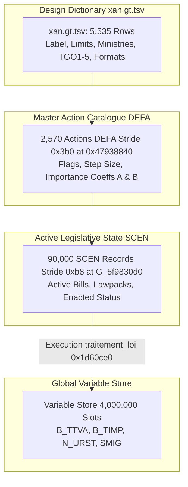
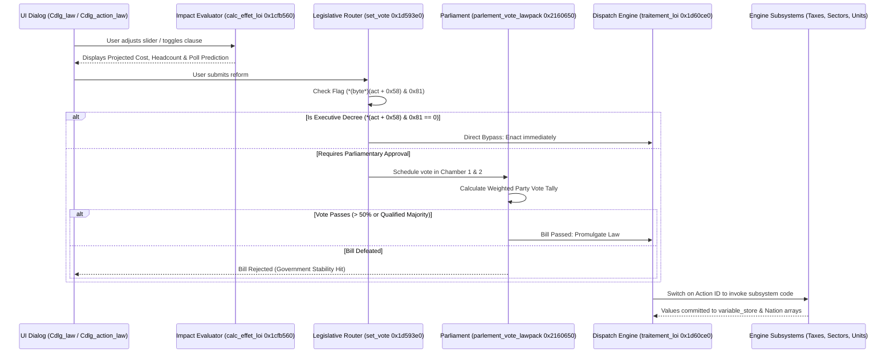
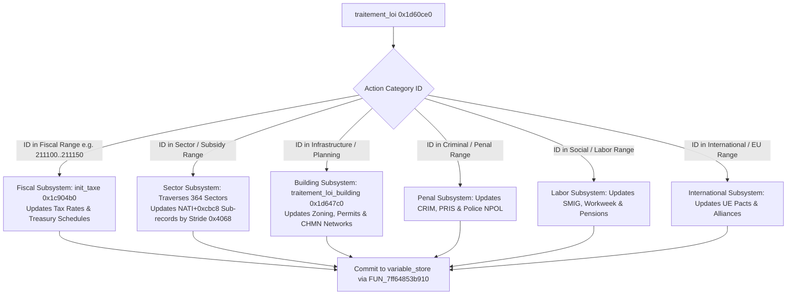

# Volume 6: Legislative System & Law Execution Engine

---

## 1. Law Storage & Data Representation

The legislative system in GPS5 bridges static spreadsheet design parameters with dynamic procedural simulation code. Laws, decrees, taxes, and constitutional reforms are represented through three interconnected structures:



### 1.1 The Master Action Catalogue (`DEFA`)
Located in `.rdata`/heap at RVA `0x47938840`, storing 2,570 action archetypes (stride `0x3b0` / 944 bytes):
- `+0x00`: UTF-16LE internal string identifier (e.g., `"211100"` for VAT).
- `+0x40`: Formatting / category tag (e.g., `"___%"` for percentages, `"___$"` for monetary amounts, `"Q"` or `"u"` for discrete option bitfields).
- `+0x58`: Action control bitfield (`uint32_t flags`):
  - Bit 0 (`& 0x01`): Requires parliamentary legislative vote.
  - Bit 7 (`& 0x80`): Executive decree permissible (bypasses legislative vote).
  - Bit 15 (`& 0x8000`): Minimum value dampening active.
  - Bits 16..19: Asymmetric importance scaling modifiers.
- `+0x74`: Public sensitivity coefficient (`float sens`).
- `+0x78`: Array of 30 theme integer IDs affected by this action.
- `+0xf0`: Array of 30 theme weight multipliers (`float weights[30]`).
- `+0x168`: Array of 30 target position thresholds (`float targets[30]`).
- `+0x224`: Parameter block `{ float A, float B, float val_init, float mn, float step }`.

### 1.2 The Legislative Container (`SCEN`)
When a bill is introduced, drafted, or enacted, the runtime allocates a record in the `SCEN` pool (stride `0xb8` / 184 bytes, 90,000 slots at `G_5f9830d0`):
- `+0x08`: Linked action code string.
- `+0x48`: Legislative state flags (bit 2 = pending vote, bit 4 = passed, bit 15 = decree).
- `+0x60`: Variable ID in the global `variable_store` linked to this law.
- `+0x70`: Target ministry / portfolio responsible.
- `+0x88`: Proposed parameter / target value ($V_{\text{new}}$).
- `+0x98`: Action ID integer code.
- `+0xb0`: Pre-reform baseline value ($V_{\text{old}}$).
- `+0xb8`: Lawpack container reference (if bundled in an omnibus reform).

### 1.3 Continuous Sliders vs. Discrete Option Bits (`Q` & `u`)
Laws fall into two fundamental mathematical categories:
1. **Continuous Metric Laws**:
   - Taxes, budgetary spending, age limits, minimum wages.
   - Formatted with `___%` or `___$`.
   - Stored as IEEE 754 floating-point values in the variable store.
2. **Discrete Categorical / Option Laws (`Q` and `u`)**:
   - Euthanasia authorization, abortion term limits, nuclear power authorization, cannabis legalization, capital punishment methods.
   - Stored as an integer bitmask where each individual bit represents a specific statutory clause:
     ```cpp
     // From calc_effet_loi (0x1cfb560)
     uint32_t changed_bits = (uint32_t)new_val ^ (uint32_t)old_val;
     for (int bit = 0; bit < 32; bit++) {
         if ((changed_bits >> bit) & 1) {
             // Dispatch individual clause evaluation
             evaluate_clause_impact(action_id, bit, nation_id);
         }
     }
     ```

### 1.4 The 5-Dimensional Ideological Tensor ($TGO$)
Every law is tagged in `xan.gt.tsv` with coordinates along 5 master socio-political axes, scaled from $-100$ to $+100$:
- **$TGO_{1}$ (Power Rules)**: Full Democracy ($-100$) $\longleftrightarrow$ Absolute Autocracy ($+100$).
- **$TGO_{2}$ (Economic Organization)**: State Monopolies & Protectionism ($-100$) $\longleftrightarrow$ Laissez-Faire Free Market ($+100$).
- **$TGO_{3}$ (Fiscal Redistribution)**: Democratic Socialism / Egalitarian Welfare ($-100$) $\longleftrightarrow$ Pure Capitalism / Minimal Taxes ($+100$).
- **$TGO_{4}$ (Social Values)**: Libertarian / Permissive Tolerance ($-100$) $\longleftrightarrow$ Authoritarian Moralism / Police State ($+100$).
- **$TGO_{5}$ (International Posture)**: Global Multilateralism & Supranational Integration ($-100$) $\longleftrightarrow$ National Sovereignty & Bellicose Isolation ($+100$).

---

## 2. The Legislative Workflow: From UI Proposal to Law Execution

When a player or AI reforms a law, execution flows through five deterministic stages:



---

## 3. Impact Forecasting Engine (`calc_effet_loi` / `0x1cfb560`)

Before a law is put to a vote, the UI calls `calc_effet_loi` (`decomp/d_01c.c:188145`) to calculate its ramifications:
1. **Fiscal Impact (`ImpactBudgetaire`)**:
   $$\Delta \text{Budget} = \text{COUT}(\text{action}) \times (V_{\text{new}} - V_{\text{old}})$$
2. **Civil Service Personnel Impact (`PERSONNEL`)**:
   Calculates how many additional police officers, teachers, healthcare workers, or tax inspectors must be hired:
   $$\Delta \text{CivilServants} = \text{PERSONNEL}(\text{action}) \times (V_{\text{new}} - V_{\text{old}})$$
3. **Electorate Polling Prediction (`Cdlg_action_law__calc_vote_peuple` / `0x16248c0`)**:
   Simulates how the public will react to the bill if enacted, feeding the UI opinion forecast graph.

---

## 4. Parliamentary Voting Mechanics

If a law requires legislative consent, it is evaluated by:
- **Chamber 1 (Lower House / National Assembly)**: `parlement_vote_lawpack_chambre1_estimation` (`0x2160650`).
- **Chamber 2 (Upper House / Senate / Regional Delegates)**: `parlement_vote_lawpack_chambre2_pres_region` (`0x21625a0`).

### 4.1 Mathematical Vote Tally Equation
As decompiled in `decomp/d_021.c:73405-73427`, the vote of political group $g$ is computed from its ideological proximity and party discipline:
$$\text{VoteFraction}_{g} = \mathtt{f\_2148840}(\text{PartyIdeology}_{g}, \text{LawIdeology}_{TGO})$$
$$\text{SupportRate}_{g} = \mathtt{f\_2149cbae0}(\mathtt{GROU}_{g}, \text{ActionRecord}, \text{VoteFraction}_{g})$$

The final parliamentary approval percentage $\Psi$ is the seat-weighted sum across all active parties:
$$\Psi = \sum_{g \in \text{Parties}} \left( \frac{\text{Seats}_{g}}{\text{TotalSeats}} \times \text{SupportRate}_{g} \right)$$

- **Threshold Test**:
  - Ordinary legislation: $\Psi > 50.0\%$.
  - Constitutional amendments: $\Psi \ge 66.7\%$ (two-thirds supermajority).
  - In bicameral systems, if Chamber 1 approves but Chamber 2 rejects, a constitutional reconciliation procedure (`parlement_navette`) triggers depending on national institutional rules (`NATI` constitution flags).

---

## 5. Dynamic Subsystem Code Dispatch (`traitement_loi`)

Once a law is promulgated, `traitement_loi` (`0x1d60ce0`, 14.8 KB decompiled code in `decomp/d_01d.c:30725`) executes. Instead of an object-oriented polymorphic virtual call, the engine performs a **giant procedural dispatch**:

### 5.1 The Subsystem Branch Switch
`traitement_loi` parses the action code integer $ID_{\text{action}}$ and executes dedicated logic based on the functional domain:



### 5.2 Concrete Subsystem Dispatch Examples

#### Case A: Fiscal / Tax Laws (e.g., VAT `211100`, Income Tax `211101`)
1. Reads new percentage rate from `SCEN.new_val`.
2. Locates nation record `psVar36 = NationBase + (nation_idx * 0x645310)`.
3. Calls `init_taxe` (`0x1c904b0`) to re-compute annual revenue expectations.
4. Updates linked global variable in `variable_store` (e.g., slot `B_TTVA`).
5. Posts message `0x4d` to `Cgps` to notify the financial UI.

#### Case B: Sectoral Subsidies / Price Controls (`xae.gt`)
1. As seen in `decomp/d_01d.c:31184`, the function iterates all 364 sectors inside `NATI`:
   $$\text{SectorSubRecord} = \text{NationBase} + 0\text{x}10\text{bc0} + s \times 0\text{x}4068$$
2. Matches the action's target sector string with the sector's code (`FUN_7ff64853a690`).
3. Sets or clears the state intervention flag:
   - Price ceiling / fixing: modifies pre-tax price index `Prix HT`.
   - Production quota: caps `var(+0x28)`.
   - Nationalization: flips enterprise ownership flags in `CORP` array from private to state-owned.

#### Case C: Labor Regulations & Minimum Wage (`SMIG`)
1. Writes new monthly minimum wage to `NATI + 0x6217f4` (`SMIG`).
2. Iterates corporate payrolls in `Etape 12`: enterprises calculate if low-skilled labor cost exceeds worker marginal product.
3. Automatically triggers workforce downsizing in low-margin sectors, increasing national unemployment (`CHOM`).

#### Case D: Institutional & Constitutional Reforms
1. Modifies political system flags at `NATI + 0x6222d8` (`DIKT`):
   - Executive term limit abolition.
   - Voting age lowered from 18 to 16 (re-indexes electoral cohort weights in `MO05..MO30`).
   - Transition between presidential, semi-presidential, and parliamentary constitutional regimes.

---

## 6. Lawpacks & Omnibus Legislation (`traitement_lawpack`)

When modern governments enact major economic packages (e.g., Green Energy Transition Bill, Labor Reform Package), individual laws are bundled into an omnibus container (`lawpack`):
- **Function**: `traitement_lawpack` (`0x1d5cc40`, 16.5 KB in `decomp/d_01d.c`).
- **Mechanism**:
  1. Traverses the linked list of sub-actions bundled within the master `SCEN` record.
  2. Evaluates the political package as a single atomic bill in parliament (`parlement_vote_lawpack_chambre1_estimation`).
  3. If approved, executes an internal loop invoking `traitement_loi` sequentially on every individual component bill, logging one unified event in national history (`gere_histo`).
