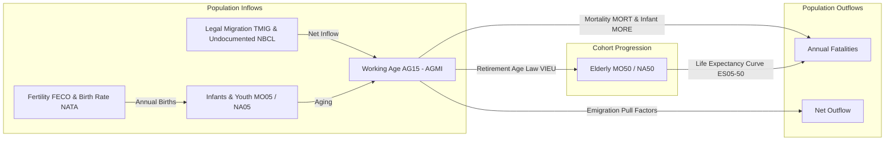
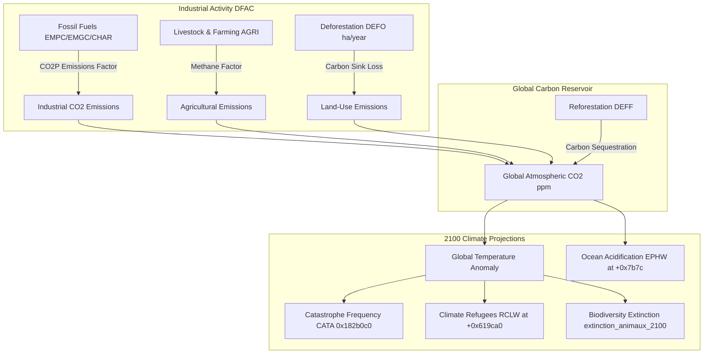

# Volume 7: Demography, Healthcare & Environmental Simulation

---

## 1. Demographic Cohort-Component Engine

GPS5 models human populations not as an undifferentiated scalar, but through a **stratified cohort-component demographic model** computed during macro-turn Etape 11 (`f_1c3c060`):

### 1.1 Demographic State Offsets in `NATI`
Located in the master nation record:
- `+0x4428`: `double POPU` — Total national population (inhabitants).
- `+0x44e8` .. `+0x44f0`: `float MO05, MO30, MO50` — Male age cohort distributions ($0-15$, $15-64$, $65+$).
- `+0x44f8` .. `+0x4500`: `float NA05, NA30, NA50` — Female age cohort distributions ($0-15$, $15-64$, $65+$).
- `+0x4508` .. `+0x4510`: `float ES05, ES30, ES50` — Life expectancy at birth, age 30, and age 50.
- `+0x453c`: `float POPC` — Annualized population growth rate (%).
- `+0x4904` .. `+0x490c`: `float AG15, AG30, AGMI` — Working-age bracket breakdowns.
- `+0x5450`: `float TMIG` — Net annual legal migration rate (per 1,000 residents).
- `+0x4988`: `float NBCL` — Estimated population of undocumented/illegal immigrants.
- `+0x5454`: `float FECO` — Total fertility rate (average children per woman).
- `+0x5458`: `float NATA` — Crude birth rate (yearly births per 1,000 inhabitants).
- `+0x545c`: `float MORE` — Infant mortality rate (deaths under age 1 per 1,000 live births).
- `+0x5460`: `float MORT` — Crude death rate (yearly deaths per 1,000 inhabitants).
- `+0x5434`: `float URBA` — Urbanization rate (fraction of population residing in cities).

### 1.2 Mathematical Formulation of Demographic Shifts
During macro-turn step $\Delta t_{\text{turn}} = 1/26$ year:
1. **Births**:
   $$\text{Births} = \mathtt{POPU} \times \left( \frac{\mathtt{NATA}}{1000} \right) \times \Delta t_{\text{turn}}$$
   Birth rate $\mathtt{NATA}$ is dynamically driven by fertility $\mathtt{FECO}$, contraception prevalence (`CONT` at `+0x5448`), family welfare subsidies (`FAMI`), and female labor participation.
2. **Deaths**:
   $$\text{Deaths} = \mathtt{POPU} \times \left( \frac{\mathtt{MORT}}{1000} \right) \times \Delta t_{\text{turn}}$$
   Crude mortality $\mathtt{MORT}$ is modulated by the Healthcare ministry star level (`MSAN`), poverty headcount (`SPAU`), unsanitary housing (`PAUV`), and violent crime (`CRIM`).
3. **Net Migration (`f_ed58e0`)**:
   International migration is governed by a gravity-potential equation:
   $$\text{MigrationPull}(A \to B) = \gamma_{\text{mig}} \times \left( \frac{\text{Salary}_{B} - \text{Salary}_{A}}{\text{Salary}_{B}} \right) \times \frac{\text{Stability}_{B}}{\text{Stability}_{A} + \text{WarPenalty}}$$
   Net arrivals increment working-age cohorts while undocumented inflows accumulate under `NBCL`.

---

## 2. Healthcare & Epidemiological Engine (`gestion_epidemies`)

Epidemic propagation executes during Phase 33 of `calc_monde` (`gestion_epidemies` / `0xd53a40`). The engine simulates both endemic chronic diseases and novel pandemic outbreaks:

### 2.1 Chronic & Endemic Diseases
- **HIV / AIDS**: Tracked via `NVIH` (seropositive headcount at `+0x4990`) and `SIDA` (annual AIDS mortality per 1,000 at `+0x4998`). Controlled via healthcare funding and pharmaceutical supply.
- **Malaria (`PALU`) & Gastric Diseases (`GAST`)**: Prevalent in tropical developing nations; reduced by sanitation infrastructure (`NMEA` water networks).
- **Cancer (`CAPM`) & Endocrine Disruptors**: Scaled by industrial pollution (`pollution` 0-100 in `xae.gt`) and chemical pesticide legislation.

### 2.2 Compartmental Pandemic Model (SEIR)
When an epidemic trigger fires (e.g. `C19B` or `EBOL` at `+0x6452c0`), the population is compartmentalized across spatial regions (`REGI`):
$$\frac{dS}{dt} = -\beta \cdot \frac{S \cdot I}{N}$$
$$\frac{dE}{dt} = \beta \cdot \frac{S \cdot I}{N} - \sigma E$$
$$\frac{dI}{dt} = \sigma E - \gamma I - \mu_{\text{epi}} I$$
$$\frac{dR}{dt} = \gamma I$$

Where:
- $\beta$ (effective transmission rate) is suppressed by governmental policies:
  $$\beta = \beta_{0} \times (1 - \text{LockdownPenalty}) \times (1 - \text{RemoteWorkRate}) \times (1 - \text{MaskMandate})$$
- $\mu_{\text{epi}}$ (case fatality rate) increases asymptotically when severe cases exceed national hospital intensive care unit capacity (`NLIT` hospital beds at `+0x621710`).

---

## 3. Environmental Engine, Carbon Accounting & Climate Change

GPS5 features an integrated Earth-system carbon model linking macroeconomic industrial activity directly to 2100 climate projections:

### 3.1 Sectoral Carbon Emission Accounting
Every sector in `data/gt/xae.gt.tsv` declares its carbon emission profile:
- Primary fossil extraction (`EMPE`, `EMPC`, `EMPN`, `EMGC`, `CHAR`): Tagged with `CO2P` (Production emissions).
- Industrial consumers: Tagged with `CO2D` (Downstream combustion emissions).
- National gross emissions:
  $$\text{Emissions}_{\text{nation}} = \sum_{s=1}^{364} \left( Q(s) \times \text{CO2Factor}(s) \right) - \text{CarbonSink}(\mathtt{DEFF})$$
Where `DEFF` (at `+0x6434a8`) records annual hectares deforested ($+$) or reforested ($-$).

### 3.2 Long-Term Climate Metrics (Target Year 2100)
The engine extrapolates historical and current emission trajectories through dedicated projection routines:
- `extinction_animaux_2100` (`0x1051c30`): Calculates projected percentage loss of global biodiversity by 2100.
- `depense_perturbateurs_endocriniens` (`0x1050360`): Tracks public health expenditures resulting from chemical and microplastic pollution.
- `EPHW` (at offset `+0x7b7c` in `NATI`): Projected global ocean pH level for 2100 (tracking marine acidification and fisheries collapse).
- `RCLW` (at offset `+0x619ca0` in `NATI`): Projected cumulative climate refugees displaced by sea-level rise and extreme desertification by 2100.

### 3.3 Natural Catastrophes Engine (`CATA` / `0x182b0c0`)
Disasters (hurricanes, tropical cyclones, river floods, severe droughts, heatwaves, earthquakes) are instantiated in the `CATA` record pool (serializer `f_14556f0`, stride `0xa98`, 3,000 slots):
- **Occurrence Probability**: Base Poisson probability scaled by global warming anomaly:
  $$\lambda_{\text{disaster}} = \lambda_{\text{baseline}} \times \left(1 + 0.15 \cdot \Delta T_{\text{global}}\right)$$
- **Damage Resolution (`calc_cata_victimes_initiales` / `0x182afc0`)**:
  Computes immediate fatalities and destroys physical buildings (`CBAT`) within the affected geographic polygon:
  $$\text{Fatalities} = \text{Pop}_{\text{region}} \times \frac{\text{Severity}}{\text{Preparedness}_{\text{etoile}}} \times 0.001$$
  Where $\text{Preparedness}_{\text{etoile}}$ is the star level of the Emergency & Civil Defense budget line.

---

## 4. Education, Innovation & Human Capital

Long-term total factor productivity (TFP) growth is governed by education and research metrics stored within `NATI`:
- **Education Infrastructure**:
  - Primary pupil-teacher ratio (`ELP1` at `+0x6216c4`).
  - Secondary pupil-teacher ratio (`ELP2` at `+0x6216cc`).
  - Primary enrollment rate (`TSC1` at `+0x621698`).
  - Higher education enrollment (`ENET` at `+0x6216a8`).
  - Illiteracy rate (`ANAL` at `+0x621690`).
- **Research & Science Output**:
  - Scientists per 100 residents (`SCIE` at `+0x6216bc`).
  - Registered patents per year (`BREV` at `+0x6216d4`).
  - Total Nobel Prizes obtained (`NOBE` at `+0x6216dc`).
- **Domain Innovation Scaling (`calc_augm_potentielle_domaine` / `0x23f6e40`)**:
  When national research budget allocations (`MREC`) accumulate sufficient research capital, technological breakthroughs unlock new unit tiers (`xue.gt.tsv`), increase energy efficiency coefficients, or lower industrial pollution parameters across the `xae.gt.tsv` activity matrix.
