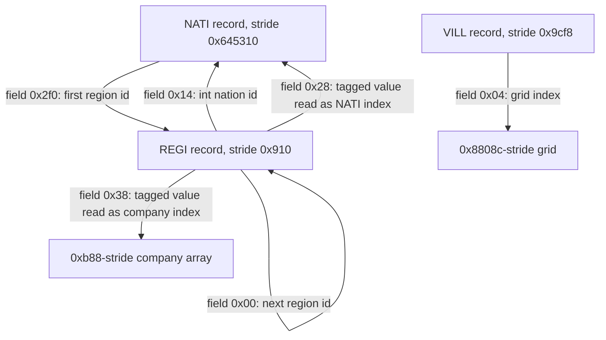
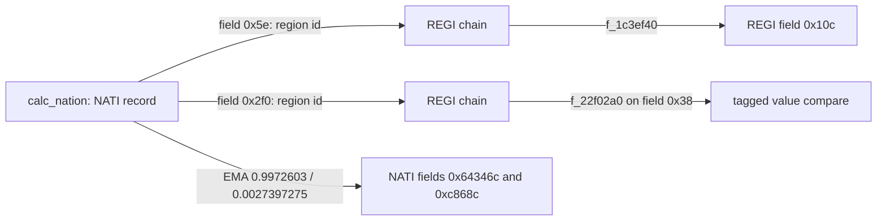
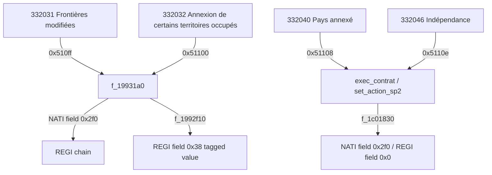
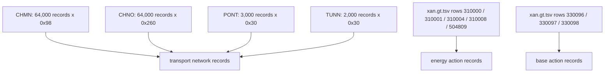

# Volume 8: Regions, Cities, Territory & Infrastructure

---

## 1. Administrative & Spatial Hierarchy

The corpus implements a three-level record hierarchy: a nation array of records with stride `[qty 0x645310 stride]`, a region array with stride `[qty 0x910 stride]`, and a city array with stride `[qty 0x9cf8 stride]`. The nation-to-region link and the region-to-region link are two different mechanisms: the nation record stores a first-region id at `[field 0x2f0 in NATI]`, and each region stores the next region id at `[field 0x0 in REGI]`.



```pseudocode
// traversal: f_85d580, corpus lines 41991 and 42005
sVar5 = *(short *)((longlong)param_1 * 0x645310 + 0x2f0 + NATI_BASE);
while (0 < sVar5) {
    // sVar5 is a REGI index
    sVar5 = *(short *)((longlong)sVar5 * 0x910 + REGI_BASE);
}

// unlink: f_1c01830, corpus lines 3265819-3265832
if (*(int *)(nation * 0x645310 + 0x2f0 + NATI_BASE) == target) {
    *(int *)(nation * 0x645310 + 0x2f0 + NATI_BASE) = *target;
} else {
    p = *(int *)(nation * 0x645310 + 0x2f0 + NATI_BASE);
    while (0 < p) {
        next = *(int *)(p * 0x910 + REGI_BASE);
        if (target == next)
            *(int *)(p * 0x910 + REGI_BASE) = *(int *)(next * 0x910 + REGI_BASE);
        p = next;
    }
}
```

### 1.1 Nation Array and Activation

The nation array base is `[global 0x46208908 i64]`. The loader `[fn 0x1399d60 f_1399d60]` advances the destination pointer by `[qty 0x645310 stride]` for every record (corpus line 1991897), and `[fn 0x85d580 f_85d580]` indexes a record with `param_1 * 0x645310` (corpus line 41991). `Cdatabase__es_base` calls the loader with a count (corpus line 2074049). That count is set to `[qty 300 nation-slots]` for the normal path and to the live counter `[global 0x322a3f4 i32]` for the other path (corpus lines 2074045-2074047). The live counter is initialised to 1 in `[fn 0x1cbac20 f_1cbac20]` (corpus line 3345979).

`nation_is_active` is not a flag test. It is:

```c
return *(int *)(param_1 + 0x2f0) != 0;   // f_1a47850, corpus line 2942160
```

So a nation is active when its first-region field is non-zero. `[fn 0x1c30ef0 f_1c30ef0]` allocates a region and stores the new id into that same field when the nation has none (corpus lines 3290386-3290390).

### 1.2 Region Record, Identity and the Linked List

The region array is loaded by `[fn 0x139bb40 f_139bb40]`, which adds `0x910` per record (corpus line 1993157). Its count is the live region counter `[global 0x463d1b48 i32]`, passed at corpus line 2074132. The counter is initialised to 1 at corpus line 3345982 and incremented after each allocation at corpus line 3291928. The shipped data file's extent divided by the record size gives 1,309 records, but the corpus does not contain that number as a literal; the loader uses the counter.

The region allocator `[fn 0x1c32e50 f_1c32e50]` writes the record at index `[global 0x463d1b48 i32]` (corpus lines 3291882-3291906):

| Field | Evidence | Meaning established by the code |
| :--- | :--- | :--- |
| `[field 0x0 in REGI]` | `*puVar11 = *(undefined4 *)(param_1 + 0x178);` line 3291886 | next region id / previous list head |
| `[field 0x4 in REGI]` | `*(int *)(lVar10 + G_47e23354) = _DAT_463d1b48;` line 3291885 | self region id |
| `[field 0x14 in REGI]` | `*(int *)(lVar10 + G_47e23364) = (int)*param_1;` line 3291887 | integer nation id |
| `[field 0x28 in REGI]` | lines 3291889-3291890 | 16-byte tagged value (double payload, tag at `[field 0x30 in REGI]`) |
| `[field 0x38 in REGI]` | lines 3291898-3291901 | 16-byte tagged value |
| `[field 0x48 in REGI]` | line 3291897 | integer payload |

The `+0x28` value is read as a nation reference: `[fn 0x857ff0 AVTerritoire__calc_prix_territoire]` reads it, converts it to an integer and multiplies by `[qty 0x645310 stride]` to index the nation array (corpus lines 38187-38189). The `+0x38` value is not a nation reference: `[fn 0x1992f10 f_1992f10]` reads it as an integer and multiplies by `0xb88` to index the company array `[global 0x5d859dc8 i64]` (corpus line 2803960).

The list is a genuine singly-linked list because both the store and the traversal are visible. The store is `[fn 0x1c01830 f_1c01830]` (corpus lines 3265819-3265832): it replaces the nation's `[field 0x2f0 in NATI]` head or rewrites the predecessor's `[field 0x0 in REGI]`. The traversal is `[fn 0x85d580 f_85d580]` (corpus lines 41991 and 42005).

### 1.3 City Record

The city array base is `[global 0x26e03518 i64]`. `[fn 0x13a07b0 f_13a07b0]` allocates `param_3 * 0x9cf8` bytes and copies the records (corpus lines 1996505-1996515); the count comes from the save stream at corpus line 2076846.

The corpus exposes these city fields:

| Field | Evidence | Meaning established by the code |
| :--- | :--- | :--- |
| `[field 0x4 in VILL]` | `f_937500` lines 192372-192373 | integer multiplied by `[qty 0x8808c grid-stride]` to index a per-city grid |
| `[field 0x8 in VILL]` | `gestion_popu_warville` line 4125207 | uint compared to `2` on the combat path |
| `[field 0x20 in VILL]` | `f_92a0b0` line 184420 | integer multiplied by `0x750` to index a `0x750`-stride array |
| `[field 0x28 in VILL]` | `gestion_popu_warville` line 4125208 | day stamp compared to `[global 0x464916a8 i32] - 1` |
| `[field 0x2c in VILL]` | `gestion_popu_warville` line 4125201 | integer tested for `< 1` |
| `[field 0x34 in VILL]` | `f_f92060` line 1439686 | flag word OR-ed with `[qty 0xc0000 flag-bits]` |

The old `+0x00` city id, `+0x04` parent `REGI` id, `+0x08` peace/contested/siege enumeration, `+0x28` "last bombardment", and `+0x34` mayor pointer are not supported. The code has a combat branch that tests `[field 0x8 in VILL] == 2` and a day stamp at `[field 0x28 in VILL]`, but it does not label the state numbers or the stamp as siege/bombardment.

### What the code does not establish

- A city id at `[field 0x0 in VILL]`; no access to city offset 0 was found.
- A parent region id at `[field 0x4 in VILL]`; the field is used as a grid index.
- The meanings "peace / contested / siege" for the three values of `[field 0x8 in VILL]`.
- A mayor or governor `PERS` pointer in the city record.
- Municipal hospitals, schools or police as city fields.
- A fixed 1,309 region count; the count is the runtime counter `[global 0x463d1b48 i32]`.

---

## 2. Regional GDP Calculation & National Factoring

The section title is retained for continuity, but the corpus does not implement a bottom-up regional GDP sum. What it implements is a nation update that walks two different region chains and applies a 365-day smoother to two nation fields. The old production formula, the Leontief subtraction and the national raw-GDP sum are removed.



```pseudocode
// _geolgame__Cgps__calc_nation, corpus lines 2052660-2052667
iVar5 = *(int *)(param_1 + 0x5e);
while (iVar5 != 0) {
    lVar21 = (longlong)iVar5 * 0x910;
    f_1c3ef40((short *)param_1, lVar21 + REGI_BASE, fVar34);
    iVar5 = *(int *)(lVar21 + REGI_BASE);
}

// same function, corpus lines 2052036-2052050
fVar30 = *(float *)(param_1 + 0x64346c) - (...);
fVar40 = clamp(fVar30, 0.0, 1.0);
*(float *)(param_1 + 0x64346c) =
    *(float *)(param_1 + 0x64346c) * 0.9972603 + fVar40 * 0.0027397275;

// same function, corpus lines 2052067-2052084
fVar30 = (... ) + *(float *)(param_1 + 0xc868c);
fVar40 = clamp(fVar30, 0.0, 1.0);
*(float *)(param_1 + 0xc868c) =
    *(float *)(param_1 + 0xc868c) * 0.9972603 + fVar40 * 0.0027397275;
```

### 2.1 What `calc_nation` Walks

`[fn 0x14134a0 _geolgame__Cgps__calc_nation]` starts with `nation_is_active(param_1)`. In its alternate branch it reads a region id from `[field 0x5e in NATI]` and walks the region chain (corpus lines 2052660-2052667), calling `[fn 0x1c3ef40 f_1c3ef40]` on each region.

`f_1c3ef40` computes one region field from a nation field and a region field:

```c
uVar3 = f_22f1330((double *)(param_2 + 0x28), 0);
*(float *)(param_2 + 0x10c) =
    *(float *)((longlong)(int)uVar3 * 0x645310 + 0xc4a8 + NATI_BASE) *
    *(float *)(param_2 + 0x118);
```

That is `[field 0x10c in REGI] = [field 0xc4a8 in NATI] * [field 0x118 in REGI]` (corpus lines 3298434-3298436), followed by an event dispatch with the tag `"CLUE"`. It is a region-level value propagation, not a sum of regional GDP into a national total.

The same function later walks every nation and every region chain to compare the `+0x38` tagged value with `f_22f02a0` (corpus lines 2056596-2056622). This is the only nation-wide region walk in the function; it does not accumulate a GDP field.

The old identification of `[field 0x30ce44 in NATI]` as NPIB is not supported. `[field 0x30ce44 in NATI]` is a float field (13 corpus hits), and `[fn 0x23e9640 f_23e9640]` uses it inside a formula `(fVar21 * 0.7) / 5000.0` (corpus line 4548009), but the corpus never labels it GDP, NPIB or PIB. The repo-derived `nation_fields.tsv` names `PIB1/PIB2/PIB3` at `[qty 0x5410 field-offset]`, `[qty 0x5414 field-offset]`, `[qty 0x5418 field-offset]` and `EPIB` at `[qty 0xc4a8 field-offset]`; the field `[field 0x30ce44 in NATI]` is not among them. That file is a derived map, not a shipped table, so it is only a lead, not proof.

### 2.2 The 365-Day Smoother Is Real, but It Is Not GDP

The exact constants exist twice in `[fn 0x14134a0 _geolgame__Cgps__calc_nation]`:

- corpus line 2052049-2052050: `field_0x64346c = field_0x64346c * 0.9972603 + fVar40 * 0.0027397275`
- corpus line 2052083-2052084: `field_0xc868c = field_0xc868c * 0.9972603 + fVar40 * 0.0027397275`

The two coefficients sum to 1.0000000275, and `0.0027397275` is the f32-rounded `1/365`; so the form is a 365-day exponential smoother. But the smoothed object is `[field 0x64346c in NATI]` / `[field 0xc868c in NATI]`, each clamped to `[0,1]` before the blend. `[fn 0xa5f510 f_a5f510]` reads `[field 0x64346c in NATI]` only to choose between a fallback constant and an `LCPE` value (corpus line 366826), and `[fn 0x1d9cbd0 f_1d9cbd0]` aggregates it across active nations as `* 100.0` for a UI/variable read (corpus line 3498469). Neither function treats it as GDP. The old "GDP EMA" claim is therefore replaced by: a 365-day EMA exists, but its target is an unlabeled unit-interval index, not national GDP.

### 2.3 Tax Retention and Equalisation

No retention ratio in `[0.10, 0.70]` was found. `[fn 0x1c904b0 init_taxe]` iterates nations and regions (corpus lines 3319355-3319410) and builds tax relationships, but it contains no clamp of a regional tax ratio to that range. The searches were: every function containing both a `0x910` region index and the literals `0.1` and `0.7`; no function contains a two-sided clamp on a tax share. Equalisation transfers likewise have no implementing function: no function takes a region surplus and adds it to another region or to a national pool.

### What the code does not establish

- A regional value-added formula with capital, workers, modernity or health terms.
- A Leontief intermediate-input subtraction over 364 sectors.
- A national raw-GDP sum over `[field 0x2f0 in NATI]` chains.
- The identification of `[field 0x30ce44 in NATI]` as GDP / NPIB.
- A GDP-targeted 365-day EMA (the EMA exists, but on two other fields).
- A regional retention ratio in `[0.10, 0.70]`.
- Equalisation transfers between regions.
- The `CBAT` / `CRPP` counts 620,000 and 248,000 as code constants; only the strides `[qty 0x68 stride]` and `[qty 0x1cc0 stride]` are verified by the loaders `[fn 0x96afa0 f_96afa0]` and `[fn 0x96a840 f_96a840]`.

---

## 3. Territorial Annexation & Secession Dynamics

The action ids in this area are data-table rows, and four of them are also code literals. The corpus does not show the pointer rewrite the old text described at `[field 0x28 in REGI]`. It does show list-traversal code, a list-unlink function, and an action handler that writes the `+0x38` tagged value.



```pseudocode
// f_19931a0, corpus lines 2804356 and 2804416-2804428 (action 0x510ff)
if ((int)*(float *)(param_1 + 200 + lVar28 * 4) == 0x510ff) {
    for (nation = 1; nation < nation_count; nation++) {
        if (nation_is_active(NATI_BASE + nation * 0x645310)) {
            for (r = *(short *)(NATI_BASE + nation * 0x645310 + 0x2f0);
                 0 < r;
                 r = *(int *)(REGI_BASE + r * 0x910)) {
                if (f_18f06d0((double *)(REGI_BASE + r * 0x910 + 0x38)))
                    f_1992f10(REGI_BASE + r * 0x910, value);
            }
        }
    }
}

// f_1992f10, corpus lines 2803962-2803963 and 2804025-2804028
uVar12 = (ulonglong)(int)*(double *)(param_1 + 0x38);
piVar13 = (int *)(uVar12 * 0xb88 + COMPANY_BASE);
/* ... company work ... */
if (0 < *(int *)(param_1 + 4)) {
    *(undefined8 *)(param_1 + 0x38) = *(undefined8 *)param_2;
    *(undefined8 *)(param_1 + 0x40) = *(undefined8 *)(param_2 + 2);
}
```

### 3.1 Action IDs: Data Rows and Code Literals

| Action id | Data row (French label) | Code literal | Handler / evidence |
| :--- | :--- | :--- | :--- |
| `[data xan.gt.tsv "332031"]` | Frontières modifiées | `[qty 0x510ff action-id]` | `[fn 0x19931a0 f_19931a0]` line 2804356 |
| `[data xan.gt.tsv "332032"]` | Annexion de certains territoires occupés | `[qty 0x51100 action-id]` | `[fn 0x19931a0 f_19931a0]` line 2804443 |
| `[data xan.gt.tsv "332040"]` | Pays annexé | `[qty 0x51108 action-id]` | `[fn 0x198cc20 exec_contrat]` line 2802237; `[fn 0x1d36a90 set_action_sp2]` line 3430880 |
| `[data xan.gt.tsv "332046"]` | Indépendance | `[qty 0x5110e action-id]` | `[fn 0x198cc20 exec_contrat]` line 2803456 |
| `[data xan.gt.tsv "102104"]` | Donner l'indépendance à une région | `[qty 0x18ed8 action-id]` | branch conditions, e.g. corpus line 2319450 |
| `[data xan.gt.tsv "506900"]` | Demander l'organisation d'un référendum d'autodétermination | none | only `[qty 0x7bc15 action-id]` (506901) occurs as a code literal, 35 times; 506900 itself has zero 32-bit immediate hits |

The `506900` row is not a code constant. Treating the id as a `*506900` base plus offset is not supported by the corpus; the code uses `[qty 0x7bc15 action-id]`, which is the next integer.

### 3.2 What the Annexation Handler Actually Does

`[fn 0x19931a0 f_19931a0]` handles `[qty 0x510ff action-id]` by walking every active nation's `[field 0x2f0 in NATI]` region chain and calling `[fn 0x1992f10 f_1992f10]` for regions whose `[field 0x38 in REGI]` passes `f_18f06d0` (corpus lines 2804416-2804428). The `[qty 0x51100 action-id]` branch reads a conflict record at `param_1 + 0x428` (stride `0x6cb8`) and calls the same function (corpus lines 2804443-2804462). The `[qty 0x51108 action-id]` branch in `exec_contrat` only formats a notification string, `" est intégré par "` (corpus line 2802237).

`f_1992f10` writes the `+0x38` tagged value at corpus lines 2804025-2804028 and operates on `[global 0x5d859dc8 i64]` records of stride `0xb88`. No write to `[field 0x28 in REGI]` or `[field 0x14 in REGI]` occurs in the cited ranges of either action handler. The list-unlink code `[fn 0x1c01830 f_1c01830]` exists and rewrites `[field 0x2f0 in NATI]` / `[field 0x0 in REGI]` (corpus lines 3265819-3265832), but the `332031` / `332032` / `332040` handlers do not call it in the cited range.

The old line `*(int16_t *)(region_ptr + 0x28) = annexing_nation_id;` is therefore removed. The `+0x28` value is a 16-byte tagged value, and the observed action-handler write is to `+0x38`, not `+0x28`.

### 3.3 Secession

The secession rows exist: `[data xan.gt.tsv "102104"]`, `[data xan.gt.tsv "506900"]`, `[data xan.gt.tsv "332046"]`. The code literals `[qty 0x18ed8 action-id]` and `[qty 0x5110e action-id]` appear in branch conditions (corpus line 2319450 and line 2803456). The list-detach operation is available as `[fn 0x1c01830 f_1c01830]`, and a dormant nation slot becomes active when `[fn 0x1c30ef0 f_1c30ef0]` stores a region id into `[field 0x2f0 in NATI]` (corpus lines 3290386-3290390).

The corpus does not implement the debt partition or the garrison defection described in the old text. Searches for a loan record (`0xec`-stride) multiplied by a region-GDP ratio returned no such expression, and no unit-record write was found tied to a seceding region. Those claims are removed.

### 3.4 The Two R1-Flagged Lines

`POP_AQTE` and `POP_PETE` are not binary constants. Both tokens have zero code-immediate hits. They are full data keys in `data/gt/xim.gt.tsv`:

- `[data xim.gt.tsv "POP_AQTE"]` — row `POP_AQTE | Acquisition territoriale | Acquisition of Territory`, line 21637.
- `[data xim.gt.tsv "POP_PETE"]` — row `POP_PETE | Perte territoriale | Loss of Territory`, line 21639.

The old AQTE/PETE binary-constant parentheticals are deleted. Both tokens have zero code-immediate hits; the surviving citations are the two `xim.gt.tsv` keys above. Volume 4 (accepted) already established the same classification; this volume is consistent with it.

### What the code does not establish

- A pointer write `[field 0x28 in REGI] = annexing nation id`.
- An unlink/relink call inside the `332031` / `332032` / `332040` handlers.
- GDP or asset transfer between the defeated and annexing nations.
- A `POP_AQTE` approval surge of +10% to +25%, or a `POP_PETE` backlash of -20% to -45%.
- Cultural/religious integration friction against `1DIC` / `LCUL`, or guerrilla spawn.
- A debt partition by GDP ratio, a credit-rating downgrade to `D`, or garrison defection.
- A code constant `506900`; only the data row exists.

---

## 4. Infrastructure Systems & Public Works

The corpus contains four transport pools with verified strides and loader counts, plus data-table rows for power plants and military bases. It does not contain a connectivity index, a friction multiplier, megawatt capacities, or base-capacity mechanics.



```pseudocode
// Cdatabase__es_base, corpus lines 2074177 and 2074187
f_1394770(param_1, (void *)G_3e45cc50, 64000, ...);  // CHMN, stride 0x98
f_1394930(param_1, (void *)G_3ee2c7d0, 64000, ...);  // CHNO, stride 0x260

// Cdatabase__es_base, corpus lines 2074904-2074941
for (lVar72 = 2000; lVar72 != 0; lVar72--) {
    f_14a8a60(tunnel_rec, 3, p2, ...);
    tunnel_rec += 0x30;
}
for (lVar25 = 3000; lVar25 != 0; lVar25--) {
    f_1499950(bridge_rec, 3, p2, ...);
    bridge_rec += 0x30;
}
```

### 4.1 Transportation Pools

| Pool | Stride | Count and loader evidence | Record tag |
| :--- | :--- | :--- | :--- |
| CHMN | `[qty 0x98 stride]` | `[qty 64000 chmn-records]` at corpus line 2074177; `[fn 0x1394770 f_1394770]` advances by `0x98` (line 1988353) | none observed |
| CHNO | `[qty 0x260 stride]` | `[qty 64000 chno-records]` at corpus line 2074187; `[fn 0x1394930 f_1394930]` advances by `0x260` (line 1988428) | none observed |
| PONT | `[qty 0x30 record-size]` | `[qty 3000 bridge-records]` at corpus lines 2074938-2074941 | `[tag 0x504f4e54 "PONT"]` in `[fn 0x1499950 f_1499950]` line 2128495 |
| TUNN | `[qty 0x30 record-size]` | `[qty 2000 tunnel-records]` at corpus lines 2074904-2074907 | `[tag 0x54554e4e "TUNN"]` in `[fn 0x14a8a60 f_14a8a60]` line 2137171 |

PONT and TUNN are serialized as a tag, a size word `0x30` and a 0x30-byte payload (corpus lines 2128493-2128497 and 2137169-2137173). The corpus does not expose lane capacity, electrification, terrain resistance or a pathfinding graph over these records.

### 4.2 Energy Action Rows

The old table assigned coal, hydro and solar to `300110`, `300112` and `300118`. Those rows are natural-disaster actions, not power plants:

- `[data xan.gt.tsv "300110"]` — `Tremblement de terre` / earthquake.
- `[data xan.gt.tsv "300112"]` — `Éruptions volcaniques` / volcanic eruptions.
- `[data xan.gt.tsv "300118"]` — `Pollution`.

The plant rows that do exist are:

| Action row | Label | Energy / environment formula | Build days | Cost cell |
| :--- | :--- | :--- | :--- | :--- |
| `[data xan.gt.tsv "310000"]` | Energie fossile | `ENEE*5,2;ENER*5,2;ENVI*-1000` | 1095 | `MISE=274000000` |
| `[data xan.gt.tsv "310001"]` | Nucléaire | `ENEE*8;ENER*8;ENVI*-10` | 2555 | `MISE=10000000000` |
| `[data xan.gt.tsv "310004"]` | Eolien Terrestre | `ENEE*40;ENER*40;ENVI*80` | 270 | `MISE=822000000` |
| `[data xan.gt.tsv "310008"]` | Solaire | `ENEE*40;ENER*120;ENVI*200` | 244 | `MISE=676500000` |
| `[data xan.gt.tsv "504809"]` | Centrale nucléaire | reaction `VICN`, parameter 256 | empty | empty |

The `504809` row is a separate action row with no cost or build-duration cell. It is not a code immediate: its 32-bit decimal value has zero hits in the corpus.

Two event themes are real tags as well as data keys:

- `[tag 0x504e4545 "PNEE"]` — `[fn 0x22e4ad0 taux_critere]` line 4374801 returns a factor of `1.2` or `6.0` in the `PNEE` branch; `[fn 0xa45270 f_a45270]` calls `taux_critere` with that tag at line 356626.
- `[tag 0x4143434e "ACCN"]` — passed to `f_21c7410` at corpus line 3275564 in `[fn 0x1c12160 f_1c12160]`.

The matching data keys are `[data xim.gt.tsv "POP_PNEE"]` (line 21605) and `[data xim.gt.tsv "POP_ACCN"]` (line 21643). They name event themes; the corpus does not contain a generation-minus-demand balance or a reactor-failure probability.

### 4.3 Military Bases

The three base rows match Volume 3 and are action ids as well as data rows:

- `[data xan.gt.tsv "330096"]` — `Bases militaires`; code literal `[qty 0x50970 action-id]` in `[fn 0x2021e10 Cmenu_droit__do_action]` (corpus line 5342038) and `[fn 0x203bc10 f_203bc10]` (line 5346849).
- `[data xan.gt.tsv "330097"]` — `Bases navales`; code literal `[qty 0x50971 action-id]` (lines 5342043 and 5346962).
- `[data xan.gt.tsv "330098"]` — `Bases aériennes`; code literal `[qty 0x50972 action-id]` (lines 5342048 and 5347075).

Those branches toggle bits in `_DAT_464de228` (`^ 0x10000000000`, `^ 0x20000000000`, and the next bit). They are menu/selection state, not base-capacity or construction mechanics. Volume 3 already records that the `xan.gt.tsv` rows have an empty construction-duration cell.

### What the code does not establish

- A regional connectivity index, a trade-cost multiplier, or `1.0 / (1.0 + 0.35 * C)`.
- Highway/rail construction cost as length times base cost times terrain multipliers 1.0/2.5/3.2; the action rows give a single `MISE` and duration.
- CHMN/CHNO record field semantics (length, lanes, electrification, terrain resistance).
- Megawatt capacities, CO2 coefficients, or the `DFAC` 38/39/42 fuel mapping.
- A national grid balance, 20%-50% manufacturing shutdown, or rolling-blackout arithmetic.
- A nuclear meltdown check, reactor aging, or health/agriculture liability formula.
- Base garrison capacity 5,000-50,000, shipyard construction, SAM/radar umbrellas, or base upkeep.
- Any runtime count for `CBAT`/`CRPP`; only their strides are verified.

---

*Evidence base: `recomp/full_fns.clean.c` (D-001) and the shipped `data/gt/xan.gt.tsv` / `xim.gt.tsv` rows named above. Fields are cited by displacement (D-010); strides and counts by quantity (D-002); data keys by full key and file (D-008/D-012).*
