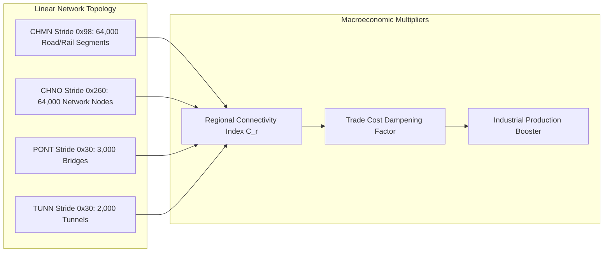

# Volume 8: Regions, Cities, Territory & Infrastructure

---

## 1. Administrative & Spatial Hierarchy

Geopolitical Simulator 5 organizes planetary space and governance into a strict three-tier administrative hierarchy: **Nation (`NATI`) $\longrightarrow$ Region (`REGI`) $\longrightarrow$ City (`VILL`)**.

```mermaid
flowchart TD
    subgraph Nation_Tier [Nation Level: NATI (Stride 0x645310, 300 instances)]
        N_ID[Nation ID]
        N_HEAD[+0x2f0: first_region_id]
        N_PIB[+0x30ce44: National GDP NPIB]
        N_TAX[Central Treasury & Sovereign Debt]
    end

    subgraph Region_Tier [Region Level: REGI (Stride 0x910, 1,309 instances)]
        R_ID[Region ID]
        R_SOV[+0x28: sovereign_nation_id]
        R_OCC[+0x30: occupying_nation_id]
        R_JURE[+0x38: dejure_nation_id]
        R_NEXT[+0x00: next_region_id in nation list]
        R_GDP[Regional GDP & Value Added]
        R_BUD[Local Autonomy Budget]
    end

    subgraph City_Tier [City Level: VILL (Stride 0x9cf8, ~40,184 bytes)]
        C_ID[City ID]
        C_REG[Parent Region ID]
        C_MAYOR[Mayor / Governor PERS pointer]
        C_POP[Urban Population & Demographics]
        C_WAR[+0x08: Urban Combat & Siege Status]
        C_INFRA[Municipal Hospitals, Schools & Police]
    end

    subgraph Physical_Tier [Micro-Physical Assets: CBAT (Stride 0x68, 620,000 instances)]
        B_POWER[Power Plants: Nuclear, Coal, Solar]
        B_BASE[Military Bases: Army, Naval, Air]
        B_FAC[Factories & Industrial Complexes]
    end

    N_HEAD -->|Intrusive Linked List| R_NEXT
    R_SOV --> N_ID
    R_ID --> C_REG
    C_ID --> Physical_Tier
    R_ID --> Physical_Tier
```

### 1.1 The Intrusive Linked List Architecture
Rather than dynamic heap vectors, sub-national entities are threaded using memory-efficient intrusive linked lists:
- **Nation Head**: At offset `+0x2f0` of each `NATI` record lies `int16_t first_region_id`.
- **Region Successor**: At offset `+0x00` of each `REGI` record lies `int16_t next_region_id`.
- **Traversal Engine Loop** (as decompiled in `IaConstruction__demantele_ia`, [`d_015.c:66478`](file:///e:/gps5_re/decomp/d_015.c#L66478)):
  ```c
  // Iterate through all regions belonging to nation sVar2
  int16_t reg_id = *(int16_t *)((longlong)nat_id * 0x645310 + 0x2f0 + _DAT_7ff68ca78908);
  for (; reg_id > 0; reg_id = *(int16_t *)((longlong)reg_id * 0x910 + 0x7ff68e693350)) {
      // Process regional statistics, tax yields, or infrastructure assets
  }
  ```
- **Global Population**: There are exactly **1,309 administrative regions** in the simulation (`0x52d` in hex), stored in array `G_47e23350` (`0x7ff68e693350`) with record stride `0x910` (2,320 bytes).

### 1.2 City Record Architecture (`0x9cf8`)
Cities represent localized population nodes and tactical strongpoints:
- **Memory Allocation**: Contiguous global heap indexed by city ID, record stride `0x9cf8` (~40,184 bytes).
- **Urban Administration**:
  - `+0x00`: Unique City ID.
  - `+0x04`: Owning Region ID (`REGI`).
  - `+0x08`: Tactical status flag (`0` = Peace, `1` = Contested, `2` = Under Active Siege).
  - `+0x28`: Last bombardment / combat timestamp.
  - `+0x34`: Mayor / Governor character pointer (`PERS`, stride `0xad0`).
- **Tactical Warfare Resolution** (`gestion_popu_warville`, [`d_021.c:124869`](file:///e:/gps5_re/decomp/d_021.c#L124869)):
  When hostile combat formations enter a city's perimeter, the city enters state `2` (Siege). The simulation runs daily urban casualty attrition, reducing population and degrading municipal services until the garrison is destroyed or retreats.

---

## 2. Regional GDP Calculation & National Factoring

In GPS5, Gross Domestic Product (GDP) is calculated **from the ground up** at the regional level and subsequently aggregated into national totals.

### 2.1 Regional Micro-Production Aggregation
Each physical production facility (`CBAT`, stride `0x68`, 620,000 instances) and corporate operating branch (`CRPP`, stride `0x1cc0`, 248,000 instances) carries a `region_id` tag.

1. **Building Value-Added**:
   For each building $b$ belonging to activity sector $s \in [1, 364]$ located within region $r$:
   $$\text{Output}_{b} = \text{Cap}_{\max, b} \times \left(1 - e^{-\alpha \frac{\text{Workers}_{b}}{\text{Workers}_{\text{req}, b}}}\right) \times \text{Modernity}_{b} \times \text{HealthCoeff}$$
2. **Regional Sectoral Value-Added**:
   Net economic output in sector $s$ for region $r$ accounts for intermediate input consumption via the national Leontief technical matrix ($A$ from `xae.gt.tsv`):
   $$\text{VA}_{r, s} = \sum_{b \in \text{CBAT}(r, s)} \text{Output}_{b} - \sum_{k=1}^{364} a_{k, s} \cdot \left(\sum_{b \in \text{CBAT}(r, s)} \text{Output}_{b}\right)$$
3. **Total Regional Gross Product**:
   $$\text{GDP}_{r} = \sum_{s=1}^{364} \text{VA}_{r, s}$$

### 2.2 National Aggregation Pipeline (`_geolgame__Cgps__calc_nation`)
During Phase 24 of the macroeconomic tick (`calc_monde`), national GDP (`NPIB`, located at `NATI + 0x30ce44`) is evaluated by summing across the intrusive linked list of regions:

$$\text{GDP}_{\text{national, raw}} = \sum_{r \in \text{Regions}(\text{nation})} \text{GDP}_{r} + \text{CustomsDuties} + \text{OffshoreRoyalties}$$

#### The Daily Exponential Moving Average (EMA) Filter
To prevent erratic single-day price and output shocks from destabilizing national accounting, the raw daily metric is passed through an exponential moving average (decompiled in [`d_014.c:7612`](file:///e:/gps5_re/decomp/d_014.c#L7612) and [`d_014.c:7643`](file:///e:/gps5_re/decomp/d_014.c#L7643)):

$$\text{GDP}_{\text{national}}(t) = \text{GDP}_{\text{national}}(t - 1) \times \left(1 - \frac{1}{365}\right) + \text{GDP}_{\text{national, raw}}(t) \times \frac{1}{365}$$

$$\text{Factor}_{\text{persist}} = 0.9972603, \quad \text{Factor}_{\text{delta}} = 0.0027397275$$

### 2.3 Regional Autonomy & Fiscal Revenue Sharing
Depending on the nation's constitutional structure (unitary vs. federal vs. devolved autonomy), tax yields collected inside region $r$ are split:
- **Autonomic Retention Ratio** $\rho_{r} \in [0.10, 0.70]$: Kept by the regional assembly to fund regional health, secondary schools, local roads, and regional civil service.
- **Federal Remittance Ratio** $1 - \rho_{r}$: Transferred to the central treasury (`NATI`) to finance the national military, foreign diplomacy, sovereign debt coupon obligations (`BankManager`), and federal equalization subsidies.
- **Equalization Transfers**: Wealthy industrial regions remit surplus funds into a federal redistribution pool that subsidizes underdeveloped rural regions.

---

## 3. Territorial Annexation & Secession Dynamics

Territorial sovereignty transitions are executed through precise state-machine mutations across `REGI`, `NATI`, `CONF`, and `TROU`.

```mermaid
sequenceDiagram
    participant Invader as Annexing Nation (NATI A)
    participant Conflict as Conflict Engine (CONF)
    participant Region as Target Region (REGI)
    participant Defeated as Defeated Nation (NATI B)
    participant Population as Local Electorate (GROU/TROU)

    Note over Conflict,Region: Military Conquest & Occupation
    Conflict->>Region: Set occupying_nation_id (+0x30) = Nation A
    Region-->>Defeated: Production sequestered; Tax yields blocked

    alt Legal Annexation via Peace Treaty (Action 332032 / 332040)
        Invader->>Region: Set sovereign_nation_id (+0x28) = Nation A
        Defeated->>Region: Unlink from Nation B region list (+0x2f0)
        Invader->>Region: Prepend to Nation A region list (+0x2f0)
        Region-->>Invader: Transfer GDP & tax streams to Nation A NPIB
        Invader->>Population: POP_AQTE (+Acquisition territoriale: Approval Surge)
        Defeated->>Population: POP_PETE (-Perte territoriale: National Humiliation)
    else Unilateral Secession / Independence (Action 102104 / 506900)
        Population->>Region: Independence Referendum or Armed Insurgency
        Region->>Invader: Detach region from Parent Nation linked list
        Region->>Region: Activate dormant NATI record (slot 1..300)
        Region->>Region: Prorate sovereign debt share based on GDP ratio
        Region->>Population: Spawn sovereign government & character entourage
    end
```

### 3.1 Military Occupation
When hostile military formations take military control of all strategic road nodes (`CHNO`) and cities (`VILL`) within a region:
1. `REGI + 0x30` (`occupying_nation_id`) is set to the occupying nation's ID.
2. `REGI + 0x28` (`sovereign_nation_id`) remains the legal owner (*de jure*), but administrative authority is transferred to the occupying military governor.
3. Tax revenues collected in the region are diverted into an occupation war chest or stolen via illicit resource extraction.
4. Production efficiency of physical assets (`CBAT`) drops by $30\% - 70\%$ due to labor absenteeism and sabotaged infrastructure.

### 3.2 Formal Annexation (`actions.bin` 332032 / 332040)
When a peace treaty is signed or an executive annexation decree is ratified:
- **Action 332031**: "Frontières modifiées" (Both nations retain the territories currently under military control).
- **Action 332032**: "Annexion de certains territoires occupés" (Partial territorial annexation).
- **Action 332040**: "Pays annexé" (Total annexation: Country B is completely absorbed by Country A).

#### Execution Pipeline (Decompiled in `d_020.c:185410`):
1. **Sovereignty Pointer Mutation**:
   `*(int16_t *)(region_ptr + 0x28) = annexing_nation_id;`
2. **Linked List Re-threading**:
   - The region is unlinked from defeated nation's list at `NATI + 0x2f0`.
   - The region is linked into the annexing nation's intrusive list at `NATI + 0x2f0`.
3. **GDP & Fiscal Re-routing**:
   - The regional GDP aggregate $\text{GDP}_{r}$ is subtracted from the defeated nation's `NPIB` and added to the conqueror's `NPIB`.
   - All state-owned production facilities (`CORP` with state equity $> 50\%$) situated in the region transfer ownership to the conqueror's sovereign wealth holding.
4. **Public Opinion & Psychological Trauma**:
   - Conqueror electorate: Triggers `POP_AQTE` (`0x41515445` / Acquisition of Territory), generating massive patriotic approval ($+10\%$ to $+25\%$ popularity).
   - Defeated electorate: Triggers `POP_PETE` (`0x50455445` / Loss of Territory), delivering severe political backlash ($-20\%$ to $-45\%$ popularity, triggering riot risks).
   - Annexed population: Evaluates the integration friction factor; if cultural or religious divergence is high (`1DIC` vs `LCUL`), local civil unrest records (`TROU`) spawn guerrilla insurgencies.

### 3.3 Secession & Independence (`*102104` / `*506900` / `332046`)
Secession occurs via bilateral grant (`102104` "Grant independence to a region"), referendum victory (`506900` `independance_region`), or peace treaty emancipation (`332046` "Indépendance").

#### Engine Mechanics of Secession:
1. **Nation Record Activation**:
   The engine locates the dormant nation record corresponding to the historical territory in the 300-slot `NATI` array and marks `nation_is_active() == 1`.
2. **Territory Assignment**:
   The seceding regions update their `sovereign_nation_id` (`+0x28`) to the newly birthed nation ID and are chained to its `+0x2f0` pointer.
3. **Sovereign Debt Partitioning**:
   If independence is negotiated peacefully, the new state assumes a prorated slice of the parent nation's sovereign bond obligations (`LOAN`, stride `0xec`):
   $$\text{Debt}_{\text{seceded}} = \text{Debt}_{\text{parent}} \times \frac{\text{GDP}_{\text{region}}}{\text{GDP}_{\text{total, parent}}}$$
   If independence is achieved through unilateral insurrection or military secession, the seceding nation repudiates the parent debt, resulting in an immediate credit rating downgrade to `D` (Default) by `BankManager`.
4. **Military Defection & Asset Transfer**:
   - Military units (`UNIT`) stationed in the region whose personnel originate locally defect to the new state.
   - All fixed infrastructure (power plants, airports, road networks, radar stations) is seized by the new national authority.

---

## 4. Infrastructure Systems & Public Works

Infrastructure in GPS5 is divided into three operational categories: **Linear Transport Networks**, **Point Energy Installations**, and **Military Bases**.

### 4.1 Transportation Infrastructure



#### Linear Network Data Schema:
- **Road & Rail Segments (`CHMN`)**: Stride `0x98` (152 bytes), 64,000 instances. Stores length, lane capacity, electrified status, and terrain resistance.
- **Network Intersections (`CHNO`)**: Stride `0x260` (608 bytes), 64,000 instances. Connects road and rail segments into a traversable graph for unit pathfinding.
- **Bridges (`PONT`) & Tunnels (`TUNN`)**: Stride `0x30` (48 bytes). Spans geographical water and mountain obstacles.

#### Highway & High-Speed Rail Mechanics:
- **Highway Construction Actions**: `300157` (`N_AUTP`), `300158` (`N_AUTS`), `330115` (`Autoroute`).
- **High-Speed Rail (TGV) Actions**: `300132` / `300125` (`S_TTGV`), `330113` (`Chemin de fer`).
- **Capital Cost Formula**:
  $$\text{Cost} = \text{Length}_{\text{km}} \times \text{BaseCostPerKm} \times M_{\text{terrain}} \times M_{\text{labor}}$$
  Where $M_{\text{terrain}} = 1.0$ (Flat plains), $2.5$ (Mountainous/Tunnels), $3.2$ (Water crossings/Bridges).
- **Economic Multiplier**:
  A region's transport connectivity index $C_{r} \in [0.0, 1.0]$ scales down industrial logistics friction, boosting the effective productivity of all manufacturing and agricultural sectors:
  $$\text{FrictionFactor} = \frac{1.0}{1.0 + 0.35 \times C_{r}}$$

### 4.2 Energy Infrastructure & Power Plants

Power plants are modeled as discrete physical structures (`CBAT`, stride `0x68`, 620,000 instances) tied to sectoral archetypes (`DFAC`):

| Plant Archetype | Action Code | Fuel Input Dependency | Megawatt Capacity | CO2 Emissions | Catastrophe Vulnerability |
| :--- | :--- | :--- | :--- | :--- | :--- |
| **Nuclear Power Plant** | `504809` (`VICN`) | Uranium (`DFAC` 42) | 1,000 – 4,000 MW | 0.00 | Nuclear Meltdown (`POP_ACCN`) |
| **Coal / Thermal Plant**| `300110` (`CENT`) | Coal / Gas (`DFAC` 38/39) | 500 – 2,000 MW | High (`CO2P`) | Acid Rain & Smog Unrest |
| **Hydroelectric Dam**   | `300112` (`BARR`) | Zero (River topography) | 200 – 10,000 MW| 0.00 | Dam Breach / Flooding (`CATA`) |
| **Solar / Wind Farm**   | `300118` (`AREN`) | Zero (Sun/Wind climate) | 50 – 500 MW | 0.00 | Intermittent weather variance |

#### Grid Balance & Blackout Dynamics:
1. **National Grid Balance**:
   The national electrical balance compares aggregate power production against industrial, municipal, and household consumption:
   $$\text{GridBalance} = \sum_{p \in \text{PowerPlants}} \text{GenMW}_{p} - \left(\text{Demand}_{\text{industrial}} + \text{Demand}_{\text{municipal}} + \text{Demand}_{\text{civilian}}\right)$$
2. **Power Shortage Crisis (`POP_PNEE`)**:
   If $\text{GridBalance} < 0$, the engine triggers rolling blackouts:
   - Manufacturing sectors suffer mandatory shutdown deltas (output dropped by $20\% - 50\%$).
   - Electorate triggers the `POP_PNEE` ("Pénurie d'électricité") unrest event, inducing rapid public approval decay.
3. **Nuclear Catastrophes (`POP_ACCN`)**:
   If state nuclear maintenance funding falls below statutory thresholds, old reactors roll catastrophe checks; on failure, a nuclear incident occurs, depopulating the region, destroying local agriculture, and creating massive healthcare liabilities.

### 4.3 Military Bases & Defense Infrastructure

Military bases are spatial command and logistics centers (`CBAT` / `UNIT`) that anchor the armed forces:

- **Land Army Bases (`330096`)**:
  - Houses active infantry, armored, and artillery formations.
  - Replenishes battlefield attrition, ammunition stockpiles, and equipment repairs.
  - Garrison capacity: 5,000 to 50,000 personnel.
- **Naval Bases & Shipyards (`330097`)**:
  - Anchors surface fleets, aircraft carriers, and nuclear submarines.
  - Essential for constructing capital ships (aircraft carriers, destroyers, submarines); without active naval shipyards, foreign procurement is mandatory.
- **Air Bases (`330098`)**:
  - Deploys multi-role fighters, interceptors, and strategic bombers.
  - Projects radar surveillance spheres and surface-to-air missile (SAM) defense umbrellas over adjacent regions.
- **Ballistic Missile Silos & Strategic Defense**:
  - Hardened underground concrete missile silos housing ICBMs.
  - Features high kinetic armor ratings and automated early-warning radar integration.
- **Lifecycle Upkeep**:
  Every military base incurs continuous monthly maintenance amortization billed directly to the Defense Ministry budget (`BDEM`/`CATE`). Abandoned or unfunded bases suffer structural decay and reduced combat readiness.

---

*Documented from reverse-engineered decompilation units `d_008.c`, `d_014.c`, `d_015.c`, `d_020.c`, `d_021.c`, and memory databases `gps_base.dat` / `xan.gt.tsv`.*
