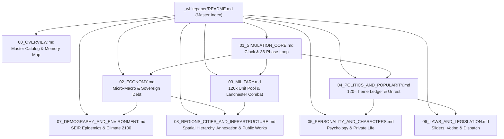
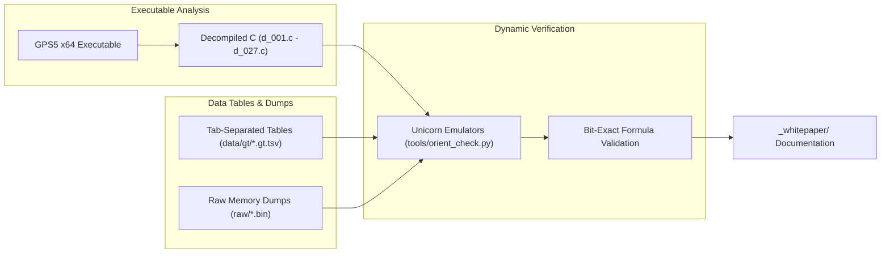

# Geopolitical Simulator 5: Reverse-Engineered Architecture & Mathematical Specification

**Geopolitical Simulator 5 (Power & Revolution 2026 Edition)**  
*Comprehensive Technical Whitepaper Series on Simulation Architecture, Game Logic, Mathematical Formulas, and Data Structures.*

---

## Executive Summary

This whitepaper suite provides a complete, high-level mathematical and architectural reconstruction of the simulation engine powering **Geopolitical Simulator 5 (Power & Revolution 2026 Edition)**. Reconstructed directly from decompiled binary code (`d_001.c` through `d_027.c`), raw memory save dumps (`raw/*.bin`), static databases (`data/gt/*.gt.tsv`), and validated via native Unicorn/Python emulation harnesses (`tools/orient_check.py`, `tools/emu_calc_nation.py`), this documentation describes the internal mechanics that govern global economics, domestic politics, military operations, character psychology, legislative drafting, and global climate systems.

All documentation is strictly compartmentalized under `_whitepaper/` and organized into dedicated, deep-dive volumes.

---

## Whitepaper Volume Catalog

### [Volume 0: Master Simulation Architecture & Data Schema](file:///e:/gps5_re/_whitepaper/00_OVERVIEW.md)
- **Primary Focus**: Global memory layout, record schemas, static arrays, and global variables.
- **Key Concepts**:
  - Catalog of all 58 simulation record types (`NATI`, `DFAC`, `CORP`, `CRPP`, `CBAT`, `UNIT`, `PERS`, `PEPR`, `GROU`, `SCEN`, `DEFA`).
  - Stride dimensions and allocation bounds across global heaps.
  - The 4-million-slot scalar `variable_store` (`0x8b9490`) for cross-subsystem telemetry and script communication.
  - Top-level pointer anchors (`*0x46208908`, `*0x47938840`).

### [Volume 1: Simulation Core & Temporal Loop](file:///e:/gps5_re/_whitepaper/01_SIMULATION_CORE.md)
- **Primary Focus**: Dual-tier temporal mechanics, execution phases, multi-frame task queues, and save serialization.
- **Key Concepts**:
  - The fundamental time step: $\Delta t = \frac{1}{26} \text{ year}$ (exactly 14.04 days per macroeconomic tick).
  - High-frequency daily unit kinematics vs. low-frequency macroeconomic aggregation.
  - The 36 discrete execution phases of `calc_monde` (`0x13f3290`).
  - The 20 multi-frame worker `Etapes` (`0x1409f40`) preventing UI thread stalls.
  - Save file serialization modes (5, 6, 1) and raw stream decompression in `es_base` (`0x143acd0`).

### [Volume 2: Economic Engine & Micro-Macro Production](file:///e:/gps5_re/_whitepaper/02_ECONOMY.md)
- **Primary Focus**: 4-tier micro-to-macro economic aggregation, Leontief Input-Output matrix, progressive taxation, non-linear budgetary curves, and sovereign bond auctions.
- **Key Concepts**:
  - Bottom-up production pyramid:
    $$620\text{k } \mathtt{CBAT} \longrightarrow 248\text{k } \mathtt{CRPP} \longrightarrow 124\text{k } \mathtt{CORP} \longrightarrow 364 \mathtt{DFAC}$$
  - Building production equation with workforce, equipment, and efficiency saturation:
    $$\text{Prod} = \text{Cap}_{\max} \times \left(1 - e^{-\alpha \frac{\text{Workers}}{\text{Workers}_{\text{req}}}}\right) \times \text{Modernity} \times \text{HealthCoeff}$$
  - Leontief input-output coefficient matrix from `xae.gt.tsv`.
  - Progressive tax calculation engine from `gps_taux.cpp` and non-linear "Budget en Étoile" marginal return curves.
  - `BankManager` (`0x1705700`) sovereign debt issuance, credit ratings (AAA to D), yield spreads, and debt rollover.
  - Macro aggregates: Nominal/Real GDP (`NPIB`), Inflation (`INFL`), Growth (`CRSS`), and Currency pegging.

### [Volume 3: Military Infrastructure & Combat Resolution](file:///e:/gps5_re/_whitepaper/03_MILITARY.md)
- **Primary Focus**: Unit data structures, spatial hashing, weapon parameters, combat attrition, urban warfare, and nuclear deterrence.
- **Key Concepts**:
  - 120,000-slot global `UNIT` pool (stride `0x750` / 1,872 bytes).
  - Spatial hash grid partitioning world coordinates into $100 \times 100 \text{ km}$ cells for $O(1)$ collision checks.
  - Lanchester $N$-square attrition law with terrain and posture modifiers:
    $$\frac{dA}{dt} = -\beta \cdot B(t) \cdot M_{\text{terrain}} \cdot M_{\text{weather}} \cdot M_{\text{intel}}$$
  - Equipment procurement schedules (`BDEM`) and operational upkeep amortization (`CATE`).
  - Urban warfare and civilian collateral casualties (`gestion_popu_warville`).
  - Nuclear launch sequence, missile interception geometry, and MAD (Mutually Assured Destruction) thresholds.

### [Volume 4: Politics, Popularity & Social Dynamics](file:///e:/gps5_re/_whitepaper/04_POLITICS_AND_POPULARITY.md)
- **Primary Focus**: The national opinion ledger, complete 120-slot enumeration, policy impact formulas, Head of State popularity, and civil unrest.
- **Key Concepts**:
  - **The 120-Theme Political Opinion Ledger** (`+0x620ee0` to `+0x621660` in `NATI`):
    - Complete, unabridged table of all 120 slots (slots 0–101 active, slots 102–119 reserved).
    - Five master ideological axes: `1DIC` (Authority vs. Human Rights), `2LIB` (State Employees vs. Public Sector), `3CAP` (Capitalism vs. Social), `4SEC` (Security vs. Liberties), `5IND` (Sovereignty vs. Foreign Policy).
    - 18 engine alias pairs (`SCO2 -> SCOL`, `HOS2 -> HOSP`, `TFO1..5 -> 1DIC..5IND`, etc.).
    - High-bit flag bit 31 masking on solvency (`0xd34f4c56 & 0x7fffffff -> 0x534f4c56` `SOLV`).
  - Reform resonance evaluation: `importance_action` (`0x215be60`), sensitivity damping (`f_214a610`), and `theme_delta` kernel (`0x215d4a0`).
  - Head of State Popularity equation:
    $$\mathtt{Pop} = 0.75 \times \left(0.50 + 0.50 \times S_{\text{themes}}\right) + 0.25 \times \left(0.50 + \frac{\sum \text{Opinion}_{i}}{2 N_{\text{peers}}}\right) + \sum \text{Offsets}$$
  - 15,000 Social and Pressure Groups (`GROU`) and civil unrest / riot escalation state machine (`TROU`).

### [Volume 5: Character Psychology, Diplomatic AI & Private Life](file:///e:/gps5_re/_whitepaper/05_PERSONALITY_AND_CHARACTERS.md)
- **Primary Focus**: Character schemas, corruption checks, diplomatic state machine, and the Head of State private life (spouse, family, lovers, nepotism, divorce).
- **Key Concepts**:
  - Character records: `PERS` (stride `0xad0` / 2,768 B) and `PEPR` (stride `0x41b8` / 16,824 B).
  - Psychological parameters: Competence, Loyalty, Ambition, Honesty, and Charisma.
  - Corruption test (`is_perso_corruptible` `0x21c0400`):
    $$\text{Threshold} = (1.0 - \text{Honesty}) \times 0.60 + \text{Ambition} \times 0.40 - \text{WealthIndex} \times 0.30$$
  - Diplomatic meeting engine (`gere_rdv` `0x21ce890` / `xrn.gt.tsv` dialogue trees).
  - **Head of State Private Life Mechanics**:
    - First Lady / First Gentleman appointment (`NommerConjointPres`, `'CONJ'`).
    - Biological family entourage (`RME` Mother, `RPE` Father, `RFR` Siblings).
    - Romantic mistresses / lovers (`Cphotomin_amant`).
    - Nepotism dynamics (`NEPO` flag): Cabinet appointments of unqualified relatives trigger media scrutiny and peer disapproval.
    - Adultery scandals, leaks to the press, public outrage, and divorce proceedings (`POP_DIVO`, `POP_MARI`, actions `140050..140089`).

### [Volume 6: Laws, Legislation & Dynamic Dispatch](file:///e:/gps5_re/_whitepaper/06_LAWS_AND_LEGISLATION.md)
- **Primary Focus**: Statutory storage, slider vs. discrete option representations, 5-axis ideological tensor, bicameral voting tallies, and execution dispatch.
- **Key Concepts**:
  - Law definition records: `SCEN` (scenarios) and `DEFA` (default actions from `xan.gt.tsv`).
  - Two fundamental legislative representations:
    1. Continuous numeric sliders ($V_{\text{min}}, V_{\text{max}}, \text{step}, V_{\text{val}}$).
    2. Discrete categorical bitmasks (`Q` questions, `u` multiple choices, bitflags).
  - 5-Axis Ideological Transformation Tensor ($TGO_{1..5}$):
    $$\begin{bmatrix} \Delta \text{Ideology}_{1} \\ \vdots \\ \Delta \text{Ideology}_{5} \end{bmatrix} = \mathbf{TGO} \times \Delta V$$
  - Ex-ante legislative impact forecasting (`calc_effet_loi` `0x1d58a10`).
  - Bicameral parliamentary voting tally (`parlement_vote_lawpack_chambre1_estimation` `0x1d4a920`) with party discipline, whip strength, and coalition loyalty.
  - Executive decree vs. statutory bill branching.
  - Subsystem execution router (`traitement_loi` `0x1d60ce0`) dispatching approved reforms to fiscal, economic, military, and social engines.

### [Volume 7: Demographics, Epidemiology & Climate Projections](file:///e:/gps5_re/_whitepaper/07_DEMOGRAPHY_AND_ENVIRONMENT.md)
- **Primary Focus**: Cohort-component population dynamics, migration gravity models, SEIR epidemic modeling, carbon accounting, and 2100 climate warming.
- **Key Concepts**:
  - Age-sex cohort projection:
    $$P(a+1, t+1) = P(a, t) \times (1 - q(a, t)) + M(a, t)$$
  - Migration gravity model driven by wage differentials, human rights index, and visa restrictions.
  - Modified SEIR epidemic model (`gestion_epidemies` `0x16b8a40`) simulating transmission, hospitalization saturation, and vaccine rollout.
  - Greenhouse gas accounting: Emissions production (`CO2P`), absorptions (`CO2D`), and atmospheric concentration ($C_{\text{atm}}$).
  - Global temperature anomaly and sea level rise up to year 2100 (`EPHW`, `RCLW`).
  - Dynamic natural catastrophes (`CATA`): Floods, droughts, hurricanes, and forest fires triggered by regional climate anomalies.

### [Volume 8: Regions, Cities, Territory & Infrastructure](file:///e:/gps5_re/_whitepaper/08_REGIONS_CITIES_AND_INFRASTRUCTURE.md)
- **Primary Focus**: Administrative spatial hierarchy, regional GDP computation, annexation and secession dynamics, and infrastructure systems (transport, energy, military).
- **Key Concepts**:
  - The 3-tier hierarchy: Nation (`NATI`, stride `0x645310`) $\to$ Region (`REGI`, stride `0x910`, 1,309 instances) $\to$ City (`VILL`, stride `0x9cf8`).
  - Intrusive linked lists: `NATI + 0x2f0` (`first_region_id`) $\to$ `REGI + 0x00` (`next_region_id`).
  - Ground-up regional GDP aggregation from 620,000 `CBAT` buildings and 248,000 `CRPP` plants into `NPIB` with 365-day EMA filtering ($0.99726 \cdot \text{prev} + 0.00274 \cdot \text{today}$).
  - Regional tax sharing, local autonomy budget retention $\rho_{r} \in [0.10, 0.70]$, and federal equalization transfers.
  - Annexation mechanics (Actions `332031`, `332032`, `332040`): Pointer rewrites (`REGI + 0x28`), linked list re-threading, GDP & corporate asset transfers, nationalist approval surge (`POP_AQTE`) vs. defeated humiliation (`POP_PETE`).
  - Secession mechanics (Actions `*102104`, `*506900`, `332046`): Dormant nation activation, Head of State appointment, prorated sovereign debt partitioning, and military garrison defection.
  - Linear transport networks: Roads and rail (`CHMN`, stride `0x98`), nodes (`CHNO`, stride `0x260`), bridges (`PONT`), tunnels (`TUNN`), highways (`300157`/`300158`), and high-speed rail (`300132`).
  - Point energy infrastructure: Nuclear (`504809`), thermal, hydro, solar/wind farms; grid balancing, blackout crises (`POP_PNEE`), and nuclear accidents (`POP_ACCN`).
  - Military defense infrastructure: Army garrisons (`330096`), naval shipyards (`330097`), airbases (`330098`), and missile silos.

---

## Technical Methodology & Data Sources

The specifications in this whitepaper were derived through rigorous static and dynamic reverse-engineering methodology:

1. **Decompiled C Code**: 27 massive decompilation units (`decomp/d_001.c` to `d_027.c`) totaling over 4 million lines of code.
2. **Data Tables (`data/gt/`)**:
   - `xan.gt.tsv`: 2,400+ action, decree, and law definitions.
   - `xim.gt.tsv`: 45,000+ localized text strings, political themes, and public opinion descriptions.
   - `xae.gt.tsv`: Macroeconomic and sector-to-sector Leontief input-output matrix.
   - `xue.gt.tsv`: Military unit archetypes, firepower ratings, and operational ranges.
   - `xrn.gt.tsv`: Diplomatic negotiation state machine dialogue nodes.
3. **Memory Saves (`raw/`)**:
   - `nations_0_7.bin` (52.6 MB): Full unpacked multi-nation simulation state.
   - `actions.bin` (2.4 MB): Complete in-memory table of active policy parameters.
   - `people_all.bin` (141.1 MB) & `leaders_all.bin` (201.8 MB): Population and character heap dumps.
4. **Emulation Verification (`tools/`)**:
   - `tools/orient_check.py`: Validated bit-exact identity between the native `importance_action` (`0x215be60`) / `theme_delta` (`0x215d4a0`) algorithms and mathematical Python implementations.
   - `tools/emu_calc_nation.py`: Verified macroeconomic and fiscal aggregates.

---

## Directory File Index

| File | Size | Description |
| :--- | :--- | :--- |
| [`00_OVERVIEW.md`](file:///e:/gps5_re/_whitepaper/00_OVERVIEW.md) | ~8.6 KB | Memory maps, entity record types, stride catalog, and `variable_store`. |
| [`01_SIMULATION_CORE.md`](file:///e:/gps5_re/_whitepaper/01_SIMULATION_CORE.md) | ~11.3 KB | $\Delta t = 1/26\text{ yr}$ clock, 36 phases of `calc_monde`, 20 `Etapes`, save modes. |
| [`02_ECONOMY.md`](file:///e:/gps5_re/_whitepaper/02_ECONOMY.md) | ~14.0 KB | 4-tier micro-macro pyramid, Leontief matrix, taxes, budget curves, debt auctions. |
| [`03_MILITARY.md`](file:///e:/gps5_re/_whitepaper/03_MILITARY.md) | ~10.4 KB | 120k unit pool, spatial hash grid, Lanchester combat equations, nuclear exchange. |
| [`04_POLITICS_AND_POPULARITY.md`](file:///e:/gps5_re/_whitepaper/04_POLITICS_AND_POPULARITY.md) | ~26.1 KB | Full 120-slot opinion array table, alias redirection, popularity formula, riots. |
| [`05_PERSONALITY_AND_CHARACTERS.md`](file:///e:/gps5_re/_whitepaper/05_PERSONALITY_AND_CHARACTERS.md) | ~13.8 KB | Psychology, corruption, diplomacy, Head of State marriage, family, lovers, nepotism. |
| [`06_LAWS_AND_LEGISLATION.md`](file:///e:/gps5_re/_whitepaper/06_LAWS_AND_LEGISLATION.md) | ~12.2 KB | Continuous vs discrete laws, 5-axis ideological tensor, voting tally, `traitement_loi`. |
| [`07_DEMOGRAPHY_AND_ENVIRONMENT.md`](file:///e:/gps5_re/_whitepaper/07_DEMOGRAPHY_AND_ENVIRONMENT.md) | ~9.4 KB | Cohort-component model, gravity migration, SEIR epidemic model, CO2, climate 2100. |
| [`08_REGIONS_CITIES_AND_INFRASTRUCTURE.md`](file:///e:/gps5_re/_whitepaper/08_REGIONS_CITIES_AND_INFRASTRUCTURE.md) | ~14.0 KB | Spatial hierarchy, regional GDP tracking, annexation & secession, transport, energy & military bases. |
| [`README.md`](file:///e:/gps5_re/_whitepaper/README.md) | ~14.5 KB | Master navigational index, architectural summaries, and methodology guide. |

---

*Authored as part of the GPS5 Reverse-Engineering Initiative. All rights reserved by original IP holders. Strictly for technical analysis, academic study, and modding engine interoperability.*
